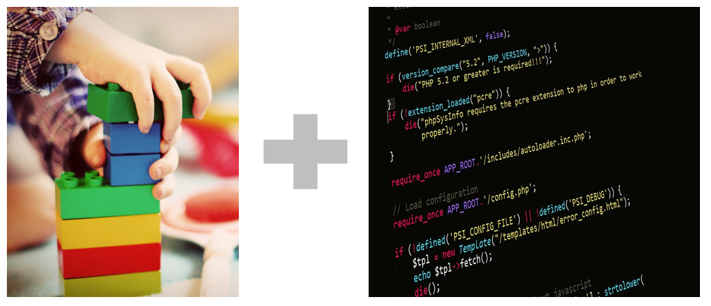

# 145_블록에디터_이벤트구동프로그래밍 🧩💻


**도로시와 지니가 함께하는 비주얼 이벤트 프로그래밍(Event-Driven)의 기본 원리**

* 👧 **도로시**: "지니야! 디자인이 끝났으니 이제 버튼을 눌렀을 때 무슨 일을 해야 하는지 마법의 명령을 걸 차례지?"
* 🐱 **지니**: "맞아! 화면 우측 상단의 **[블록 (Blocks)]** 버튼을 누르면 알록달록 코딩 퍼즐 세상이 열린단다! 자석처럼 착착 블록을 끼우면 코딩 끝!"
* 🐶 **토토**: "바우! 레고 맞추는 소리가 착착 들린다 멍!"

* 🖥️ **강의 슬라이드**: [slides.md](./slides.md)

---

## 1. 블록(Blocks) 작업 환경으로의 전환


### 🧩 화면 디자이너에서 두뇌 코딩으로 이동
* 디자이너 화면에서 스마트폰 화면의 부품 배치를 마쳤다면, 이제 동작 로직을 작성할 시간입니다.
* 우측 상단의 초록색 **[블록 (Blocks)]** 버튼을 클릭합니다.
* 모니터 전체가 시원하고 넓은 블록 작업판(Blocks Workspace)으로 전환되며, 화면 좌측에는 블록 서랍장(Drawer)들이 깔끔하게 분류되어 나타납니다.

---

## 2. 블록 서랍장의 2대 분류: 공통 블록 vs 컴포넌트 블록

### 🗄️ 필요한 블록을 쏙쏙 찾아 꺼내는 체계적인 서랍장

| 분류 | 세부 카테고리 | 주요 역할 및 대표 블록 |
| :--- | :--- | :--- |
| **공통 블록 (Built-in)** | **제어 (Control)** | `만약 ... 라면 (if)`, `반복 실행 (for/while)` 등 프로그램의 흐름 제어 |
| | **논리 (Logic)** | `참 (true)`, `거짓 (false)`, `AND`, `OR`, `같다 (=)` |
| | **수학 (Math)** | 숫자 상수(`0, 1, 100`), 사칙연산(`+ - * /`), 난수 생성 |
| | **텍스트 (Text)** | 문자 상수(`""`), 문자열 합치기(`join`), 문자 길이 |
| | **변수 (Variables)** | 데이터 값을 임시 저장하고 변경하는 저장 상자 |
| **컴포넌트 블록 (Components)** | **버튼 (btn_led_on)** | 버튼 클릭 이벤트 (`when btn_led_on.Click do`) |
| | **목록선택 (btn_connect)** | 기기 선택 전/후 이벤트 (`BeforePicking`, `AfterPicking`) |
| | **블루투스 (bt_client)** | 무선 텍스트 전송 (`call bt_client.SendText`), 연결 끊기 |

---

## 3. 이벤트 기반 프로그래밍 (Event-Driven Programming)의 본질



### ⚡ "어떤 사건(Event)이 일어났을 때, 무슨 행동(Action)을 하라!"
* 고전적인 C 언어 프로그램은 위에서 아래로 순서대로 코드가 실행되지만, 모바일 앱은 **사용자가 화면을 언제 터치할지 알 수 없습니다.**
* 따라서 스마트폰 앱은 **"이벤트(Event)를 감시하고 있다가 반응하는 방식"** 으로 동작합니다:

```text
[이벤트 발생] 사용자가 'LED ON' 버튼을 손가락으로 꾹 눌렀다!
      ↓
[이벤트 감지] "언제 btn_led_on.클릭 실행" 블록이 깨어남!
      ↓
[액션 실행]   내부에 조립된 "호출 bt_client.SendText('1')" 명령을 수행!
```

---

## 4. 형태 맞춤 안전장치 (Type-Safe Visual Syntax)

### 🛡️ 문법 에러가 원천적으로 불가능한 퍼즐 구조
* 블록들은 홈(Socket)과 돌기(Plug)의 모양이 데이터 타입별로 엄격하게 구별되어 있습니다:
  * 조건식 구멍에는 **납작한 육각형 논리 블록**만 들어갑니다.
  * 텍스트 구멍에는 **둥근 모서리의 분홍색 문자 블록**만 결합됩니다.
* 잘못된 형태의 블록은 물리적으로 결합되지 않고 튕겨 나가므로, 초보자가 세미콜론 누락이나 오타로 인해 겪는 고통을 100% 예방해 줍니다!

---

## 🌟 도로시와 지니의 핵심 요약 노트!

* 👧 **도로시**: "앱 인벤터는 키보드로 타자를 치는 대신, 이벤트 블록 안에 명령 블록을 자석처럼 끼우는 방식이구나!"
* 🐱 **지니**: "맞아! '누르면 실행한다'는 기본 규칙만 기억하면 어떤 복잡한 앱도 쉽게 만들 수 있단다."
* 🐶 **토토**: "바우! 이제 블루투스 기기 목록을 띄우고 연결하는 블록을 맞추러 가자 멍!"
