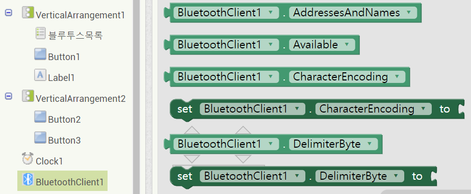
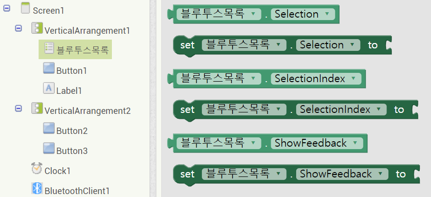
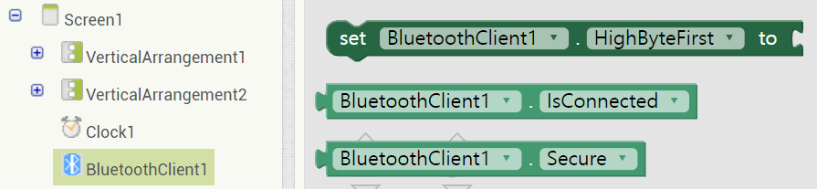
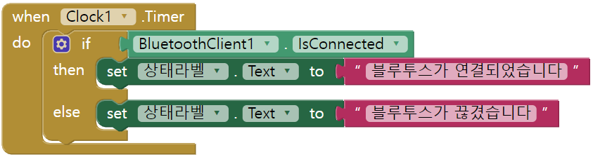

# 146_블루투스연결_블록조립하기 🔗📱


**도로시와 지니가 함께하는 장치 목록 띄우기(BeforePicking)와 실시간 연결(AfterPicking) 블록 완성**
* 👧 **도로시**: "지니야! 스마트폰 화면에서 [블루투스 기기 선택] 버튼을 탭했을 때, 주변에 켜져 있는 내 아두이노(HC-06)를 찾아 무선으로 찰칵 연결하려면 어떤 블록이 필요해?"
* 🐱 **지니**: "'선택 전(BeforePicking)'에 스마트폰에 등록된 블루투스 기기 주소 목록을 가져오고, 사용자가 기기를 '선택한 후(AfterPicking)'에 연결을 호출하면 된단다!"
* 🐶 **토토**: "바우! 주소록을 펼쳐보고 원하는 친구 번호를 콕 찍어 통화하는 것과 똑같다 멍!"
* 📖 **상세 강의 교재**: [index.md](./index.md)


> 여러분 안녕하세요! 이번 시간에는 '146. 블루투스연결 블록조립하기 🔗📱'을 주제로 함께 흥미진진한 탐험을 떠나보겠습니다. 오늘 강의에서는 특히 도로시와 지니가 함께하는 장치 목록 띄우기(BeforePicking)와 실시간 연결(AfterPicking) 블록 완성, 👧 도로시: "지니야! 스마트폰 화면에서 [블루투스 기기 선택] 버튼을 탭했을 때, 주변에 켜져 있는 내 아두이노(HC-06)를 찾아 무선으로 찰칵 연결하려면 어떤 블록이 필요해?"를 중심으로 핵심 원리와 응용 방법을 차근차근 배워보겠습니다. 마법 멘토 지니와 호기심 많은 탐험가 도로시, 그리고 귀여운 토토와 함께 신나는 아두이노 모험을 힘차게 시작해 봅시다. 준비되셨나요?

---

## 1. Step 1: 기기 목록 띄우기 전 (BeforePicking) 블록 조립



* [!TIP]
* 스마트폰의 안드로이드 OS 설정에서 미리 아두이노 HC-06 모듈(기본 PIN: `1234` 또는 `0000`)과 페어링(등록)을 마쳐두어야 `주소와 이름들` 목록에 HC-06이 깨끗하게 나타납니다!

1. 좌측 컴포넌트 목록에서 **`목록선택_블루투스`** 를 클릭합니다.
2. **`언제 목록선택_블루투스.선택 전 실행`** 블록을 꺼내어 작업판에 놓습니다.
3. **`지정하기 목록선택_블루투스.요소 값`** 퍼즐을 안쪽에 끼웁니다.
4. **`블루투스_클라이언트1`** 서랍에서 **`블루투스_클라이언트1.주소와 이름들 (AddressesAndNames)`** 블록을 가져와 연결합니다.

### 📋 목록선택 버튼을 누르는 순간의 동작 원리
사용자가 [블루투스 기기 선택] 버튼을 손가락으로 누르면, 화면에 팝업창(Dialog)이 뜨기 직전에 **`선택 전(BeforePicking)`** 이벤트가 먼저 발생합니다:

```text
언제 목록선택_블루투스.선택 전 실행
  지정하기 목록선택_블루투스.요소 값 <- 블루투스_클라이언트1.주소와 이름들
```

> 이번 슬라이드에서는 '1. Step 1: 기기 목록 띄우기 전 (BeforePicking) 블록 조립'에 대한 실제 동작 코드를 분석해 보겠습니다. 화면의 코드를 살펴보시면, 컴퓨터가 아두이노 하드웨어에 단계별로 명령을 내리는 흐름을 명확하게 확인할 수 있습니다. 여기서 핵심은 좌측 컴포넌트 목록에서 목록선택블루투스 를 클릭합니다.입니다. 각 함수의 역할과 괄호 안의 매개변수가 하드웨어 핀과 어떤 관계를 맺고 동작하는지 주의 깊게 살펴보시기 바랍니다.

---

## 2. Step 2: 기기를 선택했을 때 (AfterPicking) 연결 시도 블록



1. **`언제 목록선택_블루투스.선택 후 실행`** 블록을 꺼냅니다.
2. 제어 서랍에서 **`만약 ... 라면`** 블록을 넣습니다.
3. 조건식 구멍에 **`호출 블루투스_클라이언트1.연결 주소`** 블록을 끼우고, 주소 인자값으로 **`목록선택_블루투스.선택된 항목`** 을 연결합니다.
4. `연결` 함수는 연결에 성공하면 `참(True)`을 반환하므로, 성공했을 때 안내 문구를 갱신합니다.

### 🤝 선택한 MAC 주소로 무선 세션 연결하기
사용자가 팝업창 목록에서 `HC-06 (98:D3:31:FC:..)`을 손가락으로 탭하는 순간 **`선택 후(AfterPicking)`** 이벤트가 실행됩니다:

```text
언제 목록선택_블루투스.선택 후 실행
  만약 [호출 블루투스_클라이언트1.연결 주소 <- 목록선택_블루투스.선택된 항목] 이라면
    그러면 [지정하기 레이블_연결상태.텍스트 값 <- "연결 성공! (HC-06)"]
           [지정하기 레이블_연결상태.글자색 값 <- 초록색]
```

> 이번 슬라이드에서는 '2. Step 2: 기기를 선택했을 때 (AfterPicking) 연결 시도 블록'에 대한 실제 동작 코드를 분석해 보겠습니다. 화면의 코드를 살펴보시면, 컴퓨터가 아두이노 하드웨어에 단계별로 명령을 내리는 흐름을 명확하게 확인할 수 있습니다. 여기서 핵심은 언제 목록선택블루투스.선택 후 실행 블록을 꺼냅니다.입니다. 각 함수의 역할과 괄호 안의 매개변수가 하드웨어 핀과 어떤 관계를 맺고 동작하는지 주의 깊게 살펴보시기 바랍니다.

---

## 3. Step 3: 주기적인 연결 상태 감시 (Clock.Timer)



1. 팔레트의 센서 카테고리에서 **`시계 (Clock)`** 부품을 디자이너에 추가합니다 (속성: 타이머 간격 1000ms = 1초).
2. 블록 에디터에서 **`언제 시계1.타이머 실행`** 블록을 꺼냅니다.
3. 제어 서랍에서 **`만약 ... 라면, 아니라면`** 블록을 가져옵니다.

### ⏱️ 1초마다 통신 무결성 점검하기
무선 통신은 배터리 방전이나 거리 멀어짐으로 인해 갑자기 끊어질 수 있습니다. 시계(Clock) 컴포넌트로 1초마다 연결 상태를 실시간 감시합니다:

> 이번 슬라이드에서는 '3. Step 3: 주기적인 연결 상태 감시 (Clock.Timer)'에 대해 자세히 살펴보겠습니다. 화면의 다이어그램과 사진을 함께 참고해 주시기 바랍니다. 첫 번째 핵심은 팔레트의 센서 카테고리에서 시계 (Clock) 부품을 디자이너에 추가합니다 (속성: 타이머 간격 1000ms = 1초).이며, 두 번째로는 블록 에디터에서 언제 시계1.타이머 실행 블록을 꺼냅니다.입니다. 여기에 덧붙여 제어 서랍에서 만약 ... 라면, 아니라면 블록을 가져옵니다. 내용까지 함께 이해해 두시면 완벽합니다. 이 원리는 아두이노 시스템 전체를 관통하는 핵심 논리이므로 머릿속에 꼭 정리해 두시기 바랍니다.

---

## 4. Step 4: 실시간 상태 레이블 자동 갱신



* 아두이노 전원이 켜져 있고 통신 중일 때는 초록색 **"연결됨 🟢"**, 아두이노 전원을 끄면 즉각 빨간색 **"연결 끊김 🔴"** 으로 바뀌어 사용자가 통신 상태를 실시간 파악할 수 있습니다!

### 📢 화면 글씨가 살아 움직이는 동적 UI

```text
언제 시계1.타이머 실행
  만약 [블루투스_클라이언트1.연결 상태] 라면
    그러면 -> [지정하기 레이블_연결상태.텍스트 값 <- "연결됨 🟢"]
           -> [지정하기 레이블_연결상태.글자색 값 <- 초록색]
  아니라면 -> [지정하기 레이블_연결상태.텍스트 값 <- "연결 끊김 🔴"]
           -> [지정하기 레이블_연결상태.글자색 값 <- 빨간색]
```

> 이번 슬라이드에서는 '4. Step 4: 실시간 상태 레이블 자동 갱신'에 대한 실제 동작 코드를 분석해 보겠습니다. 화면의 코드를 살펴보시면, 컴퓨터가 아두이노 하드웨어에 단계별로 명령을 내리는 흐름을 명확하게 확인할 수 있습니다. 여기서 핵심은 아두이노 전원이 켜져 있고 통신 중일 때는 초록색 "연결됨 🟢", 아두이노 전원을 끄면 즉각 빨간색 "연결 끊김 🔴" 으로 바뀌어 사용자가 통신 상태를 실시간 파악할 수 있습니다!입니다. 각 함수의 역할과 괄호 안의 매개변수가 하드웨어 핀과 어떤 관계를 맺고 동작하는지 주의 깊게 살펴보시기 바랍니다.

---
## 🌟 도로시와 지니의 핵심 요약 노트!


* 👧 **도로시**: "선택 전에는 주소록을 열고, 선택 후에는 통화를 연결하는 흐름이 정말 명쾌해!"
* 🐱 **지니**: "맞아! 이제 블루투스 파이프라인이 튼튼하게 연결되었으니, 다음 단계에서 LED ON/OFF 무선 제어 버튼을 완성해보자!"
* 🐶 **토토**: "바우! 이제 아두이노 LED 불 켜러 가자 멍!"

| 이벤트 블록 | 발생 시점 | 수행 작업 |
| :--- | :--- | :--- |
| **`선택 전 (BeforePicking)`** | 목록선택 버튼 터치 시 | 주변 페어링된 기기 MAC 주소 목록 로드 |
| **`선택 후 (AfterPicking)`** | 목록에서 HC-06 터치 시 | `호출 블루투스_클라이언트.연결` 수행 |
| **`타이머 (Clock.Timer)`** | 1초마다 주기적 발생 | `연결 상태(IsConnected)` 확인 및 텍스트 갱신 |

> 오늘 배운 '🌟 도로시와 지니의 핵심 요약 노트!'의 핵심 내용을 모두 정리해 보았습니다. 오늘 다룬 내용 중에서도 👧 도로시: "선택 전에는 주소록을 열고, 선택 후에는 통화를 연결하는 흐름이 정말 명쾌해!" 부분은 앞으로의 아두이노 실습과 프로젝트에서 계속 사용되는 매우 중요한 기초 지식입니다. 오늘 배운 내용을 꼭 다시 한번 복습해 보시고, 다음 강의에서 더욱 신나고 유익한 모험으로 다시 만나겠습니다. 모두 수고 많으셨습니다!