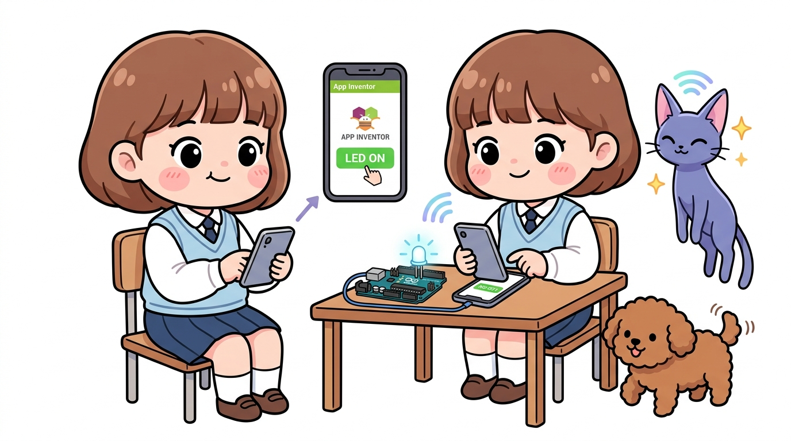
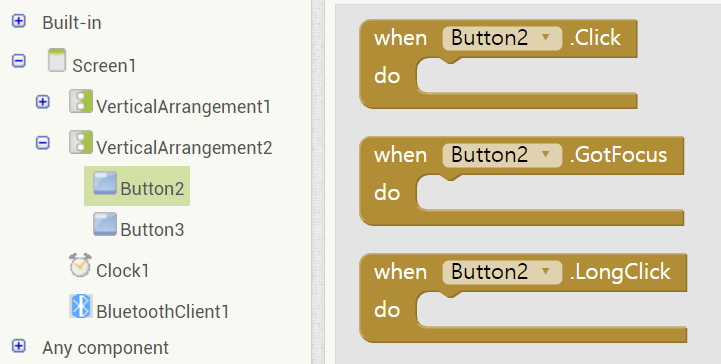
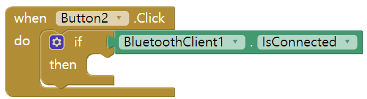
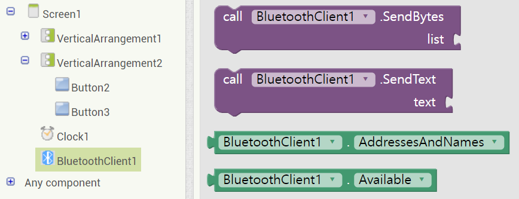
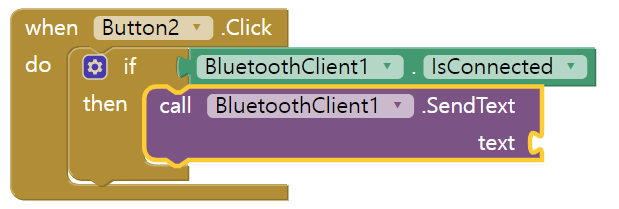
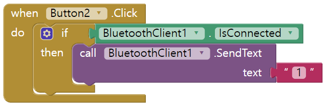
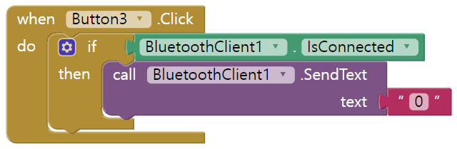
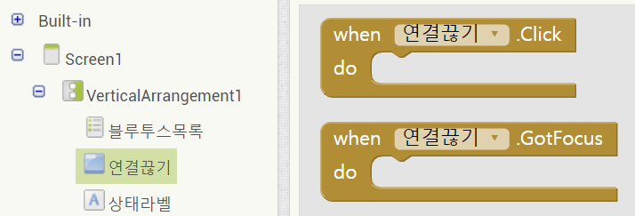
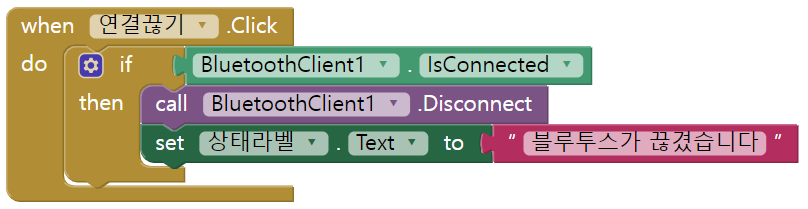

# 147_LED제어_무선텍스트전송블록 💡📲



**도로시와 지니가 함께하는 텍스트 보내기(SendText) 블록 코딩**

* 👧 **도로시**: "지니야! 스마트폰 화면의 초록색 버튼을 터치하면 아두이노로 '1'을 보내고, 빨간색 버튼을 누르면 '0'을 보내서 LED를 켜고 끄고 싶어!"
* 🐱 **지니**: "`호출 블루투스_클라이언트1.텍스트 보내기(SendText)` 블록을 연결하면 터치 한 번으로 스마트폰에서 아두이노로 무선 신호가 전파를 타고 날아간단다!"
* 🐶 **토토**: "바우! 멍멍! 불 켜라 '1', 불 꺼라 '0'! 스마트 홈 원격 제어의 시작이다 멍!"

* 🖥️ **강의 슬라이드**: [slides.md](./slides.md)

---

## 1. Step 1: LED ON 버튼 클릭 이벤트 블록 꺼내기



### 💡 버튼 이벤트의 핵심 원리
* 화면 좌측 블록 메뉴에서 **`버튼_LED_ON`** 을 클릭하면 사용 가능한 이벤트 블록들이 나타납니다.
* 가장 위에 있는 **`언제 버튼_LED_ON.클릭 실행`** 블록을 작업 영역(Viewer)으로 드래그합니다.
* 사용자가 스마트폰 화면에서 이 버튼을 손가락으로 터치하는 순간 이 블록 안의 명령들이 차례대로 실행됩니다.



---

## 2. Step 2: 블루투스 연결 상태 검사하기 (If 조건문)



### 🛡️ 런타임 에러를 방지하는 방어적 코딩 (Defensive Coding)
* 블루투스가 아직 아두이노와 페어링/연결되지 않은 상태에서 무선 데이터를 전송하려 하면 앱이 비정상 종료(Crash)되거나 통신 오류가 발생합니다.
* 따라서 반드시 **`만약 ... 라면`** 제어 블록을 배치하고, 조건식에 **`블루투스_클라이언트1.연결 상태`** 가 `참(True)`인지 먼저 확인해야 합니다!

```text
언제 버튼_LED_ON.클릭 실행
  만약 [블루투스_클라이언트1.연결 상태] 라면
    그러면 [ ... 전송 명령 실행 ... ]
```

---

## 3. Step 3: 문자 "1" 텍스트 보내기 (SendText)



### 📡 문자열 1 전송하기
* **블루투스_클라이언트1** 항목에서 **`호출 블루투스_클라이언트1.텍스트 보내기`** 블록을 찾아 `그러면` 슬롯에 끼워 넣습니다.
* 좌측 공통 블록의 **`텍스트`** 카테고리에서 따옴표 빈 상자 `""` 블록을 가져와 `1`을 입력합니다.
* 이제 버튼을 누르면 아두이노를 향해 무선으로 아스키코드 문자 `'1'` (1바이트, 0x31)이 전송됩니다!



---

## 4. Step 4: LED OFF 버튼 복제 및 문자 "0" 변경



### ⚡ 마우스 우클릭 복제(Duplicate) 꿀팁!
1. 이미 완성한 `언제 버튼_LED_ON.클릭` 블록 위에서 마우스 우클릭을 누르고 **`복사하기(Duplicate)`** 를 클릭합니다.
2. 버튼 이름 드롭다운을 눌러 **`버튼_LED_OFF`** 로 변경합니다.
3. 텍스트 상자 안의 문자 `"1"`을 **`"0"`** 으로 수정하면 LED OFF 블록이 순식간에 완성됩니다!

```text
언제 버튼_LED_OFF.클릭 실행
  만약 [블루투스_클라이언트1.연결 상태] 라면
    그러면 [호출 블루투스_클라이언트1.텍스트 보내기 텍스트 <- "0"]
```

---

## 5. Step 5: 블루투스 연결 끊기 (Disconnect) 버튼 완성



### 🔌 안전한 세션 종료와 리소스 반환
* 원격 제어가 끝났을 때 연결을 깔끔하게 끊어주어야 스마트폰 배터리 소모를 줄이고, 다른 기기가 아두이노에 접속할 수 있습니다.
* `버튼_연결끊기`를 누르면 `블루투스_클라이언트1.연결 끊기`를 호출하고 안내 레이블에 상태를 갱신합니다.



```text
언제 버튼_연결끊기.클릭 실행
  만약 [블루투스_클라이언트1.연결 상태] 라면
    그러면 -> [호출 블루투스_클라이언트1.연결 끊기]
           -> [지정하기 레이블_상태.텍스트 값 <- "블루투스 연결이 해제되었습니다."]
```

---

## 6. 아두이노 수신 스케치 코드 (Arduino C++)

### 💻 스마트폰의 문자를 수신하여 LED를 제어하는 전체 코드

```cpp
#include <SoftwareSerial.h>

// 아두이노 2번 핀을 RX(수신), 3번 핀을 TX(송신)로 설정하여 블루투스 모듈과 통신
SoftwareSerial BTSerial(2, 3);

// 13번 핀에 내장된 LED 또는 외부 LED 제어용 핀 정의
const int LED_PIN = 13;

void setup() {
  // PC 시리얼 모니터 디버깅용 시리얼 통신 시작 (9600 bps)
  Serial.begin(9600);
  
  // HC-06 블루투스 모듈과의 소프트웨어 시리얼 통신 시작 (9600 bps)
  BTSerial.begin(9600);
  
  // LED 핀을 출력 모드로 설정
  pinMode(LED_PIN, OUTPUT);
  digitalWrite(LED_PIN, LOW); // 시작할 때 LED 소등
  
  Serial.println("Bluetooth LED Remote Ready! Waiting for command...");
}

void loop() {
  // 스마트폰 앱인벤터에서 블루투스로 데이터가 도착했는지 확인
  if (BTSerial.available() > 0) {
    // 1바이트 문자 읽기
    char cmd = BTSerial.read();
    
    // PC 시리얼 모니터에 수신된 문자 출력
    Serial.print("Received Command: ");
    Serial.println(cmd);
    
    // 앱인벤터의 'LED ON' 버튼을 눌러 '1'이 전송된 경우
    if (cmd == '1') {
      digitalWrite(LED_PIN, HIGH); // 13번 핀에 5V 출력 (LED 점등)
      Serial.println("Action -> LED turned ON!");
    }
    // 앱인벤터의 'LED OFF' 버튼을 눌러 '0'이 전송된 경우
    else if (cmd == '0') {
      digitalWrite(LED_PIN, LOW);  // 13번 핀에 0V 출력 (LED 소등)
      Serial.println("Action -> LED turned OFF!");
    }
  }
}
```

---

## 7. 아두이노 코드 핵심 상세 해설

### 🔍 무선 제어 통신 메커니즘 심층 분석

1. **`SoftwareSerial BTSerial(2, 3);`**:
   * 아두이노 우노의 0번/1번 하드웨어 시리얼 핀은 PC와의 업로드 및 디버깅에 사용되므로, 일반 디지털 핀 2번(RX)과 3번(TX)을 소프트웨어 시리얼로 할당하여 HC-06 모듈과 독립적인 통신 채널을 구성합니다.
2. **`BTSerial.available() > 0`**:
   * 블루투스 모듈의 내부 FIFO 수신 버퍼에 스마트폰이 보낸 데이터가 1바이트 이상 쌓여있는지 검사합니다. 데이터가 없으면 CPU를 낭비하지 않고 다음 루프로 넘어갑니다.
3. **`char cmd = BTSerial.read();`**:
   * 수신 버퍼의 선두에서 1글자를 읽어옵니다. 앱인벤터의 `SendText("1")`는 아스키코드 `'1'`(10진수 49)을 전송하므로, 따옴표가 있는 문자형 리터럴 `cmd == '1'`로 비교해야 정확히 일치합니다.
4. **`digitalWrite(LED_PIN, HIGH/LOW);`**:
   * 조건문에 따라 13번 LED를 물리적으로 켜고 끄며, PC 시리얼 모니터에도 동작 결과를 즉시 출력하여 원격 제어 상태를 눈으로 실시간 확인할 수 있습니다.

---

## 🌟 도로시와 지니의 핵심 요약 노트!

| 스마트폰 앱 동작 | 전송 텍스트 | 아두이노 동작 | 결과 |
| :--- | :---: | :--- | :--- |
| **LED ON 터치** | **`"1"`** | `digitalWrite(LED_PIN, HIGH)` | 13번 LED 점등 |
| **LED OFF 터치** | **`"0"`** | `digitalWrite(LED_PIN, LOW)` | 13번 LED 소등 |
| **연결 끊기 터치** | - | `BTSerial` 세션 닫힘 | 모듈 페어링 대기 모드 |

* 👧 **도로시**: "앱인벤터에서 보낸 문자 '1'과 '0'이 아두이노의 `BTSerial.read()`로 쏙 들어오는 과정이 마법처럼 신기해!"
* 🐱 **지니**: "이 원리를 응용하면 선풍기 모터, 스마트 조명, RC카 주행까지 스마트폰 하나로 모두 제어할 수 있단다!"
* 🐶 **토토**: "바우! 이제 직접 스마트폰에 설치해서 켜보자 멍!"
