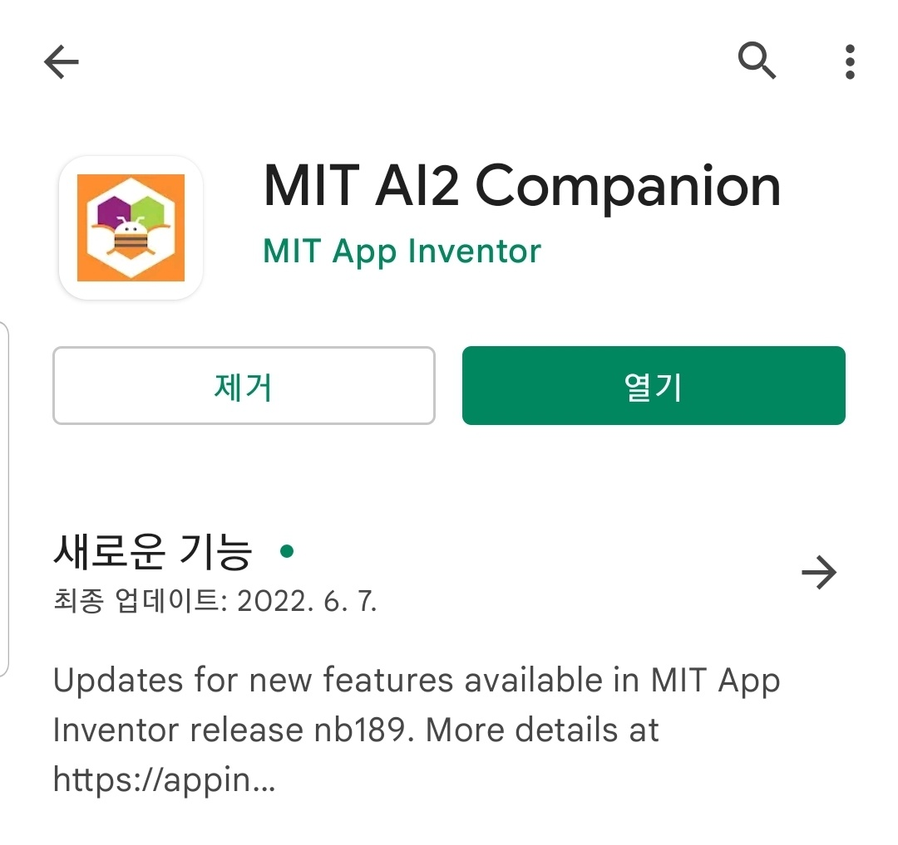
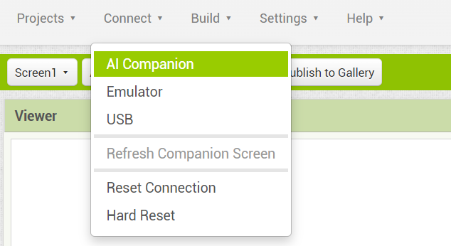
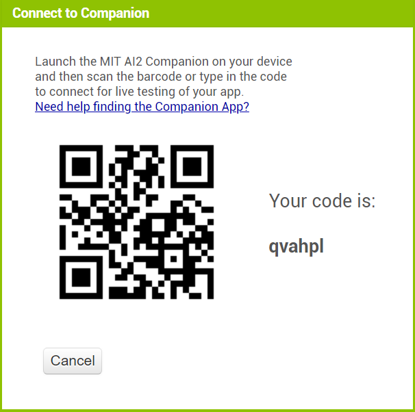
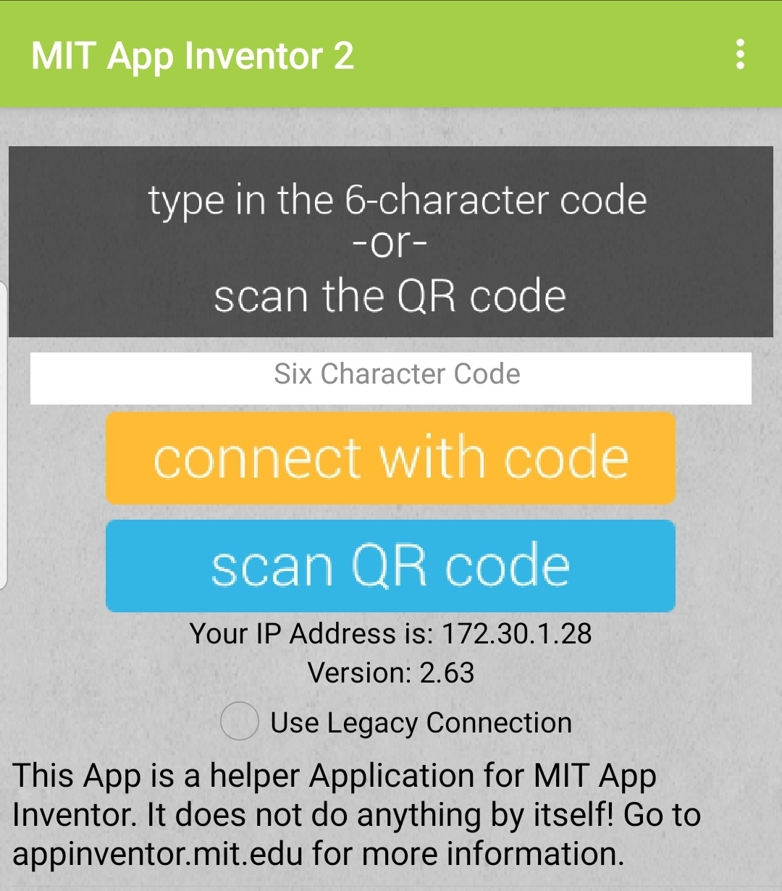
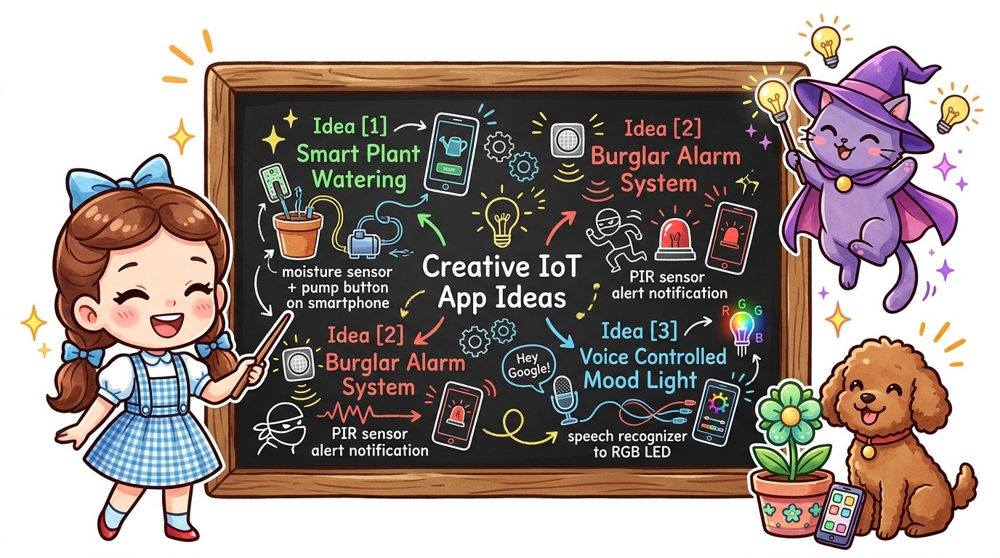

# 148_스마트폰앱_APK빌드및실행 📦🚀

**도로시와 지니가 함께하는 진짜 앱 설치 및 최종 무선 LED 제어 실습**
* 👧 **도로시**: "지니야! 우리가 직접 만든 앱이 내 스마트폰에서 진짜로 켜졌어! 이제 [LED ON] 버튼을 누르면 아두이노 불이 켜질까?"
* 🐱 **지니**: "블루투스 목록에서 HC-06을 선택하고 [LED ON] 버튼을 눌러봐! 빛의 마술이 너의 손끝에서 시작될 거야!"
* 🐶 **토토**: "바우! 번쩍! 13번 LED가 환하게 켜졌다 멍!"
* 📖 **상세 강의 교재**: [index.md](./index.md)

> 여러분 안녕하세요! 이번 시간에는 '148. 스마트폰앱 APK빌드및실행 📦🚀'을 주제로 함께 흥미진진한 탐험을 떠나보겠습니다. 오늘 강의에서는 특히 도로시와 지니가 함께하는 진짜 앱 설치 및 최종 무선 LED 제어 실습, 👧 도로시: "지니야! 우리가 직접 만든 앱이 내 스마트폰에서 진짜로 켜졌어! 이제 [LED ON] 버튼을 누르면 아두이노 불이 켜질까?"를 중심으로 핵심 원리와 응용 방법을 차근차근 배워보겠습니다. 마법 멘토 지니와 호기심 많은 탐험가 도로시, 그리고 귀여운 토토와 함께 신나는 아두이노 모험을 힘차게 시작해 봅시다. 준비되셨나요?

---

## 1. 앱을 스마트폰에 탑재하는 2가지 방법

| 구분 | 1. AI2 컴패니언 라이브 테스트 | 2. 안드로이드 설치 패키지 (.apk) ⭐ |
| :--- | :--- | :--- |
| **빌드 과정** | 상단 메뉴: **[연결] ➡️ [AI Companion]** | 상단 메뉴: **[빌드] ➡️ [Android App (.apk)]** |
| **동작 특징** | 컴퓨터와 같은 Wi-Fi에 연결되어 있어야 동작 | **컴퓨터나 Wi-Fi 없이 스마트폰 단독 실행 가능** |
| **보관 형태** | 컴패니언 앱 내에서 임시 렌더링 | **스마트폰 홈 화면에 나만의 앱 아이콘 생성** |
| **추천 용도** | 개발 도중 실시간 수정 및 버그 디버깅 | **친구에게 선물하거나 야외에서 RC카 조종 시** |

### 📲 실시간 테스트(Live Testing) vs 영구 설치 파일(.apk)

> 이번에 살펴볼 내용은 '1. 앱을 스마트폰에 탑재하는 2가지 방법'입니다. 슬라이드에 정리된 표를 통해 각 항목의 특징과 수치, 차이점을 한눈에 비교해 보실 수 있습니다. 이 기본 개념을 확실히 잡아두셔야 실제 부품을 브레드보드에 꽂고 코딩할 때 실수 없이 완성할 수 있습니다.

---

## 2. 평생 소장용 APK 파일 빌드하기

1. 웹 브라우저 상단 메뉴에서 **[빌드 (Build)] ➡️ [Android App (.apk 용 QR 코드 제공)]** 을 클릭합니다.
2. MIT 서버에서 우리가 맞춘 블록들과 디자인을 실제 안드로이드 기계어 패키지(`.apk`)로 컴파일합니다.
3. 1~2분 정도 지나 게이지 바가 100%에 도달하면 다운로드용 QR 코드가 모니터에 크게 나타납니다!

### ⚙️ 클라우드 컴파일러의 마법

> 이번 슬라이드에서는 '2. 평생 소장용 APK 파일 빌드하기'에 대해 자세히 살펴보겠습니다. 화면의 다이어그램과 사진을 함께 참고해 주시기 바랍니다. 첫 번째 핵심은 웹 브라우저 상단 메뉴에서 [빌드 (Build)] ➡️ [Android App (.apk 용 QR 코드 제공)] 을 클릭합니다.이며, 두 번째로는 MIT 서버에서 우리가 맞춘 블록들과 디자인을 실제 안드로이드 기계어 패키지(.apk)로 컴파일합니다.입니다. 여기에 덧붙여 ~2분 정도 지나 게이지 바가 100%에 도달하면 다운로드용 QR 코드가 모니터에 크게 나타납니다! 내용까지 함께 이해해 두시면 완벽합니다. 이 원리는 아두이노 시스템 전체를 관통하는 핵심 논리이므로 머릿속에 꼭 정리해 두시기 바랍니다.

---

## 3. 스마트폰에 다운로드 및 설치하기

1. **QR 코드 스캔**: 일반 스마트폰 기본 카메라나 QR 리더기로 화면의 QR 코드를 스캔하여 다운로드 링크를 엽니다.
2. **파일 다운로드**: 웹 브라우저의 다운로드 경고창에서 **[무조건 다운로드]** 를 선택합니다.
3. **출처를 알 수 없는 앱 허용**:
* 구글 플레이스토어를 거치지 않고 직접 설치하는 개발자 파일이므로, 보안 설정에서 "이 출처의 앱 허용"을 활성화합니다.
4. **설치 완료 및 열기**: 설치가 끝나면 홈 화면에 우리가 지은 이름과 아이콘을 가진 진짜 앱이 탄생합니다!

### 📦 나만의 앱 설치 4단계

> 이번 슬라이드에서는 '3. 스마트폰에 다운로드 및 설치하기'에 대해 자세히 살펴보겠습니다. 화면의 다이어그램과 사진을 함께 참고해 주시기 바랍니다. 첫 번째 핵심은 QR 코드 스캔: 일반 스마트폰 기본 카메라나 QR 리더기로 화면의 QR 코드를 스캔하여 다운로드 링크를 엽니다.이며, 두 번째로는 파일 다운로드: 웹 브라우저의 다운로드 경고창에서 [무조건 다운로드] 를 선택합니다.입니다. 여기에 덧붙여 출처를 알 수 없는 앱 허용 내용까지 함께 이해해 두시면 완벽합니다. 이 원리는 아두이노 시스템 전체를 관통하는 핵심 논리이므로 머릿속에 꼭 정리해 두시기 바랍니다.

---
## 4. 실전 무선 제어: 3단계 성공 미션!

1. **1단계: 하드웨어 전원 켜기**:
* 아두이노에 USB 케이블이나 9V 배터리를 연결합니다.
* HC-06 모듈의 빨간색 LED가 초당 2회 빠르게 깜빡거리는지 확인합니다 (페어링 대기 상태).
2. **2단계: 블루투스 연결**:
* 스마트폰에서 앱을 실행하고 상단의 **`[블루투스 기기 선택]`** 버튼을 탭합니다.
* 목록에서 **`HC-06`** (또는 페어링된 이름)을 터치합니다.
* 모듈의 빨간 불빛이 깜빡임을 멈추고 계속 켜진 상태로 바뀌면 연결 성공!
* 화면 상태 문구가 초록색 **"연결됨 🟢"** 으로 바뀝니다.
3. **3단계: LED 무선 원격 제어**:
* 초록색 **`[LED ON]`** 버튼을 누르면 아두이노 13번 LED 점등!
* 빨간색 **`[LED OFF]`** 버튼을 누르면 즉시 소등!

### 🚀 도로시의 무선 스마트 홈 미션 가이드

> 오늘 배운 '4. 실전 무선 제어: 3단계 성공 미션!'의 핵심 내용을 모두 정리해 보았습니다. 오늘 다룬 내용 중에서도 단계: 하드웨어 전원 켜기 부분은 앞으로의 아두이노 실습과 프로젝트에서 계속 사용되는 매우 중요한 기초 지식입니다. 오늘 배운 내용을 꼭 다시 한번 복습해 보시고, 다음 강의에서 더욱 신나고 유익한 모험으로 다시 만나겠습니다. 모두 수고 많으셨습니다!
---
## 5. 나만의 창의적인 IoT 앱으로의 확장 아이디어

* **3색 신호등 제어기**:
* 빨강, 노랑, 초록 버튼을 만들어 아두이노의 삼색 LED 신호등을 원격 제어해 보세요.
* **손가락 슬라이더 조광기 (Dimmer)**:
* 슬라이더 컴포넌트를 추가하여 손가락을 밀 때마다 아두이노 PWM(아날로그 0~255) 값을 전달해 무드등 밝기를 조절해 보세요.
* **음성인식 스마트 조명**:
* 음성인식(SpeechRecognizer) 블록을 넣어 "불 켜"라고 말하면 자동으로 불이 켜지는 AI 스마트홈을 구현할 수 있습니다!

> 이번 슬라이드에서는 '5. 나만의 창의적인 IoT 앱으로의 확장 아이디어'에 대해 자세히 살펴보겠습니다. 첫 번째 핵심은 색 신호등 제어기이며, 두 번째로는 빨강, 노랑, 초록 버튼을 만들어 아두이노의 삼색 LED 신호등을 원격 제어해 보세요.입니다. 여기에 덧붙여 손가락 슬라이더 조광기 (Dimmer) 내용까지 함께 이해해 두시면 완벽합니다. 이 원리는 아두이노 시스템 전체를 관통하는 핵심 논리이므로 머릿속에 꼭 정리해 두시기 바랍니다.
---
## 🌟 도로시와 지니의 핵심 요약 노트!

* 👧 **도로시**: "앱 인벤터로 화면을 꾸미고 블록을 맞추니 진짜 내 스마트폰에서 아두이노를 조종하는 리모컨이 되었어!"
* 🐱 **지니**: "축하해 도로시! 이제 넌 하드웨어 회로부터 모바일 소프트웨어까지 스스로 창작할 수 있는 진정한 메이커이자 개발자란다."
* 🐶 **토토**: "바우! 우리 손으로 만든 최고의 스마트 앱이다 멍!"

> 오늘 배운 '🌟 도로시와 지니의 핵심 요약 노트!'의 핵심 내용을 모두 정리해 보았습니다. 오늘 다룬 내용 중에서도 👧 도로시: "앱 인벤터로 화면을 꾸미고 블록을 맞추니 진짜 내 스마트폰에서 아두이노를 조종하는 리모컨이 되었어!" 부분은 앞으로의 아두이노 실습과 프로젝트에서 계속 사용되는 매우 중요한 기초 지식입니다. 오늘 배운 내용을 꼭 다시 한번 복습해 보시고, 다음 강의에서 더욱 신나고 유익한 모험으로 다시 만나겠습니다. 모두 수고 많으셨습니다!