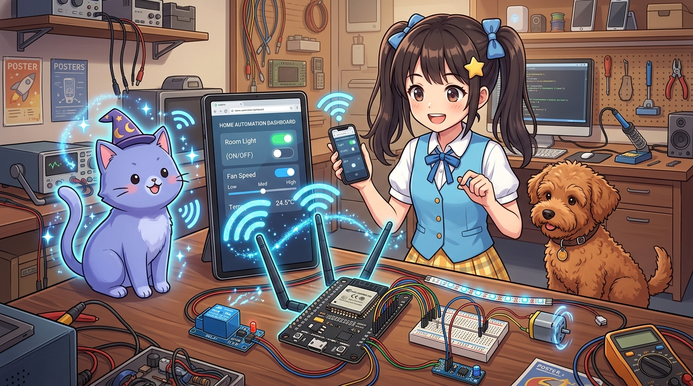
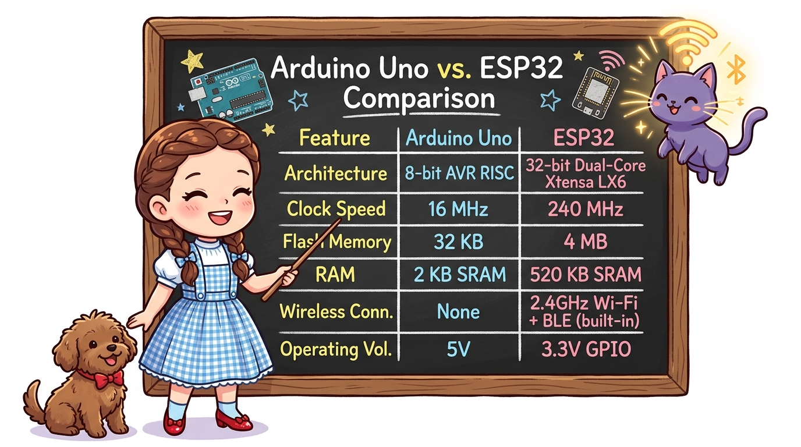
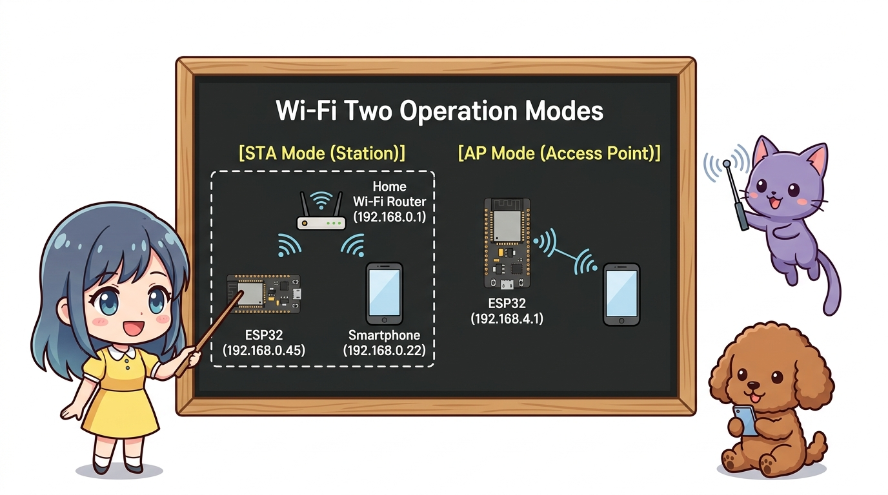
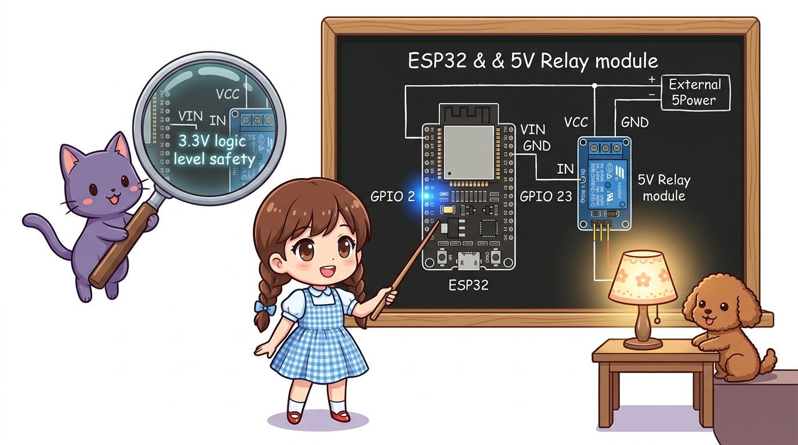
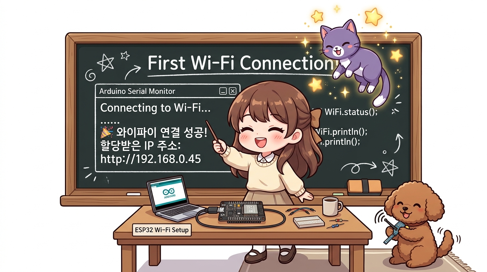

# 149_ESP32_WiFi_웹서버와_원격스마트홈제어 🌐📱



**도로시와 지니가 함께하는 ESP32 내장 Wi-Fi 웹 서버 구축과 스마트폰 브라우저 원격 홈 오토메이션**
* 👧 **도로시**: "지니야! 블루투스는 방을 조금만 벗어나도 연결이 끊기잖아. 학교나 바깥 카페에서도 우리 집 거실 조명과 환풍기를 켜고 끌 순 없을까?"
* 🐱 **지니**: "후후, 그게 바로 진짜 사물인터넷(IoT)의 세계란다! 240MHz 듀얼코어와 Wi-Fi를 품은 사물인터넷의 제왕, **ESP32** 를 사용하면 아두이노가 직접 웹 사이트를 열어 전 세계 어디서든 스마트폰으로 기기를 원격 제어할 수 있지!"
* 🐶 **토토**: "바우! 인터넷 신호가 벽을 뚫고 씽씽 날아다닌다 멍!"
* 📖 **상세 강의 교재**: [index.md](./index.md)


> 여러분 안녕하세요! 이번 시간에는 '149. ESP32 WiFi 웹서버와 원격스마트홈제어 🌐📱'을 주제로 함께 흥미진진한 탐험을 떠나보겠습니다. 오늘 강의에서는 특히 도로시와 지니가 함께하는 ESP32 내장 Wi-Fi 웹 서버 구축과 스마트폰 브라우저 원격 홈 오토메이션, 👧 도로시: "지니야! 블루투스는 방을 조금만 벗어나도 연결이 끊기잖아. 학교나 바깥 카페에서도 우리 집 거실 조명과 환풍기를 켜고 끌 순 없을까?"를 중심으로 핵심 원리와 응용 방법을 차근차근 배워보겠습니다. 마법 멘토 지니와 호기심 많은 탐험가 도로시, 그리고 귀여운 토토와 함께 신나는 아두이노 모험을 힘차게 시작해 봅시다. 준비되셨나요?

---

## 1. 사물인터넷(IoT)의 심장: ESP32 마이크로컨트롤러란?



| 비교 항목 | 아두이노 우노 (UNO R3) | ESP32 NodeMCU 보드 |
| :--- | :--- | :--- |
| **CPU 프로세서** | 8비트 ATmega328P (1코어) | **32비트 Xtensa LX6 (듀얼코어, 2Core)** |
| **동작 클록 속도** | 16 MHz | **240 MHz (약 15배 초고속 연산!)** |
| **플래시 메모리 / SRAM** | 32 KB / 2 KB | **4 MB (4096KB) / 520 KB** |
| **무선 네트워크 통신** | 없음 (외부 모듈 필요) | **2.4GHz Wi-Fi (802.11 b/g/n) + BLE 4.2 내장** |
| **동작 전압 (GPIO)** | **5.0 V** | **3.3 V (※ 5V 직결 시 파괴 주의!)** |

Espressif 사의 ESP32는 기존 아두이노 우노(ATmega328P)를 아득히 뛰어넘는 초고성능과 무선 인터넷을 기본 내장한 차세대 IoT 표준 칩셋입니다.

> 자, 이번 슬라이드의 질문을 함께 보시겠습니다. 바로 '1. 사물인터넷(IoT)의 심장: ESP32 마이크로컨트롤러란?'라는 아주 흥미로운 질문입니다. 이 질문 속에 숨겨진 전자 회로와 컴퓨팅의 핵심 원리를 지금부터 차근차근 하나씩 파헤쳐 보겠습니다.

---
## 2. Wi-Fi의 두 가지 동작 모드: STA vs AP




```
 [ STA 모드 (Station Mode) ]                     [ AP 모드 (Access Point Mode) ]
 ESP32가 가정용 공유기(AP)에 접속하여            ESP32 자체가 무선 공유기(핫스팟)가 되어
 공유기가 할당해 준 사설 IP 주소로 통신           외부 인터넷 공유기 없이 스마트폰과 1:1 직결
   (스마트폰과 동일 와이파이 망에서 제어)           (야외, 차 안 등 인터넷 없는 곳에서 제어)

     [인터넷 공유기]                                    [ ESP32 ]
     (192.168.0.1)                               (192.168.4.1 핫스팟 생성)
       /        \                                       /         \
   [ESP32]   [스마트폰]                              [노트북]    [스마트폰]
 (192.168.0.45) (192.168.0.22)
```

> 이번 슬라이드에서는 '2. Wi-Fi의 두 가지 동작 모드: STA vs AP'에 대한 실제 동작 코드를 분석해 보겠습니다. 화면의 코드를 살펴보시면, 컴퓨터가 아두이노 하드웨어에 단계별로 명령을 내리는 흐름을 명확하게 확인할 수 있습니다. 각 함수의 역할과 괄호 안의 매개변수가 하드웨어 핀과 어떤 관계를 맺고 동작하는지 주의 깊게 살펴보시기 바랍니다.
---
## 3. 회로 결선도 (ESP32 + 릴레이 모듈 + LED)




ESP32는 3.3V 로직 레벨로 동작하므로, 릴레이 모듈의 VCC는 외부 5V 전원에, 신호선(IN)은 GPIO 23번에 연결합니다.

```
       [ ESP32 NodeMCU ]                   [ 5V 릴레이 모듈 / LED ]
       ────────────────────────────────────────────────────────────
       VIN (또는 외부 5V) ────────────────▶ Relay VCC (+5V)
       GND               ────────────────▶ Relay GND & LED (-)
       GPIO 23           ────────────────▶ Relay IN (조명 제어 신호선)
       GPIO 2 (내장 LED) ────────────────▶ 보드 동작 확인용 블루 LED
```

> 이번 슬라이드에서는 '3. 회로 결선도 (ESP32 + 릴레이 모듈 + LED)'에 대한 실제 동작 코드를 분석해 보겠습니다. 화면의 코드를 살펴보시면, 컴퓨터가 아두이노 하드웨어에 단계별로 명령을 내리는 흐름을 명확하게 확인할 수 있습니다. 각 함수의 역할과 괄호 안의 매개변수가 하드웨어 핀과 어떤 관계를 맺고 동작하는지 주의 깊게 살펴보시기 바랍니다.
---
## 4. 실습 1: 공유기(Wi-Fi) 접속 및 할당 IP 확인




아두이노 IDE [보드 매니저]에서 `esp32` (Espressif)를 설치하고 보드를 `ESP32 Dev Module`로 선택합니다.

```cpp
#include <WiFi.h>

const char* ssid = "YOUR_WIFI_SSID";         // 공유기 이름
const char* password = "YOUR_WIFI_PASSWORD"; // 공유기 암호

void setup() {
  Serial.begin(115200);
  delay(1000);

  Serial.println("
[Wi-Fi 연결 시도 중...]");
  WiFi.begin(ssid, password);

  // 공유기 연결 대기 (점 찍기)
  while (WiFi.status() != WL_CONNECTED) {
    delay(500);
    Serial.print(".");
  }

  Serial.println("
🎉 와이파이 연결 성공!");
  Serial.print("할당받은 IP 주소: http://");
  Serial.println(WiFi.localIP()); // 예: 192.168.0.45
}

void loop() {}
```

> 이번 슬라이드에서는 '4. 실습 1: 공유기(Wi-Fi) 접속 및 할당 IP 확인'에 대한 실제 동작 코드를 분석해 보겠습니다. 화면의 코드를 살펴보시면, 컴퓨터가 아두이노 하드웨어에 단계별로 명령을 내리는 흐름을 명확하게 확인할 수 있습니다. 각 함수의 역할과 괄호 안의 매개변수가 하드웨어 핀과 어떤 관계를 맺고 동작하는지 주의 깊게 살펴보시기 바랍니다.
---
## 5. 실습 2: 내장 웹 서버 구축 및 스마트폰 반응형 원격 제어


ESP32가 자체 HTML 웹 페이지를 전송하여, 스마트폰 웹 브라우저에서 버튼을 누르면 즉시 릴레이 조명이 켜지고 꺼지는 스마트홈 서버를 완성합니다.

```cpp
#include <WiFi.h>
#include <WebServer.h>

const char* ssid = "YOUR_WIFI_SSID";
const char* password = "YOUR_WIFI_PASSWORD";

WebServer server(80); // 80번 표준 HTTP 웹 포트 개방

const int RELAY_PIN = 23;
bool relayState = false;

// 모바일 웹 브라우저에 전송할 반응형 HTML 페이지 생성 함수
String getHTML() {
  String html = "<!DOCTYPE html><html><head><meta charset='UTF-8'>";
  html += "<meta name='viewport' content='width=device-width, initial-scale=1.0'>";
  html += "<title>도로시의 스마트홈</title>";
  html += "<style>body{font-family:sans-serif;text-align:center;background:#1a1a2e;color:#fff;padding-top:40px;}";
  html += ".card{background:#16213e;padding:30px;border-radius:15px;display:inline-block;box-shadow:0 8px 20px rgba(0,0,0,0.5);}";
  html += ".btn{display:inline-block;padding:15px 40px;font-size:20px;border-radius:50px;text-decoration:none;margin:20px;color:#fff;font-weight:bold;}";
  html += ".on{background:#00b4d8;} .off{background:#e63946;}";
  html += "</style></head><body><div class='card'>";
  html += "<h2>🏡 도로시 & 지니 IoT 스마트홈</h2>";
  html += "<p>현재 조명 상태: <strong>" + String(relayState ? "💡 ON (점등)" : "💤 OFF (소등)") + "</strong></p>";
  
  if (relayState) {
    html += "<a href='/toggle' class='btn off'>조명 끄기 (OFF)</a>";
  } else {
    html += "<a href='/toggle' class='btn on'>조명 켜기 (ON)</a>";
  }
  html += "</div></body></html>";
  return html;
}

// 메인 웹 페이지 접속 핸들러
void handleRoot() {
  server.send(200, "text/html", getHTML());
}

// 토글 버튼 클릭 핸들러
void handleToggle() {
  relayState = !relayState;
  digitalWrite(RELAY_PIN, relayState ? HIGH : LOW);
  server.sendHeader("Location", "/"); // 상태 변경 후 다시 메인으로 리디렉트
  server.send(303);
}

void setup() {
  Serial.begin(115200);
  pinMode(RELAY_PIN, OUTPUT);
  digitalWrite(RELAY_PIN, LOW);

  WiFi.begin(ssid, password);
  while (WiFi.status() != WL_CONNECTED) {
    delay(500);
    Serial.print(".");
  }

  Serial.println("
Wi-Fi Connected!");
  Serial.print("스마트폰으로 접속할 주소: http://");
  Serial.println(WiFi.localIP());

  // URL 라우팅 등록
  server.on("/", handleRoot);
  server.on("/toggle", handleToggle);

  server.begin(); // 웹 서버 시작
  Serial.println("HTTP Web Server Started!");
}

void loop() {
  server.handleClient(); // 들어오는 스마트폰 HTTP 요청을 실시간 처리!
}
```

> 이번 슬라이드에서는 '5. 실습 2: 내장 웹 서버 구축 및 스마트폰 반응형 원격 제어'에 대한 실제 동작 코드를 분석해 보겠습니다. 화면의 코드를 살펴보시면, 컴퓨터가 아두이노 하드웨어에 단계별로 명령을 내리는 흐름을 명확하게 확인할 수 있습니다. 각 함수의 역할과 괄호 안의 매개변수가 하드웨어 핀과 어떤 관계를 맺고 동작하는지 주의 깊게 살펴보시기 바랍니다.
---

## 🌟 도로시와 지니의 핵심 요약 노트!


* 👧 **도로시**: "스마트폰 앱을 따로 설치하지 않아도 크롬이나 사파리 웹 브라우저에서 IP 주소만 치면 예쁜 버튼이 뜨고 진짜 조명이 켜져!"
* 🐱 **지니**: "ESP32 내장 WebServer가 마이크로 웹 서버가 되어 반응형 HTML을 뿌려주기 때문이란다! 이제 전 세계 사물인터넷 기기들이 대화하는 언어, **'150_MQTT_경량IoT메시징'**으로 떠나보자!"
* 🐶 **토토**: "바우! 초경량 초고속 메시징 우체국이 기다린다 멍!"

> 오늘 배운 '🌟 도로시와 지니의 핵심 요약 노트!'의 핵심 내용을 모두 정리해 보았습니다. 오늘 다룬 내용 중에서도 👧 도로시: "스마트폰 앱을 따로 설치하지 않아도 크롬이나 사파리 웹 브라우저에서 IP 주소만 치면 예쁜 버튼이 뜨고 진짜 조명이 켜져!" 부분은 앞으로의 아두이노 실습과 프로젝트에서 계속 사용되는 매우 중요한 기초 지식입니다. 오늘 배운 내용을 꼭 다시 한번 복습해 보시고, 다음 강의에서 더욱 신나고 유익한 모험으로 다시 만나겠습니다. 모두 수고 많으셨습니다!