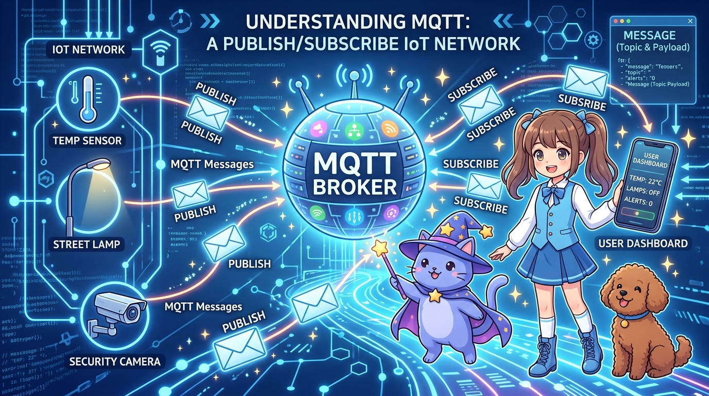

# 150_MQTT_경량IoT메시징_발행구독과_초고속통신 📮⚡



**도로시와 지니가 함께하는 IoT 글로벌 표준 프로토콜 MQTT의 브로커(Broker)와 발행/구독(Pub/Sub) 실전 구축**

* 👧 **도로시**: "지니야! 수백 개의 온습도 센서가 1초마다 웹 서버로 HTTP 요청을 보내면 서버가 버벅대고 느려지지 않을까? 더 가볍고 번개처럼 빠른 통신 방식은 없어?"
* 🐱 **지니**: "아주 날카로운 질문이야 도로시! 그래서 전 세계 모든 IoT 산업계는 무거운 HTTP 대신 초경량 메시징 프로토콜인 **MQTT (Message Queuing Telemetry Transport)** 를 표준으로 사용한단다! 헤더 크기가 단 **2바이트**에 불과해 수만 대의 장치가 동시 접속해도 끄떡없지!"
* 🐶 **토토**: "바우! 우체국 편지 배달부처럼 정확하게 날아온다 멍!"

* 🖥️ **강의 슬라이드**: [slides.md](./slides.md)

---

## 1. HTTP vs MQTT: 왜 사물인터넷은 MQTT를 쓸까?


```
 [ HTTP 방식 : 요청-응답 (1:1 유선 전화) ]      [ MQTT 방식 : 발행-구독 (방송국과 우체국) ]
  클라이언트 ──── (무거운 헤더 요청) ──▶ 서버       센서(발행) ───▶ [MQTT 브로커] ───▶ 스마트폰(구독)
  클라이언트 ◀─── (HTML 데이터 응답) ── 서버       온도계(발행) ──▶ (중앙 우체국) ──▶ PC 대시보드(구독)
  * 연결을 맺고 끊을 때마다 오버헤드 큼!           * 영구 TCP 세션 유지, 2바이트 초경량 패킷!
```

| 비교 항목 | HTTP (HyperText Transfer Protocol) | MQTT (Message Queuing Telemetry Transport) |
| :--- | :--- | :--- |
| **통신 패러다임** | 요청-응답 (Request-Response, 1:1) | **발행-구독 (Publish-Subscribe, 1:N)** |
| **메시지 헤더 크기**| 수백 바이트 ~ 수 킬로바이트(KB) | **최소 2 바이트 (초경량!)** |
| **통신 지연 (Latency)**| 매 요청마다 TCP 핸드셰이크로 느림 | **연결 유지 상태에서 즉각 푸시(Push)** |
| **전력 소모** | 큼 (배터리 구동 IoT에 불리) | **극히 적음 (수면 모드 슬립 최적화)** |

---

## 2. MQTT 핵심 3대 구성 요소: 브로커, 발행자, 구독자

1. **브로커 (MQTT Broker)**:
   * 모든 메시지를 중계하는 **중앙 허브 우체국**. 클라이언트들의 연결을 관리하고 토픽별로 편지를 분류해 배달합니다. (예: Mosquitto, HiveMQ, EMQX)
2. **발행자 (Publisher)**:
   * 특정 '주제(Topic)'에 메시지(Payload)를 실어 브로커로 쏘아 올리는 장치 (예: 온습도 센서 노드)
3. **구독자 (Subscriber)**:
   * 관심 있는 '주제(Topic)'를 브로커에 등록해 두고, 새 편지가 오면 즉시 수신하는 장치 (예: 스마트폰 앱, LED 조명)

---

## 3. 계층형 토픽(Topic) 주소 설계법

MQTT 주소는 슬래시(`/`)를 기준으로 나뭇가지처럼 계층을 나눕니다:

```
        home (최상위 분류)
         ├── livingroom (거실)
         │    ├── temperature (온도) ──▶ 발행: "24.5"
         │    └── light       (조명) ──▶ 구독: "ON"
         └── kitchen (주방)
              └── gas         (가스) ──▶ 발행: "SAFE"
```

* **와일드카드(Wildcard) 구독의 마법**:
  * **`+` (단일 레벨 와일드카드)**: `home/+/temperature` ➔ 거실, 주방, 안방 등 모든 방의 온도를 한 번에 구독!
  * **`#` (다중 레벨 와일드카드)**: `home/#` ➔ `home` 아래에서 일어나는 모든 장치의 메시지를 일괄 도청!

---

## 4. 실습: ESP32 + 무료 공용 브로커(HiveMQ) 기반 센서 발행 및 LED 원격 제어

아두이노 IDE [라이브러리 관리자]에서 **`PubSubClient`** (by Nick O'Leary) 라이브러리를 설치합니다.

```cpp
#include <WiFi.h>
#include <PubSubClient.h>

const char* ssid = "YOUR_WIFI_SSID";
const char* password = "YOUR_WIFI_PASSWORD";

// 무료 오픈 공용 MQTT 브로커
const char* mqtt_server = "broker.hivemq.com";
const int mqtt_port = 1883;

// 토픽 이름 정의 (중복 방지를 위해 자신만의 고유 이름 사용!)
const char* topic_sensor = "dorothy/smartlab/temp";
const char* topic_led    = "dorothy/smartlab/led";

WiFiClient espClient;
PubSubClient client(espClient);

const int LED_PIN = 2; // 내장 LED

// 브로커로부터 구독(Subscribe)한 메시지가 도착했을 때 실행되는 콜백 함수
void callback(char* topic, byte* payload, unsigned int length) {
  String message = "";
  for (int i = 0; i < length; i++) {
    message += (char)payload[i];
  }
  Serial.print("[수신 토픽] ");
  Serial.print(topic);
  Serial.print(" ➔ 명령: ");
  Serial.println(message);

  if (String(topic) == topic_led) {
    if (message == "ON")  digitalWrite(LED_PIN, HIGH);
    if (message == "OFF") digitalWrite(LED_PIN, LOW);
  }
}

// 브로커 재접속 및 토픽 구독 등록
void reconnect() {
  while (!client.connected()) {
    Serial.print("MQTT 브로커 접속 중...");
    String clientId = "ESP32Client-" + String(random(0xffff), HEX);
    if (client.connect(clientId.c_str())) {
      Serial.println("접속 성공!");
      client.subscribe(topic_led); // LED 제어 토픽 구독 개시!
    } else {
      delay(2000);
    }
  }
}

void setup() {
  Serial.begin(115200);
  pinMode(LED_PIN, OUTPUT);

  WiFi.begin(ssid, password);
  while (WiFi.status() != WL_CONNECTED) delay(500);

  client.setServer(mqtt_server, mqtt_port);
  client.setCallback(callback); // 콜백 등록
}

unsigned long lastMsg = 0;

void loop() {
  if (!client.connected()) reconnect();
  client.loop(); // MQTT 패킷 수신 루프

  // 5초마다 온도 데이터 발행(Publish)
  unsigned long now = millis();
  if (now - lastMsg > 5000) {
    lastMsg = now;
    float fakeTemp = 24.0 + random(0, 30) / 10.0;
    char tempString[8];
    dtostrf(fakeTemp, 1, 1, tempString);

    client.publish(topic_sensor, tempString); // 브로커로 쏘아올림!
    Serial.print(">> [발행 성공] 온도: ");
    Serial.println(tempString);
  }
}
```

---

## 🌟 도로시와 지니의 핵심 요약 노트!


* 👧 **도로시**: "센서는 브로커에 온도만 던져두고, 스마트폰은 토픽만 구독하고 있으니까 0.01초 만에 데이터가 바로바로 도착해!"
* 🐱 **지니**: "그게 바로 MQTT의 발행/구독 마법이란다! 이제 이 데이터를 인터넷 클라우드에 24시간 저장하고 예쁜 꺾은선 그래프로 시각화하는 **'151_IoT클라우드_ThingSpeak'**로 나아가보자!"
* 🐶 **토토**: "바우! 구름(Cloud) 위에 내 기록을 남긴다 멍!"
