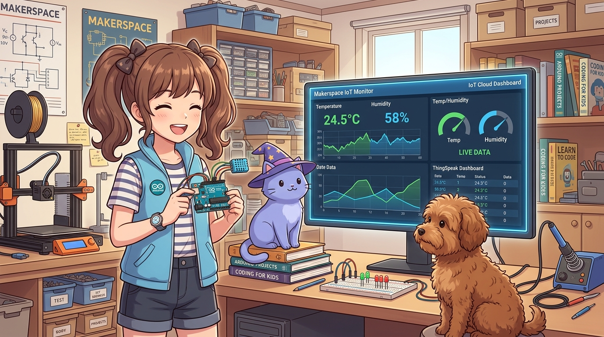
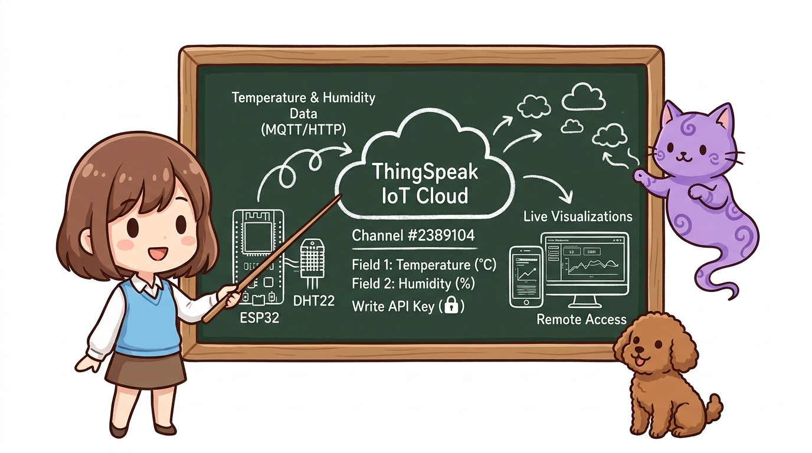
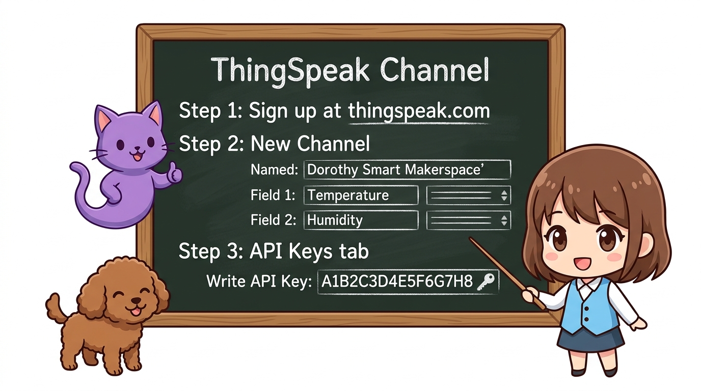
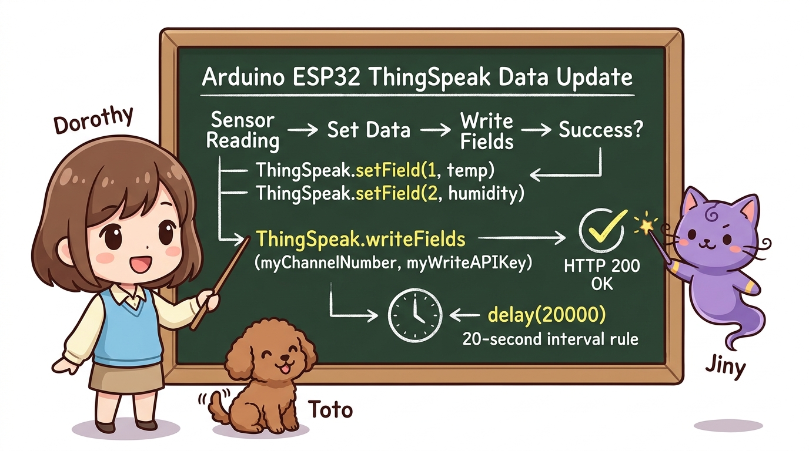
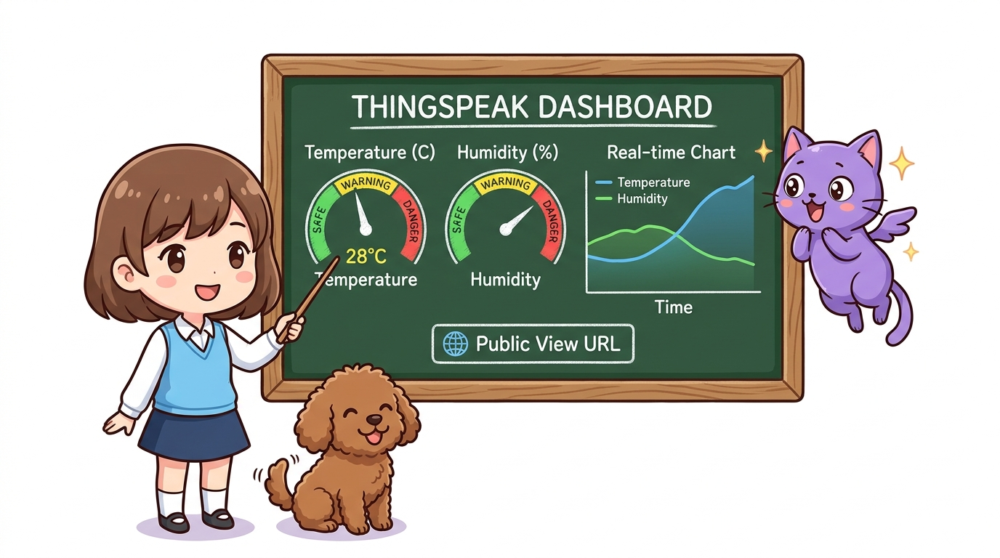

# 151_IoT클라우드_ThingSpeak_실시간센서대시보드 ☁️📈



**도로시와 지니가 함께하는 센서 빅데이터 클라우드 로깅과 실시간 인터랙티브 온라인 차트 대시보드 구축**
* 👧 **도로시**: "지니야! 아두이노 시리얼 플로터는 컴퓨터를 끄면 그래프가 다 날아가버리잖아. 며칠 동안 낮과 밤의 기온 변화를 인터넷 구름(Cloud)에 24시간 안전하게 기록하고, 언제 어디서나 스마트폰으로 그래프를 볼 순 없을까?"
* 🐱 **지니**: "그게 바로 글로벌 빅데이터 연구에 쓰이는 대표적인 오픈 IoT 클라우드 플랫폼, **씽스피크(ThingSpeak)** 란다! 전 세계 메이커와 연구원들이 센서 데이터를 무료로 클라우드에 보관하고, 실시간 그래프와 게이지 위젯으로 공유하는 최고의 도구지!"
* 🐶 **토토**: "바우! 온도가 오르내리는 물결이 화면에 착착 그려진다 멍!"
* 📖 **상세 강의 교재**: [index.md](./index.md)


> 여러분 안녕하세요! 이번 시간에는 '151. IoT클라우드 ThingSpeak 실시간센서대시보드 ☁️📈'을 주제로 함께 흥미진진한 탐험을 떠나보겠습니다. 오늘 강의에서는 특히 도로시와 지니가 함께하는 센서 빅데이터 클라우드 로깅과 실시간 인터랙티브 온라인 차트 대시보드 구축, 👧 도로시: "지니야! 아두이노 시리얼 플로터는 컴퓨터를 끄면 그래프가 다 날아가버리잖아. 며칠 동안 낮과 밤의 기온 변화를 인터넷 구름(Cloud)에 24시간 안전하게 기록하고, 언제 어디서나 스마트폰으로 그래프를 볼 순 없을까?"를 중심으로 핵심 원리와 응용 방법을 차근차근 배워보겠습니다. 마법 멘토 지니와 호기심 많은 탐험가 도로시, 그리고 귀여운 토토와 함께 신나는 아두이노 모험을 힘차게 시작해 봅시다. 준비되셨나요?

---

## 1. IoT 클라우드와 ThingSpeak의 핵심 구조



* **채널(Channel)**: 내 센서 장치를 등록하는 데이터 보관소
* **필드(Field 1~8)**: 채널 안에서 최대 8개까지 독립된 센서 값(온도, 습도, 미세먼지 등)을 개별 저장
* **Write API Key**: 외부에서 허가받지 않은 침입자가 내 채널에 가짜 데이터를 쓰지 못하게 막는 16자리 암호 보안 키

```
   [ 우리 집 ESP32 센서 ]                  [ ThingSpeak IoT 클라우드 ]               [ 사용자 (어디서나) ]
   ──────────────────────────────────────────────────────────────────────────────────────────────────
   온도: 24.5 ℃ ──(15초 주기 HTTP GET)──▶ [ Channel #2389104 ]                 스마트폰 웹 브라우저
   습도: 58 %                              - Field 1: Temperature ──(실시간 차트)─▶ PC 태블릿 대시보드
                                           - Field 2: Humidity                    친구/가족 공유 URL
```

> 이번 슬라이드에서는 '1. IoT 클라우드와 ThingSpeak의 핵심 구조'에 대한 실제 동작 코드를 분석해 보겠습니다. 화면의 코드를 살펴보시면, 컴퓨터가 아두이노 하드웨어에 단계별로 명령을 내리는 흐름을 명확하게 확인할 수 있습니다. 여기서 핵심은 채널(Channel): 내 센서 장치를 등록하는 데이터 보관소입니다. 각 함수의 역할과 괄호 안의 매개변수가 하드웨어 핀과 어떤 관계를 맺고 동작하는지 주의 깊게 살펴보시기 바랍니다.

---
## 2. 무료 계정 생성 및 채널 개설 3단계




1. **ThingSpeak 웹사이트(thingspeak.com)** 접속 및 무료 회원가입 (MathWorks 계정)
2. **`Channels` ➔ `New Channel`** 클릭:
* Name: `Dorothy Smart Makerspace`
* Field 1: `Temperature` (온도)
* Field 2: `Humidity` (습도)
* 하단 [Save Channel] 버튼 클릭!
3. **`API Keys` 탭** 확인:
* **`Write API Key`** (예: `A1B2C3D4E5F6G7H8`)를 복사해둡니다.

> 이번 슬라이드에서는 '2. 무료 계정 생성 및 채널 개설 3단계'에 대해 자세히 살펴보겠습니다. 첫 번째 핵심은 ThingSpeak 웹사이트(thingspeak.com) 접속 및 무료 회원가입 (MathWorks 계정)이며, 두 번째로는 Channels ➔ New Channel 클릭입니다. 여기에 덧붙여 Name: Dorothy Smart Makerspace 내용까지 함께 이해해 두시면 완벽합니다. 이 원리는 아두이노 시스템 전체를 관통하는 핵심 논리이므로 머릿속에 꼭 정리해 두시기 바랍니다.
---
## 3. 라이브러리 설치


아두이노 IDE [라이브러리 관리자]에서 **`ThingSpeak`** (by MathWorks)를 검색하여 설치합니다.

> 이번 슬라이드에서는 '3. 라이브러리 설치'에 대해 자세히 살펴보겠습니다. 이 원리는 아두이노 시스템 전체를 관통하는 핵심 논리이므로 머릿속에 꼭 정리해 두시기 바랍니다.
---
## 4. 실습: ESP32 + 온습도 센서 클라우드 자동 업로드




```cpp
#include <WiFi.h>
#include <ThingSpeak.h>

const char* ssid = "YOUR_WIFI_SSID";
const char* password = "YOUR_WIFI_PASSWORD";

WiFiClient client;

// ThingSpeak 채널 정보 (본인의 채널 번호와 Write API 키 입력!)
unsigned long myChannelNumber = 2389104;
const char* myWriteAPIKey = "A1B2C3D4E5F6G7H8";

void setup() {
  Serial.begin(115200);

  WiFi.begin(ssid, password);
  while (WiFi.status() != WL_CONNECTED) {
    delay(500);
    Serial.print(".");
  }
  Serial.println("
Wi-Fi Connected!");

  ThingSpeak.begin(client); // ThingSpeak 클라이언트 초기화
}

void loop() {
  // 실제 센서 값(DHT11 등) 또는 실습용 시뮬레이션 데이터
  float temp = 23.5 + random(-20, 30) / 10.0;
  int humidity = 55 + random(-10, 15);

  // Field 1과 Field 2에 데이터 세팅
  ThingSpeak.setField(1, temp);
  ThingSpeak.setField(2, humidity);

  // 클라우드로 일괄 전송!
  int httpCode = ThingSpeak.writeFields(myChannelNumber, myWriteAPIKey);

  if (httpCode == 200) {
    Serial.println("✅ [클라우드 업로드 성공] 온도: " + String(temp) + "C, 습도: " + String(humidity) + "%");
  } else {
    Serial.println("❌ 업로드 실패! 에러 코드: " + String(httpCode));
  }

  // ThingSpeak 무료 정책상 최소 15초 이상의 업로드 간격 필수!
  delay(20000); // 20초마다 주기적 업데이트
}
```

> 이번 슬라이드에서는 '4. 실습: ESP32 + 온습도 센서 클라우드 자동 업로드'에 대한 실제 동작 코드를 분석해 보겠습니다. 화면의 코드를 살펴보시면, 컴퓨터가 아두이노 하드웨어에 단계별로 명령을 내리는 흐름을 명확하게 확인할 수 있습니다. 각 함수의 역할과 괄호 안의 매개변수가 하드웨어 핀과 어떤 관계를 맺고 동작하는지 주의 깊게 살펴보시기 바랍니다.
---
## 5. 대시보드 위젯 꾸미기와 공개(Public) 공유




1. **위젯 추가(Add Widgets)**:
* 채널 화면에서 [Add Widgets] 클릭 후 **Gauge(원형 계측기)** 또는 **Numeric Display(숫자 디스플레이)** 선택
* 초록-노랑-빨강 색상 구간을 지정하여 위험 온도 경보 비주얼 완성
2. **공개 뷰(Sharing)**:
* `Sharing` 탭에서 **`Share channel view with everyone`** 을 선택하면 나만의 실시간 환경 모니터링 웹 사이트 URL 생성!

> 이번 슬라이드에서는 '5. 대시보드 위젯 꾸미기와 공개(Public) 공유'에 대해 자세히 살펴보겠습니다. 첫 번째 핵심은 위젯 추가(Add Widgets)이며, 두 번째로는 채널 화면에서 [Add Widgets] 클릭 후 Gauge(원형 계측기) 또는 Numeric Display(숫자 디스플레이) 선택입니다. 여기에 덧붙여 초록-노랑-빨강 색상 구간을 지정하여 위험 온도 경보 비주얼 완성 내용까지 함께 이해해 두시면 완벽합니다. 이 원리는 아두이노 시스템 전체를 관통하는 핵심 논리이므로 머릿속에 꼭 정리해 두시기 바랍니다.
---

## 🌟 도로시와 지니의 핵심 요약 노트!


* 👧 **도로시**: "스마트폰으로 링크에 접속했더니 내가 만든 온습도 꺾은선 차트가 실시간으로 움직여! 이제 집 밖에서도 언제든 연구실 환경을 감시할 수 있어!"
* 🐱 **지니**: "훌륭해! 센서 데이터를 축적하면 계절별 변화나 이상 징후를 예측하는 진정한 빅데이터 AIoT로 발전할 수 있단다."
* 🐶 **토토**: "바우! 이제 긴급 상황이 터지면 스마트폰 메신저로 삐뽀삐뽀 알림을 쏴주는 **'152_스마트폰_텔레그램봇'**으로 출동하자 멍!"

> 오늘 배운 '🌟 도로시와 지니의 핵심 요약 노트!'의 핵심 내용을 모두 정리해 보았습니다. 오늘 다룬 내용 중에서도 👧 도로시: "스마트폰으로 링크에 접속했더니 내가 만든 온습도 꺾은선 차트가 실시간으로 움직여! 이제 집 밖에서도 언제든 연구실 환경을 감시할 수 있어!" 부분은 앞으로의 아두이노 실습과 프로젝트에서 계속 사용되는 매우 중요한 기초 지식입니다. 오늘 배운 내용을 꼭 다시 한번 복습해 보시고, 다음 강의에서 더욱 신나고 유익한 모험으로 다시 만나겠습니다. 모두 수고 많으셨습니다!