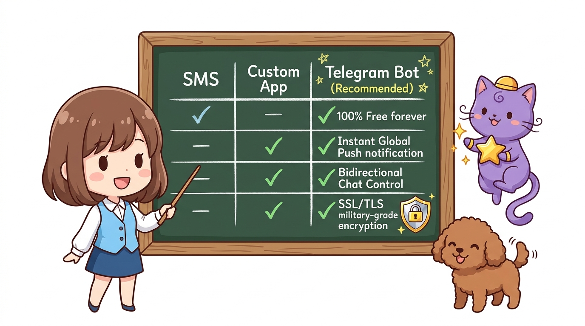
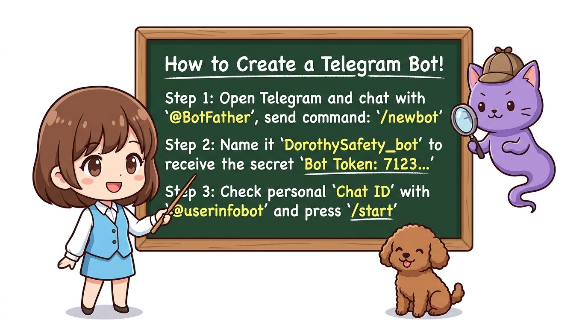
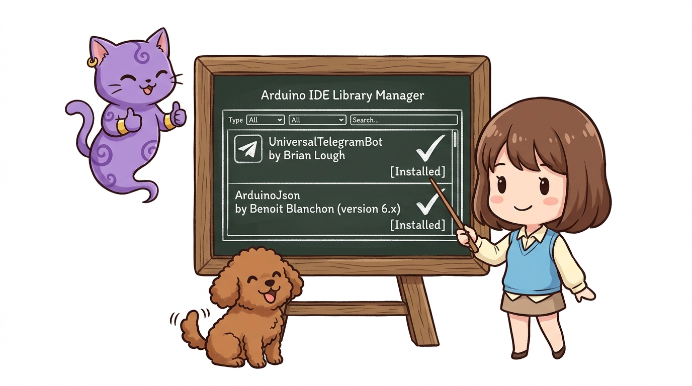
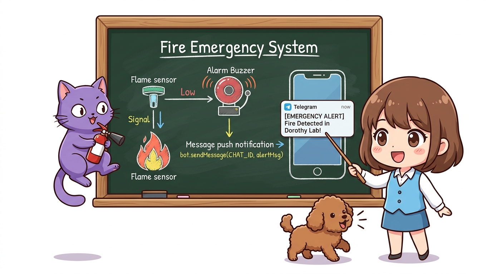
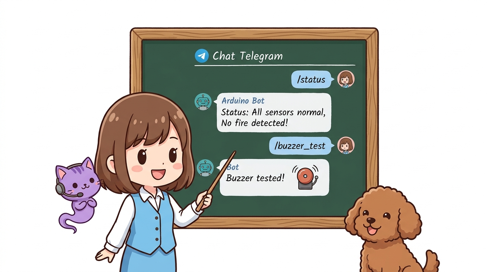

# 152_스마트폰_텔레그램봇_침입화재_실시간푸시알림 🚨💬


**도로시와 지니가 함께하는 화재·침입 이상 감지 시 스마트폰 메신저로 긴급 사진과 푸시 경보를 발송하는 AIoT 보안 봇**
* 👧 **도로시**: "지니야! 우리가 연구실을 비웠을 때 화재 센서가 불꽃을 감지하거나 도난 센서가 울리면, 내 스마트폰 카카오톡이나 텔레그램으로 '🚨 불이야! 빨리 출동해!' 하고 메시지가 즉시 날아오게 만들 순 없을까?"
* 🐱 **지니**: "당연히 가능하지! 전 세계 수억 명이 쓰는 메신저 텔레그램(Telegram)의 공개 봇 API를 활용하면, 아두이노가 나만의 든든한 **24시간 사이버 경비원 봇**으로 변신한단다! 센서가 이상을 감지하는 순간 1초 만에 스마트폰 화면에 푸시 알림과 진동을 울려주지!"
* 🐶 **토토**: "바우! 연구실 보안은 내가 지킨다 멍!"
* 📖 **상세 강의 교재**: [index.md](./index.md)


> 여러분 안녕하세요! 이번 시간에는 '152. 스마트폰 텔레그램봇 침입화재 실시간푸시알림 🚨💬'을 주제로 함께 흥미진진한 탐험을 떠나보겠습니다. 오늘 강의에서는 특히 도로시와 지니가 함께하는 화재·침입 이상 감지 시 스마트폰 메신저로 긴급 사진과 푸시 경보를 발송하는 AIoT 보안 봇, 👧 도로시: "지니야! 우리가 연구실을 비웠을 때 화재 센서가 불꽃을 감지하거나 도난 센서가 울리면, 내 스마트폰 카카오톡이나 텔레그램으로 '🚨 불이야! 빨리 출동해!' 하고 메시지가 즉시 날아오게 만들 순 없을까?"를 중심으로 핵심 원리와 응용 방법을 차근차근 배워보겠습니다. 마법 멘토 지니와 호기심 많은 탐험가 도로시, 그리고 귀여운 토토와 함께 신나는 아두이노 모험을 힘차게 시작해 봅시다. 준비되셨나요?

---

## 1. 텔레그램 봇(Telegram Bot)을 이용한 IoT 경보의 장점



| 구분 | 일반 SMS 문자 메시지 | 전용 스마트폰 앱 제작 | 텔레그램 메신저 봇 (추천!) |
| :--- | :--- | :--- | :--- |
| **비용** | 건당 발송 비용 발생 (유료) | 개발자 계정 등록비용 발생 | **완전 100% 무료 (평생 무제한!)** |
| **알림 신뢰도** | 스팸 차단 위험 | 백그라운드 프로세스 종료 시 먹통 | **전 세계 최정상 서버의 즉각적 푸시 알림** |
| **양방향 제어** | 불가능 | 복잡한 UI 구현 필요 | **채팅창에 `/status`, `/light_on` 입력으로 원격 제어** |
| **보안** | 평문 전송 | 보안 취약 | **군사급 종단간 SSL/TLS 암호화 통신** |

> 이번에 살펴볼 내용은 '1. 텔레그램 봇(Telegram Bot)을 이용한 IoT 경보의 장점'입니다. 슬라이드에 정리된 표를 통해 각 항목의 특징과 수치, 차이점을 한눈에 비교해 보실 수 있습니다. 이 기본 개념을 확실히 잡아두셔야 실제 부품을 브레드보드에 꽂고 코딩할 때 실수 없이 완성할 수 있습니다.

---
## 2. 스마트폰 텔레그램 봇 생성 및 Chat ID 확인 3단계




1. **텔레그램 앱 실행 ➔ 검색창에 `@BotFather` 검색**:
* 대화창에 `/newbot` 입력
* 봇 이름: `DorothySafetyBot`
* 봇 유저네임: `DorothySafety_bot` (반드시 `_bot`으로 끝나야 함)
* ➔ BotFather가 **`Bot Token` (예: `7123456789:ABCdefGhIJKlmNoPQRsTuvWxYz`)** 을 발급해 줍니다!
2. **내 고유 Chat ID 확인하기**:
* 검색창에 `@userinfobot` 검색 ➔ `/start` 입력
* ➔ 내 숫자 아이디 **`Id: 123456789`** 를 복사해 둡니다.
3. 방금 만든 내 봇(`@DorothySafety_bot`)을 검색하여 **`/start`** 버튼을 눌러 대화를 활성화해 둡니다.

> 이번 슬라이드에서는 '2. 스마트폰 텔레그램 봇 생성 및 Chat ID 확인 3단계'에 대해 자세히 살펴보겠습니다. 첫 번째 핵심은 텔레그램 앱 실행 ➔ 검색창에 @BotFather 검색이며, 두 번째로는 대화창에 /newbot 입력입니다. 여기에 덧붙여 봇 이름: DorothySafetyBot 내용까지 함께 이해해 두시면 완벽합니다. 이 원리는 아두이노 시스템 전체를 관통하는 핵심 논리이므로 머릿속에 꼭 정리해 두시기 바랍니다.
---
## 3. 라이브러리 설치




1. **`UniversalTelegramBot`** (by Brian Lough)
2. **`ArduinoJson`** (by Benoit Blanchon, 버전 6.x)

아두이노 IDE [라이브러리 관리자]에서 아래 2개의 라이브러리를 설치합니다:

> 이번 슬라이드에서는 '3. 라이브러리 설치'에 대해 자세히 살펴보겠습니다. 첫 번째 핵심은 UniversalTelegramBot (by Brian Lough)이며, 두 번째로는 ArduinoJson (by Benoit Blanchon, 버전 6.x)입니다. 이 원리는 아두이노 시스템 전체를 관통하는 핵심 논리이므로 머릿속에 꼭 정리해 두시기 바랍니다.
---
## 4. 실습: 화재 불꽃 감지 시 텔레그램 스마트폰 푸시 경보 발송




불꽃 감지 센서(디지털 22번 핀)에 라이터 불빛이 닿는 즉시 텔레그램으로 비상 경보 메시지를 쏩니다.

```cpp
#include <WiFi.h>
#include <WiFiClientSecure.h>
#include <UniversalTelegramBot.h>
#include <ArduinoJson.h>

const char* ssid = "YOUR_WIFI_SSID";
const char* password = "YOUR_WIFI_PASSWORD";

// 텔레그램 봇 토큰 및 수신자 Chat ID
#define BOT_TOKEN "7123456789:ABCdefGhIJKlmNoPQRsTuvWxYz"
#define CHAT_ID   "123456789"

WiFiClientSecure secured_client;
UniversalTelegramBot bot(BOT_TOKEN, secured_client);

const int FLAME_SENSOR_PIN = 22; // 디지털 불꽃 감지 센서 핀
const int BUZZER_PIN = 23;       // 경보 부저

bool fireAlertSent = false;

void setup() {
  Serial.begin(115200);
  pinMode(FLAME_SENSOR_PIN, INPUT);
  pinMode(BUZZER_PIN, OUTPUT);

  WiFi.begin(ssid, password);
  while (WiFi.status() != WL_CONNECTED) {
    delay(500);
    Serial.print(".");
  }
  Serial.println("
Wi-Fi Connected!");

  // 보안 HTTPS SSL 인증서 검증 생략 (간편한 IoT 접속)
  secured_client.setInsecure();

  // 봇 부팅 안내 메시지 발송
  bot.sendMessage(CHAT_ID, "🛡️ [시스템 알림] 도로시 연구실 스마트 안전 봇이 정상 가동되었습니다!", "");
}

void loop() {
  int flameStatus = digitalRead(FLAME_SENSOR_PIN);

  // 불꽃 감지 센서는 불꽃 발견 시 LOW(0) 신호 출력
  if (flameStatus == LOW) {
    digitalWrite(BUZZER_PIN, HIGH); // 현장 경보 부저 울림!

    if (!fireAlertSent) {
      Serial.println("🚨 화재 발생 감지! 텔레그램 발송!");

      String alertMsg = "🚨🚨🚨 [긴급 비상 경보] 🚨🚨🚨

";
      alertMsg += "연구실에서 위험 불꽃이 감지되었습니다!
";
      alertMsg += "위치: 3번 메이커 작업대
";
      alertMsg += "시간: 즉각 확인 및 대피 요망!";

      bot.sendMessage(CHAT_ID, alertMsg, "Markdown");
      fireAlertSent = true; // 중복 폭풍 발송 방지
    }
  } else {
    digitalWrite(BUZZER_PIN, LOW);
    fireAlertSent = false; // 화재 상황 해제 시 플래그 리셋
  }

  delay(200);
}
```

> 이번 슬라이드에서는 '4. 실습: 화재 불꽃 감지 시 텔레그램 스마트폰 푸시 경보 발송'에 대한 실제 동작 코드를 분석해 보겠습니다. 화면의 코드를 살펴보시면, 컴퓨터가 아두이노 하드웨어에 단계별로 명령을 내리는 흐름을 명확하게 확인할 수 있습니다. 각 함수의 역할과 괄호 안의 매개변수가 하드웨어 핀과 어떤 관계를 맺고 동작하는지 주의 깊게 살펴보시기 바랍니다.
---
## 5. 양방향 제어: 스마트폰 채팅으로 연구실 상태 확인하기




스마트폰 텔레그램 채팅창에 `/status`라고 치면 연구실 온습도와 센서 상태를 즉시 답장해줍니다.

```cpp
void handleNewMessages(int numNewMessages) {
  for (int i = 0; i < numNewMessages; i++) {
    String chat_id = String(bot.messages[i].chat_id);
    if (chat_id != CHAT_ID) continue; // 등록되지 않은 외부인 차단!

    String text = bot.messages[i].text;

    if (text == "/start" || text == "/help") {
      String welcome = "안녕하세요 도로시님! 지원 명령어입니다:
";
      welcome += "/status : 연구실 상태 조회
";
      welcome += "/buzzer_test : 1초간 경보음 테스트";
      bot.sendMessage(chat_id, welcome, "");
    }
    else if (text == "/status") {
      bot.sendMessage(chat_id, "🌡️ 현재 상태: 모든 센서 정상 가동 중 (화재 위험 없음)", "");
    }
    else if (text == "/buzzer_test") {
      digitalWrite(BUZZER_PIN, HIGH);
      delay(1000);
      digitalWrite(BUZZER_PIN, LOW);
      bot.sendMessage(chat_id, "🔔 부저 테스트 완료!", "");
    }
  }
}
```

> 이번 슬라이드에서는 '5. 양방향 제어: 스마트폰 채팅으로 연구실 상태 확인하기'에 대한 실제 동작 코드를 분석해 보겠습니다. 화면의 코드를 살펴보시면, 컴퓨터가 아두이노 하드웨어에 단계별로 명령을 내리는 흐름을 명확하게 확인할 수 있습니다. 각 함수의 역할과 괄호 안의 매개변수가 하드웨어 핀과 어떤 관계를 맺고 동작하는지 주의 깊게 살펴보시기 바랍니다.
---

## 🌟 도로시와 지니의 핵심 요약 노트!


* 👧 **도로시**: "센서가 불꽃을 보자마자 스마트폰에 1초 만에 텔레그램 알림이 번쩍 뜨니까 너무 든든해! 채팅으로 `/status` 묻는 기능도 정말 편리해!"
* 🐱 **지니**: "축하해 도로시! 이제 너는 단순한 전자 회로 제작자를 넘어, 전 세계 어디서든 소통하고 제어하는 진정한 **'사물인터넷(IoT) 마스터'** 가 되었단다!"
* 🐶 **토토**: "바우! 도로시와 지니, 그리고 토토와 함께한 신나는 IoT 대모험 대성공이다 멍!"

> 오늘 배운 '🌟 도로시와 지니의 핵심 요약 노트!'의 핵심 내용을 모두 정리해 보았습니다. 오늘 다룬 내용 중에서도 👧 도로시: "센서가 불꽃을 보자마자 스마트폰에 1초 만에 텔레그램 알림이 번쩍 뜨니까 너무 든든해! 채팅으로 /status 묻는 기능도 정말 편리해!" 부분은 앞으로의 아두이노 실습과 프로젝트에서 계속 사용되는 매우 중요한 기초 지식입니다. 오늘 배운 내용을 꼭 다시 한번 복습해 보시고, 다음 강의에서 더욱 신나고 유익한 모험으로 다시 만나겠습니다. 모두 수고 많으셨습니다!