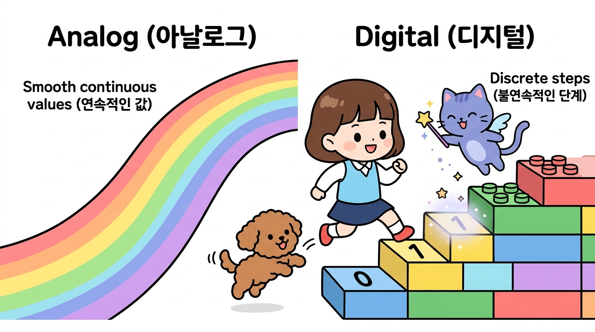
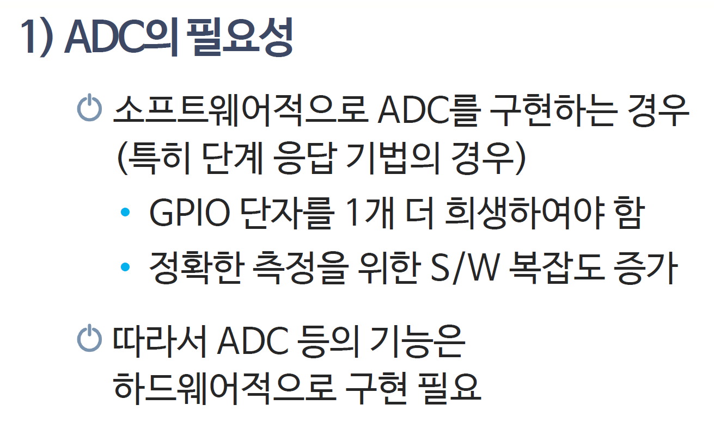
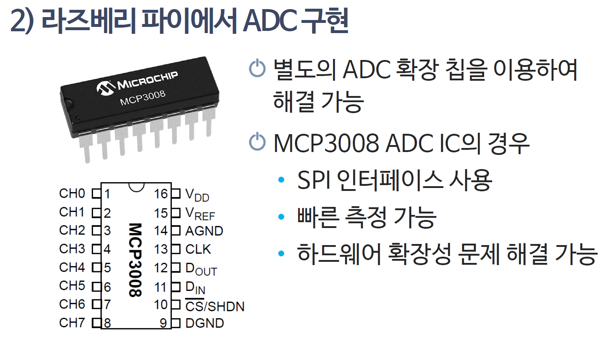

# 153_외부ADC컨버터_초정밀계측 🔬⚡



**도로시와 지니가 함께하는 16비트 초정밀 아날로그-디지털 변환**

* 👧 **도로시**: "지니야! 아두이노의 기본 0~1023 눈금보다 훨씬 더 촘촘하고 정밀하게 전압을 재야 할 때는 어떡해?"
* 🐱 **지니**: "무려 65,536단계로 쪼개어 읽어주는 **16비트 외부 ADC 컨버터(ADS1115)** 모듈을 쓰면 된단다!"
* 🐶 **토토**: "바우! 눈금이 64배나 더 촘촘해졌다 멍!"

* 🖥️ **강의 슬라이드**: [slides.md](./slides.md)

---

## 1. 아두이노 내장 ADC vs 외부 16비트 ADC 비교



### 🔬 10비트와 16비트의 해상도 격차!

* **아두이노 기본 내장 ADC (10-bit)**:
  * $2^{10} = 1,024$ 단계로 쪼갬
  * 분해능: $5\text{V} / 1024 \approx \mathbf{4.88\,\text{mV}}$
* **외부 정밀 ADC 칩 (ADS1115, 16-bit)**:
  * $2^{16} = 65,536$ 단계로 쪼갬
  * 분해능: $\mathbf{0.007\,\text{mV} (7.8\,\mu\text{V})}$!
  * 무게 센서(로드셀), 정밀 의료 센서처럼 0.001V 미만의 극미세 신호도 오차 없이 포착!

---

## 2. 라즈베리파이의 구원투수!



### 🍓 아날로그 핀이 없는 미니 PC를 위한 필수품!
* 라즈베리파이(Raspberry Pi)는 뛰어난 소형 컴퓨터이지만, **아날로그 핀이 단 1개도 없어요**.
* 조도센서, 가변저항, 수위센서를 라즈베리파이에 달려면:
  * ➡️ **외부 ADC 칩(ADS1115, MCP3008)** 을 I2C나 SPI로 연결해야만 아날로그 센서를 읽을 수 있답니다!

---

## 3. ADS1115의 핀과 I2C 연결 방법


### 🔌 단 2선 I2C로 4개 아날로그 채널 확장!
* **전원**: VDD (3.3V ~ 5V), GND
* **I2C 통신선**: **SCL ➡️ A5**, **SDA ➡️ A4**
* **아날로그 입력 채널 4개**:
  * **A0, A1, A2, A3** (독립 4채널 또는 차동 2채널 측정 가능!)
* 내장 증폭기(PGA)가 있어 작은 전압을 스스로 16배까지 확대해 측정해요.

---

## 4. ADS1115 아두이노 스케치 예시


### 💻 `Adafruit_ADS1X15` 라이브러리 활용

```cpp
#include <Wire.h>
#include <Adafruit_ADS1X15.h>

Adafruit_ADS1115 ads; // 16비트 ADC 객체 생성

void setup() {
  Serial.begin(9600);
  ads.begin(); // I2C 통신 시작 (기본 주소 0x48)
}

void loop() {
  int16_t adc0 = ads.readADC_SingleEnded(0); // 0번 채널 16비트 값
  float voltage = ads.computeVolts(adc0);    // 정밀 전압 환산

  Serial.print("Raw: "); Serial.print(adc0);
  Serial.print("  |  Voltage: "); Serial.print(voltage, 4); Serial.println(" V");

  delay(500);
}
```

---

## 🌟 도로시와 지니의 핵심 요약 노트!


* 👧 **도로시**: "외부 ADC 칩을 달면 65,536단계의 초정밀 측정이 가능하고 라즈베리파이에서도 아날로그를 읽을 수 있구나!"
* 🐱 **지니**: "정답이야! 첨단 과학 실험 장비나 정밀 전자저울을 만들 때 반드시 필요한 비밀 무기란다."
* 🐶 **토토**: "바우! 이제 미니 컴퓨터 라즈베리파이 세계로 넘어가자 멍!"
