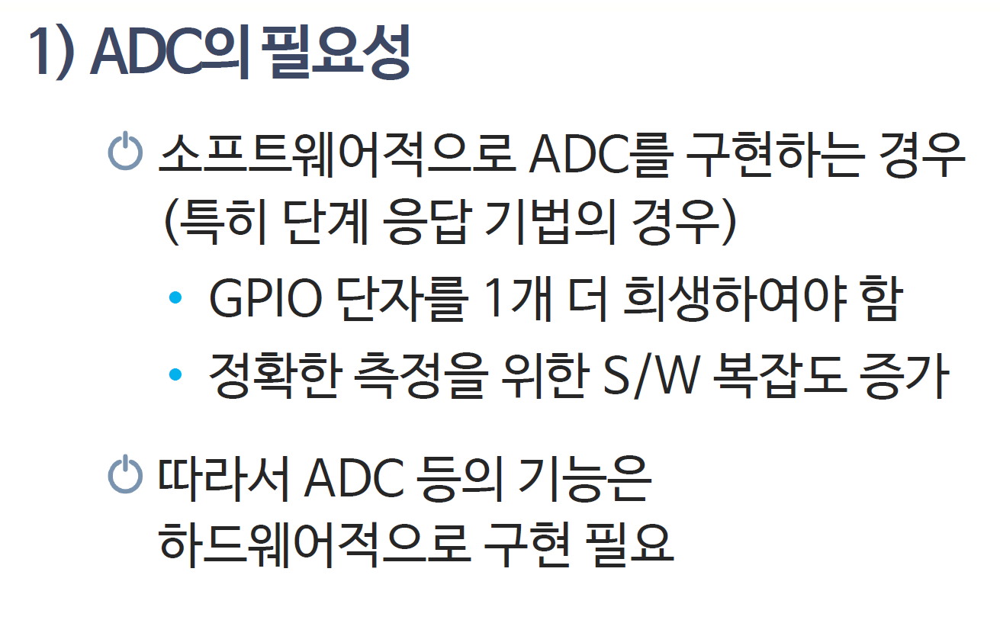
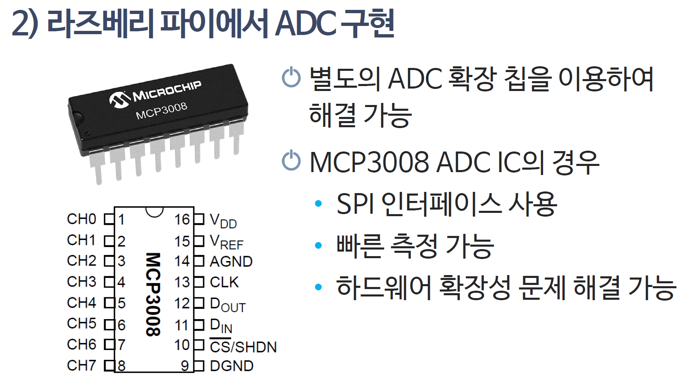

# 153_외부ADC컨버터_초정밀계측 🔬⚡


**도로시와 지니가 함께하는 16비트 초정밀 아날로그-디지털 변환**
* 👧 **도로시**: "지니야! 아두이노의 기본 0~1023 눈금보다 훨씬 더 촘촘하고 정밀하게 전압을 재야 할 때는 어떡해?"
* 🐱 **지니**: "무려 65,536단계로 쪼개어 읽어주는 **16비트 외부 ADC 컨버터(ADS1115)** 모듈을 쓰면 된단다!"
* 🐶 **토토**: "바우! 눈금이 64배나 더 촘촘해졌다 멍!"
* 📖 **상세 강의 교재**: [index.md](./index.md)


> 여러분 안녕하세요! 이번 시간에는 '153. 외부ADC컨버터 초정밀계측 🔬⚡'을 주제로 함께 흥미진진한 탐험을 떠나보겠습니다. 오늘 강의에서는 특히 도로시와 지니가 함께하는 16비트 초정밀 아날로그-디지털 변환, 👧 도로시: "지니야! 아두이노의 기본 0~1023 눈금보다 훨씬 더 촘촘하고 정밀하게 전압을 재야 할 때는 어떡해?"를 중심으로 핵심 원리와 응용 방법을 차근차근 배워보겠습니다. 마법 멘토 지니와 호기심 많은 탐험가 도로시, 그리고 귀여운 토토와 함께 신나는 아두이노 모험을 힘차게 시작해 봅시다. 준비되셨나요?

---

## 1. 아두이노 내장 ADC vs 외부 16비트 ADC 비교



* **아두이노 기본 내장 ADC (10-bit)**:
* $2^{10} = 1,024$ 단계로 쪼갬
* 분해능: $5\text{V} / 1024 \approx \mathbf{4.88\,\text{mV}}$
* **외부 정밀 ADC 칩 (ADS1115, 16-bit)**:
* $2^{16} = 65,536$ 단계로 쪼갬
* 분해능: $\mathbf{0.007\,\text{mV} (7.8\,\mu\text{V})}$!
* 무게 센서(로드셀), 정밀 의료 센서처럼 0.001V 미만의 극미세 신호도 오차 없이 포착!

### 🔬 10비트와 16비트의 해상도 격차!

> 이번에 살펴볼 내용은 '1. 아두이노 내장 ADC vs 외부 16비트 ADC 비교'입니다. 화면의 회로도와 부품 사진을 보면서 각 핀과 배선이 어떻게 구성되어 있는지 눈으로 직접 따라와 주시기 바랍니다. 첫째로 아두이노 기본 내장 ADC (10-bit)에 유의해야 하며, 둘째로 $2^{10} = 1,024$ 단계로 쪼갬라는 점이 핵심입니다. 이 기본 개념을 확실히 잡아두셔야 실제 부품을 브레드보드에 꽂고 코딩할 때 실수 없이 완성할 수 있습니다.

---

## 2. 라즈베리파이의 구원투수!



* 라즈베리파이(Raspberry Pi)는 뛰어난 소형 컴퓨터이지만, **아날로그 핀이 단 1개도 없어요**.
* 조도센서, 가변저항, 수위센서를 라즈베리파이에 달려면:
* ➡️ **외부 ADC 칩(ADS1115, MCP3008)** 을 I2C나 SPI로 연결해야만 아날로그 센서를 읽을 수 있답니다!

### 🍓 아날로그 핀이 없는 미니 PC를 위한 필수품!

> 이번 슬라이드에서는 '2. 라즈베리파이의 구원투수!'에 대해 자세히 살펴보겠습니다. 화면의 다이어그램과 사진을 함께 참고해 주시기 바랍니다. 첫 번째 핵심은 라즈베리파이(Raspberry Pi)는 뛰어난 소형 컴퓨터이지만, 아날로그 핀이 단 1개도 없어요.이며, 두 번째로는 조도센서, 가변저항, 수위센서를 라즈베리파이에 달려면입니다. 여기에 덧붙여 ➡️ 외부 ADC 칩(ADS1115, MCP3008) 을 I2C나 SPI로 연결해야만 아날로그 센서를 읽을 수 있답니다! 내용까지 함께 이해해 두시면 완벽합니다. 이 원리는 아두이노 시스템 전체를 관통하는 핵심 논리이므로 머릿속에 꼭 정리해 두시기 바랍니다.

---

## 3. ADS1115의 핀과 I2C 연결 방법


* **전원**: VDD (3.3V ~ 5V), GND
* **I2C 통신선**: **SCL ➡️ A5**, **SDA ➡️ A4**
* **아날로그 입력 채널 4개**:
* **A0, A1, A2, A3** (독립 4채널 또는 차동 2채널 측정 가능!)
* 내장 증폭기(PGA)가 있어 작은 전압을 스스로 16배까지 확대해 측정해요.

### 🔌 단 2선 I2C로 4개 아날로그 채널 확장!

> 이번에 살펴볼 내용은 '3. ADS1115의 핀과 I2C 연결 방법'입니다. 화면의 회로도와 부품 사진을 보면서 각 핀과 배선이 어떻게 구성되어 있는지 눈으로 직접 따라와 주시기 바랍니다. 첫째로 전원: VDD (3.3V ~ 5V), GND에 유의해야 하며, 둘째로 I2C 통신선: SCL ➡️ A5, SDA ➡️ A4라는 점이 핵심입니다. 이 기본 개념을 확실히 잡아두셔야 실제 부품을 브레드보드에 꽂고 코딩할 때 실수 없이 완성할 수 있습니다.

---

## 4. ADS1115 아두이노 스케치 예시


### 💻 `Adafruit_ADS1X15` 라이브러리 활용

```cpp
#include <Wire.h>
#include <Adafruit_ADS1X15.h>

Adafruit_ADS1115 ads; // 16비트 ADC 객체 생성

void setup() {
  Serial.begin(9600);
  ads.begin(); // I2C 통신 시작 (기본 주소 0x48)
}

void loop() {
  int16_t adc0 = ads.readADC_SingleEnded(0); // 0번 채널 16비트 값
  float voltage = ads.computeVolts(adc0);    // 정밀 전압 환산

  Serial.print("Raw: "); Serial.print(adc0);
  Serial.print("  |  Voltage: "); Serial.print(voltage, 4); Serial.println(" V");

  delay(500);
}
```

> 이번 슬라이드에서는 '4. ADS1115 아두이노 스케치 예시'에 대한 실제 동작 코드를 분석해 보겠습니다. 화면의 코드를 살펴보시면, 컴퓨터가 아두이노 하드웨어에 단계별로 명령을 내리는 흐름을 명확하게 확인할 수 있습니다. 각 함수의 역할과 괄호 안의 매개변수가 하드웨어 핀과 어떤 관계를 맺고 동작하는지 주의 깊게 살펴보시기 바랍니다.

---

## 🌟 도로시와 지니의 핵심 요약 노트!


* 👧 **도로시**: "외부 ADC 칩을 달면 65,536단계의 초정밀 측정이 가능하고 라즈베리파이에서도 아날로그를 읽을 수 있구나!"
* 🐱 **지니**: "정답이야! 첨단 과학 실험 장비나 정밀 전자저울을 만들 때 반드시 필요한 비밀 무기란다."
* 🐶 **토토**: "바우! 이제 미니 컴퓨터 라즈베리파이 세계로 넘어가자 멍!"

> 오늘 배운 '🌟 도로시와 지니의 핵심 요약 노트!'의 핵심 내용을 모두 정리해 보았습니다. 오늘 다룬 내용 중에서도 👧 도로시: "외부 ADC 칩을 달면 65,536단계의 초정밀 측정이 가능하고 라즈베리파이에서도 아날로그를 읽을 수 있구나!" 부분은 앞으로의 아두이노 실습과 프로젝트에서 계속 사용되는 매우 중요한 기초 지식입니다. 오늘 배운 내용을 꼭 다시 한번 복습해 보시고, 다음 강의에서 더욱 신나고 유익한 모험으로 다시 만나겠습니다. 모두 수고 많으셨습니다!