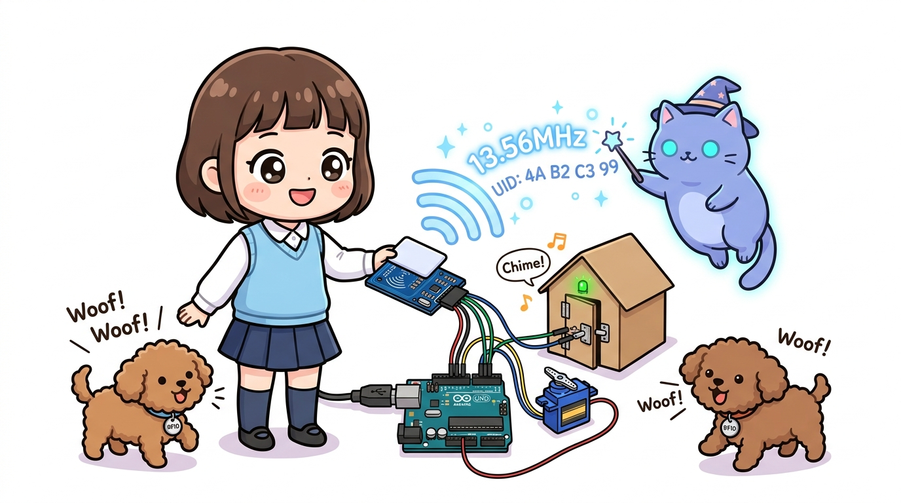

# 154_RFID_RC522_스마트도어락 💳🔐



**도로시와 지니가 함께하는 13.56MHz 무선 전자기 유도 원리, SPI 통신 배선 및 서보모터 스마트 도어락 시스템 구축**

* 👧 **도로시**: "지니야! 아파트 현관문이나 지하철 개찰구에 카드를 '삑-' 하고 갖다 대기만 해도 어떻게 내 카드를 알아채고 문이 열리는 거야?"
* 🐱 **지니**: "그건 바로 **RFID(Radio Frequency Identification)** 무선 식별 기술 덕분이란다! 카드 안에 배터리가 없어도 리더기 안테나가 뿜어내는 13.56MHz 전파 에너지를 흡수하여 자기만의 고유 식별 번호(UID)를 순식간에 아두이노에 보고하거든!"
* 🐶 **토토**: "바우! 토토 목걸이에 등록된 카드 키를 대면 문이 스르륵 열리게 만들어보자 멍!"

* 🖥️ **강의 슬라이드**: [slides.md](./slides.md)

---

## 1. RFID-RC522 모듈의 무선 통신 원리

### 📡 배터리 없는 카드와 13.56MHz 전자기 유도 (NFC 표준)
1. **수동형 태그(Passive Tag)의 비밀**:
   * 플라스틱 카드나 키태그 내부에는 얇은 구리선 안테나 코일과 초소형 IC 칩이 내장되어 있습니다.
   * 별도의 배터리가 전혀 들어있지 않지만, RC522 리더기 가까이 접근하면 전자기 유도(Electromagnetic Induction) 법칙에 의해 안테나에 유도 기전력(전기)이 발생하여 칩이 깨어납니다.
2. **고유 식별 번호 (UID - Unique ID)**:
   * 모든 RFID 카드와 태그는 공장에서 생산될 때 중복되지 않는 고유한 바이트 일련번호(예: `4A B2 C3 99`)를 부여받습니다.
   * 아두이노는 이 UID를 읽어서 "등록된 가족의 카드인가?"를 판단합니다.

---

## 2. RC522 핀 구조와 아두이노 우노 SPI 배선표

> [!WARNING]
> **전원 주의!**  
> RFID-RC522 모듈의 $V_{\text{cc}}$는 **반드시 아두이노의 3.3V 핀에 연결**해야 합니다! 5V를 연결하면 RC522 내부 RF 칩이 영구적으로 손상될 수 있습니다!

| RC522 핀 이름 | 기능 설명 | 아두이노 우노(Uno) 연결 핀 |
| :---: | :--- | :---: |
| **VCC** | 3.3V 전원 입력 (절대 5V 금지!) | **3.3V** |
| **RST** | 모듈 리셋(Reset) 제어선 | **D9** |
| **GND** | 공통 접지 전원선 | **GND** |
| **IRQ** | 인터럽트 요청선 (보통 미사용) | *연결 안 함* |
| **MISO** | SPI 마스터 수신 데이터선 | **D12 (MISO)** |
| **MOSI** | SPI 마스터 송신 데이터선 | **D11 (MOSI)** |
| **SCK** | SPI 공통 동기화 클록선 | **D13 (SCK)** |
| **SDA (SS)** | SPI 슬레이브 선택선(Chip Select) | **D10 (SS)** |

* **스마트 도어락 연동 부품**:
  * **SG90 서보모터**: 신호선 `D6`, VCC `5V`, GND `GND` (도어락 잠금 0도 / 열림 90도)
  * **초록/빨강 LED**: 저항 220Ω과 함께 `D7`(승인 초록), `D8`(거부 빨강) 연결
  * **피에조 부저**: `D5` (승인 멜로디 / 경고 삐빅음)

---

## 3. 실습 예제: 승인된 카드만 문을 열어주는 스마트 도어락

라이브러리 매니저에서 `MFRC522` by GithubCommunity 라이브러리를 설치한 뒤 아래 스케치를 업로드합니다.

```cpp
#include <SPI.h>
#include <MFRC522.h>
#include <Servo.h>

#define SS_PIN 10
#define RST_PIN 9
#define SERVO_PIN 6
#define BUZZER_PIN 5
#define LED_GREEN 7
#define LED_RED 8

MFRC522 rfc(SS_PIN, RST_PIN);
Servo lockServo;

// 등록된 승인 카드 UID (내 카드의 실제 UID 4바이트로 변경하세요)
byte masterCardUID[4] = {0x4A, 0xB2, 0xC3, 0x99};

void setup() {
  Serial.begin(9600);
  SPI.begin();          // SPI 버스 초기화
  rfc.PCD_Init();       // RC522 모듈 초기화
  
  lockServo.attach(SERVO_PIN);
  lockServo.write(0);   // 초기 상태: 문 잠김 (0도)
  
  pinMode(BUZZER_PIN, OUTPUT);
  pinMode(LED_GREEN, OUTPUT);
  pinMode(LED_RED, OUTPUT);
  
  Serial.println("======================================");
  Serial.println("🔐 도로시의 스마트 RFID 도어락 시스템 가동!");
  Serial.println("카드를 리더기 가까이 대어주세요.");
  Serial.println("======================================");
}

void loop() {
  // 새 카드가 감지되지 않았으면 대기
  if (!rfc.PICC_IsNewCardPresent()) {
    return;
  }
  
  // 카드의 일련번호(UID)를 성공적으로 읽지 못했으면 대기
  if (!rfc.PICC_ReadCardSerial()) {
    return;
  }
  
  Serial.print("💳 감지된 카드 UID: ");
  String scannedUID = "";
  bool isAuthorized = true;
  
  for (byte i = 0; i < rfc.uid.size; i++) {
    Serial.print(rfc.uid.uidByte[i] < 0x10 ? " 0" : " ");
    Serial.print(rfc.uid.uidByte[i], HEX);
    
    // 마스터 카드 UID와 1바이트씩 일치 여부 비교
    if (i < 4 && rfc.uid.uidByte[i] != masterCardUID[i]) {
      isAuthorized = false;
    }
  }
  Serial.println();
  
  // 승인 검사 결과 처리
  if (isAuthorized) {
    Serial.println("🔓 [승인 완료] 환영합니다, 도로시님! 문이 열립니다.");
    digitalWrite(LED_GREEN, HIGH);
    tone(BUZZER_PIN, 1047, 150); // 높은 도 (C6)
    delay(180);
    tone(BUZZER_PIN, 1319, 200); // 높은 미 (E6)
    
    lockServo.write(90);         // 서보모터 90도 회전 (문 열림)
    delay(3000);                 // 3초간 열림 유지
    
    lockServo.write(0);          // 자동 다시 잠김 (0도)
    digitalWrite(LED_GREEN, LOW);
    tone(BUZZER_PIN, 523, 300);  // 도 (C5 잠김 알림)
  } else {
    Serial.println("⛔ [출입 거부] 등록되지 않은 미승인 카드입니다!");
    digitalWrite(LED_RED, HIGH);
    tone(BUZZER_PIN, 300, 200);
    delay(250);
    tone(BUZZER_PIN, 300, 200);
    delay(1000);
    digitalWrite(LED_RED, LOW);
  }
  
  // 카드 읽기 세션 종료
  rfc.PICC_HaltA();
  rfc.PCD_StopCrypto1();
  delay(1000);
}
```

---

## 4. 실습 결과 및 시리얼 모니터 확인

```text
======================================
🔐 도로시의 스마트 RFID 도어락 시스템 가동!
카드를 리더기 가까이 대어주세요.
======================================
💳 감지된 카드 UID: 4A B2 C3 99
🔓 [승인 완료] 환영합니다, 도로시님! 문이 열립니다.
💳 감지된 카드 UID: 1F 89 D4 20
⛔ [출입 거부] 등록되지 않은 미승인 카드입니다!
```

---

## 5. 핵심 요약 정리 💡

1. **무선 전자기 유도**: 배터리가 없는 수동형 RFID 카드는 리더기의 13.56MHz 전파로 기전력을 얻어 작동합니다.
2. **전압 레벨 준수**: RC522 모듈의 전원선은 **반드시 3.3V**에 연결해야 고장을 방지할 수 있습니다.
3. **SPI 통신 활용**: 모듈과 아두이노는 MISO(12), MOSI(11), SCK(13), SS(10)의 4개 고속 신호선으로 실시간 패킷을 주고받습니다.
4. **UID 보안 인증**: 고유 4바이트 일련번호를 프로그램 내 마스터 배열과 비교하여 서보모터 잠금장치를 안전하게 자동 제어합니다.
