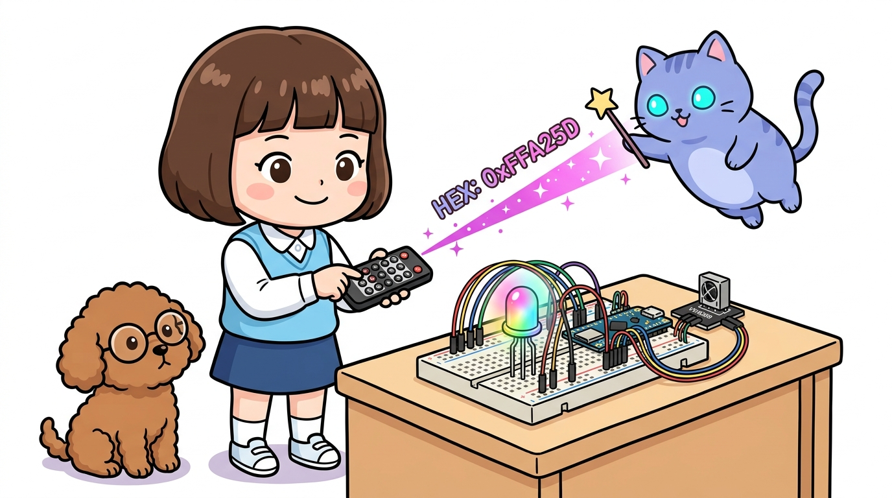
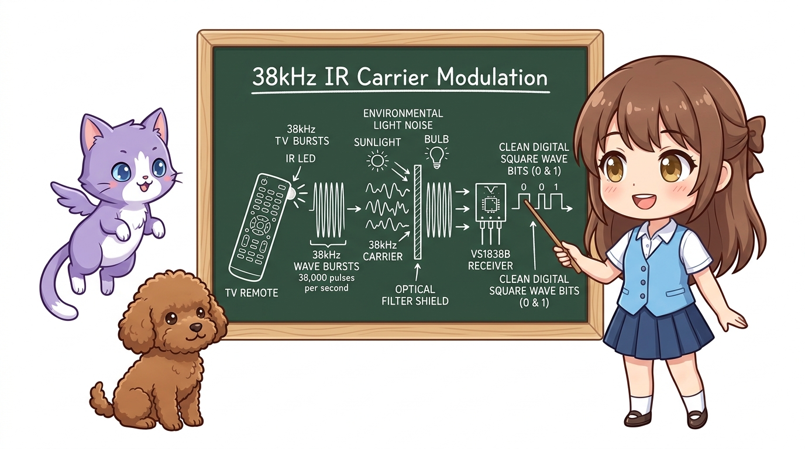
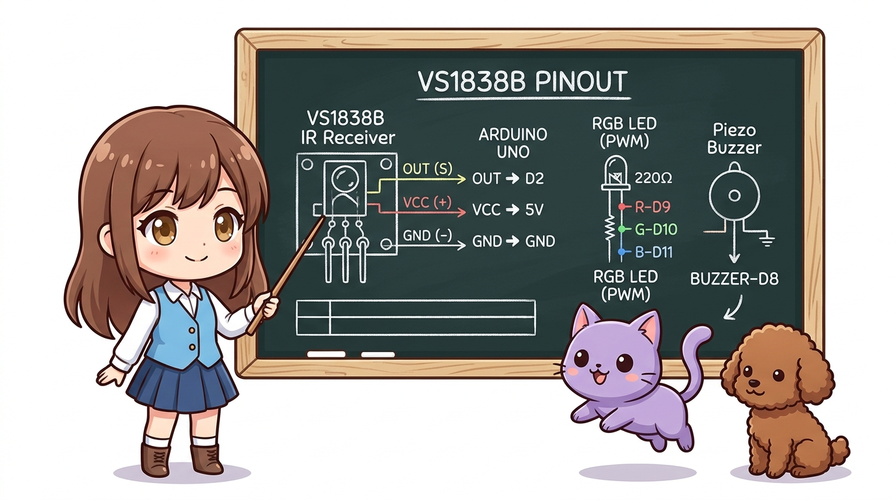
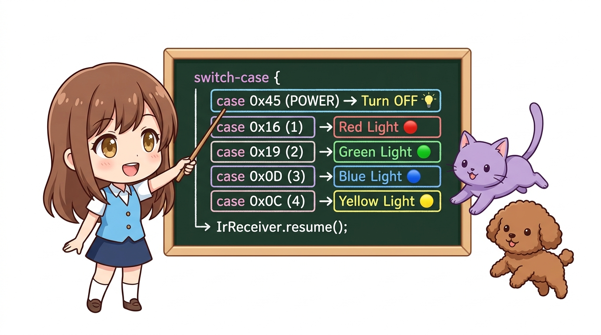
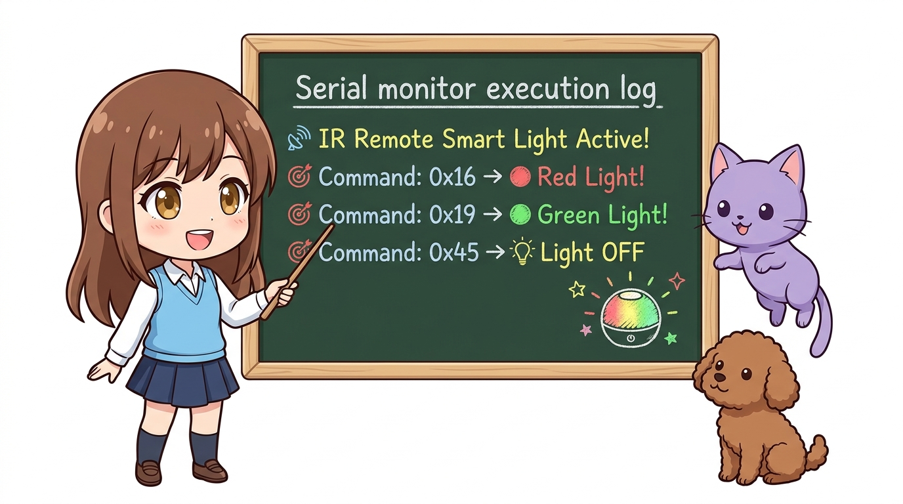

# 155_적외선IR_무선리모컨제어 📺📡



**도로시와 지니가 함께하는 38kHz 반송파 변조 원리, VS1838B 적외선 수신기와 버튼별 16진수(HEX) 신호 디코딩 및 무선 스마트 조명 제작**
* 👧 **도로시**: "지니야! 거실 TV 리모컨의 전원 버튼을 누르면 눈에는 아무런 불빛도 안 보이는데 어떻게 TV가 착 켜지는 거야?"
* 🐱 **지니**: "인간의 눈에는 보이지 않는 붉은색 바깥의 빛, 바로 **적외선(Infrared Rays)** 덕분이란다! 리모컨 앞부분의 IR LED가 초당 38,000번(38kHz) 고속으로 깜빡이면서 1과 0의 비밀 디지털 암호를 공기 중으로 쏘아 보내거든!"
* 🐶 **토토**: "바우! 침대에 누워서 아두이노 무지개 조명을 켜고 끌 수 있는 만능 리모컨을 만들자 멍!"
* 📖 **상세 강의 교재**: [index.md](./index.md)


> 여러분 안녕하세요! 이번 시간에는 '155. 적외선IR 무선리모컨제어 📺📡'을 주제로 함께 흥미진진한 탐험을 떠나보겠습니다. 오늘 강의에서는 특히 도로시와 지니가 함께하는 38kHz 반송파 변조 원리, VS1838B 적외선 수신기와 버튼별 16진수(HEX) 신호 디코딩 및 무선 스마트 조명 제작, 👧 도로시: "지니야! 거실 TV 리모컨의 전원 버튼을 누르면 눈에는 아무런 불빛도 안 보이는데 어떻게 TV가 착 켜지는 거야?"를 중심으로 핵심 원리와 응용 방법을 차근차근 배워보겠습니다. 마법 멘토 지니와 호기심 많은 탐험가 도로시, 그리고 귀여운 토토와 함께 신나는 아두이노 모험을 힘차게 시작해 봅시다. 준비되셨나요?

---
## 1. 적외선(IR) 리모컨 통신의 과학 원리




1. **왜 38kHz로 깜빡이며 보낼까?**:
* 햇빛이나 형광등, 촛불 등 일상생활의 모든 빛 속에는 자연적인 적외선이 가득 차 있습니다.
* 단순히 적외선을 켜기만 하면 주변 빛의 간섭(노이즈) 때문에 센서가 신호를 구분할 수 없습니다.
* 따라서 리모컨은 데이터를 **38kHz 주파수로 빠르게 진동(변조)** 시켜 송신하고, 수신 센서(VS1838B)는 오직 38kHz로 깜빡이는 신호만 쏙 골라내어 복조(디코딩)합니다.
2. **NEC 프로토콜과 16진수(HEX) 명령 코드**:
* 리모컨의 각 버튼(전원, 볼륨, 0~9번 숫자)을 누를 때마다 정해진 비트 길이의 고유 16진수 코드(예: `0xFFA25D`)가 전송됩니다.
* 아두이노는 `IRremote` 라이브러리를 통해 수신된 신호를 즉시 해석하여 원하는 동작을 실행합니다.

### 🔦 38kHz 반송파(Carrier) 변조와 태양광 노이즈 필터링

> 이번 슬라이드에서는 '1. 적외선(IR) 리모컨 통신의 과학 원리'에 대해 자세히 살펴보겠습니다. 첫 번째 핵심은 왜 38kHz로 깜빡이며 보낼까?이며, 두 번째로는 햇빛이나 형광등, 촛불 등 일상생활의 모든 빛 속에는 자연적인 적외선이 가득 차 있습니다.입니다. 여기에 덧붙여 단순히 적외선을 켜기만 하면 주변 빛의 간섭(노이즈) 때문에 센서가 신호를 구분할 수 없습니다. 내용까지 함께 이해해 두시면 완벽합니다. 이 원리는 아두이노 시스템 전체를 관통하는 핵심 논리이므로 머릿속에 꼭 정리해 두시기 바랍니다.
---
## 2. VS1838B 적외선 수신 센서 핀 구조와 배선표




* **무선 제어 액추에이터**:
* **RGB LED**: 공통 음극(Cathode) 기준 `D9`(Red), `D10`(Green), `D11`(Blue)에 220Ω 저항을 직렬 연결
* **피에조 부저**: `D8` (버튼 수신 확인 삑 소리 피드백)

| VS1838B 모듈 핀 | 기능 설명 | 아두이노 우노(Uno) 연결 핀 |
| :---: | :--- | :---: |
| **OUT (S)** | 적외선 수신 디지털 데이터 신호선 | **D2** (또는 D11) |
| **VCC (+)** | 모듈 구동 전원선 (3.3V ~ 5V) | **5V** |
| **GND (-)** | 공통 접지선 | **GND** |

> 이번에 살펴볼 내용은 '2. VS1838B 적외선 수신 센서 핀 구조와 배선표'입니다. 슬라이드에 정리된 표를 통해 각 항목의 특징과 수치, 차이점을 한눈에 비교해 보실 수 있습니다. 첫째로 무선 제어 액추에이터에 유의해야 하며, 둘째로 RGB LED: 공통 음극(Cathode) 기준 D9(Red), D10(Green), D11(Blue)에 220Ω 저항을 직렬 연결라는 점이 핵심입니다. 이 기본 개념을 확실히 잡아두셔야 실제 부품을 브레드보드에 꽂고 코딩할 때 실수 없이 완성할 수 있습니다.
---
## 3. 실습 예제: 리모컨 버튼으로 색상이 바뀌는 스마트 무선 조명




라이브러리 매니저에서 `IRremote` by shirriff (최신 v3/v4 버전) 라이브러리를 설치한 뒤 아래 스케치를 업로드합니다.

```cpp
#include <IRremote.h>

const int IR_RECEIVE_PIN = 2; // VS1838B 신호 핀 연결
const int RED_PIN = 9;
const int GREEN_PIN = 10;
const int BLUE_PIN = 11;
const int BUZZER_PIN = 8;

void setup() {
  Serial.begin(9600);
  
  pinMode(RED_PIN, OUTPUT);
  pinMode(GREEN_PIN, OUTPUT);
  pinMode(BLUE_PIN, OUTPUT);
  pinMode(BUZZER_PIN, OUTPUT);
  
  // 적외선 수신 시작
  IrReceiver.begin(IR_RECEIVE_PIN, ENABLE_LED_FEEDBACK);
  
  Serial.println("==========================================");
  Serial.println("📡 도로시의 무선 적외선(IR) 스마트 조명 수신기 가동!");
  Serial.println("리모컨 버튼을 눌러보세요.");
  Serial.println("==========================================");
}

void setColor(int r, int g, int b) {
  analogWrite(RED_PIN, r);
  analogWrite(GREEN_PIN, g);
  analogWrite(BLUE_PIN, b);
}

void loop() {
  // 리모컨 신호가 도착했는지 확인
  if (IrReceiver.decode()) {
    // 수신된 명령 코드 추출 (IRremote v4 표준)
    unsigned long command = IrReceiver.decodedIRData.command;
    
    // 버튼 수신 비프음 피드백
    tone(BUZZER_PIN, 1500, 50);
    
    Serial.print("🎯 수신된 리모컨 Command: 0x");
    Serial.println(command, HEX);
    
    // 리모컨 버튼별 동작 분기 (제공된 리모컨의 실제 버튼 코드에 맞추어 수정 가능)
    switch (command) {
      case 0x45: // 전원(POWER) 버튼: 소등
        Serial.println("💡 [전원] 조명을 모두 끕니다.");
        setColor(0, 0, 0);
        break;
        
      case 0x16: // 1번 버튼: 빨강
        Serial.println("🔴 [1번] 정열의 레드 조명!");
        setColor(255, 0, 0);
        break;
        
      case 0x19: // 2번 버튼: 초록
        Serial.println("🟢 [2번] 싱그러운 그린 조명!");
        setColor(0, 255, 0);
        break;
        
      case 0x0D: // 3번 버튼: 파랑
        Serial.println("🔵 [3번] 시원한 블루 조명!");
        setColor(0, 0, 255);
        break;
        
      case 0x0C: // 4번 버튼: 노랑 (Red + Green)
        Serial.println("🟡 [4번] 따스한 옐로우 조명!");
        setColor(255, 255, 0);
        break;
        
      case 0x18: // 5번 버튼: 무지개 화이트 (R+G+B)
        Serial.println("⚪ [5번] 화사한 화이트 조명!");
        setColor(255, 255, 255);
        break;
        
      default:
        Serial.println("❓ 기타 버튼이 눌렸습니다.");
        break;
    }
    
    // 다음 신호를 받을 수 있도록 수신기 버퍼 리셋
    IrReceiver.resume();
  }
}
```

> 이번 슬라이드에서는 '3. 실습 예제: 리모컨 버튼으로 색상이 바뀌는 스마트 무선 조명'에 대한 실제 동작 코드를 분석해 보겠습니다. 화면의 코드를 살펴보시면, 컴퓨터가 아두이노 하드웨어에 단계별로 명령을 내리는 흐름을 명확하게 확인할 수 있습니다. 각 함수의 역할과 괄호 안의 매개변수가 하드웨어 핀과 어떤 관계를 맺고 동작하는지 주의 깊게 살펴보시기 바랍니다.
---
## 4. 실습 결과 및 시리얼 모니터 확인




```text
==========================================
📡 도로시의 무선 적외선(IR) 스마트 조명 수신기 가동!
리모컨 버튼을 눌러보세요.
==========================================
🎯 수신된 리모컨 Command: 0x16
🔴 [1번] 정열의 레드 조명!
🎯 수신된 리모컨 Command: 0x19
🟢 [2번] 싱그러운 그린 조명!
🎯 수신된 리모컨 Command: 0x45
💡 [전원] 조명을 모두 끕니다.
```

> 이번 슬라이드에서는 '4. 실습 결과 및 시리얼 모니터 확인'에 대한 실제 동작 코드를 분석해 보겠습니다. 화면의 코드를 살펴보시면, 컴퓨터가 아두이노 하드웨어에 단계별로 명령을 내리는 흐름을 명확하게 확인할 수 있습니다. 각 함수의 역할과 괄호 안의 매개변수가 하드웨어 핀과 어떤 관계를 맺고 동작하는지 주의 깊게 살펴보시기 바랍니다.
---
## 5. 핵심 요약 정리 💡


1. **적외선 파장(940nm)**: 가시광선보다 파장이 긴 비가시광선으로 장애물이 없을 때 수 미터 이상 무선 전송이 가능합니다.
2. **38kHz 캐리어 변조**: 자연광 노이즈를 피하기 위해 고속 점멸 변조를 사용하며, VS1838B 수신기가 이를 정밀 복원합니다.
3. **디코딩 프로토콜**: 송신된 펄스 간격을 마이크로초 단위로 해석하여 16진수 명령 코드로 추출합니다.
4. **리모컨 가전 제어**: TV, 에어컨 등 가정 내 기존 리모컨 신호도 동일한 방식으로 아두이노가 읽어내어 스마트홈 허브를 구축할 수 있습니다.

> 오늘 배운 '5. 핵심 요약 정리 💡'의 핵심 내용을 모두 정리해 보았습니다. 오늘 다룬 내용 중에서도 적외선 파장(940nm): 가시광선보다 파장이 긴 비가시광선으로 장애물이 없을 때 수 미터 이상 무선 전송이 가능합니다. 부분은 앞으로의 아두이노 실습과 프로젝트에서 계속 사용되는 매우 중요한 기초 지식입니다. 오늘 배운 내용을 꼭 다시 한번 복습해 보시고, 다음 강의에서 더욱 신나고 유익한 모험으로 다시 만나겠습니다. 모두 수고 많으셨습니다!