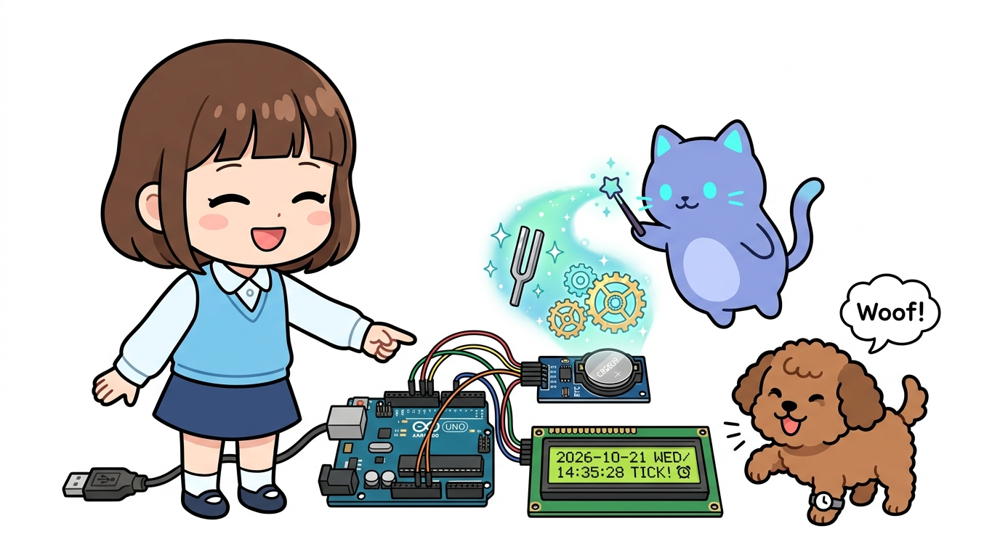
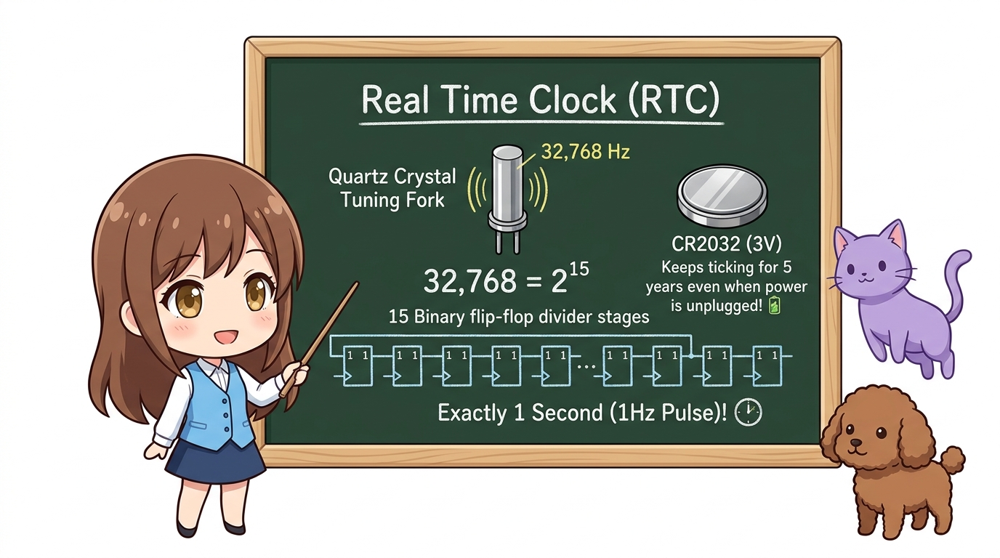
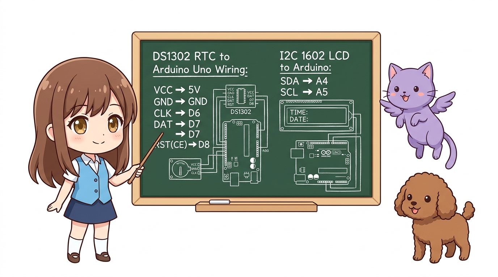
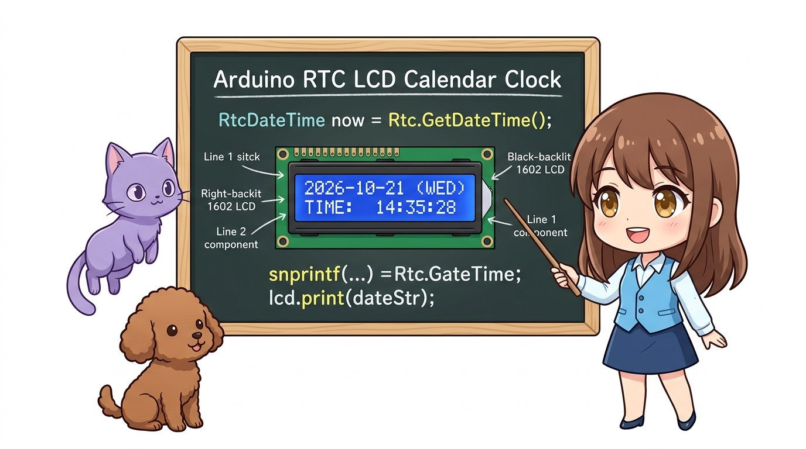
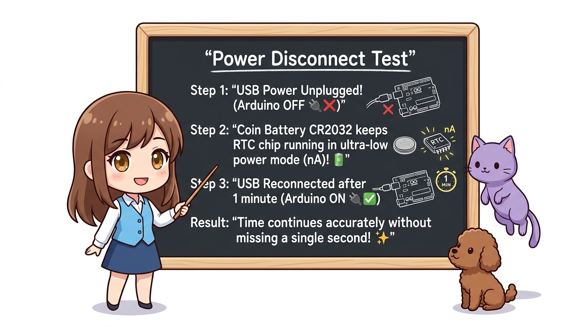

# 156_RTC_DS1302_실시간시계 ⏰🔋



**도로시와 지니가 함께하는 32.768kHz 수정 발진자 원리, CR2032 백업 배터리 및 I2C 1602 LCD 디지털 만년 달력 시계 제작**
* 👧 **도로시**: "지니야! 우리가 아두이노에서 `millis()` 함수로 시간을 재면, USB 전원을 뺐다가 다시 꽂았을 때 0초로 홀라당 리셋되어 버리잖아! 전원을 꺼도 스마트폰처럼 진짜 현재 시각(년, 월, 일, 시, 분, 초)을 계속 기억하게 할 수는 없을까?"
* 🐱 **지니**: "그 고민을 한 방에 해결해 주는 구원투수가 바로 **RTC(Real Time Clock - 실시간 시계)** 모듈이란다! 동전 모양의 CR2032 백업 배터리가 붙어 있어서 전원이 꺼져도 몇 년 동안 오차 없이 째깍째깍 현재 시각을 지켜주거든!"
* 🐶 **토토**: "바우! 정해진 시간(예: 아침 7시)이 되면 자동으로 밥을 주는 스마트 자동 급식기를 만들자 멍!"
* 📖 **상세 강의 교재**: [index.md](./index.md)


> 여러분 안녕하세요! 이번 시간에는 '156. RTC DS1302 실시간시계 ⏰🔋'을 주제로 함께 흥미진진한 탐험을 떠나보겠습니다. 오늘 강의에서는 특히 도로시와 지니가 함께하는 32.768kHz 수정 발진자 원리, CR2032 백업 배터리 및 I2C 1602 LCD 디지털 만년 달력 시계 제작, 👧 도로시: "지니야! 우리가 아두이노에서 millis() 함수로 시간을 재면, USB 전원을 뺐다가 다시 꽂았을 때 0초로 홀라당 리셋되어 버리잖아! 전원을 꺼도 스마트폰처럼 진짜 현재 시각(년, 월, 일, 시, 분, 초)을 계속 기억하게 할 수는 없을까?"를 중심으로 핵심 원리와 응용 방법을 차근차근 배워보겠습니다. 마법 멘토 지니와 호기심 많은 탐험가 도로시, 그리고 귀여운 토토와 함께 신나는 아두이노 모험을 힘차게 시작해 봅시다. 준비되셨나요?

---
## 1. RTC(Real Time Clock)의 동작 원리




1. **왜 하필 32,768Hz(32.768kHz)일까?**:
* 시계 내부에는 초소형 쿼츠(수정) 소리굽쇠 진동자가 들어 있습니다.
* $32,768 = 2^{15}$ 입니다!
* 즉, 디지털 2진 플립플롭 카운터 회로를 15번 연속으로 거치면 32,768번의 진동이 정확히 **1초(1Hz)** 의 펄스로 변환됩니다.
2. **백업 코인 배터리(CR2032)의 저전력 기적**:
* 아두이노 본체 전원이 끊어지면 RTC 칩 내부 회로가 즉시 초저전력 모드(나노암페어 $nA$ 단위 소비)로 전환되어 배터리 전원으로만 시간을 카운트합니다.
* 이 덕분에 배터리 하나로 3년~5년 동안 멈추지 않고 동작합니다.

### ⏱️ 32.768kHz 쿼츠 수정 발진자와 $2^{15}$의 수학적 비밀

> 이번 슬라이드에서는 '1. RTC(Real Time Clock)의 동작 원리'에 대해 자세히 살펴보겠습니다. 첫 번째 핵심은 왜 하필 32,768Hz(32.768kHz)일까?이며, 두 번째로는 시계 내부에는 초소형 쿼츠(수정) 소리굽쇠 진동자가 들어 있습니다.입니다. 여기에 덧붙여 $32,768 = 2^{15}$ 입니다! 내용까지 함께 이해해 두시면 완벽합니다. 이 원리는 아두이노 시스템 전체를 관통하는 핵심 논리이므로 머릿속에 꼭 정리해 두시기 바랍니다.
---
## 2. DS1302 핀 구조와 아두이노 배선표




* **실시간 시계 대시보드 디스플레이 (I2C 1602 LCD)**:
* `GND` ➔ GND
* `VCC` ➔ 5V
* `SDA` ➔ **A4** (I2C 데이터)
* `SCL` ➔ **A5** (I2C 클록)

| DS1302 핀 | 기능 설명 | 아두이노 우노(Uno) 연결 핀 |
| :---: | :--- | :---: |
| **VCC** | 주전원 공급선 (2.0V ~ 5.5V) | **5V** |
| **GND** | 공통 접지선 | **GND** |
| **CLK (SCLK)** | 직렬 클록 동기화 신호선 | **D6** |
| **DAT (I/O)** | 양방향 데이터 입출력선 | **D7** |
| **RST (CE)** | 칩 활성화(Chip Enable) 제어선 | **D8** |

> 이번에 살펴볼 내용은 '2. DS1302 핀 구조와 아두이노 배선표'입니다. 슬라이드에 정리된 표를 통해 각 항목의 특징과 수치, 차이점을 한눈에 비교해 보실 수 있습니다. 첫째로 실시간 시계 대시보드 디스플레이 (I2C 1602 LCD)에 유의해야 하며, 둘째로 GND ➔ GND라는 점이 핵심입니다. 이 기본 개념을 확실히 잡아두셔야 실제 부품을 브레드보드에 꽂고 코딩할 때 실수 없이 완성할 수 있습니다.
---
## 3. 실습 예제: I2C LCD에 띄우는 실시간 디지털 만년 달력 시계




라이브러리 매니저에서 `Rtc by Makuna` 라이브러리와 `LiquidCrystal_I2C`를 설치한 뒤 아래 스케치를 업로드합니다.

```cpp
#include <ThreeWire.h>
#include <RtcDS1302.h>
#include <Wire.h>
#include <LiquidCrystal_I2C.h>

// DS1302 핀 매핑: DAT(7), CLK(6), RST(8)
ThreeWire myWire(7, 6, 8);
RtcDS1302<ThreeWire> Rtc(myWire);

// I2C 1602 LCD (주소: 0x27 또는 0x3F)
LiquidCrystal_I2C lcd(0x27, 16, 2);

void setup() {
  Serial.begin(9600);
  
  lcd.init();
  lcd.backlight();
  lcd.clear();
  lcd.setCursor(0, 0);
  lcd.print("RTC Clock Start!");
  delay(1000);
  
  Rtc.Begin();
  
  // 컴파일 시점의 PC 컴퓨터 현재 시각으로 자동 1회 설정
  RtcDateTime compiled = RtcDateTime(__DATE__, __TIME__);
  
  if (!Rtc.IsDateTimeValid()) {
    Serial.println("⚠️ RTC 배터리가 방전되었거나 시간이 설정되지 않았습니다. 현재 시간으로 초기화합니다.");
    Rtc.SetDateTime(compiled);
  }
  
  if (Rtc.GetIsWriteProtected()) {
    Rtc.SetIsWriteProtected(false); // 쓰기 보호 해제
  }
  
  if (!Rtc.GetIsRunning()) {
    Rtc.SetIsRunning(true);         // 시계 카운터 가동
  }
  
  RtcDateTime now = Rtc.GetDateTime();
  if (now < compiled) {
    Serial.println("⏳ RTC 시간이 이전 시간이므로 컴파일 시간으로 업데이트합니다.");
    Rtc.SetDateTime(compiled);
  }
}

void loop() {
  RtcDateTime now = Rtc.GetDateTime();
  
  // 1행: 년-월-일 (YYYY-MM-DD)
  char dateStr[17];
  snprintf(dateStr, sizeof(dateStr), "%04d-%02d-%02d (%s)",
           now.Year(), now.Month(), now.Day(),
           getDayOfWeek(now.DayOfWeek()));
           
  // 2행: 시:분:초 (HH:MM:SS)
  char timeStr[17];
  snprintf(timeStr, sizeof(timeStr), "TIME:  %02d:%02d:%02d",
           now.Hour(), now.Minute(), now.Second());
           
  // LCD 화면 갱신
  lcd.setCursor(0, 0);
  lcd.print(dateStr);
  lcd.setCursor(0, 1);
  lcd.print(timeStr);
  
  // 시리얼 모니터 실시간 출력
  Serial.print(dateStr);
  Serial.print(" ");
  Serial.println(timeStr);
  
  delay(1000); // 1초마다 갱신
}

const char* getDayOfWeek(uint8_t dayOfWeek) {
  switch (dayOfWeek) {
    case 0: return "SUN";
    case 1: return "MON";
    case 2: return "TUE";
    case 3: return "WED";
    case 4: return "THU";
    case 5: return "FRI";
    case 6: return "SAT";
    default: return "???";
  }
}
```

> 이번 슬라이드에서는 '3. 실습 예제: I2C LCD에 띄우는 실시간 디지털 만년 달력 시계'에 대한 실제 동작 코드를 분석해 보겠습니다. 화면의 코드를 살펴보시면, 컴퓨터가 아두이노 하드웨어에 단계별로 명령을 내리는 흐름을 명확하게 확인할 수 있습니다. 각 함수의 역할과 괄호 안의 매개변수가 하드웨어 핀과 어떤 관계를 맺고 동작하는지 주의 깊게 살펴보시기 바랍니다.
---
## 4. 실습 결과 및 시리얼 모니터 확인




* **⚡ 전원 차단 테스트**:
* USB 케이블을 컴퓨터에서 뽑고 1분이 지난 뒤 다시 꽂아보세요!
* 아두이노가 꺼져 있던 1분 동안에도 RTC가 시간을 정확히 세고 있어, 다시 연결하자마자 1분이 흐른 최신 시각이 즉시 표시됩니다!

```text
2026-10-21 (WED) TIME:  14:35:28
2026-10-21 (WED) TIME:  14:35:29
2026-10-21 (WED) TIME:  14:35:30
```

> 이번 슬라이드에서는 '4. 실습 결과 및 시리얼 모니터 확인'에 대한 실제 동작 코드를 분석해 보겠습니다. 화면의 코드를 살펴보시면, 컴퓨터가 아두이노 하드웨어에 단계별로 명령을 내리는 흐름을 명확하게 확인할 수 있습니다. 각 함수의 역할과 괄호 안의 매개변수가 하드웨어 핀과 어떤 관계를 맺고 동작하는지 주의 깊게 살펴보시기 바랍니다.
---
## 5. 핵심 요약 정리 💡


1. **`millis()`와의 차이**: 아두이노 리셋 시 초기화되는 소프트웨어 타이머와 달리, RTC는 독립적인 하드웨어 카운터로 작동합니다.
2. **$2^{15}$ 수정 분주기**: 32.768kHz 쿼츠 진동자를 15단 플립플롭으로 나누어 완벽한 1초를 만들어냅니다.
3. **만년 달력 내장**: 윤년(Leap Year), 28/30/31일 등 각 월의 날짜와 요일까지 모듈 자체 캘린더 알고리즘으로 자동 계산됩니다.
4. **IoT 스케줄러 응용**: 특정 시간대 조명 켜기, 화분 물주기, 스마트 알람시계 등 실시간 이벤트 제어의 핵심 부품입니다.

> 오늘 배운 '5. 핵심 요약 정리 💡'의 핵심 내용을 모두 정리해 보았습니다. 오늘 다룬 내용 중에서도 millis()와의 차이: 아두이노 리셋 시 초기화되는 소프트웨어 타이머와 달리, RTC는 독립적인 하드웨어 카운터로 작동합니다. 부분은 앞으로의 아두이노 실습과 프로젝트에서 계속 사용되는 매우 중요한 기초 지식입니다. 오늘 배운 내용을 꼭 다시 한번 복습해 보시고, 다음 강의에서 더욱 신나고 유익한 모험으로 다시 만나겠습니다. 모두 수고 많으셨습니다!