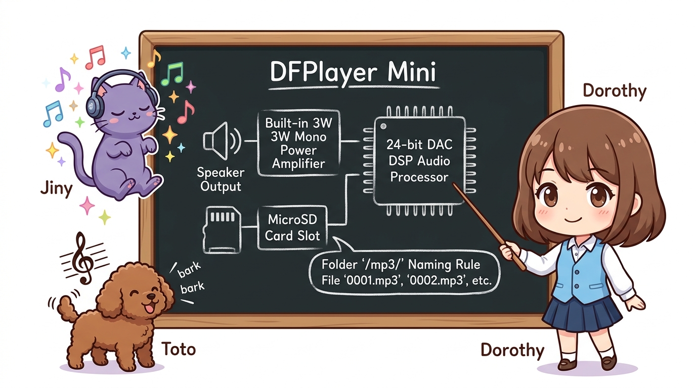
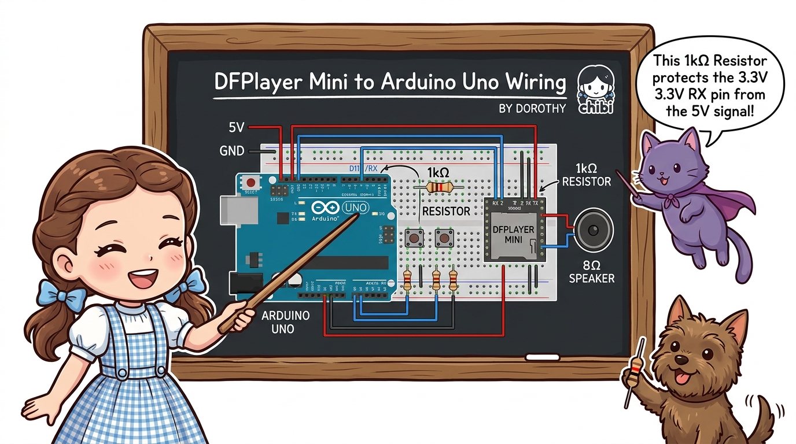
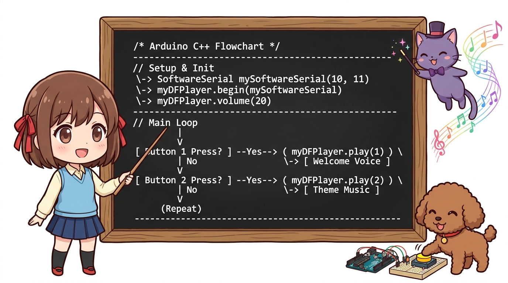

# 158_DFPlayer_MP3음원재생기 🎵🔊


**도로시와 지니가 함께하는 하드웨어 오디오 디코더, SoftwareSerial UART 통신, MicroSD 음원 트리거 및 스마트 음성 안내 스피커 제작**
* 👧 **도로시**: "지니야! 피에조 부저로 '삐- 삐-' 단조로운 기계음만 내는 건 이제 심심해! 진짜 사람 목소리로 '문이 열렸습니다~' 하거나 신나는 최신 가요 MP3 음악을 스피커로 빵빵하게 틀 수 있을까?"
* 🐱 **지니**: "당연하지! 손톱만 한 크기지만 내부에 강력한 DAC 오디오 디코더와 3W 앰프를 품고 있는 **DFPlayer Mini MP3 모듈**이 있단다! 아두이노가 시리얼 명령으로 '1번 트랙 재생해!'라고 한 줄만 보내면 고음질 음악이 즉시 뿜어져 나와!"
* 🐶 **토토**: "바우! 도둑이 들어오면 '멈춰라 멍멍!' 하고 무서운 경고 방송을 내보내자 멍!"
* 📖 **상세 강의 교재**: [index.md](./index.md)


> 여러분 안녕하세요! 이번 시간에는 '158. DFPlayer MP3음원재생기 🎵🔊'을 주제로 함께 흥미진진한 탐험을 떠나보겠습니다. 오늘 강의에서는 특히 도로시와 지니가 함께하는 하드웨어 오디오 디코더, SoftwareSerial UART 통신, MicroSD 음원 트리거 및 스마트 음성 안내 스피커 제작, 👧 도로시: "지니야! 피에조 부저로 '삐- 삐-' 단조로운 기계음만 내는 건 이제 심심해! 진짜 사람 목소리로 '문이 열렸습니다~' 하거나 신나는 최신 가요 MP3 음악을 스피커로 빵빵하게 틀 수 있을까?"를 중심으로 핵심 원리와 응용 방법을 차근차근 배워보겠습니다. 마법 멘토 지니와 호기심 많은 탐험가 도로시, 그리고 귀여운 토토와 함께 신나는 아두이노 모험을 힘차게 시작해 봅시다. 준비되셨나요?

---
## 1. DFPlayer Mini 모듈의 오디오 하드웨어 구조




1. **자체 오디오 하드웨어 내장**:
* 아두이노는 연산 속도와 RAM 용량이 작아 복잡한 MP3 압축 파일을 스스로 풀지 못합니다.
* DFPlayer Mini 모듈은 자체 DSP 칩을 통해 MP3, WAV, WMA 파일을 하드웨어적으로 직접 해제하고, 모듈에 내장된 3W 모노 파워 앰프를 통해 8Ω 스피커를 별도 증폭기 없이 직접 울려줍니다.
2. **MicroSD 카드 폴더 구조 (규칙 필수!)**:
* 음원 파일은 MicroSD 카드 루트(최상위)에 **`mp3`** 라는 이름의 폴더를 만들고, 그 안에 `0001.mp3`, `0002.mp3`, `0003.mp3`처럼 **4자리 숫자**로 이름을 저장해야 안정적으로 재생됩니다.
3. **시리얼 통신 제어**:
* 아두이노의 `SoftwareSerial` 핀 2개(TX, RX)로 연결하여 볼륨 조절(`volume(20)`), 특정 트랙 재생(`play(1)`), 일시정지, 다음 곡 넘김을 자유자재로 지시합니다.

### 🎵 24비트 DAC, 3W 앰프 내장과 UART 시리얼 제어

> 이번 슬라이드에서는 '1. DFPlayer Mini 모듈의 오디오 하드웨어 구조'에 대해 자세히 살펴보겠습니다. 첫 번째 핵심은 자체 오디오 하드웨어 내장이며, 두 번째로는 아두이노는 연산 속도와 RAM 용량이 작아 복잡한 MP3 압축 파일을 스스로 풀지 못합니다.입니다. 여기에 덧붙여 DFPlayer Mini 모듈은 자체 DSP 칩을 통해 MP3, WAV, WMA 파일을 하드웨어적으로 직접 해제하고, 모듈에 내장된 3W 모노 파워 앰프를 통해 8Ω 스피커를 별도 증폭기 없이 직접 울려줍니다. 내용까지 함께 이해해 두시면 완벽합니다. 이 원리는 아두이노 시스템 전체를 관통하는 핵심 논리이므로 머릿속에 꼭 정리해 두시기 바랍니다.
---
## 2. DFPlayer Mini 핀 구조와 아두이노 배선표




* [!IMPORTANT]
* **직렬 저항(1kΩ) 필수!**
* 아두이노의 디지털 출력은 5V 로직이지만, DFPlayer의 RX 핀은 3.3V 전압을 선호합니다.
* 따라서 **아두이노 TX(D11) ➔ DFPlayer RX(2번 핀)** 사이에 **1kΩ 저항**을 반드시 직렬로 연결해 주어야 노이즈 없이 깨끗한 소리가 나옵니다!

* **인터랙티브 푸시버튼**:
* 버튼 1 (환영 음성 재생): `D2` ➔ 택트 스위치 ➔ GND (내부 풀업)
* 버튼 2 (신나는 음악 재생): `D3` ➔ 택트 스위치 ➔ GND (내부 풀업)

| DFPlayer 핀 번호 및 이름 | 기능 설명 | 아두이노 우노(Uno) / 부품 연결 |
| :---: | :--- | :---: |
| **1. VCC** | 3.2V ~ 5.0V 전원 입력 (5V 권장) | **5V** |
| **2. RX** | 시리얼 데이터 수신선 | **1kΩ 저항 거쳐 아두이노 D11(TX)** |
| **3. TX** | 시리얼 데이터 송신선 | **아두이노 D10(RX)** 직결 |
| **7. GND** | 공통 접지선 | **GND** |
| **6. SPK_1** | 8Ω 스피커 양극(+) 연결 | **스피커 빨간 선 (+)** |
| **8. SPK_2** | 8Ω 스피커 음극(-) 연결 | **스피커 검은 선 (-)** |
| **16. BUSY** | 재생 중 LOW(0V) 출력 표시 핀 | *선택 사항 (재생 상태 감지용)* |

> 이번에 살펴볼 내용은 '2. DFPlayer Mini 핀 구조와 아두이노 배선표'입니다. 슬라이드에 정리된 표를 통해 각 항목의 특징과 수치, 차이점을 한눈에 비교해 보실 수 있습니다. 첫째로 인터랙티브 푸시버튼에 유의해야 하며, 둘째로 버튼 1 (환영 음성 재생): D2 ➔ 택트 스위치 ➔ GND (내부 풀업)라는 점이 핵심입니다. 이 기본 개념을 확실히 잡아두셔야 실제 부품을 브레드보드에 꽂고 코딩할 때 실수 없이 완성할 수 있습니다.
---
## 3. 실습 예제: 버튼을 누르면 말하고 노래하는 스마트 오디오 스테이션




라이브러리 매니저에서 `DFRobotDFPlayerMini` 라이브러리를 설치한 뒤 아래 스케치를 업로드합니다.

```cpp
#include <SoftwareSerial.h>
#include <DFRobotDFPlayerMini.h>

// SoftwareSerial 통신 핀: 아두이노 RX(10), TX(11)
SoftwareSerial mySoftwareSerial(10, 11);
DFRobotDFPlayerMini myDFPlayer;

const int BTN_VOICE = 2; // 1번 트랙(안내 음성) 버튼
const int BTN_MUSIC = 3; // 2번 트랙(음악) 버튼

void setup() {
  pinMode(BTN_VOICE, INPUT_PULLUP);
  pinMode(BTN_MUSIC, INPUT_PULLUP);
  
  // PC 디버깅 시리얼
  Serial.begin(9600);
  // DFPlayer 모듈 통신 시리얼 (9600 bps 고정)
  mySoftwareSerial.begin(9600);
  
  Serial.println("==========================================");
  Serial.println("📻 도로시의 DFPlayer Mini 스마트 오디오 가동!");
  Serial.println("모듈 통신을 초기화합니다...");
  
  if (!myDFPlayer.begin(mySoftwareSerial)) {
    Serial.println("❌ DFPlayer 초기화 실패! MicroSD 카드가 꽂혀 있는지, 배선과 1k저항을 확인하세요.");
    while (true);
  }
  
  Serial.println("✅ DFPlayer 온라인 준비 완료!");
  
  // 볼륨 설정 (0 ~ 30 범위, 15~20 추천)
  myDFPlayer.volume(20);
  
  // 시작 알림 1회 재생 (0001.mp3)
  Serial.println("📢 0001.mp3 시작 멘트를 재생합니다.");
  myDFPlayer.play(1);
}

void loop() {
  // 1번 버튼 클릭: 환영 음성 재생 (0001.mp3)
  if (digitalRead(BTN_VOICE) == LOW) {
    delay(50); // 디바운스
    if (digitalRead(BTN_VOICE) == LOW) {
      Serial.println("🎙️ [버튼 1] 환영 안내 음성을 재생합니다 (0001.mp3)");
      myDFPlayer.play(1);
      while (digitalRead(BTN_VOICE) == LOW); // 뗄 때까지 대기
    }
  }
  
  // 2번 버튼 클릭: 신나는 음악 재생 (0002.mp3)
  if (digitalRead(BTN_MUSIC) == LOW) {
    delay(50); // 디바운스
    if (digitalRead(BTN_MUSIC) == LOW) {
      Serial.println("🎵 [버튼 2] 신나는 테마곡을 재생합니다 (0002.mp3)");
      myDFPlayer.play(2);
      while (digitalRead(BTN_MUSIC) == LOW); // 뗄 때까지 대기
    }
  }
}
```

> 이번 슬라이드에서는 '3. 실습 예제: 버튼을 누르면 말하고 노래하는 스마트 오디오 스테이션'에 대한 실제 동작 코드를 분석해 보겠습니다. 화면의 코드를 살펴보시면, 컴퓨터가 아두이노 하드웨어에 단계별로 명령을 내리는 흐름을 명확하게 확인할 수 있습니다. 각 함수의 역할과 괄호 안의 매개변수가 하드웨어 핀과 어떤 관계를 맺고 동작하는지 주의 깊게 살펴보시기 바랍니다.
---
## 4. 실습 결과 및 시리얼 모니터 확인


스피커에서 지직거리는 잡음 없이 맑고 풍부한 음질로 녹음된 실제 사람 음성과 입체적인 배경 음악이 흘러나옵니다!

```text
==========================================
📻 도로시의 DFPlayer Mini 스마트 오디오 가동!
모듈 통신을 초기화합니다...
✅ DFPlayer 온라인 준비 완료!
📢 0001.mp3 시작 멘트를 재생합니다.
🎙️ [버튼 1] 환영 안내 음성을 재생합니다 (0001.mp3)
🎵 [버튼 2] 신나는 테마곡을 재생합니다 (0002.mp3)
```

> 이번 슬라이드에서는 '4. 실습 결과 및 시리얼 모니터 확인'에 대한 실제 동작 코드를 분석해 보겠습니다. 화면의 코드를 살펴보시면, 컴퓨터가 아두이노 하드웨어에 단계별로 명령을 내리는 흐름을 명확하게 확인할 수 있습니다. 각 함수의 역할과 괄호 안의 매개변수가 하드웨어 핀과 어떤 관계를 맺고 동작하는지 주의 깊게 살펴보시기 바랍니다.
---
## 5. 핵심 요약 정리 💡


1. **외장 하드웨어 오디오 코덱**: 아두이노 MCU의 처리 부담 없이 완벽한 MP3/WAV 고품질 오디오를 독립적으로 실시간 재생합니다.
2. **RX 핀 1kΩ 저항 보호**: 5V TTL 시리얼 신호 레벨을 3.3V 규격에 맞추어 강하해 줌으로써 오디오 노이즈와 모듈 손상을 막아줍니다.
3. **`mp3` 폴더와 4자리 숫자 규칙**: `/mp3/0001.mp3`, `/mp3/0002.mp3` 파일 명명 규칙을 준수해야 정확한 인덱스 번호로 즉시 호출할 수 있습니다.
4. **인터랙티브 음성 사운드 프로젝트**: RFID 도어락과 결합하여 "카드가 승인되었습니다", 가스 감지 센서와 결합하여 "화재 대피 경보!" 등 실전 메이커 작품의 완성도를 극대화합니다.

> 오늘 배운 '5. 핵심 요약 정리 💡'의 핵심 내용을 모두 정리해 보았습니다. 오늘 다룬 내용 중에서도 외장 하드웨어 오디오 코덱: 아두이노 MCU의 처리 부담 없이 완벽한 MP3/WAV 고품질 오디오를 독립적으로 실시간 재생합니다. 부분은 앞으로의 아두이노 실습과 프로젝트에서 계속 사용되는 매우 중요한 기초 지식입니다. 오늘 배운 내용을 꼭 다시 한번 복습해 보시고, 다음 강의에서 더욱 신나고 유익한 모험으로 다시 만나겠습니다. 모두 수고 많으셨습니다!