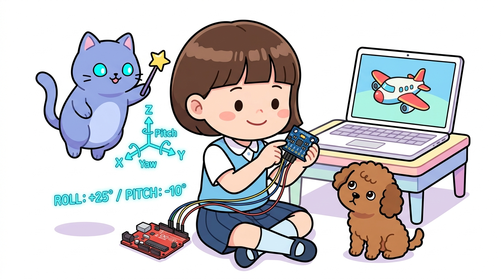
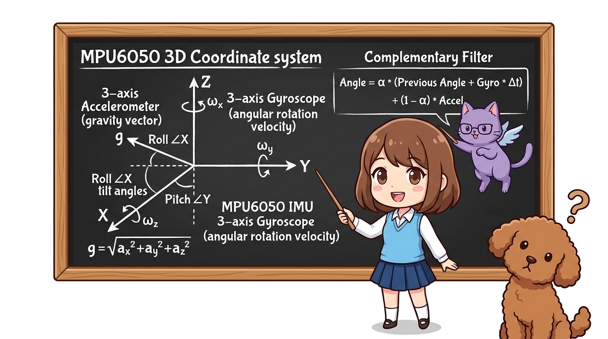
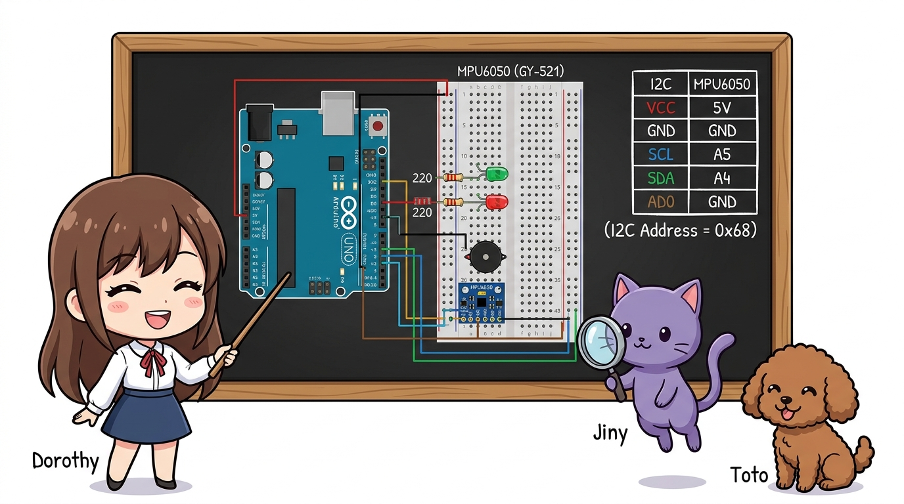
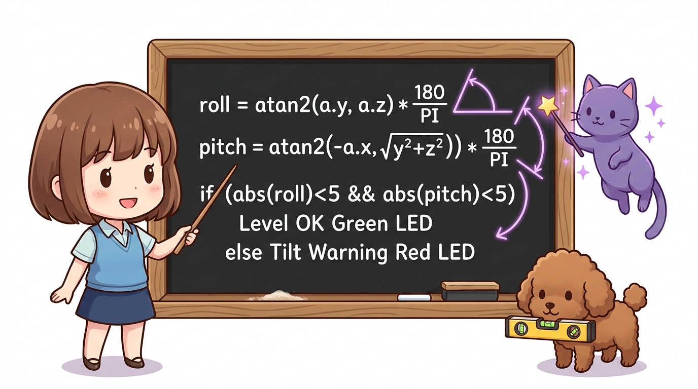
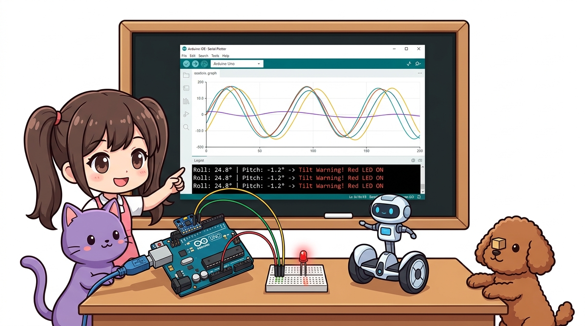

# 159_MPU6050_6축자이로가속도 🧭📐



**도로시와 지니가 함께하는 MEMS 관성 측정 장치(IMU), I2C 인터페이스, Roll & Pitch 각도 계산 및 디지털 수평계 제작**
* 👧 **도로시**: "지니야! 하늘을 나는 드론이나 2바퀴로 넘어지지 않고 서 있는 세그웨이 로봇은 자기가 얼마나 기울어졌는지 어떻게 귀신같이 알고 균형을 잡아?"
* 🐱 **지니**: "인간의 귓속에 있는 반고리관과 전정기관처럼 3차원 공간에서 움직임과 기울기를 측정하는 **MPU6050 6축 관성 센서(IMU)** 덕분이란다! 중력 가속도 3축과 회전하는 각속도 3축을 동시에 초당 수백 번씩 측정해 주거든!"
* 🐶 **토토**: "바우! 상자가 기울어지면 '기울어짐 주의!' 알림을 띄우는 디지털 스마트 수평계를 만들어보자 멍!"
* 📖 **상세 강의 교재**: [index.md](./index.md)


> 여러분 안녕하세요! 이번 시간에는 '159. MPU6050 6축자이로가속도 🧭📐'을 주제로 함께 흥미진진한 탐험을 떠나보겠습니다. 오늘 강의에서는 특히 도로시와 지니가 함께하는 MEMS 관성 측정 장치(IMU), I2C 인터페이스, Roll & Pitch 각도 계산 및 디지털 수평계 제작, 👧 도로시: "지니야! 하늘을 나는 드론이나 2바퀴로 넘어지지 않고 서 있는 세그웨이 로봇은 자기가 얼마나 기울어졌는지 어떻게 귀신같이 알고 균형을 잡아?"를 중심으로 핵심 원리와 응용 방법을 차근차근 배워보겠습니다. 마법 멘토 지니와 호기심 많은 탐험가 도로시, 그리고 귀여운 토토와 함께 신나는 아두이노 모험을 힘차게 시작해 봅시다. 준비되셨나요?

---
## 1. MPU6050 6축 IMU의 물리 센싱 원리




1. **3축 가속도계 (X, Y, Z)**:
* 정지해 있을 때 지구 중심을 향하는 **중력 가속도($1g \approx 9.8\text{m/s}^2$)** 벡터의 방향을 측정합니다.
* 삼각함수($\text{atan2}$) 공식을 이용해 센서가 좌우로 기운 각도(**Roll**)와 앞뒤로 숙인 각도(**Pitch**)를 정적으로 정확히 계산할 수 있습니다.
2. **3축 자이로스코프 (X, Y, Z 각속도)**:
* 회전할 때 발생하는 **각속도($^\circ/\text{s}$, 초당 회전 각도)**를 측정합니다.
* 빠른 동적 움직임을 측정하는 데 매우 뛰어나지만, 시간이 지날수록 오차가 누적되는 드리프트(Drift) 현상이 있습니다.
3. **상보 필터 (Complementary Filter)**:
* 중력 가속도의 장기적 안정성과 자이로스코프의 단기적 빠른 반응성을 결합하여 완벽한 기울기 각도를 산출합니다.

### 📐 가속도계(Accelerometer) vs 자이로스코프(Gyroscope)

> 이번 슬라이드에서는 '1. MPU6050 6축 IMU의 물리 센싱 원리'에 대해 자세히 살펴보겠습니다. 첫 번째 핵심은 축 가속도계 (X, Y, Z)이며, 두 번째로는 정지해 있을 때 지구 중심을 향하는 중력 가속도($1g \approx 9.8\text{m/s}^2$) 벡터의 방향을 측정합니다.입니다. 여기에 덧붙여 삼각함수($\text{atan2}$) 공식을 이용해 센서가 좌우로 기운 각도(Roll)와 앞뒤로 숙인 각도(Pitch)를 정적으로 정확히 계산할 수 있습니다. 내용까지 함께 이해해 두시면 완벽합니다. 이 원리는 아두이노 시스템 전체를 관통하는 핵심 논리이므로 머릿속에 꼭 정리해 두시기 바랍니다.
---
## 2. MPU6050 모듈 핀 구조와 I2C 배선표




* [!NOTE]
* MPU6050 모듈(GY-521)은 3.3V 전압으로 동작하지만 보드 내에 5V ➔ 3.3V 레귤레이터가 내장되어 있어 아두이노의 5V 전원과 직접 연결할 수 있습니다.

* **상태 알림 LED**:
* 초록 LED (수평 정상): `D8` ➔ 220Ω 저항 ➔ GND
* 빨강 LED (기울어짐 경고): `D9` ➔ 220Ω 저항 ➔ GND
* 피에조 부저: `D7` (기울어짐 경보 비프음)

| MPU6050 (GY-521) 핀 | 기능 설명 | 아두이노 우노(Uno) 연결 핀 |
| :---: | :--- | :---: |
| **VCC** | 모듈 전원 입력 (3.3V ~ 5V) | **5V** |
| **GND** | 공통 접지선 | **GND** |
| **SCL** | I2C 시리얼 클록선 | **A5 (SCL)** |
| **SDA** | I2C 시리얼 데이터선 | **A4 (SDA)** |
| **XDA / XCL** | 보조 I2C 마스터선 (나침반 연결용) | *연결 안 함* |
| **AD0** | I2C 슬레이브 주소 선택 핀 (GND=0x68 / VCC=0x69) | **GND** (기본 주소 `0x68`) |
| **INT** | 인터럽트 출력 신호선 | *연결 안 함 (기본 실습)* |

> 이번에 살펴볼 내용은 '2. MPU6050 모듈 핀 구조와 I2C 배선표'입니다. 슬라이드에 정리된 표를 통해 각 항목의 특징과 수치, 차이점을 한눈에 비교해 보실 수 있습니다. 첫째로 상태 알림 LED에 유의해야 하며, 둘째로 초록 LED (수평 정상): D8 ➔ 220Ω 저항 ➔ GND라는 점이 핵심입니다. 이 기본 개념을 확실히 잡아두셔야 실제 부품을 브레드보드에 꽂고 코딩할 때 실수 없이 완성할 수 있습니다.
---
## 3. 실습 예제: 실시간 롤(Roll)/피치(Pitch) 측정 스마트 디지털 수평계




라이브러리 매니저에서 `Adafruit MPU6050` 및 종속 라이브러리(`Adafruit Unified Sensor`, `Adafruit BusIO`)를 설치한 뒤 아래 스케치를 업로드합니다.

```cpp
#include <Adafruit_MPU6050.h>
#include <Adafruit_Sensor.h>
#include <Wire.h>

Adafruit_MPU6050 mpu;

const int LED_LEVEL = 8;    // 수평 유지 (초록 LED)
const int LED_TILT = 9;     // 기울어짐 경고 (빨강 LED)
const int BUZZER_PIN = 7;

void setup() {
  Serial.begin(9600);
  pinMode(LED_LEVEL, OUTPUT);
  pinMode(LED_TILT, OUTPUT);
  pinMode(BUZZER_PIN, OUTPUT);
  
  Serial.println("==========================================");
  Serial.println("🧭 도로시의 MPU6050 6축 관성 모션 센서 가동!");
  Serial.println("I2C 통신으로 MPU6050 칩을 검색합니다...");
  
  if (!mpu.begin()) {
    Serial.println("❌ MPU6050 칩을 찾을 수 없습니다! SDA(A4), SCL(A5) 배선을 확인하세요.");
    while (1) {
      delay(10);
    }
  }
  Serial.println("✅ MPU6050 연결 성공!");

  // 측정 범위 설정
  mpu.setAccelerometerRange(MPU6050_RANGE_4_G);
  mpu.setGyroRange(MPU6050_RANGE_500_DEG);
  mpu.setFilterBandwidth(MPU6050_BAND_21_HZ);

  delay(100);
}

void loop() {
  // 가속도, 자이로, 온도 데이터 취득
  sensors_event_t a, g, temp;
  mpu.getEvent(&a, &g, &temp);

  // 중력 가속도 기반 Roll(좌우 기울기), Pitch(앞뒤 기울기) 각도(도, deg) 계산
  // rad ➔ deg 변환: * (180.0 / PI)
  float roll = atan2(a.acceleration.y, a.acceleration.z) * 180.0 / PI;
  float pitch = atan2(-a.acceleration.x, 
                      sqrt(a.acceleration.y * a.acceleration.y + a.acceleration.z * a.acceleration.z)) * 180.0 / PI;

  // 시리얼 플로터/모니터 출력
  Serial.print("📐 Roll(좌우): ");
  Serial.print(roll, 1);
  Serial.print("° | Pitch(앞뒤): ");
  Serial.print(pitch, 1);
  Serial.print("° | Temp: ");
  Serial.print(temp.temperature, 1);
  Serial.println("°C");

  // 디지털 수평계 로직: ±5도 이내이면 완벽한 수평
  if (abs(roll) < 5.0 && abs(pitch) < 5.0) {
    digitalWrite(LED_LEVEL, HIGH);
    digitalWrite(LED_TILT, LOW);
  } else {
    // 5도 이상 기울어졌을 때 경고 알림
    digitalWrite(LED_LEVEL, LOW);
    digitalWrite(LED_TILT, HIGH);
    tone(BUZZER_PIN, 1200, 30); // 삐- 경고음
  }

  delay(200); // 0.2초마다 갱신
}
```

> 이번 슬라이드에서는 '3. 실습 예제: 실시간 롤(Roll)/피치(Pitch) 측정 스마트 디지털 수평계'에 대한 실제 동작 코드를 분석해 보겠습니다. 화면의 코드를 살펴보시면, 컴퓨터가 아두이노 하드웨어에 단계별로 명령을 내리는 흐름을 명확하게 확인할 수 있습니다. 각 함수의 역할과 괄호 안의 매개변수가 하드웨어 핀과 어떤 관계를 맺고 동작하는지 주의 깊게 살펴보시기 바랍니다.
---
## 4. 실습 결과 및 시리얼 모니터 확인




* **시리얼 플로터(Serial Plotter) 활용**:
* 아두이노 IDE 상단 메뉴의 **[툴] ➔ [시리얼 플로터]** 를 켜면 센서를 손으로 기울일 때 실시간으로 물결치는 각도 그래프를 시각적으로 감상할 수 있습니다!

```text
==========================================
🧭 도로시의 MPU6050 6축 관성 모션 센서 가동!
I2C 통신으로 MPU6050 칩을 검색합니다...
✅ MPU6050 연결 성공!
📐 Roll(좌우): 0.3° | Pitch(앞뒤): -0.4° | Temp: 24.2°C  ==> [수평 정상! 초록불 점등]
📐 Roll(좌우): 24.8° | Pitch(앞뒤): -1.2° | Temp: 24.3°C  ==> [기울어짐 경고! 빨간불 & 삐-]
```

> 이번 슬라이드에서는 '4. 실습 결과 및 시리얼 모니터 확인'에 대한 실제 동작 코드를 분석해 보겠습니다. 화면의 코드를 살펴보시면, 컴퓨터가 아두이노 하드웨어에 단계별로 명령을 내리는 흐름을 명확하게 확인할 수 있습니다. 여기서 핵심은 시리얼 플로터(Serial Plotter) 활용입니다. 각 함수의 역할과 괄호 안의 매개변수가 하드웨어 핀과 어떤 관계를 맺고 동작하는지 주의 깊게 살펴보시기 바랍니다.
---
## 5. 핵심 요약 정리 💡


1. **6자유도(6-DoF) 통합**: 3축 가속도계($a_x, a_y, a_z$)와 3축 자이로스코프($\omega_x, \omega_y, \omega_z$)가 실리콘 단일 칩에 집적된 MEMS 센서입니다.
2. **삼각함수 각도 유도**: 중력 가속도 분력에 `atan2()` 함수를 적용하여 정지 상태의 절대 경사각(Roll/Pitch)을 도출합니다.
3. **I2C 버스 공유**: A4(SDA), A5(SCL) 단 2선으로 다른 센서나 LCD와 버스를 공유하며 고속(400kHz) 패킷 통신을 수행합니다.
4. **로보틱스 필수 핵심**: 드론의 비행 자세 유지, 2륜 밸런싱 로봇의 직립 제어, 스마트워치의 걸음 수 측정(만보기) 등 모션 트래킹의 중추 신경망 역할을 합니다.

> 오늘 배운 '5. 핵심 요약 정리 💡'의 핵심 내용을 모두 정리해 보았습니다. 오늘 다룬 내용 중에서도 자유도(6-DoF) 통합: 3축 가속도계($ax, ay, az$)와 3축 자이로스코프($\omegax, \omegay, \omegaz$)가 실리콘 단일 칩에 집적된 MEMS 센서입니다. 부분은 앞으로의 아두이노 실습과 프로젝트에서 계속 사용되는 매우 중요한 기초 지식입니다. 오늘 배운 내용을 꼭 다시 한번 복습해 보시고, 다음 강의에서 더욱 신나고 유익한 모험으로 다시 만나겠습니다. 모두 수고 많으셨습니다!