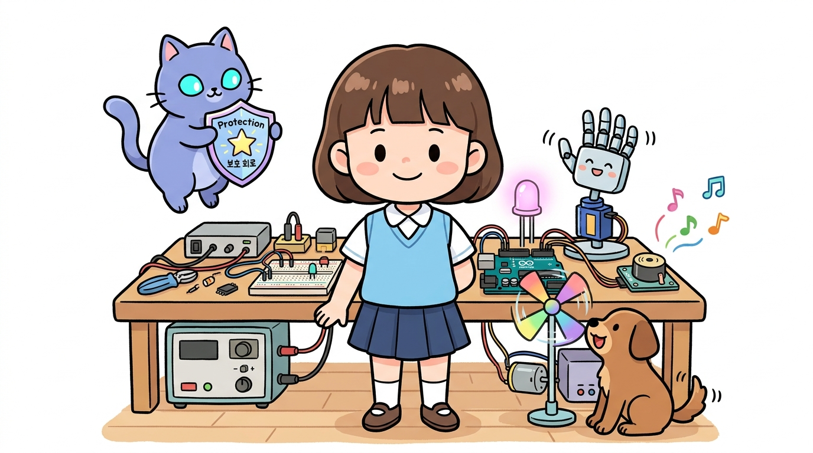
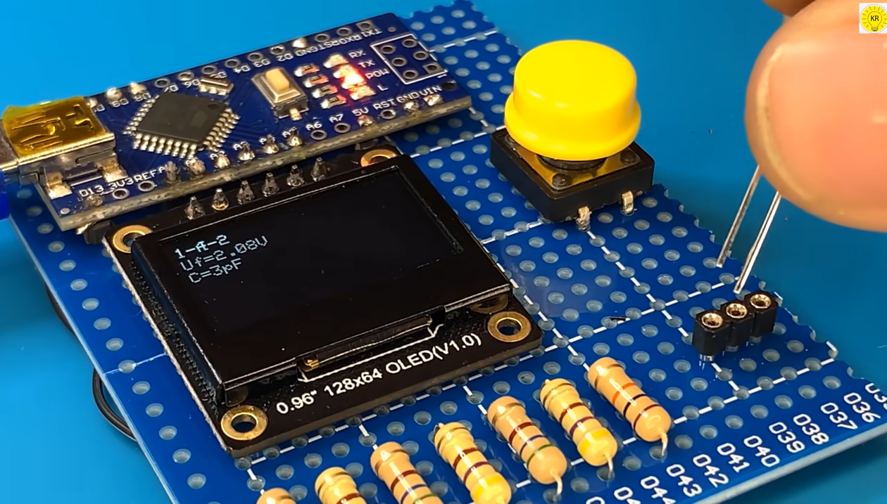
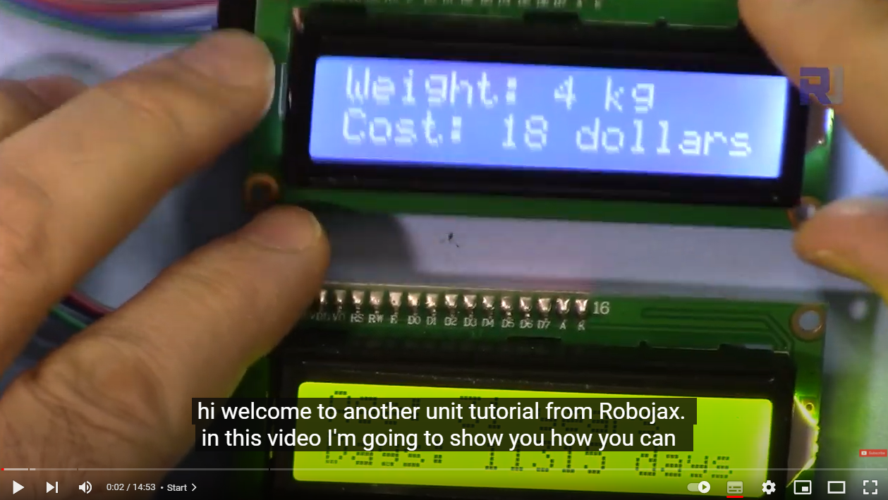
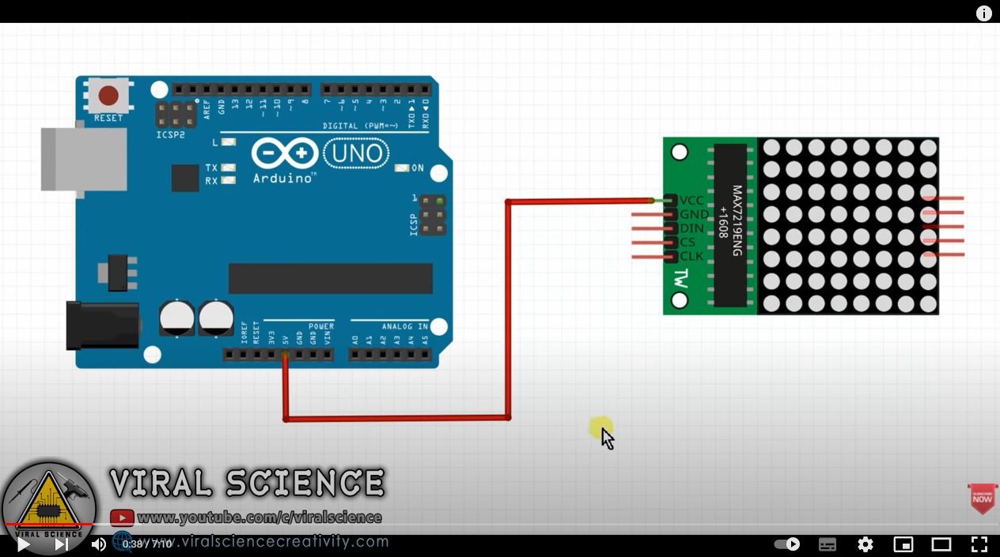
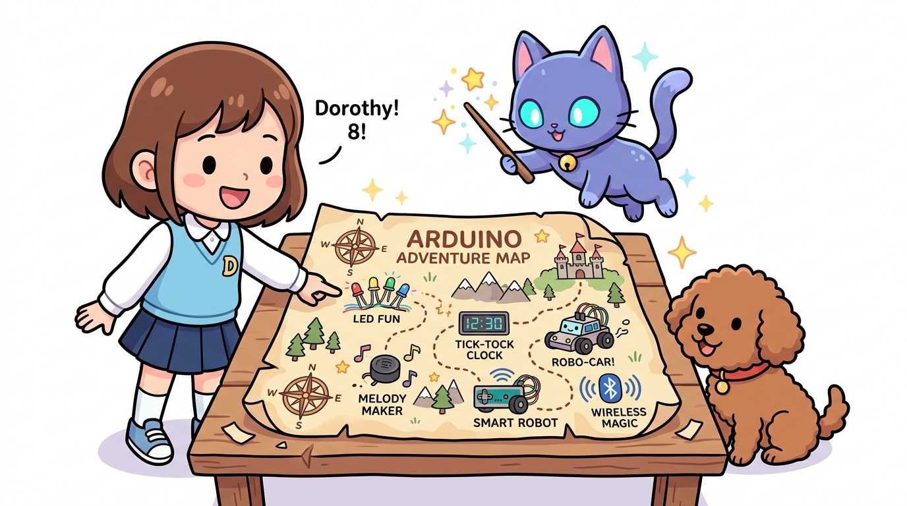

# 160_아두이노_추가실습 🎓🚀

**도로시와 지니가 함께하는 아두이노 마스터 프로젝트 & 피날레**

* 👧 **도로시**: "지니야! 우리가 그동안 배운 지식으로 더 멋지고 재미있는 응용 작품들을 만들 수 있을까?"
* 🐱 **지니**: "그럼! 듀얼 LCD, 도트 매트릭스 애니메이션, 아두이노 자가 진단기까지 끝없는 창작의 세계가 열려 있단다!"
* 🐶 **토토**: "바우! 우리 모두 진짜 메이커 발명가가 되었다 멍!"

* 🖥️ **강의 슬라이드**: [slides.md](./slides.md)

---

## 1. 보너스 프로젝트 1: 아두이노 핀 자가 진단기

### 🩺 고장 난 핀을 찾아내는 하드웨어 닥터!
* 아두이노의 모든 디지털 핀과 아날로그 핀을 순서대로 테스트하여:
  * 전압이 제대로 나오는지, 쇼트나 합선이 없는지 스스로 검사하는 똑똑한 테스터기!
* LED와 시리얼 모니터를 통해 각 핀의 정상 작동 여부를 시각적으로 진단할 수 있어요.

---

## 2. 보너스 프로젝트 2: 듀얼 I2C LCD 동시 제어

### 📟 단 2선(A4, A5)으로 화면 2개 동시에 띄우기!
* I2C 뒷면 A0, A1, A2 납땜 점퍼를 이용해:
  * 1번 LCD 주소: **`0x27`** (온도, 습도 표시)
  * 2번 LCD 주소: **`0x3F`** (현재 시간, 상태 표시)
* 두 개의 전광판에 각각 다른 정보를 나누어 출력하는 완벽한 종합 대시보드 구축!

---

## 3. 보너스 프로젝트 3: MAX7219 도트 매트릭스

### ❤️ 64개의 빨간 LED로 스마일 & 하트 애니메이션!
* SPI 통신 방식으로 단 3개의 신호선(DIN, CS, CLK)만 연결!
* 하트 뿅뿅, 반짝이는 눈동자, 움직이는 영문 전광판 글씨 효과를 마음껏 연출할 수 있어요!

---

## 4. 우리가 함께 걸어온 아두이노 모험 지도

### 🗺️ 초보자 도로시에서 만능 메이커로의 여정

* **기초 다지기**: LED 깜빡임, 옴의 법칙, 디지털/아날로그 입출력
* **출력과 제어**: 부저 멜로디, 7세그먼트, LCD, 서보·스텝·DC 모터, 릴레이
* **센서의 세계**: 초음파, 휨, 압력, 조도, 수위, 토양, 온도, 온습도, 가스, 알코올
* **무선과 확장**: I2C·SPI 통신, 블루투스, 앱 인벤터 스마트폰 연동, 라즈베리파이!

---

## 🌟 도로시와 지니의 영광스러운 수료식!

* 👧 **도로시**: "지니야, 토토야 고마워! 이제 나 혼자서도 상상하는 모든 것을 아두이노로 만들어낼 수 있을 것 같아!"
* 🐱 **지니**: "축하해 도로시! 실패를 두려워하지 않고 호기심을 따라간 너는 이미 훌륭한 엔지니어이자 발명가란다!"
* 🐶 **토토**: "바우! 도로시 최고! 지니 최고! 메이커 세상으로 영원히 출항이다 멍!"
