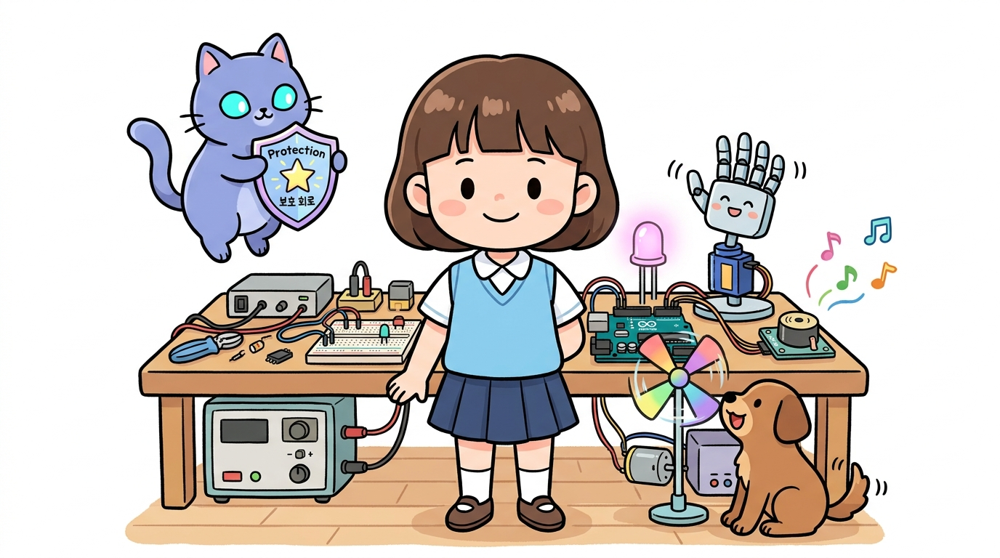
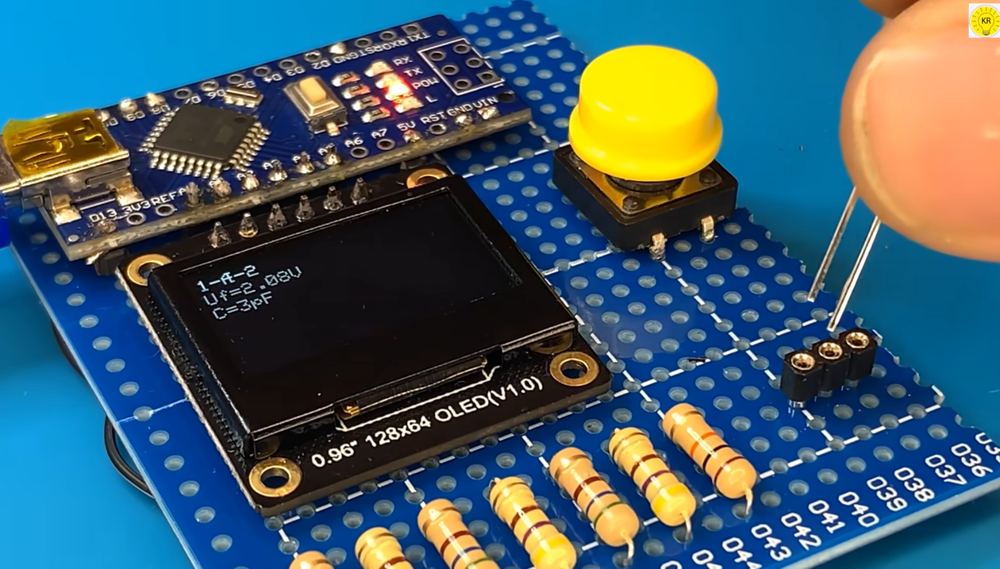
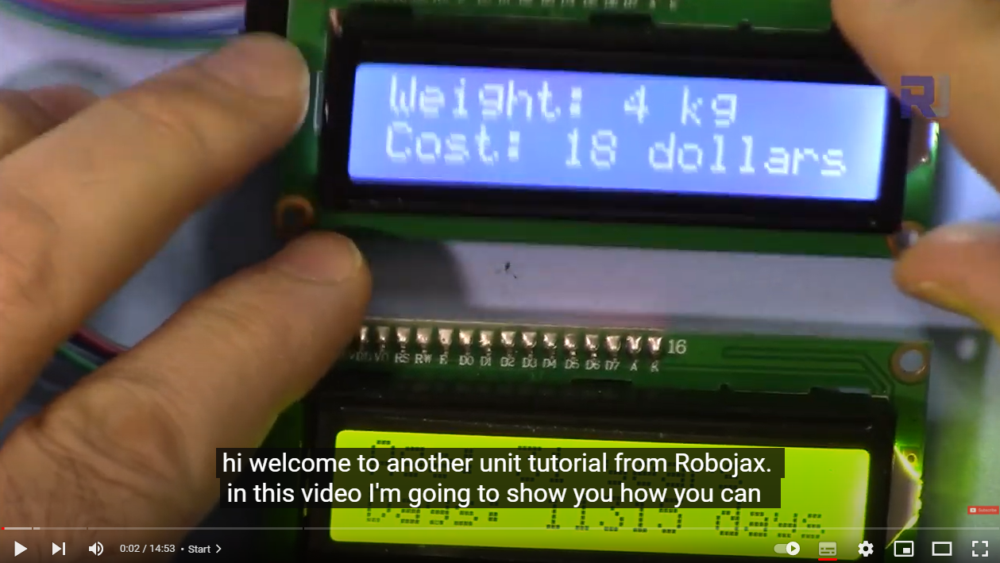
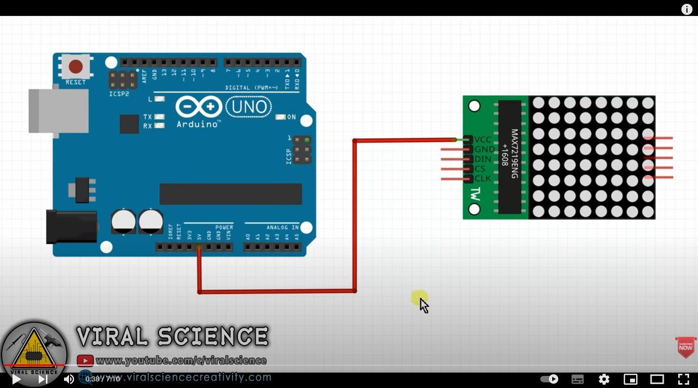
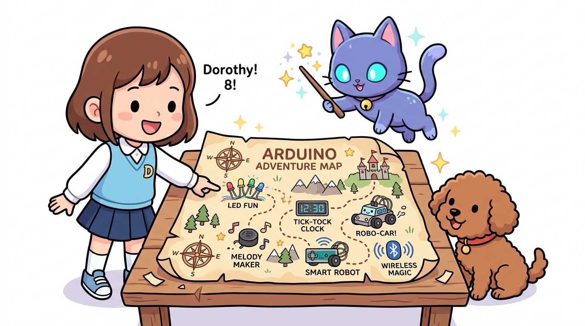

# 160_아두이노_추가실습 🎓🚀

**도로시와 지니가 함께하는 아두이노 마스터 프로젝트 & 피날레**
* 👧 **도로시**: "지니야! 우리가 그동안 배운 지식으로 더 멋지고 재미있는 응용 작품들을 만들 수 있을까?"
* 🐱 **지니**: "그럼! 듀얼 LCD, 도트 매트릭스 애니메이션, 아두이노 자가 진단기까지 끝없는 창작의 세계가 열려 있단다!"
* 🐶 **토토**: "바우! 우리 모두 진짜 메이커 발명가가 되었다 멍!"
* 📖 **상세 강의 교재**: [index.md](./index.md)

> 여러분 안녕하세요! 이번 시간에는 '160. 아두이노 추가실습 🎓🚀'을 주제로 함께 흥미진진한 탐험을 떠나보겠습니다. 오늘 강의에서는 특히 도로시와 지니가 함께하는 아두이노 마스터 프로젝트 & 피날레, 👧 도로시: "지니야! 우리가 그동안 배운 지식으로 더 멋지고 재미있는 응용 작품들을 만들 수 있을까?"를 중심으로 핵심 원리와 응용 방법을 차근차근 배워보겠습니다. 마법 멘토 지니와 호기심 많은 탐험가 도로시, 그리고 귀여운 토토와 함께 신나는 아두이노 모험을 힘차게 시작해 봅시다. 준비되셨나요?

---

## 1. 보너스 프로젝트 1: 아두이노 핀 자가 진단기

* 아두이노의 모든 디지털 핀과 아날로그 핀을 순서대로 테스트하여:
* 전압이 제대로 나오는지, 쇼트나 합선이 없는지 스스로 검사하는 똑똑한 테스터기!
* LED와 시리얼 모니터를 통해 각 핀의 정상 작동 여부를 시각적으로 진단할 수 있어요.

### 🩺 고장 난 핀을 찾아내는 하드웨어 닥터!

> 이번에 살펴볼 내용은 '1. 보너스 프로젝트 1: 아두이노 핀 자가 진단기'입니다. 화면의 회로도와 부품 사진을 보면서 각 핀과 배선이 어떻게 구성되어 있는지 눈으로 직접 따라와 주시기 바랍니다. 첫째로 아두이노의 모든 디지털 핀과 아날로그 핀을 순서대로 테스트하여에 유의해야 하며, 둘째로 전압이 제대로 나오는지, 쇼트나 합선이 없는지 스스로 검사하는 똑똑한 테스터기!라는 점이 핵심입니다. 이 기본 개념을 확실히 잡아두셔야 실제 부품을 브레드보드에 꽂고 코딩할 때 실수 없이 완성할 수 있습니다.

---

## 2. 보너스 프로젝트 2: 듀얼 I2C LCD 동시 제어

* I2C 뒷면 A0, A1, A2 납땜 점퍼를 이용해:
* 1번 LCD 주소: **`0x27`** (온도, 습도 표시)
* 2번 LCD 주소: **`0x3F`** (현재 시간, 상태 표시)
* 두 개의 전광판에 각각 다른 정보를 나누어 출력하는 완벽한 종합 대시보드 구축!

### 📟 단 2선(A4, A5)으로 화면 2개 동시에 띄우기!

> 이번 슬라이드에서는 '2. 보너스 프로젝트 2: 듀얼 I2C LCD 동시 제어'에 대해 자세히 살펴보겠습니다. 화면의 다이어그램과 사진을 함께 참고해 주시기 바랍니다. 첫 번째 핵심은 I2C 뒷면 A0, A1, A2 납땜 점퍼를 이용해이며, 두 번째로는 번 LCD 주소: 0x27 (온도, 습도 표시)입니다. 여기에 덧붙여 번 LCD 주소: 0x3F (현재 시간, 상태 표시) 내용까지 함께 이해해 두시면 완벽합니다. 이 원리는 아두이노 시스템 전체를 관통하는 핵심 논리이므로 머릿속에 꼭 정리해 두시기 바랍니다.

---

## 3. 보너스 프로젝트 3: MAX7219 도트 매트릭스

* SPI 통신 방식으로 단 3개의 신호선(DIN, CS, CLK)만 연결!
* 하트 뿅뿅, 반짝이는 눈동자, 움직이는 영문 전광판 글씨 효과를 마음껏 연출할 수 있어요!

### ❤️ 64개의 빨간 LED로 스마일 & 하트 애니메이션!

> 이번 슬라이드에서는 '3. 보너스 프로젝트 3: MAX7219 도트 매트릭스'에 대해 자세히 살펴보겠습니다. 화면의 다이어그램과 사진을 함께 참고해 주시기 바랍니다. 첫 번째 핵심은 SPI 통신 방식으로 단 3개의 신호선(DIN, CS, CLK)만 연결!이며, 두 번째로는 하트 뿅뿅, 반짝이는 눈동자, 움직이는 영문 전광판 글씨 효과를 마음껏 연출할 수 있어요!입니다. 이 원리는 아두이노 시스템 전체를 관통하는 핵심 논리이므로 머릿속에 꼭 정리해 두시기 바랍니다.

---

## 4. 우리가 함께 걸어온 아두이노 모험 지도

* **기초 다지기**: LED 깜빡임, 옴의 법칙, 디지털/아날로그 입출력
* **출력과 제어**: 부저 멜로디, 7세그먼트, LCD, 서보·스텝·DC 모터, 릴레이
* **센서의 세계**: 초음파, 휨, 압력, 조도, 수위, 토양, 온도, 온습도, 가스, 알코올
* **무선과 확장**: I2C·SPI 통신, 블루투스, 앱 인벤터 스마트폰 연동, 라즈베리파이!

### 🗺️ 초보자 도로시에서 만능 메이커로의 여정

> 이번 슬라이드에서는 '4. 우리가 함께 걸어온 아두이노 모험 지도'에 대해 자세히 살펴보겠습니다. 화면의 다이어그램과 사진을 함께 참고해 주시기 바랍니다. 첫 번째 핵심은 기초 다지기: LED 깜빡임, 옴의 법칙, 디지털/아날로그 입출력이며, 두 번째로는 출력과 제어: 부저 멜로디, 7세그먼트, LCD, 서보·스텝·DC 모터, 릴레이입니다. 여기에 덧붙여 센서의 세계: 초음파, 휨, 압력, 조도, 수위, 토양, 온도, 온습도, 가스, 알코올 내용까지 함께 이해해 두시면 완벽합니다. 이 원리는 아두이노 시스템 전체를 관통하는 핵심 논리이므로 머릿속에 꼭 정리해 두시기 바랍니다.

---

## 🌟 도로시와 지니의 영광스러운 수료식!

* 👧 **도로시**: "지니야, 토토야 고마워! 이제 나 혼자서도 상상하는 모든 것을 아두이노로 만들어낼 수 있을 것 같아!"
* 🐱 **지니**: "축하해 도로시! 실패를 두려워하지 않고 호기심을 따라간 너는 이미 훌륭한 엔지니어이자 발명가란다!"
* 🐶 **토토**: "바우! 도로시 최고! 지니 최고! 메이커 세상으로 영원히 출항이다 멍!"

> 오늘 배운 '🌟 도로시와 지니의 영광스러운 수료식!'의 핵심 내용을 모두 정리해 보았습니다. 오늘 다룬 내용 중에서도 👧 도로시: "지니야, 토토야 고마워! 이제 나 혼자서도 상상하는 모든 것을 아두이노로 만들어낼 수 있을 것 같아!" 부분은 앞으로의 아두이노 실습과 프로젝트에서 계속 사용되는 매우 중요한 기초 지식입니다. 오늘 배운 내용을 꼭 다시 한번 복습해 보시고, 다음 강의에서 더욱 신나고 유익한 모험으로 다시 만나겠습니다. 모두 수고 많으셨습니다!