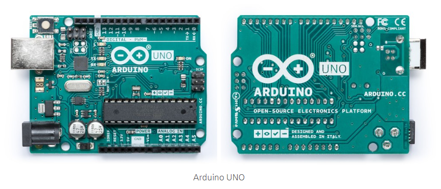
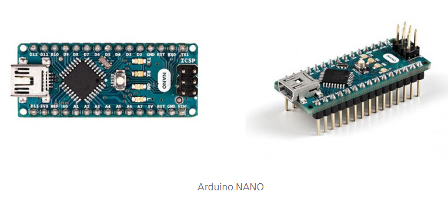
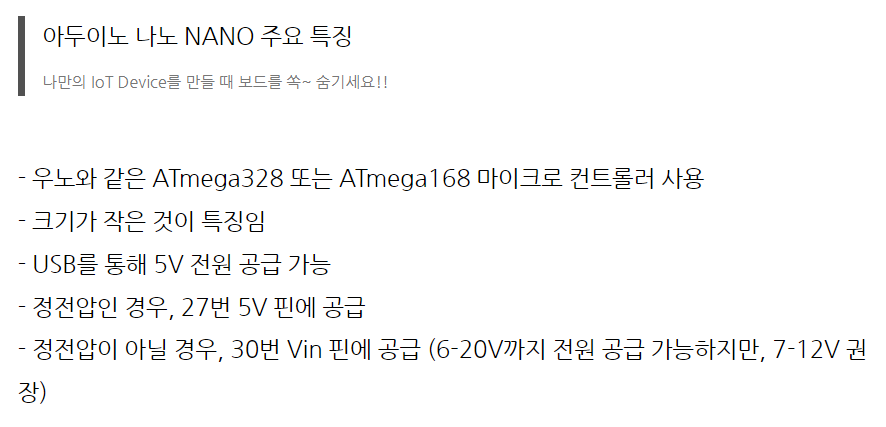
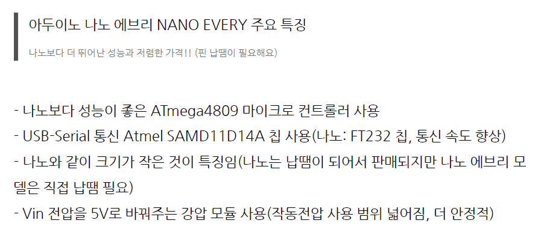

# 161_다양한아두이노보드형제들 🤖👨‍👩‍👧‍👦

**도로시와 지니가 함께하는 아두이노 패밀리 완벽 가이드**

* 👧 **도로시**: "지니야! 우리가 쓰던 파란색 아두이노 우노 말고도 작거나 더 큰 아두이노들이 많아?"
* 🐱 **지니**: "그럼! 손톱만 한 나노부터 초대형 메가, 웨어러블 릴리패드까지 용도에 맞춘 멋진 형제들이 있단다!"
* 🐶 **토토**: "바우! 키도 크고 작은 친구들이 다 모였다 멍!"

* 🖥️ **강의 슬라이드**: [slides.md](./slides.md)

---

## 1. 아두이노 패밀리 5형제 한눈에 보기

### 👨‍👩‍👧‍👦 목적에 따라 골라 쓰는 보드 라인업!

1. **아두이노 우노 (UNO)**: 전 세계 표준 입문용 보드 (ATmega328P)
2. **아두이노 나노 (Nano)**: 브레드보드에 쏙 꽂히는 초소형 미니 보드
3. **아두이노 메가 (Mega 2560)**: 핀이 54개나 되는 든든한 맏형 보드
4. **아두이노 레오나르도 (Leonardo)**: 마우스/키보드로 둔갑하는 특수 보드
5. **아두이노 프로 미니 (Pro Mini)**: 휴대용 초경량 배터리 장치용 보드

---

## 2. 대표 보드 3종 사양 비교

### 📊 도로시의 스펙 비교표

| 보드 모델 | 메인 칩(MCU) | 디지털 핀 (PWM) | 아날로그 핀 | 플래시 메모리 | 대표 용도 |
| :--- | :--- | :---: | :---: | :---: | :--- |
| **UNO** | ATmega328P | 14개 (6개) | 6개 | 32 KB | 기본 학습, 실습 |
| **Nano** | ATmega328P | 14개 (6개) | 8개 | 32 KB | 소형 장난감, 드론 |
| **Mega 2560** | ATmega2560 | **54개 (15개)** | **16개** | **256 KB** | 3D 프린터, 대형 로봇 |

---

## 3. 브레드보드의 단짝! 아두이노 나노(Nano)

### 🍬 작지만 우노와 똑같은 성능!
* 우노와 똑같은 ATmega328P 두뇌를 가졌지만, 크기는 1/3도 안 돼요.
* 핀이 핀헤더 형태로 아래로 뻗어 있어 **브레드보드 한가운데에 쏙** 꽂아 배선할 수 있어요!
* RC카, 미니 드론처럼 작고 가벼워야 하는 프로젝트에 최고 인기입니다.

---

## 4. 특수 목적 보드들: 레오나르도 & 릴리패드

### 🎭 기발한 상상을 현실로!
* **아두이노 레오나르도 (Leonardo)**:
  * ATmega32U4 칩 내장으로 컴퓨터가 **진짜 USB 키보드나 마우스**로 인식해요! 나만의 게임 조이스틱을 만들 수 있어요.
* **릴리패드 (LilyPad)**:
  * 둥글넓적한 모양으로 전도성 실로 옷에 꿰매어 입을 수 있는 패션 웨어러블 아두이노!

---

## 🌟 도로시와 지니의 핵심 요약 노트!

* 👧 **도로시**: "기본 배울 때는 우노, 작게 만들 땐 나노, 핀이 많이 필요할 땐 메가를 쓰면 되는구나!"
* 🐱 **지니**: "맞아! 내 발명품의 크기와 필요한 센서 개수에 딱 맞춰 알맞은 보드를 선택하는 것이 현명한 엔지니어란다."
* 🐶 **토토**: "바우! 다음 시간엔 54개 핀을 가진 천하장사 아두이노 메가를 만나보자 멍!"
