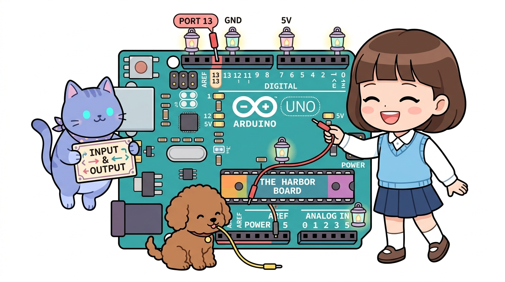
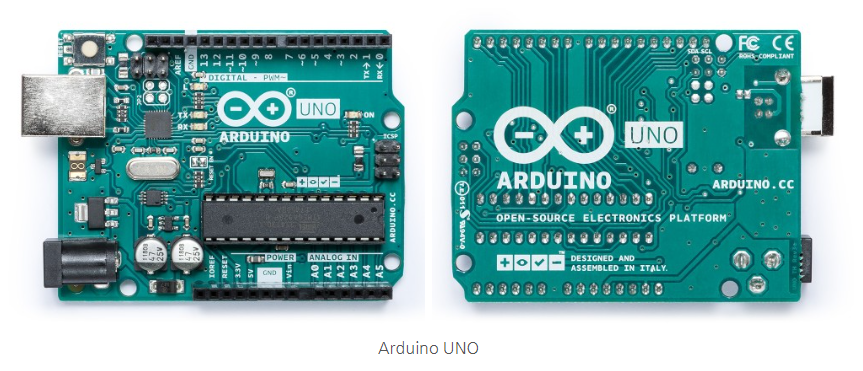
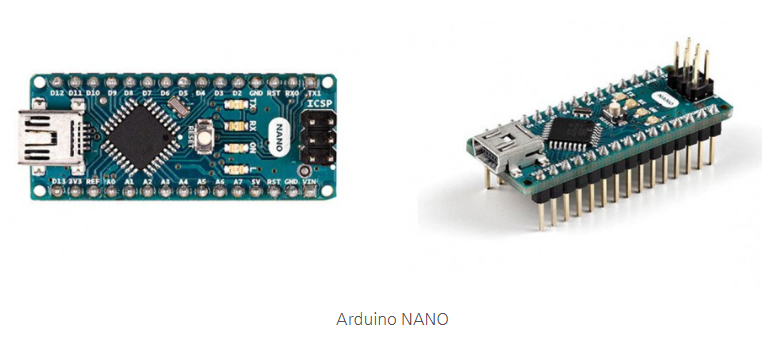
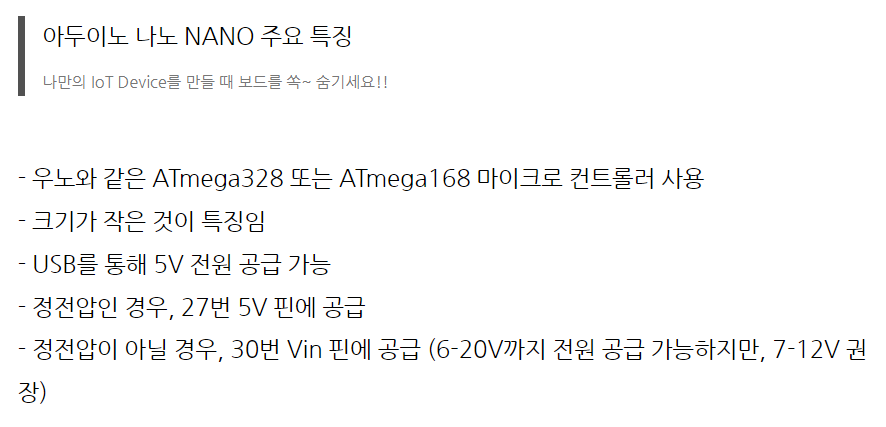
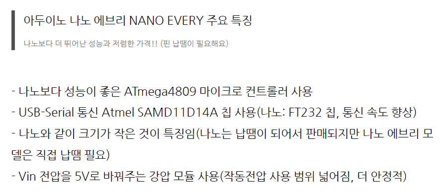

# 161_다양한아두이노보드형제들 🤖👨‍👩‍👧‍👦

**도로시와 지니가 함께하는 아두이노 패밀리 완벽 가이드**
* 👧 **도로시**: "지니야! 우리가 쓰던 파란색 아두이노 우노 말고도 작거나 더 큰 아두이노들이 많아?"
* 🐱 **지니**: "그럼! 손톱만 한 나노부터 초대형 메가, 웨어러블 릴리패드까지 용도에 맞춘 멋진 형제들이 있단다!"
* 🐶 **토토**: "바우! 키도 크고 작은 친구들이 다 모였다 멍!"
* 📖 **상세 강의 교재**: [index.md](./index.md)

> 여러분 안녕하세요! 이번 시간에는 '161. 다양한아두이노보드형제들 🤖👨‍👩‍👧‍👦'을 주제로 함께 흥미진진한 탐험을 떠나보겠습니다. 오늘 강의에서는 특히 도로시와 지니가 함께하는 아두이노 패밀리 완벽 가이드, 👧 도로시: "지니야! 우리가 쓰던 파란색 아두이노 우노 말고도 작거나 더 큰 아두이노들이 많아?"를 중심으로 핵심 원리와 응용 방법을 차근차근 배워보겠습니다. 마법 멘토 지니와 호기심 많은 탐험가 도로시, 그리고 귀여운 토토와 함께 신나는 아두이노 모험을 힘차게 시작해 봅시다. 준비되셨나요?

---

## 1. 아두이노 패밀리 5형제 한눈에 보기

1. **아두이노 우노 (UNO)**: 전 세계 표준 입문용 보드 (ATmega328P)
2. **아두이노 나노 (Nano)**: 브레드보드에 쏙 꽂히는 초소형 미니 보드
3. **아두이노 메가 (Mega 2560)**: 핀이 54개나 되는 든든한 맏형 보드
4. **아두이노 레오나르도 (Leonardo)**: 마우스/키보드로 둔갑하는 특수 보드
5. **아두이노 프로 미니 (Pro Mini)**: 휴대용 초경량 배터리 장치용 보드

### 👨‍👩‍👧‍👦 목적에 따라 골라 쓰는 보드 라인업!

> 이번 슬라이드에서는 '1. 아두이노 패밀리 5형제 한눈에 보기'에 대해 자세히 살펴보겠습니다. 화면의 다이어그램과 사진을 함께 참고해 주시기 바랍니다. 첫 번째 핵심은 아두이노 우노 (UNO): 전 세계 표준 입문용 보드 (ATmega328P)이며, 두 번째로는 아두이노 나노 (Nano): 브레드보드에 쏙 꽂히는 초소형 미니 보드입니다. 여기에 덧붙여 아두이노 메가 (Mega 2560): 핀이 54개나 되는 든든한 맏형 보드 내용까지 함께 이해해 두시면 완벽합니다. 이 원리는 아두이노 시스템 전체를 관통하는 핵심 논리이므로 머릿속에 꼭 정리해 두시기 바랍니다.

---

## 2. 대표 보드 3종 사양 비교

| 보드 모델 | 메인 칩(MCU) | 디지털 핀 (PWM) | 아날로그 핀 | 플래시 메모리 | 대표 용도 |
| :--- | :--- | :---: | :---: | :---: | :--- |
| **UNO** | ATmega328P | 14개 (6개) | 6개 | 32 KB | 기본 학습, 실습 |
| **Nano** | ATmega328P | 14개 (6개) | 8개 | 32 KB | 소형 장난감, 드론 |
| **Mega 2560** | ATmega2560 | **54개 (15개)** | **16개** | **256 KB** | 3D 프린터, 대형 로봇 |

### 📊 도로시의 스펙 비교표

> 이번에 살펴볼 내용은 '2. 대표 보드 3종 사양 비교'입니다. 슬라이드에 정리된 표를 통해 각 항목의 특징과 수치, 차이점을 한눈에 비교해 보실 수 있습니다. 이 기본 개념을 확실히 잡아두셔야 실제 부품을 브레드보드에 꽂고 코딩할 때 실수 없이 완성할 수 있습니다.

---

## 3. 브레드보드의 단짝! 아두이노 나노(Nano)

* 우노와 똑같은 ATmega328P 두뇌를 가졌지만, 크기는 1/3도 안 돼요.
* 핀이 핀헤더 형태로 아래로 뻗어 있어 **브레드보드 한가운데에 쏙** 꽂아 배선할 수 있어요!
* RC카, 미니 드론처럼 작고 가벼워야 하는 프로젝트에 최고 인기입니다.

### 🍬 작지만 우노와 똑같은 성능!

> 이번 슬라이드에서는 '3. 브레드보드의 단짝! 아두이노 나노(Nano)'에 대해 자세히 살펴보겠습니다. 화면의 다이어그램과 사진을 함께 참고해 주시기 바랍니다. 첫 번째 핵심은 우노와 똑같은 ATmega328P 두뇌를 가졌지만, 크기는 1/3도 안 돼요.이며, 두 번째로는 핀이 핀헤더 형태로 아래로 뻗어 있어 브레드보드 한가운데에 쏙 꽂아 배선할 수 있어요!입니다. 여기에 덧붙여 RC카, 미니 드론처럼 작고 가벼워야 하는 프로젝트에 최고 인기입니다. 내용까지 함께 이해해 두시면 완벽합니다. 이 원리는 아두이노 시스템 전체를 관통하는 핵심 논리이므로 머릿속에 꼭 정리해 두시기 바랍니다.

---

## 4. 특수 목적 보드들: 레오나르도 & 릴리패드

* **아두이노 레오나르도 (Leonardo)**:
* ATmega32U4 칩 내장으로 컴퓨터가 **진짜 USB 키보드나 마우스**로 인식해요! 나만의 게임 조이스틱을 만들 수 있어요.
* **릴리패드 (LilyPad)**:
* 둥글넓적한 모양으로 전도성 실로 옷에 꿰매어 입을 수 있는 패션 웨어러블 아두이노!

### 🎭 기발한 상상을 현실로!

> 이번 슬라이드에서는 '4. 특수 목적 보드들: 레오나르도 & 릴리패드'에 대해 자세히 살펴보겠습니다. 화면의 다이어그램과 사진을 함께 참고해 주시기 바랍니다. 첫 번째 핵심은 아두이노 레오나르도 (Leonardo)이며, 두 번째로는 ATmega32U4 칩 내장으로 컴퓨터가 진짜 USB 키보드나 마우스로 인식해요! 나만의 게임 조이스틱을 만들 수 있어요.입니다. 여기에 덧붙여 릴리패드 (LilyPad) 내용까지 함께 이해해 두시면 완벽합니다. 이 원리는 아두이노 시스템 전체를 관통하는 핵심 논리이므로 머릿속에 꼭 정리해 두시기 바랍니다.

---

## 🌟 도로시와 지니의 핵심 요약 노트!

* 👧 **도로시**: "기본 배울 때는 우노, 작게 만들 땐 나노, 핀이 많이 필요할 땐 메가를 쓰면 되는구나!"
* 🐱 **지니**: "맞아! 내 발명품의 크기와 필요한 센서 개수에 딱 맞춰 알맞은 보드를 선택하는 것이 현명한 엔지니어란다."
* 🐶 **토토**: "바우! 다음 시간엔 54개 핀을 가진 천하장사 아두이노 메가를 만나보자 멍!"

> 오늘 배운 '🌟 도로시와 지니의 핵심 요약 노트!'의 핵심 내용을 모두 정리해 보았습니다. 오늘 다룬 내용 중에서도 👧 도로시: "기본 배울 때는 우노, 작게 만들 땐 나노, 핀이 많이 필요할 땐 메가를 쓰면 되는구나!" 부분은 앞으로의 아두이노 실습과 프로젝트에서 계속 사용되는 매우 중요한 기초 지식입니다. 오늘 배운 내용을 꼭 다시 한번 복습해 보시고, 다음 강의에서 더욱 신나고 유익한 모험으로 다시 만나겠습니다. 모두 수고 많으셨습니다!