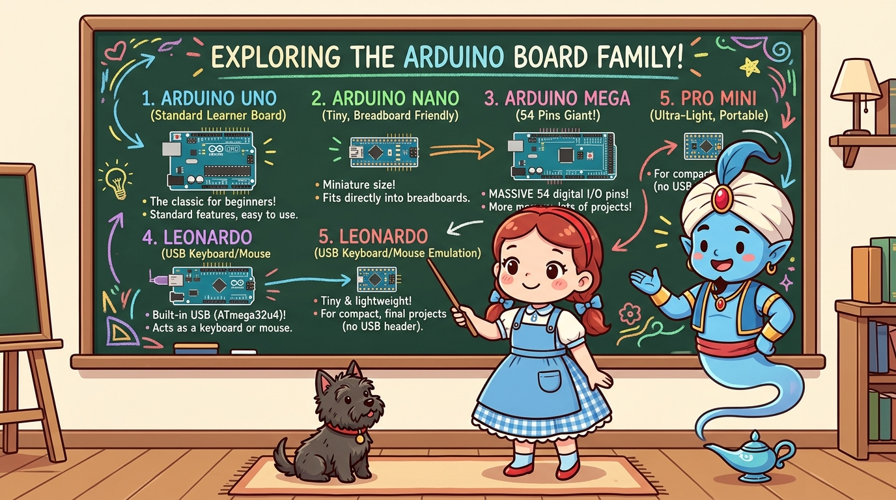
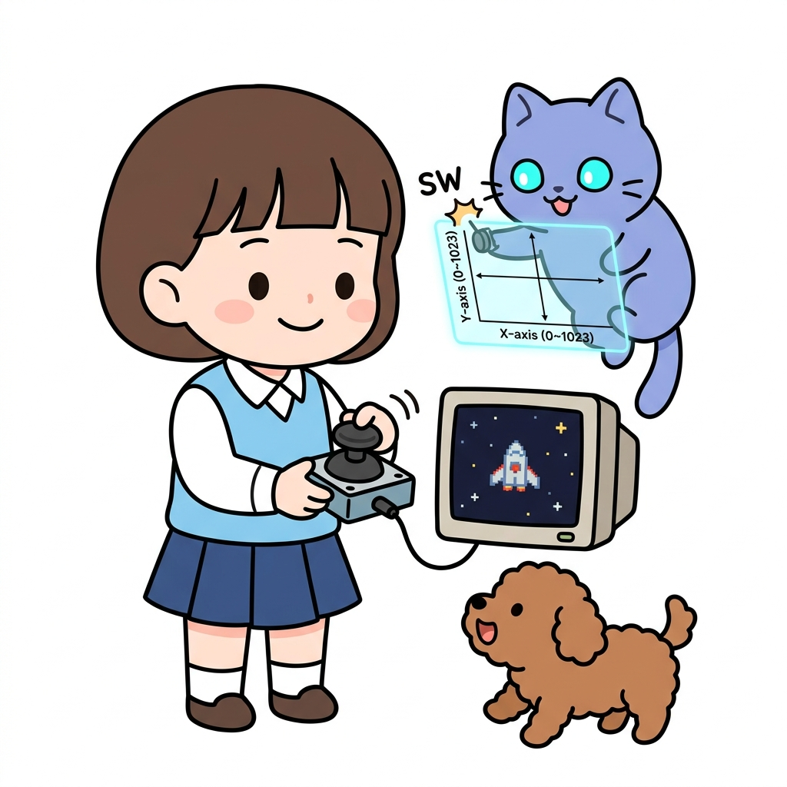

# 162_다양한아두이노_패밀리탐구 🌟

* **개성 만점! 용도와 크기에 따라 골라 쓰는 아두이노 패밀리 완벽 가이드**
* 우노(UNO), 나노(Nano), 메가(Mega), 레오나르도(Leonardo), 프로 미니(Pro Mini)의 하드웨어 특성과 보드 선택 기준을 학습합니다.
* 📖 **상세 강의 교재**: [index.md](./index.md)

> 여러분 안녕하세요! 이번 시간에는 '162. 다양한아두이노 패밀리탐구 🌟'을 주제로 함께 흥미진진한 탐험을 떠나보겠습니다. 마법 멘토 지니와 호기심 많은 탐험가 도로시, 그리고 귀여운 토토와 함께 신나는 아두이노 모험을 힘차게 시작해 봅시다. 준비되셨나요?

---

## 1. 아두이노 패밀리 5형제 한눈에 보기 👨‍👩‍👧‍👦

* **👧 도로시**: "지니야! 우리가 쓰던 파란색 우노 말고도 손톱만 한 것부터 손바닥보다 큰 아두이노까지 정말 다양해!"
* **🐱 지니**: "그럼! 로봇을 아주 작게 만들고 싶을 때, 혹은 모터와 센서를 수십 개 연결해야 할 때 알맞은 보드를 쏙 골라 쓰는 거란다!"
* **🐶 토토**: "멍멍! (작은 친구도 있고 힘센 거인 친구도 있다 멍!)"

1. **아두이노 우노 (UNO)**: 전 세계 표준 입문용 보드 (ATmega328P, 교재 및 시제품 표준).
2. **아두이노 나노 (Nano)**: 브레드보드에 쏙 꽂히는 핀헤더 일체형 초소형 보드.
3. **아두이노 메가 (Mega 2560)**: 디지털 핀 54개, 대용량 메모리를 갖춘 최강의 맏형 보드.
4. **아두이노 레오나르도 (Leonardo)**: 컴퓨터가 USB 키보드/마우스로 직접 인식하는 특수 보드.
5. **아두이노 프로 미니 (Pro Mini)**: USB 칩까지 제거하여 배터리로 가동하는 초경량 보드.

아두이노는 우리가 지금까지 배운 표준 **아두이노 우노(UNO)** 외에도, 만드는 작품의 크기와 목적에 따라 다양한 형태의 형제 보드들을 갖추고 있습니다.
### 📌 대표적인 아두이노 5대 라인업

> 이번 슬라이드에서는 '1. 아두이노 패밀리 5형제 한눈에 보기 👨‍👩‍👧‍👦'에 대해 자세히 살펴보겠습니다. 화면의 다이어그램과 사진을 함께 참고해 주시기 바랍니다. 도로시와 지니의 대화처럼, 지니야! 우리가 쓰던 파란색 우노 말고도 손톱만 한 것부터 손바닥보다 큰 아두이노까지 정말 다양해!라는 상황에 대해 그럼! 로봇을 아주 작게 만들고 싶을 때, 혹은 모터와 센서를 수십 개 연결해야 할 때 알맞은 보드를 쏙 골라 쓰는 거란다!라는 원리가 작동하는 것입니다. 첫 번째 핵심은 아두이노 우노 (UNO): 전 세계 표준 입문용 보드 (ATmega328P, 교재 및 시제품 표준).이며, 두 번째로는 아두이노 나노 (Nano): 브레드보드에 쏙 꽂히는 핀헤더 일체형 초소형 보드.입니다. 여기에 덧붙여 아두이노 메가 (Mega 2560): 디지털 핀 54개, 대용량 메모리를 갖춘 최강의 맏형 보드. 내용까지 함께 이해해 두시면 완벽합니다. 이 원리는 아두이노 시스템 전체를 관통하는 핵심 논리이므로 머릿속에 꼭 정리해 두시기 바랍니다.

---

## 2. 아두이노 대표 보드 스펙 비교 분석표 📊

| 보드 모델 | 마이크로컨트롤러 | 디지털 핀 (PWM) | 아날로그 입력 | 플래시 메모리 | 크기 및 특징 |
| :--- | :--- | :---: | :---: | :---: | :--- |
| **아두이노 우노** | ATmega328P | 14개 (6개) | 6개 (A0~A5) | 32 KB | $68.6 	imes 53.4	ext{ mm}$ (표준 규격) |
| **아두이노 나노** | ATmega328P | 14개 (6개) | **8개 (A0~A7)** | 32 KB | $45 	imes 18	ext{ mm}$ (브레드보드 직결) |
| **아두이노 메가** | ATmega2560 | **54개 (15개)** | **16개 (A0~A15)** | **256 KB** | $101.6 	imes 53.3	ext{ mm}$ (초대형 프로젝트) |
| **레오나르도** | ATmega32U4 | 20개 (7개) | 12개 | 32 KB | 네이티브 USB HID (키보드/마우스) |
| **프로 미니** | ATmega328P | 14개 (6개) | 8개 | 32 KB | $33 	imes 18	ext{ mm}$ (초경량, FTDI 프로그래머 필요) |

보드를 고를 때는 **크기, 입출력 핀 수, 통신 포트 수, 전력 소모량**을 꼼꼼히 비교해야 합니다.

> 이번에 살펴볼 내용은 '2. 아두이노 대표 보드 스펙 비교 분석표 📊'입니다. 슬라이드에 정리된 표를 통해 각 항목의 특징과 수치, 차이점을 한눈에 비교해 보실 수 있습니다. 이 기본 개념을 확실히 잡아두셔야 실제 부품을 브레드보드에 꽂고 코딩할 때 실수 없이 완성할 수 있습니다.

---

## 3. 특수 목적 보드들: 레오나르도 & 웨어러블 릴리패드 🎮🧵

* **내장 USB 컨트롤러(ATmega32U4)** 탑재!
* 컴퓨터에 연결하면 별도 드라이버 없이 **진짜 USB 키보드나 마우스**로 즉각 인식됩니다.
* 조이스틱과 버튼을 달아 **나만의 커스텀 PC 게임 컨트롤러**나 매크로 키패드를 제작할 수 있습니다!
* 옷에 꿰맬 수 있도록 둥글넓적하게 설계된 패션 테크 보드입니다.
* 구리 전선 대신 **전도성 실(Conductive Thread)**로 옷감에 바느질하여 LED 드레스나 스마트 글러브를 만듭니다.

특수한 인터랙티브 프로젝트를 위해 탄생한 독특한 아두이노들입니다.
### 🕹️ 아두이노 레오나르도 (Leonardo)
### 🌸 릴리패드 (LilyPad)

> 이번 슬라이드에서는 '3. 특수 목적 보드들: 레오나르도 & 웨어러블 릴리패드 🎮🧵'에 대해 자세히 살펴보겠습니다. 화면의 다이어그램과 사진을 함께 참고해 주시기 바랍니다. 첫 번째 핵심은 내장 USB 컨트롤러(ATmega32U4) 탑재!이며, 두 번째로는 컴퓨터에 연결하면 별도 드라이버 없이 진짜 USB 키보드나 마우스로 즉각 인식됩니다.입니다. 여기에 덧붙여 조이스틱과 버튼을 달아 나만의 커스텀 PC 게임 컨트롤러나 매크로 키패드를 제작할 수 있습니다! 내용까지 함께 이해해 두시면 완벽합니다. 이 원리는 아두이노 시스템 전체를 관통하는 핵심 논리이므로 머릿속에 꼭 정리해 두시기 바랍니다.

---

## 🌟 도로시와 지니의 핵심 요약! 🏆

* **👧 도로시**: "이제 상황에 딱 맞는 아두이노를 골라 쓸 수 있는 눈이 생겼어!"
* **🐱 지니**: "훌륭해! 다음 시간에는 브레드보드의 최고 단짝인 **'아두이노 나노의 하드웨어와 핀맵'**을 자세히 파헤쳐 보자!"

* [x] **학습과 프로토타입**: 튼튼하고 다루기 쉬운 **아두이노 우노**가 최우선 선택입니다.
* [x] **초소형 완성작**: 브레드보드에 바로 꽂히는 **아두이노 나노**로 크기를 획기적으로 줄입니다.
* [x] **핀 부족 해결**: 3D 프린터나 복잡한 다관절 로봇에는 **아두이노 메가**를 투입합니다.

> 오늘 배운 '🌟 도로시와 지니의 핵심 요약! 🏆'의 핵심 내용을 모두 정리해 보았습니다. 오늘 다룬 내용 중에서도 [x] 학습과 프로토타입: 튼튼하고 다루기 쉬운 아두이노 우노가 최우선 선택입니다. 부분은 앞으로의 아두이노 실습과 프로젝트에서 계속 사용되는 매우 중요한 기초 지식입니다. 지니 멘토가 강조했듯이 훌륭해! 다음 시간에는 브레드보드의 최고 단짝인 라는 점을 꼭 마음에 새겨두시길 바랍니다. 오늘 배운 내용을 꼭 다시 한번 복습해 보시고, 다음 강의에서 더욱 신나고 유익한 모험으로 다시 만나겠습니다. 모두 수고 많으셨습니다!