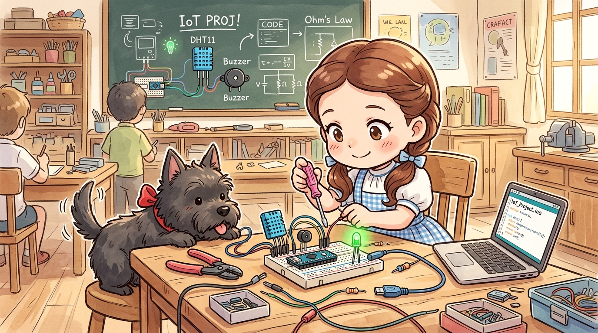
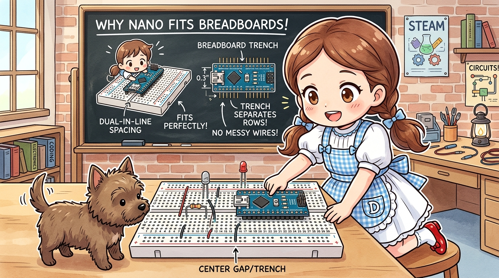
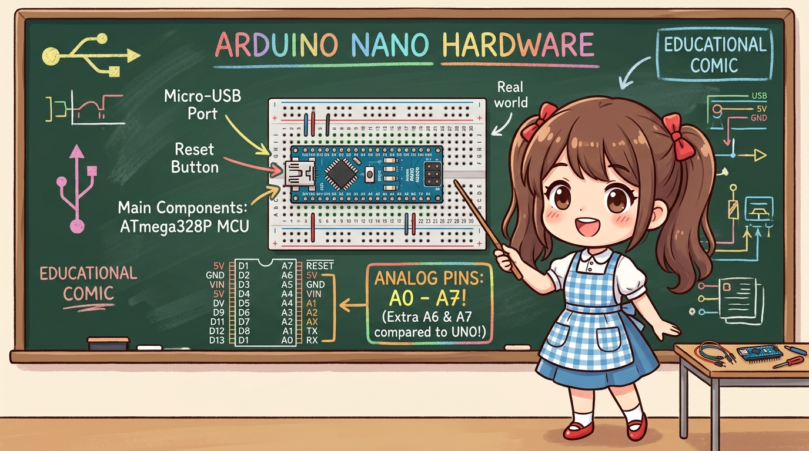
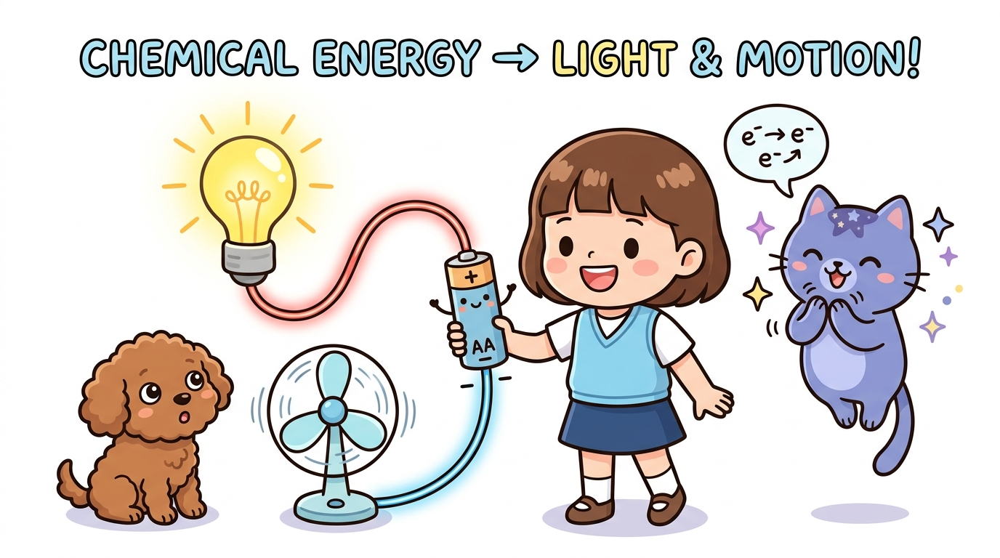

# 163_아두이노나노_하드웨어와핀맵 🍬🔌

> **브레드보드에 쏙! 작지만 우노의 두뇌를 그대로 품은 초소형 아두이노 나노**  
> 폼팩터 규격, 핀헤더 핀맵, 우노보다 2개 더 많은 아날로그 핀(A6, A7), 전원 공급 체계를 완벽히 정리합니다.

* 🖥️ **강의 슬라이드**: [slides.md](./slides.md)

---

## 1. 브레드보드에 쏙 꽂히는 혁신적 폼팩터 🍞✨

아두이노 우노는 크기가 크고 암놈(Female) 소켓으로 되어 있어 점퍼 와이어를 주렁주렁 연결해야 했습니다.

> **👧 도로시**: "우와! 나노는 아래쪽에 핀이 돋아 있어서 브레드보드 정중앙 홈에 딱 꽂혀!"  
> **🐱 지니**: "맞아 도로시! 브레드보드 중앙 분리 홈(Trench)을 사이에 두고 양쪽으로 꽂으면 선이 엉키지 않고 부품과 바로 연결할 수 있단다!"  
> **🐶 토토**: "멍멍! (선이 깔끔해져서 토토 발에 안 걸린다 멍!)"

### 📌 나노 폼팩터의 3대 장점
1. **극적인 부피 감소**: $45 	imes 18	ext{ mm}$ 크기로 우노 부피의 1/4 이하!
2. **배선 간결성**: 브레드보드에 직결되어 점퍼 와이어 숫자를 대폭 절감.
3. **가벼운 무게**: 단 7g에 불과하여 RC 비행기, 드론, 스마트 안경에 안성맞춤.

---

## 2. 아두이노 나노 핀맵 상세 분석 🗺️

아두이노 나노는 우노와 동일한 **ATmega328P** 마이크로컨트롤러를 탑재하여 소프트웨어 코드가 100% 호환됩니다.

### 🌟 [주목] 우노보다 2개 더 많은 아날로그 입력 핀 (A6, A7)!
* 우노(UNO)는 DIP 패키지 칩을 사용하여 아날로그 핀이 A0~A5까지 총 6개였습니다.
* 나노(Nano)는 표면실장형(TQFP) 칩을 사용하여 내부에 숨겨져 있던 **A6 핀과 A7 핀**이 바깥으로 나와 있습니다!
* ⚠️ **주의**: A6과 A7 핀은 **순수 아날로그 입력 전용(`analogRead`)** 핀으로, 디지털 출력(`digitalWrite`)으로는 사용할 수 없습니다.

### 📌 주요 핀 배치
* **디지털 핀**: D0(RX), D1(TX), D2 ~ D13 (PWM 지원: D3, D5, D6, D9, D10, D11)
* **내장 LED**: D13 핀에 보드 위 작은 주황색 LED가 연결되어 있습니다.
* **USB 단자**: 보드 모델에 따라 Mini-B USB 또는 현대적인 Type-C USB 포트가 탑재됩니다.

---

## 3. 나노의 전원 공급 체계 (VIN, 5V, 3V3) ⚡🔋

소형 기기에 나노를 장착할 때는 전원 연결 방식에 각별히 유의해야 합니다.

1. **USB 전원 (5V)**:
   - PC나 보조배터리의 USB 케이블을 꽂으면 5V 전원이 안정적으로 공급됩니다.
2. **외부 배터리 전원 (VIN 핀)**:
   - 7V ~ 12V DC 전원(9V 사각 배터리나 7.4V 리포 배터리)을 **`VIN`** 핀에 연결하면 내장 레귤레이터가 안전하게 5V로 낮추어 동작합니다.
3. **5V 전원 핀**:
   - 이미 레귤레이터를 거쳐 정제된 깨끗한 5V 전원을 센서나 모듈에 공급하는 출력 핀입니다.
4. **3V3 전원 핀**:
   - 보드 내 USB 칩에서 생성되는 3.3V 전원으로, 최대 전류량이 약 50mA로 적으므로 저전력 센서 전원으로만 써야 합니다.

---

## 🌟 도로시와 지니의 핵심 요약! 🏆

* [x] **브레드보드 직결**: 핀헤더가 장착된 나노는 브레드보드 중앙 분리 홈에 바로 꽂아 씁니다.
* [x] **아날로그 핀 8개**: A0부터 A7까지 총 8개의 아날로그 센서를 측정할 수 있습니다 (A6, A7은 아날로그 전용).
* [x] **우노와 코드 100% 동일**: 핀 번호와 라이브러리가 우노와 완벽히 호환됩니다.

> **👧 도로시**: "우노랑 똑같은데 크기만 훨씬 작아서 휴대용 장난감 만들 때 최고야!"  
> **🐱 지니**: "하지만 나노를 컴퓨터에 연결할 땐 IDE 설정에서 꼭 주의해야 할 점이 있단다! 다음 시간 **'아두이노 나노 IDE 사용법과 부트로더'**에서 그 비밀을 풀어보자!"
