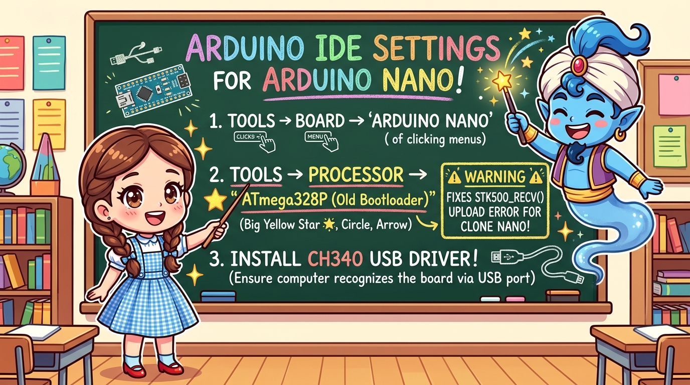
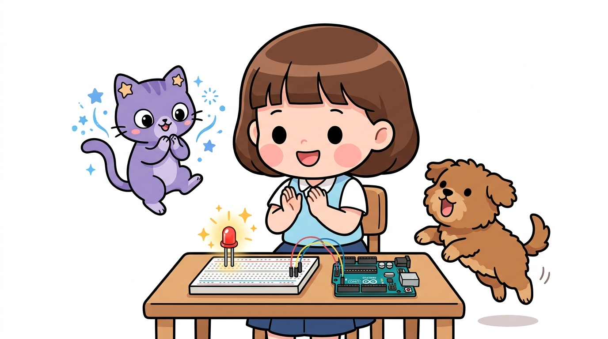

# 164_아두이노나노_IDE사용법과_부트로더 🛠️💻


* **아두이노 우노와 IDE 사용법이 다르다? 나노 사용자가 반드시 겪는 필수 설정!**
* 보드 선택, 프로세서 옵션(Old Bootloader vs New Bootloader), CH340 드라이버 설치와 업로드 에러 해결법을 마스터합니다.
* 📖 **상세 강의 교재**: [index.md](./index.md)


> 여러분 안녕하세요! 이번 시간에는 '164. 아두이노나노 IDE사용법과 부트로더 🛠️💻'을 주제로 함께 흥미진진한 탐험을 떠나보겠습니다. 마법 멘토 지니와 호기심 많은 탐험가 도로시, 그리고 귀여운 토토와 함께 신나는 아두이노 모험을 힘차게 시작해 봅시다. 준비되셨나요?

---

## 1. 아두이노 IDE에서 나노(Nano) 보드 선택하기 🧭


1. 아두이노 IDE 상단 메뉴에서 **`툴(Tools)` ➡️ `보드(Board)` ➡️ `Arduino AVR Boards`**로 이동합니다.
2. 목록에서 **`Arduino Nano`**를 클릭하여 선택합니다.
3. 보드를 선택하면, 바로 아래에 우노에는 없던 **`프로세서(Processor)`**라는 새로운 선택 메뉴가 활성화됩니다!

아두이노 우노를 쓸 때는 보드 메뉴에서 `Arduino Uno`만 누르면 끝났지만, 나노는 설정이 한 단계 더 필요합니다.
### 📌 IDE 보드 설정 단계

> 이번 슬라이드에서는 '1. 아두이노 IDE에서 나노(Nano) 보드 선택하기 🧭'에 대해 자세히 살펴보겠습니다. 화면의 다이어그램과 사진을 함께 참고해 주시기 바랍니다. 첫 번째 핵심은 아두이노 IDE 상단 메뉴에서 툴(Tools) ➡️ 보드(Board) ➡️ Arduino AVR Boards로 이동합니다.이며, 두 번째로는 목록에서 Arduino Nano를 클릭하여 선택합니다.입니다. 여기에 덧붙여 보드를 선택하면, 바로 아래에 우노에는 없던 프로세서(Processor)라는 새로운 선택 메뉴가 활성화됩니다! 내용까지 함께 이해해 두시면 완벽합니다. 이 원리는 아두이노 시스템 전체를 관통하는 핵심 논리이므로 머릿속에 꼭 정리해 두시기 바랍니다.

---

## 2. 🔥 프로세서 선택의 함정: Old Bootloader의 비밀 ⚠️



* **👧 도로시**: "지니야! 분명 코드는 에러가 없는데 업로드만 누르면 빨간 글씨로 'stk500_recv()' 에러가 뜨면서 안 올라가!"
* **🐱 지니**: "놀라지 마 도로시! 2018년 이후 아두이노 공식 부트로더 통신 속도가 115,200bps로 바뀌면서 생긴 현상이란다!"
* **🐶 토토**: "멍멍! (선택 한 번만 바꾸면 마법처럼 해결된다 멍!)"

* **`툴` ➡️ `프로세서(Processor)` 메뉴를 클릭합니다.**
* 시중에 유통되는 대부분의 가성비 아두이노 나노 호환 보드는 구형 부트로더(57,600bps)를 품고 있습니다.
* 이때 메뉴에서 **`"ATmega328P (Old Bootloader)"`**를 선택하면 거짓말처럼 업로드가 1초 만에 성공합니다!

| 프로세서 옵션 | 부트로더 통신 속도 | 대상 보드 |
| :--- | :---: | :--- |
| **`ATmega328P`** | 115,200 bps | 최신 정품 아두이노 나노 (2018년 이후 생산분) |
| **`ATmega328P (Old Bootloader)`** | **57,600 bps** | **시중 대부분의 나노 호환 보드 및 구형 나노 (적극 권장!)** |

아두이노 나노 입문자들이 가장 많이 절망하는 순간이 바로 코드를 업로드할 때 발생하는 **`avrdude: stk500_recv(): programmer is not responding`** 에러입니다!
### 💡 에러 완벽 해결법: 프로세서 옵션 변경!

> 이번에 살펴볼 내용은 '2. 🔥 프로세서 선택의 함정: Old Bootloader의 비밀 ⚠️'입니다. 슬라이드에 정리된 표를 통해 각 항목의 특징과 수치, 차이점을 한눈에 비교해 보실 수 있습니다. 첫째로 툴 ➡️ 프로세서(Processor) 메뉴를 클릭합니다.에 유의해야 하며, 둘째로 시중에 유통되는 대부분의 가성비 아두이노 나노 호환 보드는 구형 부트로더(57,600bps)를 품고 있습니다.라는 점이 핵심입니다. 이 기본 개념을 확실히 잡아두셔야 실제 부품을 브레드보드에 꽂고 코딩할 때 실수 없이 완성할 수 있습니다.

---

## 3. 컴퓨터가 나노를 못 찾을 땐? CH340 드라이버 설치 🔌


1. 나노를 USB에 꽂았는데 `툴 ➡️ 포트` 메뉴가 회색으로 비활성화되어 있다면?
2. 구글에서 **"CH340 드라이버 다운로드"**(WCH 공식 사이트 또는 제조사)를 검색합니다.
3. `CH341SER.EXE` 설치 파일을 실행하고 **[INSTALL]** 버튼을 클릭합니다.
4. "Driver install success!" 창이 뜨고 나면, 아두이노 IDE에 `COM3`, `COM4` (Mac의 경우 `/dev/cu.usbserial-xxx`) 포트가 선명하게 나타납니다!

정품 아두이노 우노는 고가의 ATmega16U2 칩을 써서 드라이버가 자동 설치되지만, 보급형 나노 보드는 가격을 낮추기 위해 **WCH 사의 CH340 USB 변환 칩**을 많이 사용합니다.
### 📌 포트가 비활성화되어 있을 때 해결 순서

> 자, 이번 슬라이드의 질문을 함께 보시겠습니다. 바로 '3. 컴퓨터가 나노를 못 찾을 땐? CH340 드라이버 설치 🔌'라는 아주 흥미로운 질문입니다. 우리가 일상에서 흔히 접하는 나노를 USB에 꽂았는데 툴 ➡️ 포트 메뉴가 회색으로 비활성화되어 있다면? 현상을 떠올려보면 왜 이런 의문이 생기는지 쉽게 공감할 수 있습니다. 이 질문 속에 숨겨진 전자 회로와 컴퓨팅의 핵심 원리를 지금부터 차근차근 하나씩 파헤쳐 보겠습니다.

---

## 4. 첫 나노 스케치 업로드 실습 (Blink) ✨



* **👧 도로시**: "업로드 완료 메시지가 뜨면서 나노 보드 한가운데 작은 주황색 불이 1초마다 깜빡여! 성공이야!"

모든 설정이 완료되었다면, 나노 보드 위의 13번 내장 LED를 깜빡여 정상 동작을 검증합니다.

```cpp
// 아두이노 나노 13번 내장 LED 깜빡이기
void setup() {
  pinMode(LED_BUILTIN, OUTPUT); // 13번 핀
}

void loop() {
  digitalWrite(LED_BUILTIN, HIGH); // 켜기
  delay(1000);
  digitalWrite(LED_BUILTIN, LOW);  // 끄기
  delay(1000);
}
```

> 이번 슬라이드에서는 '4. 첫 나노 스케치 업로드 실습 (Blink) ✨'에 대한 실제 동작 코드를 분석해 보겠습니다. 화면의 코드를 살펴보시면, 컴퓨터가 아두이노 하드웨어에 단계별로 명령을 내리는 흐름을 명확하게 확인할 수 있습니다. 각 함수의 역할과 괄호 안의 매개변수가 하드웨어 핀과 어떤 관계를 맺고 동작하는지 주의 깊게 살펴보시기 바랍니다.

---

## 🌟 도로시와 지니의 핵심 요약! 🏆


* **👧 도로시**: "우노랑 IDE 설정이 조금 달라서 당황했지만, 이제 원리를 완벽히 알았으니 어떤 나노 보드도 문제없어!"
* **🐱 지니**: "훌륭해! 다음 시간에는 브레드보드에 나노를 직접 꽂아 멋진 소형 프로젝트를 완성해 보자!"

* [x] **보드 설정**: `툴 ➡️ 보드 ➡️ Arduino Nano`를 지정합니다.
* [x] **업로드 에러 시**: `프로세서 ➡️ ATmega328P (Old Bootloader)`로 전환합니다.
* [x] **포트 미인식 시**: `CH340 드라이버`를 PC에 설치하여 USB 시리얼 포트를 개통합니다.

> 오늘 배운 '🌟 도로시와 지니의 핵심 요약! 🏆'의 핵심 내용을 모두 정리해 보았습니다. 오늘 다룬 내용 중에서도 [x] 보드 설정: 툴 ➡️ 보드 ➡️ Arduino Nano를 지정합니다. 부분은 앞으로의 아두이노 실습과 프로젝트에서 계속 사용되는 매우 중요한 기초 지식입니다. 지니 멘토가 강조했듯이 훌륭해! 다음 시간에는 브레드보드에 나노를 직접 꽂아 멋진 소형 프로젝트를 완성해 보자!라는 점을 꼭 마음에 새겨두시길 바랍니다. 오늘 배운 내용을 꼭 다시 한번 복습해 보시고, 다음 강의에서 더욱 신나고 유익한 모험으로 다시 만나겠습니다. 모두 수고 많으셨습니다!