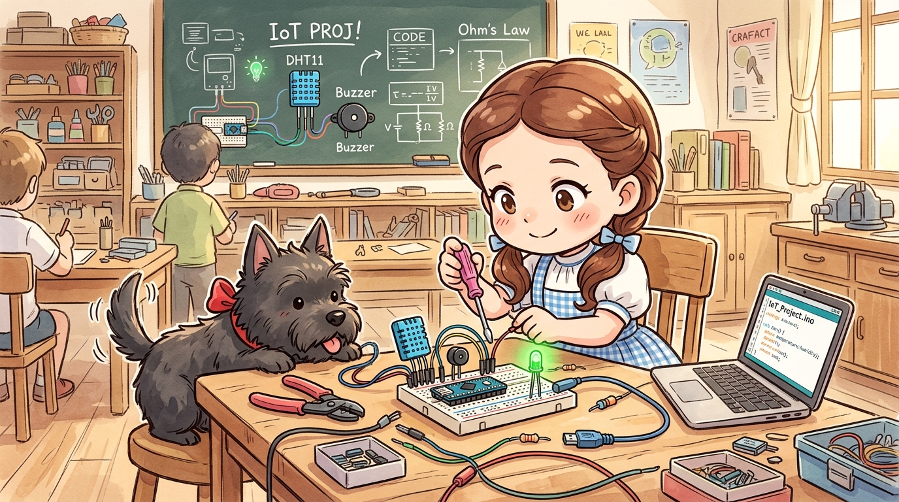
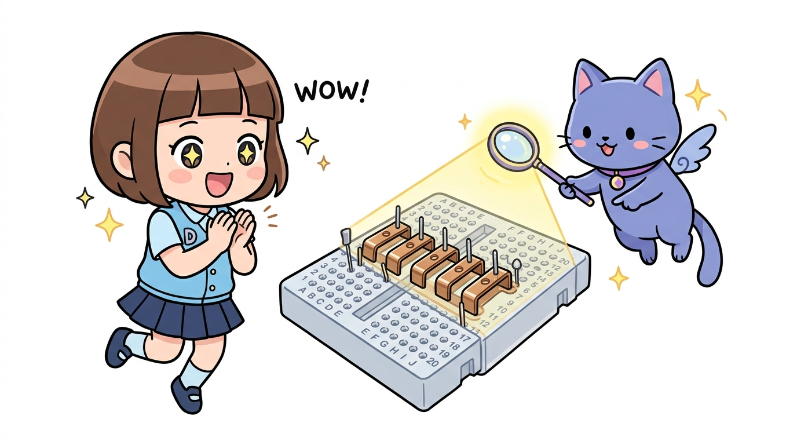
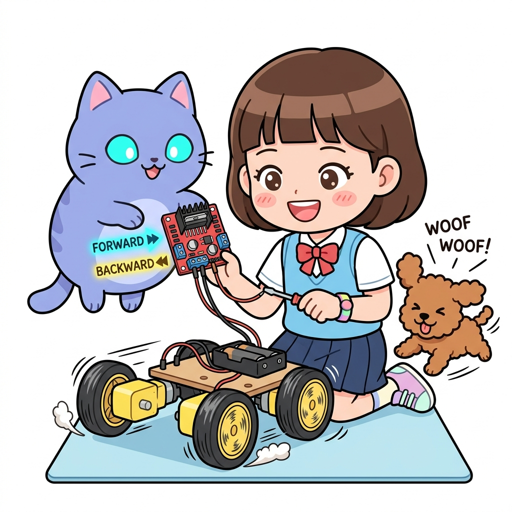

# 165_아두이노나노_초소형실전응용 🚀🤖

> **작은 거인 아두이노 나노로 완성하는 초소형 임베디드 프로젝트**  
> 브레드보드 직결 배선, A6/A7 아날로그 전용 핀 측정, 휴대용 스마트 디바이스 제작 노하우를 익힙니다.



* 🖥️ **강의 슬라이드**: [slides.md](./slides.md)

---

## 1. 브레드보드 직결 초소형 인터랙티브 회로 설계 🍞🛠️

나노 보드는 점퍼 와이어를 주렁주렁 매달지 않고, 브레드보드의 내부 연결 핀을 최대로 활용하여 컴팩트하게 설계합니다.



### 📌 컴팩트 배선 요령
1. **나노 보드 위치**: 브레드보드의 맨 왼쪽이나 오른쪽에 꽂아 남는 공간에 센서와 부품을 꽂을 자리를 확보합니다.
2. **GND 및 5V 버스 라인**: 나노의 5V 핀과 GND 핀에서 브레드보드 상하단의 전원 레일(빨간선, 파란선)로 짧은 와이어를 먼저 연결해 둡니다.
3. **부품 직결**: 저항과 LED를 나노 핀 바로 옆 구멍에 꽂으면 별도의 전선 없이도 깔끔한 일체형 회로가 완성됩니다.

---

## 2. 나노만의 비밀 무기: A6과 A7 핀 실전 활용 📈

우노에는 없는 나노만의 추가 아날로그 핀 A6과 A7에 센서를 연결하여 다채널 계측 시스템을 구축합니다.


```cpp
// 아두이노 나노 전용: A6(조도 센서), A7(가변저항) 동시 측정
const byte LIGHT_PIN = A6; // 순수 아날로그 입력 전용 핀!
const byte POT_PIN   = A7; // 순수 아날로그 입력 전용 핀!
const byte LED_PIN   = 9;  // PWM 출력 핀

void setup() {
  Serial.begin(9600);
  pinMode(LED_PIN, OUTPUT);
  // 주의: A6, A7은 pinMode() 선언이 필요 없으며 오직 analogRead만 가능!
}

void loop() {
  int lightVal = analogRead(LIGHT_PIN); // 0 ~ 1023
  int potVal   = analogRead(POT_PIN);   // 0 ~ 1023
  
  Serial.print("빛 센서(A6): ");
  Serial.print(lightVal);
  Serial.print(" | 가변저항(A7): ");
  Serial.println(potVal);
  
  // 가변저항 값에 비례하여 LED 밝기 조절 (0~255 변환)
  analogWrite(LED_PIN, map(potVal, 0, 1023, 0, 255));
  delay(100);
}
```

> **👧 도로시**: "우노에서는 아날로그 핀이 6개라 모자랄 때가 있었는데, 나노는 A6, A7이 있어서 센서를 2개나 더 달 수 있네!"

---

## 3. 소형 웨어러블 및 드론/RC카 탑재 노하우 🏎️🛸

가볍고 작은 아두이노 나노는 움직이는 이동체 프로젝트에서 진가를 발휘합니다.



### 🔋 이동체 제작 3대 팁
1. **진동 방지**: 핀헤더 연결이 흔들려 빠지지 않도록 만능기판(PCB)에 직접 납땜하거나 글루건으로 고정합니다.
2. **배터리 경량화**: 3.7V 리튬폴리머(Li-Po) 배터리 2개를 직렬 연결(7.4V)하여 `VIN` 핀에 인가하면 가볍고 강력한 전원이 공급됩니다.
3. **무게중심 배분**: 나노 보드를 차체나 드론 프레임의 정중앙에 배치하여 비행 및 주행 밸런스를 유지합니다.

---

## 🌟 도로시와 지니의 핵심 요약! 🏆


* [x] **브레드보드 최적화**: 전선 없이 부품을 직결하여 초소형 인터랙티브 장치를 구현했습니다.
* [x] **A6/A7 전용 핀**: 추가 아날로그 핀으로 풍부한 센서 계측 네트워크를 구성했습니다.
* [x] **이동체 적용**: 가벼운 무게와 작은 부피를 활용해 스마트 장난감과 로봇을 완성했습니다.

> **👧 도로시**: "아두이노 나노를 마스터하고 나니 손바닥만 한 미니 로봇도 쉽게 만들 수 있겠어!"  
> **🐱 지니**: "멋지다 도로시! 이제 반대로 핀이 무려 54개나 되는 천하장사, **[Part 9] 아두이노 메가(Mega 2560)**의 거대한 세계로 출발해 보자!"
