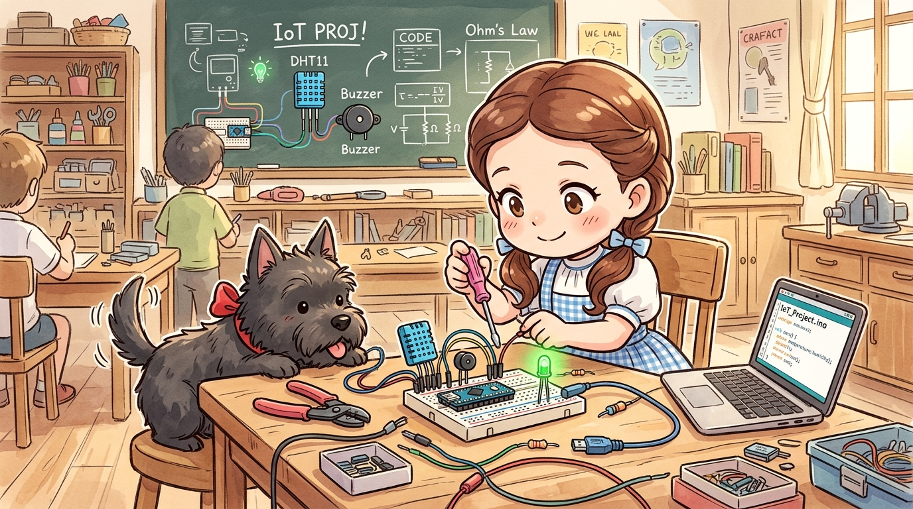
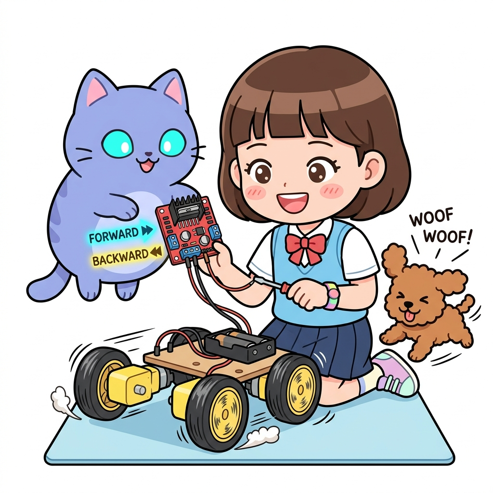

# 165_아두이노나노_초소형실전응용 🚀🤖



* **작은 거인 아두이노 나노로 완성하는 초소형 임베디드 프로젝트**
* 브레드보드 직결 배선, A6/A7 아날로그 전용 핀 측정, 휴대용 스마트 디바이스 제작 노하우를 익힙니다.
* 📖 **상세 강의 교재**: [index.md](./index.md)


> 여러분 안녕하세요! 이번 시간에는 '165. 아두이노나노 초소형실전응용 🚀🤖'을 주제로 함께 흥미진진한 탐험을 떠나보겠습니다. 마법 멘토 지니와 호기심 많은 탐험가 도로시, 그리고 귀여운 토토와 함께 신나는 아두이노 모험을 힘차게 시작해 봅시다. 준비되셨나요?

---

## 1. 브레드보드 직결 초소형 인터랙티브 회로 설계 🍞🛠️


1. **나노 보드 위치**: 브레드보드의 맨 왼쪽이나 오른쪽에 꽂아 남는 공간에 센서와 부품을 꽂을 자리를 확보합니다.
2. **GND 및 5V 버스 라인**: 나노의 5V 핀과 GND 핀에서 브레드보드 상하단의 전원 레일(빨간선, 파란선)로 짧은 와이어를 먼저 연결해 둡니다.
3. **부품 직결**: 저항과 LED를 나노 핀 바로 옆 구멍에 꽂으면 별도의 전선 없이도 깔끔한 일체형 회로가 완성됩니다.

나노 보드는 점퍼 와이어를 주렁주렁 매달지 않고, 브레드보드의 내부 연결 핀을 최대로 활용하여 컴팩트하게 설계합니다.
### 📌 컴팩트 배선 요령

> 이번에 살펴볼 내용은 '1. 브레드보드 직결 초소형 인터랙티브 회로 설계 🍞🛠️'입니다. 화면의 회로도와 부품 사진을 보면서 각 핀과 배선이 어떻게 구성되어 있는지 눈으로 직접 따라와 주시기 바랍니다. 첫째로 나노 보드 위치: 브레드보드의 맨 왼쪽이나 오른쪽에 꽂아 남는 공간에 센서와 부품을 꽂을 자리를 확보합니다.에 유의해야 하며, 둘째로 GND 및 5V 버스 라인: 나노의 5V 핀과 GND 핀에서 브레드보드 상하단의 전원 레일(빨간선, 파란선)로 짧은 와이어를 먼저 연결해 둡니다.라는 점이 핵심입니다. 이 기본 개념을 확실히 잡아두셔야 실제 부품을 브레드보드에 꽂고 코딩할 때 실수 없이 완성할 수 있습니다.

---

## 2. 나노만의 비밀 무기: A6과 A7 핀 실전 활용 📈


* **👧 도로시**: "우노에서는 아날로그 핀이 6개라 모자랄 때가 있었는데, 나노는 A6, A7이 있어서 센서를 2개나 더 달 수 있네!"

우노에는 없는 나노만의 추가 아날로그 핀 A6과 A7에 센서를 연결하여 다채널 계측 시스템을 구축합니다.

```cpp
// 아두이노 나노 전용: A6(조도 센서), A7(가변저항) 동시 측정
const byte LIGHT_PIN = A6; // 순수 아날로그 입력 전용 핀!
const byte POT_PIN   = A7; // 순수 아날로그 입력 전용 핀!
const byte LED_PIN   = 9;  // PWM 출력 핀

void setup() {
  Serial.begin(9600);
  pinMode(LED_PIN, OUTPUT);
  // 주의: A6, A7은 pinMode() 선언이 필요 없으며 오직 analogRead만 가능!
}

void loop() {
  int lightVal = analogRead(LIGHT_PIN); // 0 ~ 1023
  int potVal   = analogRead(POT_PIN);   // 0 ~ 1023
  
  Serial.print("빛 센서(A6): ");
  Serial.print(lightVal);
  Serial.print(" | 가변저항(A7): ");
  Serial.println(potVal);
  
  // 가변저항 값에 비례하여 LED 밝기 조절 (0~255 변환)
  analogWrite(LED_PIN, map(potVal, 0, 1023, 0, 255));
  delay(100);
}
```

> 이번 슬라이드에서는 '2. 나노만의 비밀 무기: A6과 A7 핀 실전 활용 📈'에 대한 실제 동작 코드를 분석해 보겠습니다. 화면의 코드를 살펴보시면, 컴퓨터가 아두이노 하드웨어에 단계별로 명령을 내리는 흐름을 명확하게 확인할 수 있습니다. 각 함수의 역할과 괄호 안의 매개변수가 하드웨어 핀과 어떤 관계를 맺고 동작하는지 주의 깊게 살펴보시기 바랍니다.

---

## 3. 소형 웨어러블 및 드론/RC카 탑재 노하우 🏎️🛸



1. **진동 방지**: 핀헤더 연결이 흔들려 빠지지 않도록 만능기판(PCB)에 직접 납땜하거나 글루건으로 고정합니다.
2. **배터리 경량화**: 3.7V 리튬폴리머(Li-Po) 배터리 2개를 직렬 연결(7.4V)하여 `VIN` 핀에 인가하면 가볍고 강력한 전원이 공급됩니다.
3. **무게중심 배분**: 나노 보드를 차체나 드론 프레임의 정중앙에 배치하여 비행 및 주행 밸런스를 유지합니다.

가볍고 작은 아두이노 나노는 움직이는 이동체 프로젝트에서 진가를 발휘합니다.
### 🔋 이동체 제작 3대 팁

> 이번 슬라이드에서는 '3. 소형 웨어러블 및 드론/RC카 탑재 노하우 🏎️🛸'에 대해 자세히 살펴보겠습니다. 화면의 다이어그램과 사진을 함께 참고해 주시기 바랍니다. 첫 번째 핵심은 진동 방지: 핀헤더 연결이 흔들려 빠지지 않도록 만능기판(PCB)에 직접 납땜하거나 글루건으로 고정합니다.이며, 두 번째로는 배터리 경량화: 3.7V 리튬폴리머(Li-Po) 배터리 2개를 직렬 연결(7.4V)하여 VIN 핀에 인가하면 가볍고 강력한 전원이 공급됩니다.입니다. 여기에 덧붙여 무게중심 배분: 나노 보드를 차체나 드론 프레임의 정중앙에 배치하여 비행 및 주행 밸런스를 유지합니다. 내용까지 함께 이해해 두시면 완벽합니다. 이 원리는 아두이노 시스템 전체를 관통하는 핵심 논리이므로 머릿속에 꼭 정리해 두시기 바랍니다.

---

## 🌟 도로시와 지니의 핵심 요약! 🏆


* **👧 도로시**: "아두이노 나노를 마스터하고 나니 손바닥만 한 미니 로봇도 쉽게 만들 수 있겠어!"
* **🐱 지니**: "멋지다 도로시! 이제 반대로 핀이 무려 54개나 되는 천하장사, **[Part 9] 아두이노 메가(Mega 2560)**의 거대한 세계로 출발해 보자!"

* [x] **브레드보드 최적화**: 전선 없이 부품을 직결하여 초소형 인터랙티브 장치를 구현했습니다.
* [x] **A6/A7 전용 핀**: 추가 아날로그 핀으로 풍부한 센서 계측 네트워크를 구성했습니다.
* [x] **이동체 적용**: 가벼운 무게와 작은 부피를 활용해 스마트 장난감과 로봇을 완성했습니다.

> 오늘 배운 '🌟 도로시와 지니의 핵심 요약! 🏆'의 핵심 내용을 모두 정리해 보았습니다. 오늘 다룬 내용 중에서도 [x] 브레드보드 최적화: 전선 없이 부품을 직결하여 초소형 인터랙티브 장치를 구현했습니다. 부분은 앞으로의 아두이노 실습과 프로젝트에서 계속 사용되는 매우 중요한 기초 지식입니다. 오늘 배운 내용을 꼭 다시 한번 복습해 보시고, 다음 강의에서 더욱 신나고 유익한 모험으로 다시 만나겠습니다. 모두 수고 많으셨습니다!