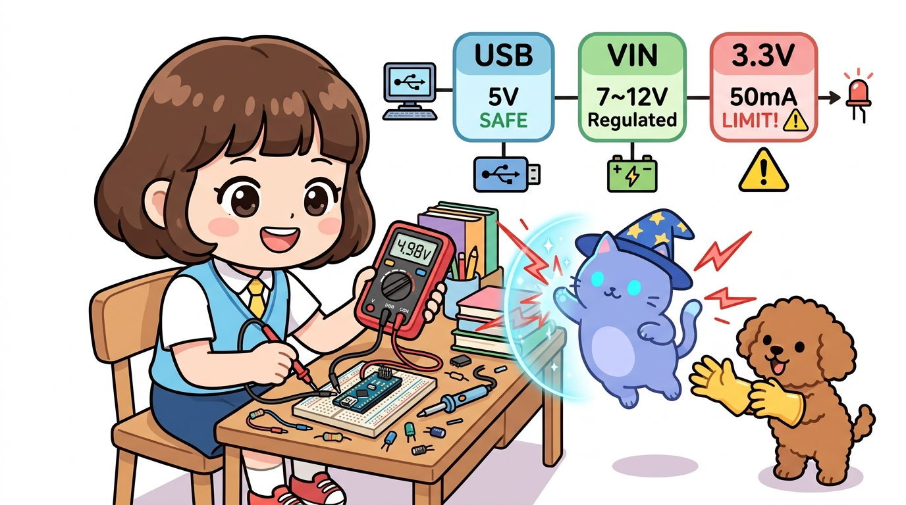

# 166_아두이노나노_전원체계와_전압주의점 ⚡⚠️



**도로시와 지니가 함께하는 우노 vs 나노 전원 레일 비교, VIN 입력 전압 범위(7~12V), 3.3V 핀의 50mA 전류 한계 및 배터리 전원 설계 노하우**

* 👧 **도로시**: "지니야! 아두이노 나노는 우노보다 몸집이 1/3밖에 안 되잖아! 그런데 우노에 있던 커다란 원통형 DC 전원 소켓(배럴잭)이 나노에는 없어! 9V 사각 배터리나 외장 전원을 꽂으려면 대체 어디로 연결해야 해?"
* 🐱 **지니**: "잠깐 도로시! 아무 핀에나 9V를 꽂으면 나노가 '펑-' 하고 연기를 내뿜으며 타버릴 수 있어! 나노는 우노와 크기가 다른 만큼 내부 전원 레귤레이터 회로와 허용 전류 용량이 완전히 다르단다!"
* 🐶 **토토**: "바우! 잘못 꽂으면 아두이노가 타버린다니, 지니의 전원 안전 수업을 똑똑히 들어야겠다 멍!"

* 🖥️ **강의 슬라이드**: [slides.md](./slides.md)

---

## 1. 👧 도로시의 아찔했던 실수: "5V 핀에 9V 배터리를 꽂을 뻔했어요!"

어느 날 도로시는 RC카를 만들기 위해 9V 배터리의 빨간 선(+)을 나노의 **`5V`** 핀에 직접 꽂으려고 했습니다.  
그 순간, 마법 고양이 지니가 깜짝 놀라 타임스톱 마법을 걸고 도로시의 손을 멈춰 세웠습니다!

> **🐱 지니**: "휴~ 큰일 날 뻔했어 도로시! **`5V` 핀은 전압 조절기를 거치지 않고 메인 두뇌 칩(ATmega328P)으로 직행하는 통로**야!  
> 거기에 5V를 초과하는 9V나 12V를 넣으면 나노의 심장 칩이 0.1초 만에 타버린단다!"  
> **👧 도로시**: "앗, 정말요?! 그럼 9V 배터리는 어디에 꽂아야 해요?"  
> **🐱 지니**: "나노 기판 구석에 적힌 **`VIN(Voltage Input)`** 핀에 꽂아야 해! VIN 핀 뒤에는 높은 전압을 안전하게 5V로 깎아주는 **LDO 전압 레귤레이터(강압기)**가 지키고 있거든!"

---

## 2. 아두이노 나노의 3가지 전원 공급 통로 (Power Map)

```
[1] USB 포트 (Mini-B / Type-C) ──> 쇼트키 다이오드(0.3V 강하) ──> VCC (5V 레일) ──> ATmega328P
[2] VIN 핀 (7V ~ 12V 배터리)   ──> 온보드 LDO 레귤레이터 (AMS1117) ──> VCC (5V 레일) ──> ATmega328P
[3] 5V 핀 (정전압 5V 직결)      ──────────────────────────────────> VCC (5V 레일) ──> ATmega328P
                                                                       │
                                                       (FT232R / CH340 내부 LDO)
                                                                       ▼
                                                          3.3V 핀 (★최대 50mA 한계!)
```

### 1) USB 포트 전원 (5V)
* PC 컴퓨터의 USB 포트로부터 안정적인 5V 전원을 공급받습니다.
* 기판 바닥면에 초소형 **쇼트키 다이오드(Schottky Diode, MBR0520)** 가 장착되어 있어, USB 전원과 VIN 전원이 동시에 들어와도 전류가 PC로 역류하는 것을 방지합니다.

### 2) VIN 핀 전원 (권장 7V ~ 12V, 한계 6V ~ 20V)
* 9V 사각 배터리, 2S 리튬이온 배터리(7.4V~8.4V), 12V 아답터를 연결하는 통로입니다.
* 기판 뒷면에 실장된 초소형 LDO 레귤레이터(LM1117-5.0 또는 AMS1117)가 높은 전압을 정밀한 5V로 낮추어 공급합니다.
* ⚠️ **발열 주의**: 리니어 레귤레이터는 남는 전압을 '열'로 태워서 버립니다. 만약 12V를 넣고 센서를 많이 켜면 레귤레이터가 손을 델 수 없을 정도로 뜨거워지므로, **7V~9V 입력을 가장 권장**합니다.

### 3) 5V 핀 (외부 정전압 공급 or 전원 출력)
* USB나 VIN으로 전원이 공급되고 있을 때는 다른 센서들에게 **5V 전원을 나누어주는 출력 핀** 역할을 합니다.
* 이미 5V로 깔끔하게 조절된 스마트폰 보조배터리 전원을 나노에 직접 공급할 때도 사용됩니다.

---

## 3. ★가장 치명적인 함정: 나노 3.3V 핀의 '50mA 전류 한계'

우노(Uno)와 나노(Nano)의 가장 결정적인 차이점 중 하나는 바로 **3.3V 전원 공급 능력**입니다!

| 비교 항목 | 아두이노 우노 (Uno R3) | 아두이노 나노 (Nano V3.0) |
| :---: | :---: | :---: |
| **3.3V 생성 방식** | 독립된 고용량 LDO 칩 (LP2985) | **USB 시리얼 변환 칩 내부 LDO 공유** |
| **최대 허용 전류** | **최대 150mA** (비교적 넉넉함) | **최대 30mA ~ 50mA 미만** (초소형 한계!) |
| **연결 가능한 모듈** | 간단한 센서, 블루투스, 소형 OLED | 초소형 센서 1~2개 (초과 시 칩 사망) |
| **절대 직결 금지 부품** | 대용량 모듈 직결 시 주의 | **ESP8266 와이파이, NRF24L01, 대형 TFT LCD** |

> [!CAUTION]
> **나노의 3.3V 핀에 와이파이(ESP8266) 모듈을 꽂으면 안 되는 이유!**  
> 정품 나노의 3.3V는 FT232RL 칩 내부에서, 호환 보드는 CH340 칩 내부에서 겨우 30~50mA만 생산합니다.  
> 전파를 쏠 때 순간적으로 200mA 이상을 소모하는 ESP8266이나 NRF24L01 무선 모듈을 나노의 3.3V 핀에 꽂으면, 시리얼 칩이 과열되어 타버리거나 PC에서 나노 인식이 영구적으로 끊어집니다!  
> ➡️ **해결책**: 3.3V 소모가 큰 부품을 쓸 때는 반드시 외부에 별도의 **AMS1117-3.3V 전원 모듈**을 장착해야 합니다.

---

## 4. 실습 예제: 나노 전원 전압 실시간 모니터링 & 저전압 경보 시스템

배터리로 움직이는 나노 프로젝트에서 배터리 전압이 6.5V 이하로 떨어지면 경고를 울리는 스마트 전압 감시 코드입니다. (아날로그 A0 핀에 10kΩ과 10kΩ 전압 분배 저항을 연결하여 계측)

```cpp
// 아두이노 나노 배터리 전압 감시 시스템
const int VOLT_PIN = A0;      // 1/2 전압 분배 회로 입력 (10k + 10k)
const int LED_WARN = 13;      // 저전압 경고 LED (나노 온보드 LED)
const int BUZZER_PIN = 9;

// 아두이노 기준 전압 (USB 전원에 따라 약 4.95V ~ 5.0V)
const float VREF = 5.0;

void setup() {
  Serial.begin(9600);
  pinMode(LED_WARN, OUTPUT);
  pinMode(BUZZER_PIN, OUTPUT);
  
  Serial.println("==========================================");
  Serial.println("⚡ 도로시의 나노 배터리 전원 감시 시스템 가동!");
  Serial.println("==========================================");
}

void loop() {
  // A0 핀의 아날로그 값 읽기 (0 ~ 1023)
  int rawADC = analogRead(VOLT_PIN);
  
  // 분배된 전압(V_out) 계산
  float vOut = (rawADC * VREF) / 1024.0;
  
  // 원래 입력 전압(V_in) 복원 (10k:10k 이므로 2배)
  float vIn = vOut * 2.0;

  Serial.print("🔋 배터리 공급 전압(VIN): ");
  Serial.print(vIn, 2);
  Serial.print(" V  (ADC: ");
  Serial.print(rawADC);
  Serial.println(")");

  // 레귤레이터 동작 최저 권장 전압(6.8V) 이하로 떨어지면 경보
  if (vIn < 6.8 && vIn > 2.0) {
    Serial.println("⚠️ [경고] 배터리 전압 부족! 즉시 교체하세요.");
    digitalWrite(LED_WARN, HIGH);
    tone(BUZZER_PIN, 1000, 100);
    delay(200);
    digitalWrite(LED_WARN, LOW);
  } else {
    digitalWrite(LED_WARN, LOW);
  }

  delay(1000);
}
```

---

## 5. 핵심 요약 정리 💡

1. **5V 핀에 고전압 직결 금지**: 5V 핀은 MCU와 직결되어 있으므로 절대 5.5V를 넘는 전압을 넣어서는 안 됩니다.
2. **외장 배터리는 VIN 핀으로**: 7V~12V 배터리(9V 사각 배터리 등)는 반드시 내장 LDO가 보호해 주는 **`VIN`** 핀에 연결해야 합니다.
3. **3.3V 50mA 전류 리미트**: 나노의 3.3V 핀은 시리얼 IC 내부의 소용량 출력이므로, ESP8266이나 NRF24L01 같은 대전류 무선 모듈을 직결하면 안 됩니다.
4. **발열 최소화 설계**: VIN에 12V를 넣는 것보다 7.4V(2S 리튬 배터리)를 넣을 때 나노의 에너지 효율이 가장 높고 발열이 적습니다.
