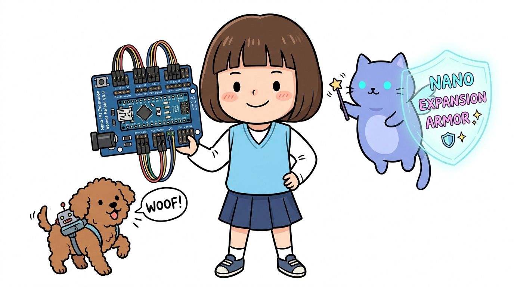

# 167_아두이노나노_센서실드_확장보드 🛡️✨



**도로시와 지니가 함께하는 Nano I/O Sensor Shield V3.0 완벽 정복, G-V-S 3핀 케이블 직결, DC 배럴잭 외장 전원 분리 및 브레드보드 프리(Breadboard-Free) 로봇 프로젝트**

* 👧 **도로시**: "지니야! 나노는 크기가 작아서 좋은데, 브레드보드에 꽂아두고 서보모터 3개랑 초음파 센서, LCD를 연결하려니 점퍼선이 엉키고 툭 치면 쏙 빠져버려! 우노처럼 편하게 전선과 모듈을 꽂을 수 있는 방법은 없을까?"
* 🐱 **지니**: "후후, 나노 전용 강화 외골격 아머, **나노 I/O 확장 센서 실드(Nano Sensor Shield V3.0)** 를 장착할 시간이군! 나노를 실드 한가운데 쏙 꽂아주기만 하면 우노보다 훨씬 더 강력한 3핀(G-V-S) 인터페이스 로봇 보드로 변신한단다!"
* 🐶 **토토**: "바우! 빵판 없이도 모터 선을 딸깍 꽂을 수 있어서 로봇 만들기에 최고다 멍!"

* 🖥️ **강의 슬라이드**: [slides.md](./slides.md)

---

## 1. 👧 도로시의 배선 스트레스: "빵판에서 전선이 자꾸 빠져요!"

로봇 강아지 관절을 만들기 위해 서보모터 3개를 작은 브레드보드에 연결하던 도로시는 한숨을 쉬었습니다.  
`5V` 핀과 `GND` 핀은 나노에 1~2개밖에 없어서, 브레드보드 전원 레일에 선을 주렁주렁 따다 보니 마치 스파게티 국수처럼 엉켜버렸기 때문입니다.

> **🐱 지니**: "도로시, 메이커 세계에는 **'G-V-S 삼총사'** 라는 편리한 표준이 있단다!"  
> * **G (Ground)**: 검은색 또는 갈색 접지선  
> * **V (VCC)**: 빨간색 5V 전원선  
> * **S (Signal)**: 노란색 또는 주황색 제어 신호선  
> 
> "나노 센서 실드는 나노의 모든 디지털 핀(D0~D13)과 아날로그 핀(A0~A7) 옆에 각각 전용 VCC와 GND 핀을 나란히 3열로 배치해 두었어!  
> 덕분에 서보모터나 센서의 3가닥 커넥터를 그냥 **딸깍- 직결**하기만 하면 끝이란다!"

---

## 2. Nano I/O Sensor Shield V3.0의 하드웨어 스펙

```
                ┌──────────────────────────────────────┐
                │ [DC 배럴잭] 7V~12V 외장 서보/보드 전원 │
                └──────────────────┬───────────────────┘
                                   │
      ┌────────────────────────────▼────────────────────────────┐
      │  [D0 ~ D13]  각 핀마다 [GND - VCC - Signal] 3핀 헤더 구비!  │
      │  ─────────────────────────────────────────────────────  │
      │              ┌────────────────────────┐                 │
      │              │   아두이노 나노 소켓   │                 │
      │              │ (가운데 쏙 꽂아서 장착)│                 │
      │              └────────────────────────┘                 │
      │  ─────────────────────────────────────────────────────  │
      │  [A0 ~ A7]   각 핀마다 [GND - VCC - Signal] 3핀 헤더 구비!  │
      │                                                         │
      │  [전용 포트]: I2C (SCL/SDA) / UART (TX/RX) / 블루투스  │
      └─────────────────────────────────────────────────────────┘
```

### 1) G-V-S 3핀 일체형 헤더 (총 22세트!)
* **디지털 14포트 (D0 ~ D13)**: 서보모터, 초음파 센서, 부저, LED 등을 브레드보드 없이 직결
* **아날로그 8포트 (A0 ~ A7)**: 조도, 온도, 가변저항, 조이스틱 등 아날로그 센서 직결

### 2) 우노급 DC 배럴잭 & 대용량 전원 공급
* 나노 자체에는 없는 **DC 전원 잭(5.5/2.1mm)** 이 실드 자체에 장착되어 있습니다.
* 9V 1A 또는 12V 2A 아답터를 실드에 바로 꽂아, 여러 개의 서보모터가 동시에 회전할 때 발생하는 전류 부족 현상을 완벽하게 해결합니다.

### 3) 전용 인터페이스 소켓 완비
* **I2C 전용 4핀 헤더**: VCC, GND, SCL, SDA (1602 LCD, OLED, MPU6050 센서 직결)
* **UART 시리얼 4핀 헤더**: VCC, GND, TX, RX (블루투스 HC-06, 시리얼 통신 직결)
* **리셋 버튼**: 나노 위에 부품이 가려져도 실드 모서리의 큰 리셋 버튼으로 편리하게 리셋 가능

---

## 3. 나노를 우노 폼팩터로 바꿔주는 'Nano-to-Uno 어댑터 실드'

나노의 또 다른 막강한 장점은 **우노용 대형 쉴드(Ethernet Shield, CNC Shield, LCD Keypad Shield 등)를 그대로 재활용**할 수 있다는 점입니다!

* **변환 원리**: 나노의 핀맵을 아두이노 우노의 긴 소켓 배열 형태로 변환해 주는 중계 어댑터 기판입니다.
* **장점**: 가격이 저렴한 나노를 두뇌로 사용하면서도, 시중에 출시된 수천 종의 우노 전용 실드를 그대로 적층하여 결합할 수 있습니다.

---

## 4. 실습 예제: 나노 센서 실드를 이용한 3관절 로봇 팔 동시 구동

나노 센서 실드의 D3, D5, D6 핀에 3개의 SG90 서보모터(G-V-S 커넥터)를 브레드보드 없이 직결하고, A0에 가변저항을 꽂아 실시간으로 움직이는 실습 코드입니다.

```cpp
#include <Servo.h>

// 3개의 서보모터 객체 생성
Servo baseServo;   // D3: 로봇 팔 바닥 회전 (Base)
Servo armServo;    // D5: 로봇 팔 어깨 관절 (Shoulder)
Servo clawServo;   // D6: 로봇 집게 손 (Gripper)

const int POT_PIN = A0; // 센서 실드 A0 포트에 직결된 아날로그 가변저항

void setup() {
  Serial.begin(9600);

  // 센서 실드의 G-V-S 핀에 직접 꽂은 서보모터 핀 할당
  baseServo.attach(3);
  armServo.attach(5);
  clawServo.attach(6);

  // 초기 위치 정렬 (90도 중립)
  baseServo.write(90);
  armServo.write(90);
  clawServo.write(90);
  delay(1000);

  Serial.println("==========================================");
  Serial.println("🦾 도로시의 나노 센서 실드 로봇 관절 제어기 가동!");
  Serial.println("브레드보드 없이 G-V-S 직결로 3개 서보를 동시 제어합니다.");
  Serial.println("==========================================");
}

void loop() {
  // A0 가변저항 값을 읽어 0~1023 ➔ 0~180도로 변환
  int potValue = analogRead(POT_PIN);
  int targetAngle = map(potValue, 0, 1023, 0, 180);

  // 1. 바닥 모터는 가변저항을 따라 회전
  baseServo.write(targetAngle);

  // 2. 어깨 관절은 반대 방향으로 연동 (180 - 각도)
  armServo.write(180 - targetAngle);

  // 3. 집게는 부드러운 스위핑 동작 (자동 여닫기)
  static unsigned long lastSweepTime = 0;
  static bool clawOpen = false;
  if (millis() - lastSweepTime > 2000) {
    lastSweepTime = millis();
    clawOpen = !clawOpen;
    clawServo.write(clawOpen ? 140 : 40); // 140도(열림) / 40도(닫힘)
    Serial.print("🤖 집게 상태: ");
    Serial.println(clawOpen ? "OPEN (열림)" : "GRAB (잡기)");
  }

  Serial.print("🎯 조종 각도: ");
  Serial.print(targetAngle);
  Serial.println("°");

  delay(20);
}
```

---

## 5. 실습 결과 및 시리얼 모니터 확인

```text
==========================================
🦾 도로시의 나노 센서 실드 로봇 관절 제어기 가동!
브레드보드 없이 G-V-S 직결로 3개 서보를 동시 제어합니다.
==========================================
🎯 조종 각도: 90°
🤖 집게 상태: OPEN (열림)
🎯 조종 각도: 125°
🎯 조종 각도: 142°
🤖 집게 상태: GRAB (잡기)
```

브레드보드 없이 실드에 케이블을 바로 꽂았기 때문에 로봇 팔이 격렬하게 움직여도 전선이 빠지거나 접촉 불량이 일어나지 않습니다!

---

## 6. 핵심 요약 정리 💡

1. **G-V-S 3핀 표준화**: 전원(V), 접지(G), 신호(S)가 일체형으로 배치되어 있어 센서 및 서보모터 배선 시간을 90% 이상 단축합니다.
2. **배선 신뢰성 향상**: 브레드보드에서 빈번하게 발생하는 점퍼선 헐거워짐과 진동 쇼트 문제를 완벽하게 해결합니다.
3. **독립 외장 전원 지원**: 내장 DC 배럴잭을 통해 고출력 모터나 서보를 구동할 수 있어 나노의 전원 공급 한계를 극복합니다.
4. **우노의 장점 + 나노의 장점 결합**: 프로토타입 개발 단계에서는 센서 실드로 우노처럼 쾌적하게 개발하고, 최종 소형 완제품 제작 시에는 나노만 쏙 빼서 초소형으로 탑재할 수 있는 유연성을 제공합니다.
