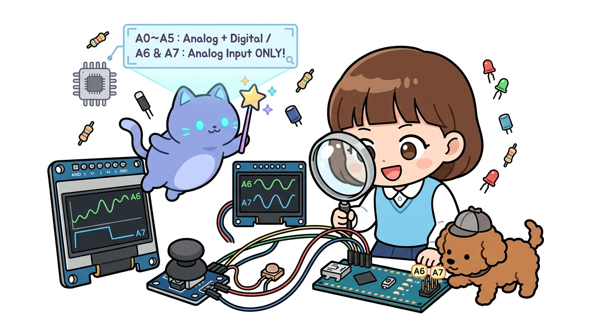

# 168_아두이노나노_A6A7아날로그_특수핀 🎛️🔍



**도로시와 지니가 함께하는 TQFP-32 패키지의 2개 추가 ADC 채널, 디지털 I/O 불가(Pure Analog-In) 원리 및 I2C 통신과 듀얼 아날로그 센서 완벽 분리 실습**

* 👧 **도로시**: "지니야! 아두이노 나노 핀들을 돋보기로 살펴보다가 엄청 신기한 걸 발견했어! 우노는 아날로그 핀이 `A0`부터 `A5`까지 딱 6개뿐인데, 나노에는 왜 `A6`이랑 `A7`이라는 2개의 보너스 핀이 더 있는 거야?"
* 🐱 **지니**: "우와, 도로시 관찰력 최고인걸! 그게 바로 나노가 우노보다 더 강력한 비장의 무기란다! 하지만 아주 치명적인 비밀이 하나 숨어 있어. `A0~A5`는 디지털 핀으로도 쓸 수 있지만, **`A6`과 `A7`은 오직 아날로그 입력(`analogRead`)으로만 동작**하거든!"
* 🐶 **토토**: "바우! A6에 LED를 꽂고 켜려고 했는데 불이 안 켜져서 깜짝 놀랐다 멍!"

* 🖥️ **강의 슬라이드**: [slides.md](./slides.md)

---

## 1. 👧 도로시의 수수께끼: "A6 핀에 꽂은 LED는 왜 불이 안 켜질까요?"

도로시는 나노의 보너스 핀 A6에 신이 나서 LED를 꽂고 코드를 짰습니다.

```cpp
// 도로시가 작성했던 코드
pinMode(A6, OUTPUT);
digitalWrite(A6, HIGH); // 앗! 불이 안 켜져요!
```

코드를 업로드하고 한참을 기다려도 LED는 감감무소식이었습니다.  
도대체 왜 이런 일이 일어났을까요?

> **🐱 지니**: "도로시, 마이크로컨트롤러 칩의 내부 반도체 회로를 들여다보면 이유를 알 수 있어!"  
> * **우노의 직사각형 DIP-28 칩**: 다리가 28개뿐이라 공간이 부족해 ADC6과 ADC7 선을 밖으로 빼내지 못했습니다.  
> * **나노의 정사각형 TQFP-32 칩**: 다리가 32개로 늘어나면서 숨어 있던 **ADC6**과 **ADC7** 두 가닥이 기판 밖으로 탈출했습니다!  
> * **하지만 핵심 반도체 구조!**:  
>   * `A0 ~ A5`: 디지털 입출력 회로(PORTC) + 아날로그 ADC 변환기 양쪽에 모두 연결됨!  
>   * `A6, A7`: **오직 아날로그 멀티플렉서(ADC Mux)에만 연결되어 있고, 디지털 출력 트랜지스터와 내부 풀업 저항이 아예 존재하지 않음!**

---

## 2. 우노 vs 나노 아날로그 핀 비교표

| 핀 이름 | 아두이노 우노 (Uno R3) | 아두이노 나노 (Nano V3.0) | `analogRead()` 가능? | `digitalRead()` / `digitalWrite()` 가능? | 내부 풀업(`INPUT_PULLUP`) 가능? |
| :---: | :---: | :---: | :---: | :---: | :---: |
| **A0 ~ A3** | 지원 (4개) | 지원 (4개) | ✅ 가능 (0~1023) | ✅ 가능 (HIGH/LOW) | ✅ 가능 (20k~50kΩ) |
| **A4 (SDA)** | I2C 겸용 | I2C 겸용 | ✅ 가능 | ✅ 가능 | ✅ 가능 |
| **A5 (SCL)** | I2C 겸용 | I2C 겸용 | ✅ 가능 | ✅ 가능 | ✅ 가능 |
| **A6** | ❌ **없음** | **보너스 탑재!** | ✅ **완벽 지원** | ❌ **절대 불가!** | ❌ **불가** (외장 저항 필수) |
| **A7** | ❌ **없음** | **보너스 탑재!** | ✅ **완벽 지원** | ❌ **절대 불가!** | ❌ **불가** (외장 저항 필수) |

---

## 3. A6과 A7이 만들어내는 메이커 프로젝트의 기적

보통 아두이노 프로젝트에서 **I2C 디스플레이(1602 LCD, OLED)** 나 I2C 센서를 사용하면 `A4(SDA)`와 `A5(SCL)` 핀을 통신용으로 빼앗기게 됩니다.  
그러면 우노에서는 아날로그 핀이 A0~A3 딱 4개만 남아 센서를 더 연결하기가 빠듯해집니다.

하지만 **나노는 A6과 A7이 있기 때문에**:
1. `A4`, `A5`는 I2C 통신(OLED 화면)에 양보하고,
2. `A0 ~ A3`는 자유롭게 다른 센서나 디지털 핀으로 쓰면서,
3. **남는 `A6`과 `A7`에 2축 조이스틱(X축, Y축)이나 배터리 전압 센서를 마음껏 직결**할 수 있습니다!

---

## 4. 실습 예제: I2C OLED를 쓰면서 A6·A7으로 2축 조이스틱 정밀 계측하기

I2C 통신(A4/A5)으로 1602 LCD에 실시간 데이터를 띄우면서, 보너스 핀 A6과 A7으로 2축 조이스틱의 X축, Y축 좌표를 읽어내는 완벽한 실습 코드입니다.

```cpp
#include <Wire.h>
#include <LiquidCrystal_I2C.h>

// A4(SDA), A5(SCL)은 I2C LCD가 사용!
LiquidCrystal_I2C lcd(0x27, 16, 2);

// 나노만의 보너스 아날로그 전용 핀 할당
const int JOY_X_PIN = A6; // 조이스틱 X축 아날로그 입력 (0~1023)
const int JOY_Y_PIN = A7; // 조이스틱 Y축 아날로그 입력 (0~1023)
const int LED_CENTER = 13; // 나노 온보드 LED (중립 표시)

void setup() {
  Serial.begin(9600);
  
  // ⚠️ 주의: A6, A7은 pinMode()를 호출할 필요가 없습니다! (호출해도 무시됨)
  pinMode(LED_CENTER, OUTPUT);

  // I2C LCD 초기화
  lcd.init();
  lcd.backlight();
  lcd.clear();
  lcd.setCursor(0, 0);
  lcd.print("Nano A6/A7 Test!");
  delay(1000);

  Serial.println("==========================================");
  Serial.println("🕹️ 도로시의 나노 A6/A7 조이스틱 계측 시스템 가동!");
  Serial.println("A4/A5는 I2C LCD로 통신하고, A6/A7은 조이스틱을 계측합니다.");
  Serial.println("==========================================");
}

void loop() {
  // A6과 A7에서 아날로그 전압 값 읽기 (0 ~ 1023)
  int xVal = analogRead(JOY_X_PIN);
  int yVal = analogRead(JOY_Y_PIN);

  // 0~1023 범위를 -100 ~ +100 좌표로 매핑 (중립이 약 512)
  int xCoord = map(xVal, 0, 1023, -100, 100);
  int yCoord = map(yVal, 0, 1023, -100, 100);

  // 조이스틱이 중앙(중립)에 머물러 있는지 판별
  if (abs(xCoord) < 10 && abs(yCoord) < 10) {
    digitalWrite(LED_CENTER, HIGH); // 중립일 때 LED 점등
  } else {
    digitalWrite(LED_CENTER, LOW);
  }

  // LCD 1행: A6(X축) / LCD 2행: A7(Y축)
  lcd.setCursor(0, 0);
  lcd.print("A6 (X): ");
  lcd.print(xCoord);
  lcd.print("   "); // 잔상 지우기

  lcd.setCursor(0, 1);
  lcd.print("A7 (Y): ");
  lcd.print(yCoord);
  lcd.print("   ");

  // 시리얼 모니터 실시간 출력
  Serial.print("🎯 A6(X Raw): ");
  Serial.print(xVal);
  Serial.print(" (");
  Serial.print(xCoord);
  Serial.print(") | A7(Y Raw): ");
  Serial.print(yVal);
  Serial.print(" (");
  Serial.print(yCoord);
  Serial.println(")");

  delay(100); // 0.1초마다 갱신
}
```

---

## 5. 실습 결과 및 시리얼 모니터 확인

```text
==========================================
🕹️ 도로시의 나노 A6/A7 조이스틱 계측 시스템 가동!
A4/A5는 I2C LCD로 통신하고, A6/A7은 조이스틱을 계측합니다.
==========================================
🎯 A6(X Raw): 512 (0) | A7(Y Raw): 508 (0)    ==> [중립]
🎯 A6(X Raw): 980 (91) | A7(Y Raw): 510 (0)   ==> [오른쪽 밀기]
🎯 A6(X Raw): 512 (0) | A7(Y Raw): 80 (-84)   ==> [아래로 당기기]
```

I2C LCD 화면이 부드럽게 글자를 표시하는 동시에, A6과 A7 핀이 조이스틱의 움직임을 1비트의 간섭도 없이 완벽하고 정밀하게 읽어냅니다!

---

## 6. 핵심 요약 정리 💡

1. **TQFP-32 패키지의 선물**: 나노는 칩의 소형 표면실장 패키지 특성 덕분에 우노보다 2개 더 많은 아날로그 핀(A6, A7)을 가집니다.
2. **Pure Analog-In 제약**: A6과 A7은 디지털 입출력 레지스터가 연결되어 있지 않으므로 `digitalRead()`, `digitalWrite()`는 절대 작동하지 않습니다.
3. **내부 풀업 저항 없음**: `pinMode(A6, INPUT_PULLUP)`이 불가능하므로, 스위치를 연결할 때는 외부에 물리적인 10kΩ 풀다운/풀업 저항을 달아주어야 합니다.
4. **I2C 프로젝트의 구원투수**: A4, A5 핀을 I2C 디스플레이 통신에 할당하더라도 아날로그 센서 핀이 부족해지지 않는 나노만의 독보적인 장점입니다.
