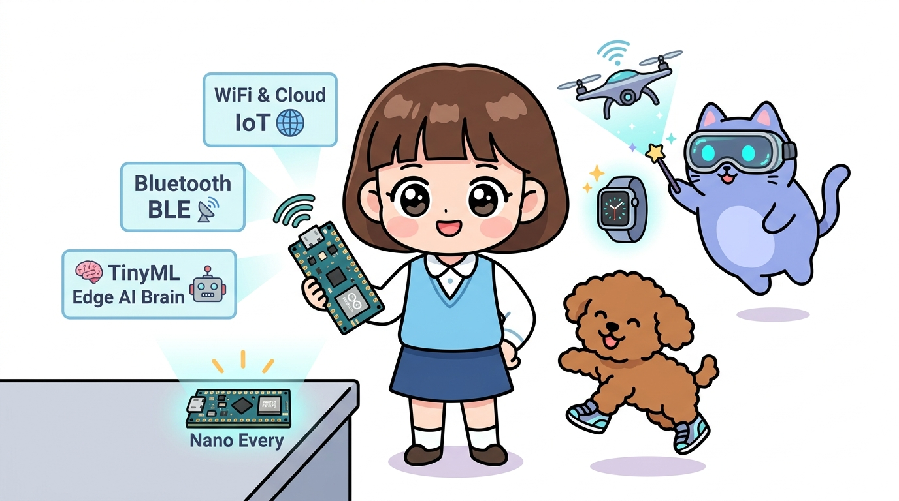
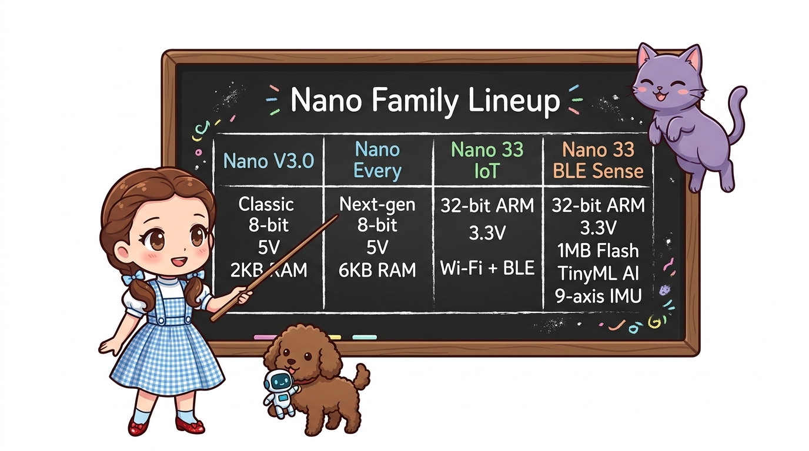
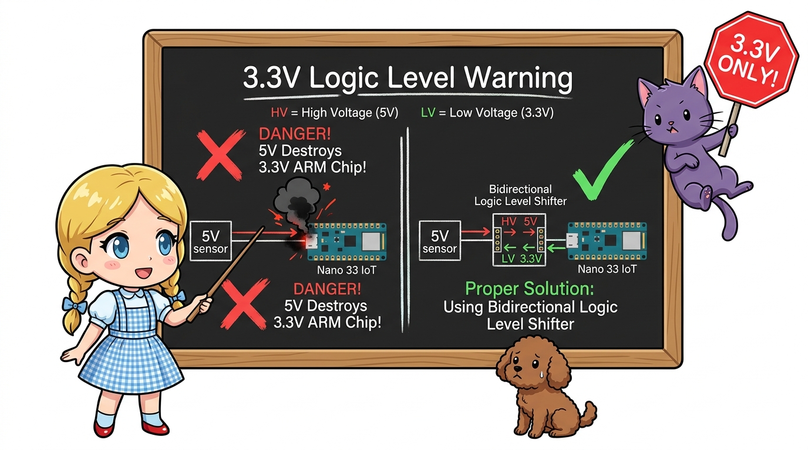
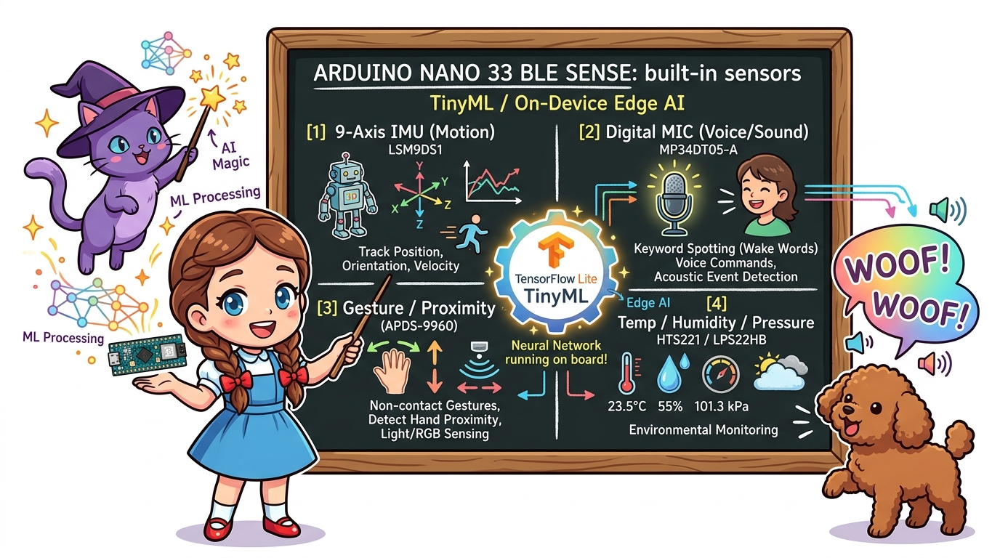
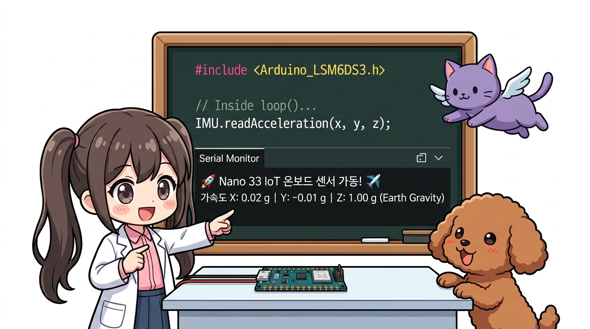

# 169_아두이노나노_차세대패밀리_Every와33 🚀🤖



**도로시와 지니가 함께하는 8비트 클래식 나노부터 32비트 ARM 코어텍스, 와이파이·블루투스 내장 Nano 33 IoT 및 온디바이스 인공지능(TinyML)의 미래**
* 👧 **도로시**: "지니야! 우리가 실습한 초록색/파란색 클래식 나노 외에도 요즘 'Nano Every', 'Nano 33 IoT', 'Nano 33 BLE' 같은 최첨단 나노 보드들이 많다고 들었어! 똑같이 생겼는데 속에는 어떤 엄청난 마법이 들어 있는 거야?"
* 🐱 **지니**: "후후, 나노 폼팩터의 껍질은 그대로 유지하면서 내부 두뇌를 32비트 슈퍼컴퓨터로 업그레이드한 **차세대 나노 패밀리**란다! 별도의 모듈 없이도 기판 자체에 와이파이, 블루투스, 9축 센서, 마이크가 내장되어 있고 손바닥 위에서 인공지능(AI) 딥러닝까지 돌릴 수 있지!"
* 🐶 **토토**: "바우! 토토의 목소리를 알아듣는 인공지능 스마트 목걸이를 만들 수 있겠다 멍!"
* 📖 **상세 강의 교재**: [index.md](./index.md)


> 여러분 안녕하세요! 이번 시간에는 '169. 아두이노나노 차세대패밀리 Every와33 🚀🤖'을 주제로 함께 흥미진진한 탐험을 떠나보겠습니다. 오늘 강의에서는 특히 도로시와 지니가 함께하는 8비트 클래식 나노부터 32비트 ARM 코어텍스, 와이파이·블루투스 내장 Nano 33 IoT 및 온디바이스 인공지능(TinyML)의 미래, 👧 도로시: "지니야! 우리가 실습한 초록색/파란색 클래식 나노 외에도 요즘 'Nano Every', 'Nano 33 IoT', 'Nano 33 BLE' 같은 최첨단 나노 보드들이 많다고 들었어! 똑같이 생겼는데 속에는 어떤 엄청난 마법이 들어 있는 거야?"를 중심으로 핵심 원리와 응용 방법을 차근차근 배워보겠습니다. 마법 멘토 지니와 호기심 많은 탐험가 도로시, 그리고 귀여운 토토와 함께 신나는 아두이노 모험을 힘차게 시작해 봅시다. 준비되셨나요?

---
## 1. 클래식 나노 vs 차세대 나노 패밀리 한눈에 비교




| 비교 모델 | 메인 프로세서 (MCU) | 동작 클록 / 아키텍처 | Flash / SRAM | 동작 전압 (로직 레벨) | 핵심 내장 기능 | 추천 활용 분야 |
| :---: | :---: | :---: | :---: | :---: | :---: | :---: |
| **Nano V3.0**<br>*(클래식)* | **ATmega328P** | 16MHz<br>8-bit AVR | 32KB<br>2KB | **5V** | 기본 디지털/아날로그<br>A6, A7 핀 구비 | 입문용, 기초 센서 실습, 소형 로봇 |
| **Nano Every**<br>*(가성비 후속작)* | **ATmega4809** | 20MHz<br>8-bit AVR | 48KB<br>**6KB (3배!)** | **5V** | 하드웨어 Serial1 독립 지원<br>고성능 레귤레이터 (1A) | 클래식 나노의 완벽한 상위 호환, 복잡한 코드 |
| **Nano 33 IoT**<br>*(사물인터넷)* | **SAMD21**<br>*(Cortex-M0+)* | 48MHz<br>32-bit ARM | 256KB<br>32KB | ⚠️ **3.3V 전용!** | **Wi-Fi + BLE (NINA-W102)**<br>6축 IMU 자이로/가속도<br>ATECC608A 보안 암호화 칩 | 아두이노 IoT 클라우드, 스마트홈, 원격 제어 |
| **Nano 33 BLE Sense**<br>*(온디바이스 AI)* | **nRF52840**<br>*(Cortex-M4F)* | 64MHz<br>32-bit ARM + FPU | **1MB**<br>**256KB** | ⚠️ **3.3V 전용!** | **TinyML 텐서플로 라이트**<br>9축 IMU, 디지털 마이크,<br>제스처/근접, 온습도/기압 센서 | 음성 인식, 제스처 모션 AI, 최첨단 웨어러블 |

우리가 지금까지 배운 **클래식 나노 V3.0(ATmega328P)** 은 2008년에 탄생한 8비트 명작이지만, 최신 IoT와 인공지능 시대를 맞아 성능이 수십 배 향상된 차세대 형제들이 탄생했습니다.

> 이번에 살펴볼 내용은 '1. 클래식 나노 vs 차세대 나노 패밀리 한눈에 비교'입니다. 슬라이드에 정리된 표를 통해 각 항목의 특징과 수치, 차이점을 한눈에 비교해 보실 수 있습니다. 이 기본 개념을 확실히 잡아두셔야 실제 부품을 브레드보드에 꽂고 코딩할 때 실수 없이 완성할 수 있습니다.
---
## 2. ⚠️ 차세대 나노 사용 시 가장 중요한 주의점: 3.3V 로직 레벨!




* [!WARNING]
* **5V 신호를 넣으면 즉시 파괴됩니다!**
* 클래식 나노와 Nano Every는 5V 로직을 사용하므로 기존 5V 센서들과 편하게 연결할 수 있습니다.
* 하지만 **Nano 33 시리즈(Nano 33 IoT, Nano 33 BLE)** 는 내부 칩셋이 **3.3V 로직 레벨**로 동작합니다!
* 입출력 핀에 5V 전압이 직접 들어오면 ARM 코어텍스 칩이 영구적으로 손상되므로, 5V 센서를 연결할 때는 반드시 **로직 레벨 시프터(Logic Level Shifter)** 나 저항 전압 분배기를 거쳐야 합니다!

> 이번 슬라이드에서는 '2. ⚠️ 차세대 나노 사용 시 가장 중요한 주의점: 3.3V 로직 레벨!'에 대해 자세히 살펴보겠습니다. 이 원리는 아두이노 시스템 전체를 관통하는 핵심 논리이므로 머릿속에 꼭 정리해 두시기 바랍니다.
---
## 3. 차세대 나노들의 특별한 매력 탐구




* **기존 5V 실습 100% 호환**: 기존 우노나 나노용 5V 센서들을 그대로 사용 가능
* **SRAM 3배 증가(6KB)**: 문자열이나 대용량 배열을 다룰 때 메모리 부족(Stack Overflow) 걱정 해소
* **독립 하드웨어 시리얼**: PC 통신(Serial)과 외부 블루투스/GPS 통신(Serial1)을 `SoftwareSerial` 꼼수 없이 하드웨어 속도로 완벽 지원!
* 보드 자체에 u-blox NINA-W102 모듈이 내장되어 있어 **Wi-Fi 인터넷 접속과 Bluetooth 저전력(BLE)** 통신이 기본 탑재!
* **아두이노 IoT 클라우드(Arduino Cloud)** 와 연동하여 스마트폰 앱 화면에서 전 세계 어디서든 나노의 센서 데이터를 실시간 대시보드로 확인 가능!
* 놀랍게도 손가락 한 마디 크기의 기판 위에 다음 센서들이 **전부 납땜되어 내장**되어 있습니다:
1. 9축 모션 센서 (LSM9DS1: 가속도, 자이로, 지자기)
2. 디지털 MP34DT05 마이크 (사람 음성 감지)
3. APDS-9960 비접촉 제스처, 색상, 근접도 센서
4. HTS221 정밀 온습도 센서 & LPS22HB 기압 센서
* **TinyML (TensorFlow Lite Micro)**: 외부 클라우드 컴퓨터 연결 없이 나노 자체에서 머신러닝 신경망을 실행하여 "기침 소리 감지", "마술봉 제스처 인식"을 배터리만으로 실행합니다.

### 1) Nano Every: 가장 똑똑하고 튼튼한 5V 직계 후계자
### 2) Nano 33 IoT: 전선 없는 클라우드 세상의 열쇠
### 3) Nano 33 BLE Sense: 센서 백화점이자 인공지능 두뇌

> 이번 슬라이드에서는 '3. 차세대 나노들의 특별한 매력 탐구'에 대해 자세히 살펴보겠습니다. 첫 번째 핵심은 기존 5V 실습 100% 호환: 기존 우노나 나노용 5V 센서들을 그대로 사용 가능이며, 두 번째로는 SRAM 3배 증가(6KB): 문자열이나 대용량 배열을 다룰 때 메모리 부족(Stack Overflow) 걱정 해소입니다. 여기에 덧붙여 독립 하드웨어 시리얼: PC 통신(Serial)과 외부 블루투스/GPS 통신(Serial1)을 SoftwareSerial 꼼수 없이 하드웨어 속도로 완벽 지원! 내용까지 함께 이해해 두시면 완벽합니다. 이 원리는 아두이노 시스템 전체를 관통하는 핵심 논리이므로 머릿속에 꼭 정리해 두시기 바랍니다.
---
## 4. 실습 개념 예제: Nano 33 IoT의 내장 6축 IMU 센서 읽기




별도의 외장 MPU6050 배선 없이, 보드 자체에 납땜된 LSM6DS3 모션 센서를 활성화하여 실시간 가속도를 읽는 간결한 코드입니다.

```cpp
#include <Arduino_LSM6DS3.h>

void setup() {
  Serial.begin(9600);
  while (!Serial); // 시리얼 모니터 연결 대기

  Serial.println("==========================================");
  Serial.println("🚀 도로시의 Nano 33 IoT 온보드 센서 탐구!");
  Serial.println("내장 6축 IMU 센서를 초기화합니다...");

  if (!IMU.begin()) {
    Serial.println("❌ 내장 IMU 센서 초기화 실패!");
    while (1);
  }
  Serial.println("✅ 내장 IMU 센서 온라인! 별도 배선 없이 계측 시작!");
  Serial.println("==========================================");
}

void loop() {
  float x, y, z;

  // 보드 자체에 내장된 센서에서 3축 가속도 읽기 (단위: g)
  if (IMU.accelerationAvailable()) {
    IMU.readAcceleration(x, y, z);

    Serial.print("✈️ 가속도 X: "); Serial.print(x, 2);
    Serial.print(" g | Y: "); Serial.print(y, 2);
    Serial.print(" g | Z: "); Serial.print(z, 2);
    Serial.println(" g");
  }

  delay(200); // 0.2초마다 갱신
}
```

> 이번 슬라이드에서는 '4. 실습 개념 예제: Nano 33 IoT의 내장 6축 IMU 센서 읽기'에 대한 실제 동작 코드를 분석해 보겠습니다. 화면의 코드를 살펴보시면, 컴퓨터가 아두이노 하드웨어에 단계별로 명령을 내리는 흐름을 명확하게 확인할 수 있습니다. 각 함수의 역할과 괄호 안의 매개변수가 하드웨어 핀과 어떤 관계를 맺고 동작하는지 주의 깊게 살펴보시기 바랍니다.
---
## 5. 핵심 요약 정리 💡


1. **폼팩터의 연속성**: 클래식 나노와 최신 Nano 33 시리즈는 핀 간격(0.1인치 30핀)과 외형 규격이 동일하여 기존 브레드보드 및 베이스보드 구조를 그대로 계승합니다.
2. **5V vs 3.3V 구분 필수**: 클래식 나노/Every는 5V 로직, Nano 33 시리즈는 3.3V 전용 로직이므로 센서 전압 매칭에 각별히 유의해야 합니다.
3. **올인원 온보드 하드웨어**: 최신 나노 보드는 외장 모듈 주렁주렁 배선할 필요 없이 Wi-Fi, BLE, 환경 센서, IMU가 기판 표면에 일체형으로 통합되어 제작 완성도를 비약적으로 높여줍니다.
4. **피지컬 컴퓨팅에서 엣지 AI로**: 단순한 LED 깜빡임에서 시작한 우리의 아두이노 모험이 이제 온디바이스 인공지능(TinyML)과 전 세계 클라우드 IoT 네트워크로 무한히 확장됩니다!

> 오늘 배운 '5. 핵심 요약 정리 💡'의 핵심 내용을 모두 정리해 보았습니다. 오늘 다룬 내용 중에서도 폼팩터의 연속성: 클래식 나노와 최신 Nano 33 시리즈는 핀 간격(0.1인치 30핀)과 외형 규격이 동일하여 기존 브레드보드 및 베이스보드 구조를 그대로 계승합니다. 부분은 앞으로의 아두이노 실습과 프로젝트에서 계속 사용되는 매우 중요한 기초 지식입니다. 오늘 배운 내용을 꼭 다시 한번 복습해 보시고, 다음 강의에서 더욱 신나고 유익한 모험으로 다시 만나겠습니다. 모두 수고 많으셨습니다!