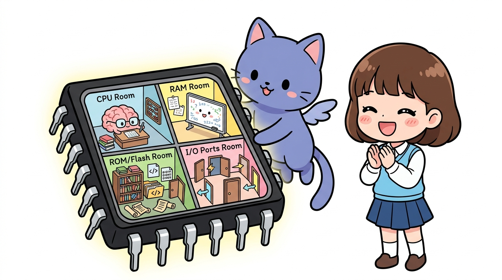
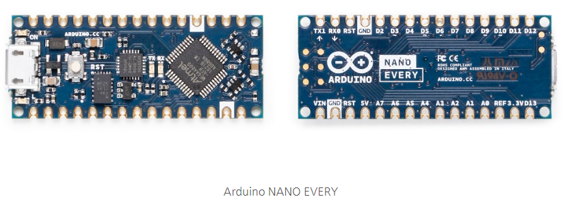

# 170_아두이노메가_소개와_핀부자MCU 👑🦾

**도로시와 지니가 함께하는 초대형 프로젝트를 위한 메가 보드 탐구**

* 👧 **도로시**: "지니야! 모터도 6개 달고 센서도 10개 달고 싶은데 핀이 모자라면 어떡해?"
* 🐱 **지니**: "그럴 땐 아두이노의 맏형, **아두이노 메가 2560(Arduino Mega)** 을 쓰면 핀 걱정이 눈 녹듯 사라진단다!"
* 🐶 **토토**: "바우! 핀이 무려 54개나 있다 멍!"

* 🖥️ **강의 슬라이드**: [slides.md](./slides.md)

---

## 1. 아두이노 메가(Mega 2560)의 탄생 배경

### 👑 ATmega2560 칩을 품은 거인 보드!
* **우노(UNO)의 한계를 넘어서**:
  * 아두이노 우노(UNO)는 14개의 디지털 핀과 6개의 아날로그 핀을 가지고 있어 입문용으로 최고지만, 대형 스마트팜이나 휴머노이드 로봇을 만들다 보면 핀이 금세 부족해집니다.
* **디지털 핀 54개**:
  * 0번부터 53번까지! 그중 15개 핀이 PWM 아날로그 출력을 지원해요.
* **아날로그 입력 핀 16개**:
  * A0부터 A15까지 센서 16개를 한 번에 꽂을 수 있어요!
* **초대용량 메모리**:
  * 플래시 메모리 **256 KB** (우노의 8배!), SRAM **8 KB** (우노의 4배!)

---

## 2. 하드웨어 시리얼 포트 4쌍 완비!

### 📻 여러 통신 장치를 동시에 연결해요!
* 우노는 시리얼 포트가 1개뿐이라 USB 디버깅 중엔 블루투스를 달기 어려웠죠?
* 메가는 4개의 독립된 하드웨어 시리얼 포트를 내장하고 있어요:
  * `Serial` : 0 (RX) & 1 (TX) - PC USB 통신용
  * `Serial1` : 19 (RX) & 18 (TX) - 블루투스 모듈 연결
  * `Serial2` : 17 (RX) & 16 (TX) - GPS 위성 수신기 연결
  * `Serial3` : 15 (RX) & 14 (TX) - 와이파이 / 기타 제어기 연결

---

## 3. 메가 보드가 활약하는 대표적인 분야

### 🏭 어디에 쓰이고 있을까요?

1. **3D 프린터 (RAMPS 1.4 보드)**:
   * X, Y, Z축 스텝모터 4~5개와 가열 노즐 히터, 온도센서를 모두 메가가 제어해요!
2. **다족 보행 로봇 (거미 로봇, 6족 로봇)**:
   * 서보 모터를 12개~18개씩 동시에 정밀 제어할 때 필수!
3. **스마트 팜 / 공장 자동화**:
   * 수십 개의 온습도, 토양, 조도 센서와 모터 밸브를 단 1대로 통합 관리!

---

## 🌟 도로시와 지니의 핵심 요약 노트!

* 👧 **도로시**: "핀이 54개, 아날로그 16개, 시리얼 포트가 4개나 있어서 아무리 복잡한 로봇도 거뜬하구나!"
* 🐱 **지니**: "정답이야! 3D 프린터나 대형 모터 제어 프로젝트를 꿈꾼다면 메가 보드가 든든한 동반자가 되어줄 거야."
* 🐶 **토토**: "바우! 다음 시간엔 메가의 거대한 하드웨어 아키텍처와 메모리를 파헤치는 **'162_아두이노메가_압도적인스펙탐구'**를 배워보자 멍!"
