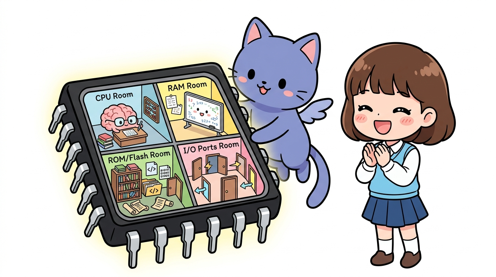
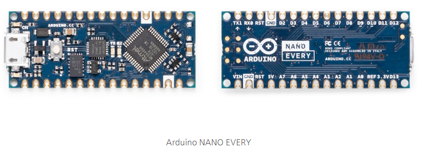

# 170_아두이노메가_소개와_핀부자MCU 👑🦾

**도로시와 지니가 함께하는 초대형 프로젝트를 위한 메가 보드 탐구**
* 👧 **도로시**: "지니야! 모터도 6개 달고 센서도 10개 달고 싶은데 핀이 모자라면 어떡해?"
* 🐱 **지니**: "그럴 땐 아두이노의 맏형, **아두이노 메가 2560(Arduino Mega)** 을 쓰면 핀 걱정이 눈 녹듯 사라진단다!"
* 🐶 **토토**: "바우! 핀이 무려 54개나 있다 멍!"
* 📖 **상세 강의 교재**: [index.md](./index.md)

> 여러분 안녕하세요! 이번 시간에는 '170. 아두이노메가 소개와 핀부자MCU 👑🦾'을 주제로 함께 흥미진진한 탐험을 떠나보겠습니다. 오늘 강의에서는 특히 도로시와 지니가 함께하는 초대형 프로젝트를 위한 메가 보드 탐구, 👧 도로시: "지니야! 모터도 6개 달고 센서도 10개 달고 싶은데 핀이 모자라면 어떡해?"를 중심으로 핵심 원리와 응용 방법을 차근차근 배워보겠습니다. 마법 멘토 지니와 호기심 많은 탐험가 도로시, 그리고 귀여운 토토와 함께 신나는 아두이노 모험을 힘차게 시작해 봅시다. 준비되셨나요?

---

## 1. 아두이노 메가(Mega 2560)의 탄생 배경

* **우노(UNO)의 한계를 넘어서**:
* 아두이노 우노(UNO)는 14개의 디지털 핀과 6개의 아날로그 핀을 가지고 있어 입문용으로 최고지만, 대형 스마트팜이나 휴머노이드 로봇을 만들다 보면 핀이 금세 부족해집니다.
* **디지털 핀 54개**:
* 0번부터 53번까지! 그중 15개 핀이 PWM 아날로그 출력을 지원해요.
* **아날로그 입력 핀 16개**:
* A0부터 A15까지 센서 16개를 한 번에 꽂을 수 있어요!
* **초대용량 메모리**:
* 플래시 메모리 **256 KB** (우노의 8배!), SRAM **8 KB** (우노의 4배!)

### 👑 ATmega2560 칩을 품은 거인 보드!

> 이번 슬라이드에서는 '1. 아두이노 메가(Mega 2560)의 탄생 배경'에 대해 자세히 살펴보겠습니다. 화면의 다이어그램과 사진을 함께 참고해 주시기 바랍니다. 첫 번째 핵심은 우노(UNO)의 한계를 넘어서이며, 두 번째로는 아두이노 우노(UNO)는 14개의 디지털 핀과 6개의 아날로그 핀을 가지고 있어 입문용으로 최고지만, 대형 스마트팜이나 휴머노이드 로봇을 만들다 보면 핀이 금세 부족해집니다.입니다. 여기에 덧붙여 디지털 핀 54개 내용까지 함께 이해해 두시면 완벽합니다. 이 원리는 아두이노 시스템 전체를 관통하는 핵심 논리이므로 머릿속에 꼭 정리해 두시기 바랍니다.

---

## 2. 하드웨어 시리얼 포트 4쌍 완비!

* 우노는 시리얼 포트가 1개뿐이라 USB 디버깅 중엔 블루투스를 달기 어려웠죠?
* 메가는 4개의 독립된 하드웨어 시리얼 포트를 내장하고 있어요:
* `Serial` : 0 (RX) & 1 (TX) - PC USB 통신용
* `Serial1` : 19 (RX) & 18 (TX) - 블루투스 모듈 연결
* `Serial2` : 17 (RX) & 16 (TX) - GPS 위성 수신기 연결
* `Serial3` : 15 (RX) & 14 (TX) - 와이파이 / 기타 제어기 연결

### 📻 여러 통신 장치를 동시에 연결해요!

> 이번 슬라이드에서는 '2. 하드웨어 시리얼 포트 4쌍 완비!'에 대해 자세히 살펴보겠습니다. 화면의 다이어그램과 사진을 함께 참고해 주시기 바랍니다. 첫 번째 핵심은 우노는 시리얼 포트가 1개뿐이라 USB 디버깅 중엔 블루투스를 달기 어려웠죠?이며, 두 번째로는 메가는 4개의 독립된 하드웨어 시리얼 포트를 내장하고 있어요입니다. 여기에 덧붙여 Serial : 0 (RX) & 1 (TX) - PC USB 통신용 내용까지 함께 이해해 두시면 완벽합니다. 이 원리는 아두이노 시스템 전체를 관통하는 핵심 논리이므로 머릿속에 꼭 정리해 두시기 바랍니다.

---

## 3. 메가 보드가 활약하는 대표적인 분야

1. **3D 프린터 (RAMPS 1.4 보드)**:
* X, Y, Z축 스텝모터 4~5개와 가열 노즐 히터, 온도센서를 모두 메가가 제어해요!
2. **다족 보행 로봇 (거미 로봇, 6족 로봇)**:
* 서보 모터를 12개~18개씩 동시에 정밀 제어할 때 필수!
3. **스마트 팜 / 공장 자동화**:
* 수십 개의 온습도, 토양, 조도 센서와 모터 밸브를 단 1대로 통합 관리!

### 🏭 어디에 쓰이고 있을까요?

> 이번 슬라이드에서는 '3. 메가 보드가 활약하는 대표적인 분야'에 대해 자세히 살펴보겠습니다. 화면의 다이어그램과 사진을 함께 참고해 주시기 바랍니다. 첫 번째 핵심은 D 프린터 (RAMPS 1.4 보드)이며, 두 번째로는 X, Y, Z축 스텝모터 4~5개와 가열 노즐 히터, 온도센서를 모두 메가가 제어해요!입니다. 여기에 덧붙여 다족 보행 로봇 (거미 로봇, 6족 로봇) 내용까지 함께 이해해 두시면 완벽합니다. 이 원리는 아두이노 시스템 전체를 관통하는 핵심 논리이므로 머릿속에 꼭 정리해 두시기 바랍니다.

---

## 🌟 도로시와 지니의 핵심 요약 노트!

* 👧 **도로시**: "핀이 54개, 아날로그 16개, 시리얼 포트가 4개나 있어서 아무리 복잡한 로봇도 거뜬하구나!"
* 🐱 **지니**: "정답이야! 3D 프린터나 대형 모터 제어 프로젝트를 꿈꾼다면 메가 보드가 든든한 동반자가 되어줄 거야."
* 🐶 **토토**: "바우! 다음 시간엔 메가의 거대한 하드웨어 아키텍처와 메모리를 파헤치는 **'162_아두이노메가_압도적인스펙탐구'**를 배워보자 멍!"

> 오늘 배운 '🌟 도로시와 지니의 핵심 요약 노트!'의 핵심 내용을 모두 정리해 보았습니다. 오늘 다룬 내용 중에서도 👧 도로시: "핀이 54개, 아날로그 16개, 시리얼 포트가 4개나 있어서 아무리 복잡한 로봇도 거뜬하구나!" 부분은 앞으로의 아두이노 실습과 프로젝트에서 계속 사용되는 매우 중요한 기초 지식입니다. 오늘 배운 내용을 꼭 다시 한번 복습해 보시고, 다음 강의에서 더욱 신나고 유익한 모험으로 다시 만나겠습니다. 모두 수고 많으셨습니다!