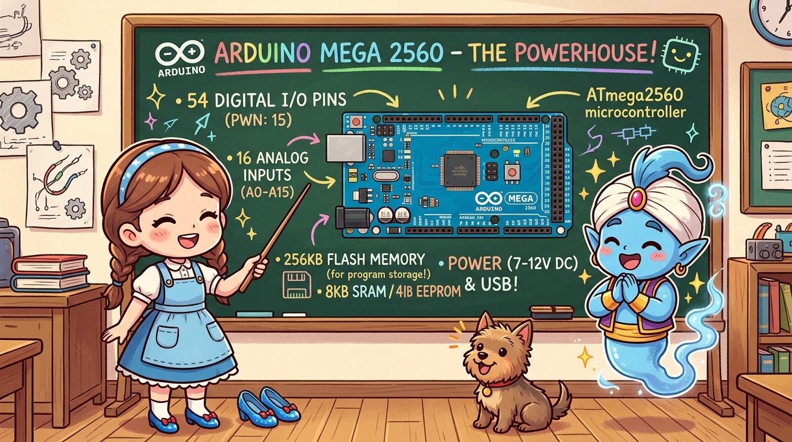
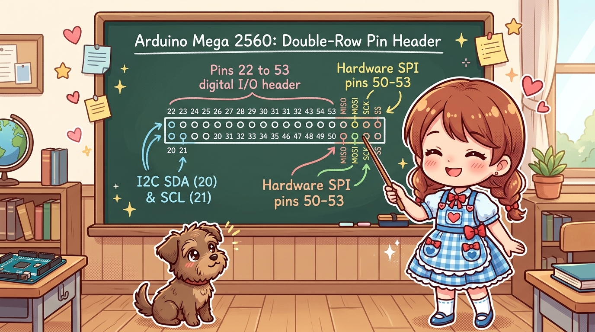
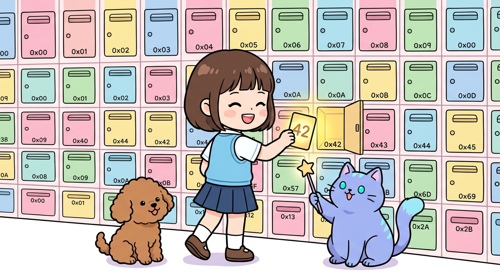

# 171_아두이노메가_압도적인스펙탐구 👑🦾

* **핀 부족은 이제 그만! ATmega2560 두뇌를 탑재한 아두이노의 제왕, 메가 2560**
* 디지털 54핀, PWM 15핀, 아날로그 16핀, 256KB 대용량 플래시 메모리의 거대한 스펙을 해부합니다.
* 📖 **상세 강의 교재**: [index.md](./index.md)

> 여러분 안녕하세요! 이번 시간에는 '171. 아두이노메가 압도적인스펙탐구 👑🦾'을 주제로 함께 흥미진진한 탐험을 떠나보겠습니다. 마법 멘토 지니와 호기심 많은 탐험가 도로시, 그리고 귀여운 토토와 함께 신나는 아두이노 모험을 힘차게 시작해 봅시다. 준비되셨나요?

---

## 1. 초대형 프로젝트의 구원투수: 메가 2560 🏟️

* **👧 도로시**: "지니야! 핀이 모자라서 센서를 더 못 달겠어! 어떡하지?"
* **🐱 지니**: "걱정 마 도로시! 아두이노 패밀리의 든든한 맏형, **아두이노 메가 2560(Arduino Mega)**을 출동시키면 핀 걱정이 눈 녹듯 사라진단다!"
* **🐶 토토**: "멍멍! (핀이 무려 54개나 되는 천하장사 거인이다 멍!)"

| 비교 사양 | 아두이노 우노 (UNO) | 아두이노 메가 (Mega 2560) | 성능 향상 배율 |
| :--- | :---: | :---: | :---: |
| **메인 MCU** | ATmega328P | **ATmega2560** | 고성능 100핀 패키지 |
| **디지털 I/O 핀** | 14개 | **54개 (D0 ~ D53)** | **약 4배 증대!** |
| **PWM 출력 핀** | 6개 | **15개** | **2.5배 증대!** |
| **아날로그 입력** | 6개 (A0~A5) | **16개 (A0~A15)** | **약 2.7배 증대!** |
| **플래시 메모리** | 32 KB | **256 KB** | **무려 8배! (방대한 라이브러리 탑재)** |
| **SRAM (메모리)** | 2 KB | **8 KB** | **4배! (변수 및 버퍼 여유)** |
| **하드웨어 UART** | 1개 (Serial) | **4개 (Serial ~ Serial3)** | **독립 통신 포트 4쌍!** |

센서를 10개 달고, 모터를 6개 구동하며, LCD 디스플레이까지 연결해야 하는 복잡한 로봇 프로젝트를 구상하다 보면 우노의 14개 핀은 순식간에 동이 납니다!
### 👑 아두이노 우노 vs 메가 2560 스펙 대조

> 이번에 살펴볼 내용은 '1. 초대형 프로젝트의 구원투수: 메가 2560 🏟️'입니다. 슬라이드에 정리된 표를 통해 각 항목의 특징과 수치, 차이점을 한눈에 비교해 보실 수 있습니다. 이 기본 개념을 확실히 잡아두셔야 실제 부품을 브레드보드에 꽂고 코딩할 때 실수 없이 완성할 수 있습니다.

---

## 2. 54개 디지털 핀과 16개 아날로그 핀 배치도 🗺️

1. **0번 ~ 13번**: 우노와 동일한 표준 핀아웃 (기존 우노용 쉴드와 상단 호환 유지).
2. **14번 ~ 21번**: 하드웨어 시리얼 포트 3쌍(`Serial1`, `Serial2`, `Serial3`) 및 I2C 통신선(`SDA 20`, `SCL 21`).
3. **22번 ~ 53번**: 보드 끝단 더블 로우 핀헤더! 대규모 LED 전광판, 다채널 릴레이, 스테핑 모터 드라이버를 줄줄이 직결.
4. **A0번 ~ A15번**: 16채널의 독립된 아날로그 센서 측정 포트.

아두이노 메가의 오른쪽 끝에는 2열로 길게 늘어선 거대한 더블 로우(Double-Row) 핀헤더가 자리 잡고 있습니다.
### 📌 핀 블록별 기능 구분

> 이번에 살펴볼 내용은 '2. 54개 디지털 핀과 16개 아날로그 핀 배치도 🗺️'입니다. 화면의 회로도와 부품 사진을 보면서 각 핀과 배선이 어떻게 구성되어 있는지 눈으로 직접 따라와 주시기 바랍니다. 첫째로 번 ~ 13번: 우노와 동일한 표준 핀아웃 (기존 우노용 쉴드와 상단 호환 유지).에 유의해야 하며, 둘째로 번 ~ 21번: 하드웨어 시리얼 포트 3쌍(Serial1, Serial2, Serial3) 및 I2C 통신선(SDA 20, SCL 21).라는 점이 핵심입니다. 이 기본 개념을 확실히 잡아두셔야 실제 부품을 브레드보드에 꽂고 코딩할 때 실수 없이 완성할 수 있습니다.

---

## 3. 256KB 대용량 플래시 메모리와 8KB SRAM의 위력 💾🚀

* **256KB 플래시 메모리**:
- 3D 프린터 제어 프로그램(Marlin)처럼 1만 줄이 넘는 거대한 펌웨어도 거뜬히 적재합니다.
* **8KB SRAM**:
- 복잡한 수학 공식, PID 제어 알고리즘, 대규모 이미지 비트맵 버퍼를 끊김 없이 고속 연산합니다.

우노에서는 코드 길이가 조금만 길어지거나 고해상도 그래픽 라이브러리(OLED, 글꼴 폰트)를 넣으면 "메모리 부족" 경고가 발생했습니다.

> 이번 슬라이드에서는 '3. 256KB 대용량 플래시 메모리와 8KB SRAM의 위력 💾🚀'에 대해 자세히 살펴보겠습니다. 화면의 다이어그램과 사진을 함께 참고해 주시기 바랍니다. 첫 번째 핵심은 KB 플래시 메모리이며, 두 번째로는 D 프린터 제어 프로그램(Marlin)처럼 1만 줄이 넘는 거대한 펌웨어도 거뜬히 적재합니다.입니다. 여기에 덧붙여 KB SRAM 내용까지 함께 이해해 두시면 완벽합니다. 이 원리는 아두이노 시스템 전체를 관통하는 핵심 논리이므로 머릿속에 꼭 정리해 두시기 바랍니다.

---

## 🌟 도로시와 지니의 핵심 요약! 🏆

* **👧 도로시**: "핀이 54개나 되니까 이제 어떤 거대한 로봇이라도 마음껏 만들 수 있겠어!"
* **🐱 지니**: "맞아! 거인 MCU를 다루기 위해선 먼저 컴퓨터와 올바르게 연결해야 한단다. 다음 시간 **'163_아두이노메가_개발환경과_부트로더'**에서 확인해 보자!"

* [x] **54개 디지털 핀**: 다축 모터와 수십 개의 센서를 확장 쉴드 없이도 여유롭게 배선합니다.
* [x] **16개 아날로그 핀**: 농장, 공장, 스마트홈의 환경 센서 16개를 1대로 통합 측정합니다.
* [x] **8배 메모리**: 거대한 소스코드와 복잡한 라이브러리를 용량 걱정 없이 빌드합니다.

> 오늘 배운 '🌟 도로시와 지니의 핵심 요약! 🏆'의 핵심 내용을 모두 정리해 보았습니다. 오늘 다룬 내용 중에서도 [x] 54개 디지털 핀: 다축 모터와 수십 개의 센서를 확장 쉴드 없이도 여유롭게 배선합니다. 부분은 앞으로의 아두이노 실습과 프로젝트에서 계속 사용되는 매우 중요한 기초 지식입니다. 지니 멘토가 강조했듯이 맞아! 거인 MCU를 다루기 위해선 먼저 컴퓨터와 올바르게 연결해야 한단다. 다음 시간 라는 점을 꼭 마음에 새겨두시길 바랍니다. 오늘 배운 내용을 꼭 다시 한번 복습해 보시고, 다음 강의에서 더욱 신나고 유익한 모험으로 다시 만나겠습니다. 모두 수고 많으셨습니다!