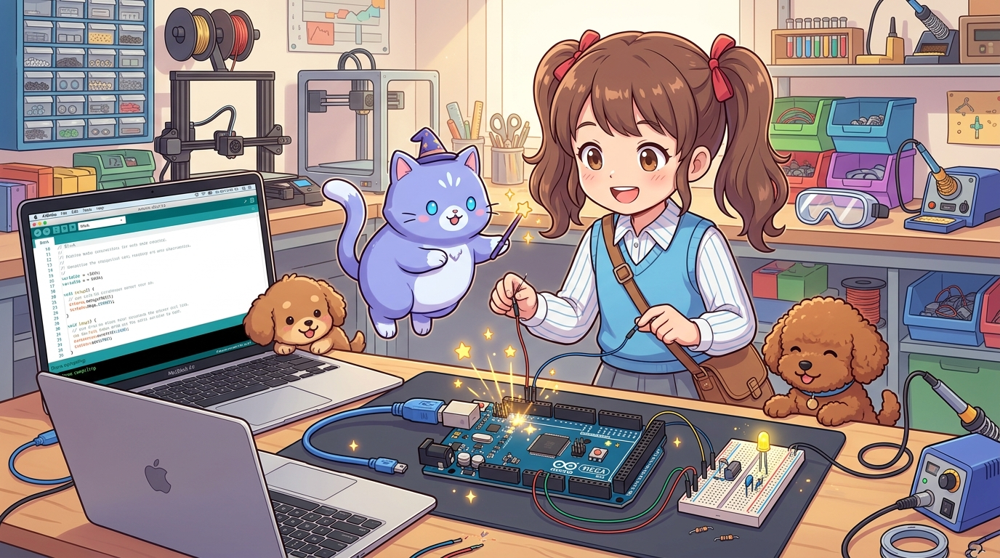
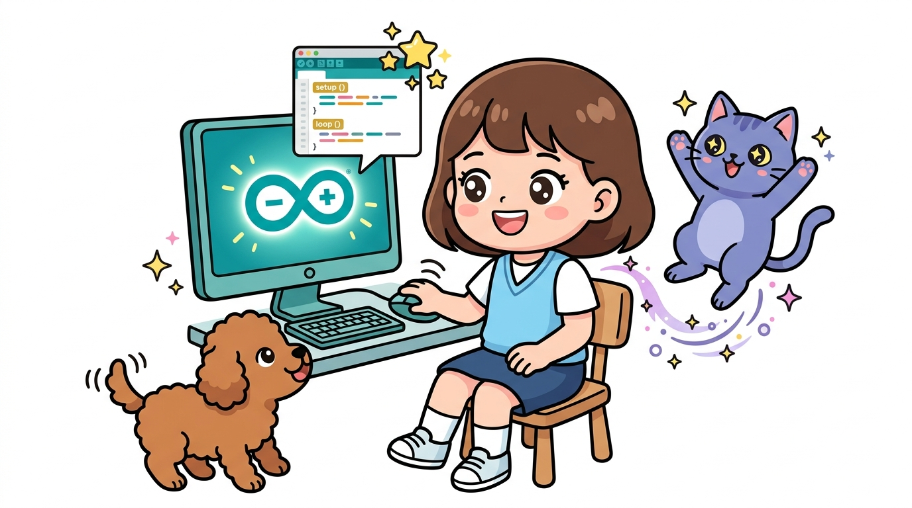
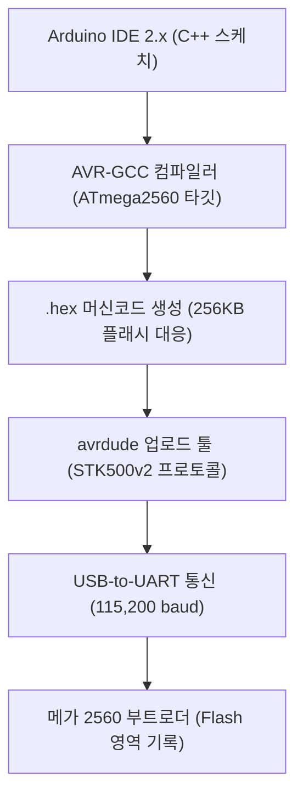
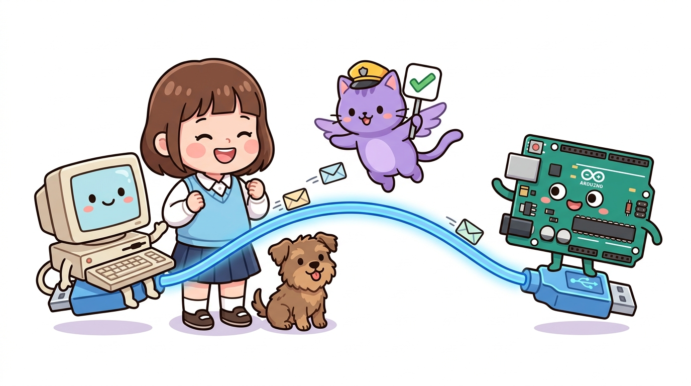
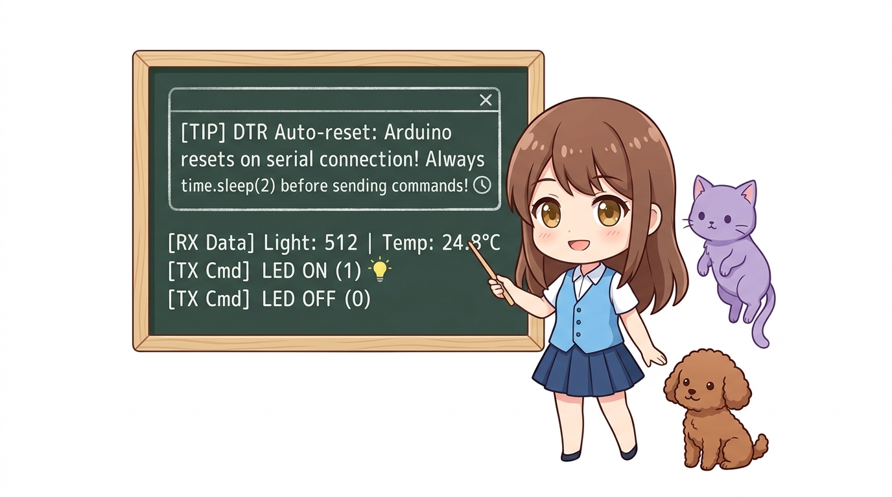
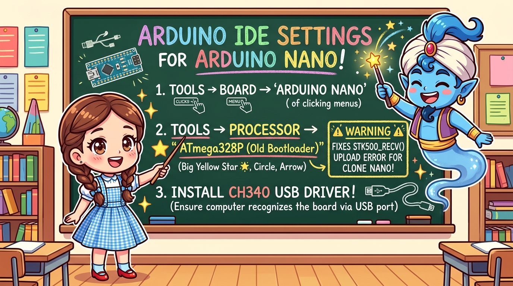
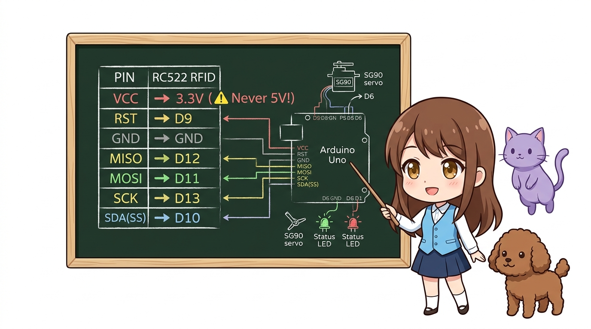
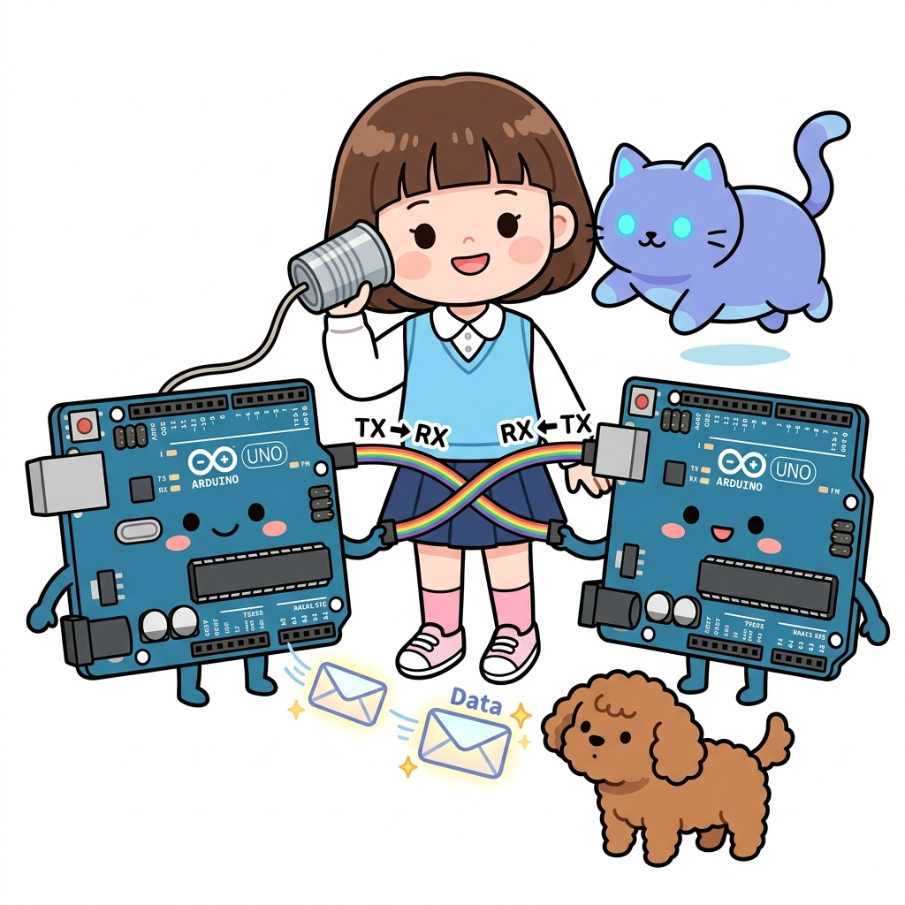
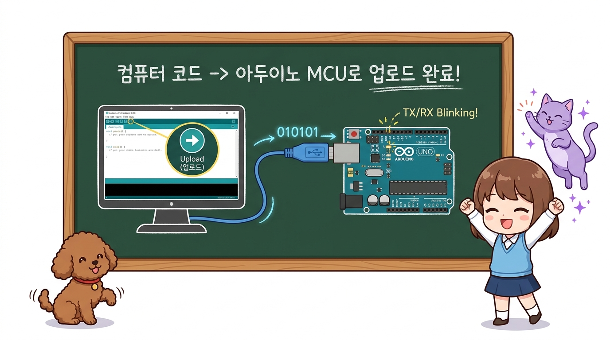

# 172_아두이노메가_개발환경과_부트로더 💻⚡



* **거인 MCU를 깨우는 첫 단계! 아두이노 IDE 2.x 설정부터 USB 인터페이스 칩셋, STK500v2 부트로더와 ICSP 프로그래밍까지 완벽 정복**
* ATmega2560 칩을 제어하기 위한 보드 매니저 구성, 정품(ATmega16U2)과 호환 보드(CH340) 드라이버 설치, DTR 오토리셋 회로 원리 및 부트로더 복구 절차를 학습합니다.
* 📖 **상세 강의 교재**: [index.md](./index.md)


> 여러분 안녕하세요! 이번 시간에는 '172. 아두이노메가 개발환경과 부트로더 💻⚡'을 주제로 함께 흥미진진한 탐험을 떠나보겠습니다. 마법 멘토 지니와 호기심 많은 탐험가 도로시, 그리고 귀여운 토토와 함께 신나는 아두이노 모험을 힘차게 시작해 봅시다. 준비되셨나요?

---
## 1. 아두이노 메가 2560 개발환경(IDE) 구축하기 🛠️




* **👧 도로시**: "지니야! 우노에서 쓰던 스케치를 메가에 그대로 올려도 괜찮을까?"
* **🐱 지니**: "코드 자체는 대부분 그대로 동작하지만, 메가의 거대한 메모리와 54개 핀을 제대로 다루려면 IDE에서 '우리의 칩이 ATmega2560이다!'라고 알려주는 보드 설정이 필수란다!"
* **🐶 토토**: "멍멍! (보드 설정을 잘못하면 업로드 에러가 난다 멍!)"

1. **보드 선택**:
- 메뉴: `도구(Tools)` ➡️ `보드(Board)` ➡️ `Arduino AVR Boards` ➡️ **`Arduino Mega or Mega 2560`**
2. **프로세서 지정 (중요!)**:
- 메뉴: `도구` ➡️ `프로세서(Processor)` ➡️ **`ATmega2560 (Mega 2560)`**
- *참고*: 간혹 구형 보드 중에 `ATmega1280` 칩을 사용한 초기 메가 보드가 있으므로, 보드 표면의 각인을 확인하여 2560인지 1280인지 선택합니다.
3. **포트 지정**:
- 메뉴: `도구` ➡️ `포트(Port)` ➡️ 메가 보드가 인식된 COM 포트(Windows) 또는 `/dev/cu.usbmodem...` / `/dev/cu.usbserial...` (Mac/Linux)를 지정합니다.

아두이노 메가는 우노(UNO)와 프로그래밍 언어(C/C++) 및 문법은 동일하지만, 내부 메모리 맵과 마이크로컨트롤러 아키텍처가 완전히 다릅니다. 따라서 컴파일러(AVR-GCC)가 올바른 바이너리 코드를 생성할 수 있도록 IDE에서 보드 설정을 정확히 맞춰주어야 합니다.
### 📌 IDE 2.x 보드 및 프로세서 설정 단계



> 오늘 배운 '1. 아두이노 메가 2560 개발환경(IDE) 구축하기 🛠️'의 핵심 내용을 모두 정리해 보았습니다. 오늘 다룬 내용 중에서도 보드 선택 부분은 앞으로의 아두이노 실습과 프로젝트에서 계속 사용되는 매우 중요한 기초 지식입니다. 지니 멘토가 강조했듯이 코드 자체는 대부분 그대로 동작하지만, 메가의 거대한 메모리와 54개 핀을 제대로 다루려면 IDE에서 라는 점을 꼭 마음에 새겨두시길 바랍니다. 오늘 배운 내용을 꼭 다시 한번 복습해 보시고, 다음 강의에서 더욱 신나고 유익한 모험으로 다시 만나겠습니다. 모두 수고 많으셨습니다!
---
## 2. USB-to-UART 통신 칩셋: 정품 16U2 vs 호환 CH340 🔌




* **⚠️ 주의 (호환 보드 드라이버 미설치 시)**:
* 가성비 알리/국내 쇼핑몰 호환 메가 보드를 PC에 꽂았는데 포트 목록에 나타나지 않는다면 99% CH340 드라이버 문제입니다! `CH341SER.EXE` (Windows) 또는 `CH34x_Install_V1.5.pkg` (Mac)를 설치하면 즉시 해결됩니다.

| 항목 | 정품 및 고급형 (ATmega16U2) | 가성비 호환형 (CH340G / CH340C) |
| :--- | :--- | :--- |
| **변환 칩셋** | **Atmel ATmega16U2** (마이크로컨트롤러) | **WCH CH340G** (전용 USB-Serial IC) |
| **드라이버** | 운영체제 표준 CDC ACM 내장 (별도 설치 불필요) | 제조사 전용 **CH341SER 드라이버** 설치 필요 |
| **외형 특징** | USB 포트 옆 4x4mm 정사각형 칩 | 직사각형 SOP-16 핀 칩 + 12MHz 크리스털 |
| **특수 기능** | DFU 펌웨어 교체로 USB 키보드/마우스/MIDI 변신 가능 | 순수 시리얼 통신 전용 |
| **업로드 안정성** | 매우 우수 | 우수 (드라이버 설치 시 완벽 호환) |

메가 보드를 PC와 연결할 때, PC의 USB 신호를 ATmega2560의 하드웨어 시리얼(UART RX0/TX0) 신호로 변환해 주는 전용 변환 칩셋이 탑재되어 있습니다.

> 이번에 살펴볼 내용은 '2. USB-to-UART 통신 칩셋: 정품 16U2 vs 호환 CH340 🔌'입니다. 슬라이드에 정리된 표를 통해 각 항목의 특징과 수치, 차이점을 한눈에 비교해 보실 수 있습니다. 이 기본 개념을 확실히 잡아두셔야 실제 부품을 브레드보드에 꽂고 코딩할 때 실수 없이 완성할 수 있습니다.
---
## 3. DTR 오토리셋 회로의 비밀과 업로드 원리 🔄




1. **PC의 신호 전송**: 업로드 시작 직전, PC 시리얼 포트가 DTR 신호를 LOW로 떨어뜨립니다.
2. **커패시터(100nF)의 미분 동작**: DTR 신호선의 0.1μF 커패시터가 순간적인 음(-)의 전압 펄스를 만들어 ATmega2560의 `RESET` 핀을 접지로 순간 쇼트시킵니다.
3. **부트로더 실행**: MCU가 리셋되자마자 플래시 메모리 최상단에 상주하는 **STK500v2 부트로더**가 깨어납니다.
4. **핸드셰이크**: 부트로더는 1~2초 동안 USB 시리얼 포트로부터 업로드 명령이 들어오는지 귀를 기울입니다.
5. **플래시 라이팅**: PC의 `avrdude` 프로그램이 보낸 새 펌웨어 바이너리를 플래시 메모리에 고속 기록(115,200 baud)한 후, 스케치의 `setup()` 함수로 점프합니다.

우리가 IDE에서 `업로드` 버튼을 누르면, 사람이 보드의 리셋 버튼을 누르지 않아도 메가가 스스로 재부팅되며 새 코드를 받아 적습니다. 이 마법 같은 기능이 바로 **DTR(Data Terminal Ready) 자동 리셋 회로**입니다.

> 이번 슬라이드에서는 '3. DTR 오토리셋 회로의 비밀과 업로드 원리 🔄'에 대해 자세히 살펴보겠습니다. 첫 번째 핵심은 PC의 신호 전송: 업로드 시작 직전, PC 시리얼 포트가 DTR 신호를 LOW로 떨어뜨립니다.이며, 두 번째로는 커패시터(100nF)의 미분 동작: DTR 신호선의 0.1μF 커패시터가 순간적인 음(-)의 전압 펄스를 만들어 ATmega2560의 RESET 핀을 접지로 순간 쇼트시킵니다.입니다. 여기에 덧붙여 부트로더 실행: MCU가 리셋되자마자 플래시 메모리 최상단에 상주하는 STK500v2 부트로더가 깨어납니다. 내용까지 함께 이해해 두시면 완벽합니다. 이 원리는 아두이노 시스템 전체를 관통하는 핵심 논리이므로 머릿속에 꼭 정리해 두시기 바랍니다.
---

## 4. 부트로더가 벽돌(Brick)되었을 때: ICSP 헤더로 복구하기 🚑



간혹 펌웨어 업로드 도중 케이블이 빠지거나, 비정상적인 전압 충격으로 부트로더가 손상되면 *"avrdude: stk500v2_ReceiveMessage(): timeout"* 에러가 발생하며 업로드가 영구 차단될 수 있습니다.

> 이번 슬라이드에서는 '4. 부트로더가 벽돌(Brick)되었을 때: ICSP 헤더로 복구하기 🚑'에 대해 자세히 살펴보겠습니다. 화면의 다이어그램과 사진을 함께 참고해 주시기 바랍니다. 이 원리는 아두이노 시스템 전체를 관통하는 핵심 논리이므로 머릿속에 꼭 정리해 두시기 바랍니다.

---
### 📌 ICSP(In-Circuit Serial Programming) 6핀 단자




1. **메인 MCU ICSP**: ATmega2560 직결 (보드 중앙 우측)
2. **USB 칩 ICSP**: ATmega16U2 직결 (USB 포트 바로 뒤)

메가 보드에는 6핀으로 구성된 2개의 ICSP 단자가 있습니다:

> 이번 슬라이드에서는 '📌 ICSP(In-Circuit Serial Programming) 6핀 단자'에 대해 자세히 살펴보겠습니다. 첫 번째 핵심은 메인 MCU ICSP: ATmega2560 직결 (보드 중앙 우측)이며, 두 번째로는 USB 칩 ICSP: ATmega16U2 직결 (USB 포트 바로 뒤)입니다. 이 원리는 아두이노 시스템 전체를 관통하는 핵심 논리이므로 머릿속에 꼭 정리해 두시기 바랍니다.
---
### 💡 다른 아두이노(우노)를 프로그래머로 사용하여 부트로더 굽기




1. 여분의 우노 보드에 `파일` ➡️ `예제` ➡️ `11.ArduinoISP` ➡️ `ArduinoISP` 예제를 업로드합니다.
2. 우노와 고장 난 메가의 ICSP 핀을 점퍼선으로 연결합니다:
- 우노 **D10** ➡️ 메가 **RESET** (ICSP 5번 핀)
- 우노 **D11 (MOSI)** ➡️ 메가 **MOSI** (ICSP 4번 핀)
- 우노 **D12 (MISO)** ➡️ 메가 **MISO** (ICSP 1번 핀)
- 우노 **D13 (SCK)** ➡️ 메가 **SCK** (ICSP 3번 핀)
- 5V ➡️ 5V, GND ➡️ GND
3. IDE 메뉴에서 `도구` ➡️ `프로그래머` ➡️ **`Arduino as ISP`** 선택.
4. `도구` ➡️ **`부트로더 굽기(Burn Bootloader)`** 클릭! 약 15초 후 새 생명이 주입됩니다.

> 이번 슬라이드에서는 '💡 다른 아두이노(우노)를 프로그래머로 사용하여 부트로더 굽기'에 대해 자세히 살펴보겠습니다. 첫 번째 핵심은 여분의 우노 보드에 파일 ➡️ 예제 ➡️ 11.ArduinoISP ➡️ ArduinoISP 예제를 업로드합니다.이며, 두 번째로는 우노와 고장 난 메가의 ICSP 핀을 점퍼선으로 연결합니다입니다. 여기에 덧붙여 우노 D10 ➡️ 메가 RESET (ICSP 5번 핀) 내용까지 함께 이해해 두시면 완벽합니다. 이 원리는 아두이노 시스템 전체를 관통하는 핵심 논리이므로 머릿속에 꼭 정리해 두시기 바랍니다.
---
## 5. 첫 시동 테스트: 메가 2560 헬로월드 스케치 🚀




보드 연결과 IDE 설정이 정상인지 확인하는 가장 완벽한 진단 코드입니다. 메가의 13번 내장 LED 점멸과 함께 PC 시리얼 모니터로 시스템 스펙 정보를 출력합니다.

```cpp
/*
 * [메가 2560 시동 진단 및 헬로월드 스케치]
 * 보드: Arduino Mega 2560
 * 통신속도: 115200 bps
 */

const int ledPin = 13; // 메가 보드 내장 LED (PB7)

void setup() {
  pinMode(ledPin, OUTPUT);
  
  // 메가는 고속 115200bps 통신에서도 데이터 손실이 없습니다!
  Serial.begin(115200);
  while (!Serial) {
    ; // USB 시리얼 포트 연결 대기 (메가 32u4/네이티브 환경 호환용)
  }

  Serial.println(F("========================================"));
  Serial.println(F("   👑 아두이노 메가 2560 시스템 진단 완료!   "));
  Serial.println(F("========================================"));
  Serial.println(F("CPU: ATmega2560 @ 16.0 MHz"));
  Serial.println(F("Flash Memory: 256 KB (Bootloader 8 KB)"));
  Serial.println(F("SRAM: 8 KB (우노의 4배!)"));
  Serial.println(F("EEPROM: 4 KB"));
  Serial.println(F("디지털 I/O: 54핀 / 아날로그 입력: 16핀"));
  Serial.println(F("하드웨어 UART: 4채널 완비"));
  Serial.println(F("========================================"));
}

void loop() {
  // LED 하트비트 점멸 (0.5초 간격)
  digitalWrite(ledPin, HIGH);
  delay(500);
  digitalWrite(ledPin, LOW);
  delay(500);
  
  // 살아있음을 알리는 타임스탬프 출력
  Serial.print(F("[RUNNING] 시스템 가동 시간: "));
  Serial.print(millis() / 1000);
  Serial.println(F(" 초 경과... 정상 동작 중!"));
}
```

> 이번 슬라이드에서는 '5. 첫 시동 테스트: 메가 2560 헬로월드 스케치 🚀'에 대한 실제 동작 코드를 분석해 보겠습니다. 화면의 코드를 살펴보시면, 컴퓨터가 아두이노 하드웨어에 단계별로 명령을 내리는 흐름을 명확하게 확인할 수 있습니다. 각 함수의 역할과 괄호 안의 매개변수가 하드웨어 핀과 어떤 관계를 맺고 동작하는지 주의 깊게 살펴보시기 바랍니다.
---

## 🌟 도로시와 지니의 핵심 요약! 🏆


* **👧 도로시**: "보드 설정과 드라이버, 부트로더의 원리까지 배우니까 메가가 어떻게 컴퓨터와 대화하는지 한눈에 보여!"
* **🐱 지니**: "훌륭해! 이제 개발환경을 완벽히 갖췄으니, 다음 챕터에서는 메가의 심장인 **'164_아두이노메가_포트구조와_레지스터제어'**로 들어가 초고속 제어 비법을 파헤쳐 보자!"

* [x] **보드 설정**: IDE에서 `Arduino Mega or Mega 2560` 및 `ATmega2560` 프로세서를 정확히 선택해야 컴파일 에러를 방지할 수 있습니다.
* [x] **통신 칩셋**: 정품(16U2)은 플러그앤플레이, 호환 보드(CH340)는 전용 드라이버를 1회 설치해야 포트가 인식됩니다.
* [x] **DTR 오토리셋**: PC에서 업로드 신호가 오면 커패시터가 리셋 핀을 튕겨주어 STK500v2 부트로더를 즉시 가동합니다.
* [x] **ICSP 복구**: 부트로더가 손상된 벽돌 보드는 우노나 전용 프로그래머를 ICSP 6핀에 연결하여 언제든지 부트로더를 복구할 수 있습니다.

> 오늘 배운 '🌟 도로시와 지니의 핵심 요약! 🏆'의 핵심 내용을 모두 정리해 보았습니다. 오늘 다룬 내용 중에서도 [x] 보드 설정: IDE에서 Arduino Mega or Mega 2560 및 ATmega2560 프로세서를 정확히 선택해야 컴파일 에러를 방지할 수 있습니다. 부분은 앞으로의 아두이노 실습과 프로젝트에서 계속 사용되는 매우 중요한 기초 지식입니다. 지니 멘토가 강조했듯이 훌륭해! 이제 개발환경을 완벽히 갖췄으니, 다음 챕터에서는 메가의 심장인 라는 점을 꼭 마음에 새겨두시길 바랍니다. 오늘 배운 내용을 꼭 다시 한번 복습해 보시고, 다음 강의에서 더욱 신나고 유익한 모험으로 다시 만나겠습니다. 모두 수고 많으셨습니다!