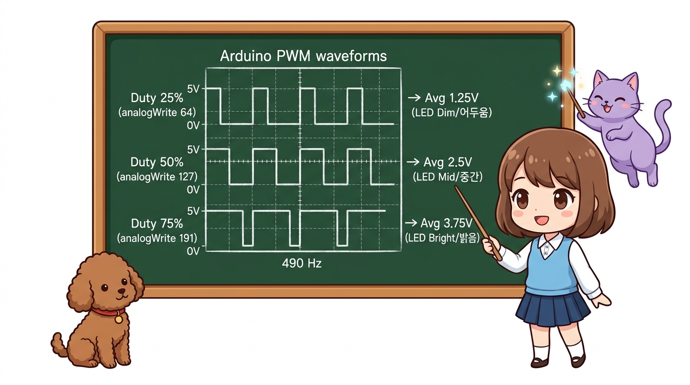
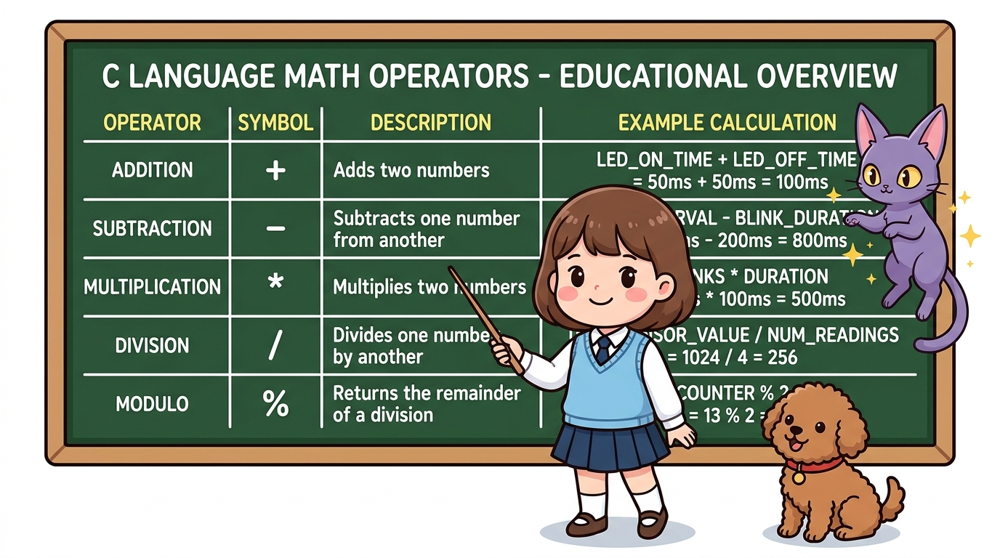

# 173_아두이노메가_포트구조와_레지스터제어 ⚡🎛️


* **digitalWrite()보다 40배 빠르다! ATmega2560의 100핀 TQFP 내부 포트 구조와 8비트 레지스터 직접 제어**
* PORTA부터 PORTL까지 총 11개 하드웨어 포트의 핀 맵, DDRx/PORTx/PINx 레지스터 3총사의 동작 원리, 나노초(ns) 단위 초고속 8비트 병렬 제어 스케치를 완벽 실습합니다.
* 📖 **상세 강의 교재**: [index.md](./index.md)


> 여러분 안녕하세요! 이번 시간에는 '173. 아두이노메가 포트구조와 레지스터제어 ⚡🎛️'을 주제로 함께 흥미진진한 탐험을 떠나보겠습니다. 마법 멘토 지니와 호기심 많은 탐험가 도로시, 그리고 귀여운 토토와 함께 신나는 아두이노 모험을 힘차게 시작해 봅시다. 준비되셨나요?

---
## 1. ATmega2560 100핀 TQFP와 8비트 하드웨어 포트 🧩


* **👧 도로시**: "지니야! 아두이노 우노는 포트가 B, C, D 3개뿐이었는데, 메가는 왜 이렇게 포트 알파벳이 많아?"
* **🐱 지니**: "메가는 100개의 핀을 거느리고 있어서 **PORTA부터 PORTL까지 무려 11개의 8비트 포트**를 가지고 있단다! 우노와는 비교도 안 되는 거대한 데이터 고속도로지!"
* **🐶 토토**: "멍멍! (8비트씩 묶여 있으니 1바이트를 한 번에 뿜어낼 수 있다 멍!)"

| 하드웨어 포트 | 포함된 비트 | 매핑된 아두이노 핀 번호 | 물리적 위치 및 특징 |
| :--- | :---: | :--- | :--- |
| **PORTA** | PA0 ~ PA7 | **D22, D23, D24, D25, D26, D27, D28, D29** | 메가 끝단 더블 로우 핀헤더 (순수 8비트 병렬 출력 최적!) |
| **PORTC** | PC0 ~ PC7 | **D37, D36, D35, D34, D33, D32, D31, D30** | 더블 로우 핀헤더 (역순 배치에 주의!) |
| **PORTL** | PL0 ~ PL7 | **D49, D48, D47, D46, D45, D44, D43, D42** | 더블 로우 핀헤더 (LCD/디스플레이 8비트 데이터 버스용) |
| **PORTB** | PB0 ~ PB7 | **D53, D52, D51, D50, D10, D11, D12, D13** | SPI 통신 핀 및 내장 LED(PB7, D13) |
| **PORTF/K** | PF0~7 / PK0~7 | **A0 ~ A7 / A8 ~ A15** | 16채널 아날로그 입력 전용 ADC 포트 |
| **PORTE/H** | PE0~1 / PH0~1 | **D0, D1 / D16, D17** | 하드웨어 UART 시리얼 통신 포트 (`Serial`, `Serial2`) |
| **PORTD/J** | PD0~3 / PJ0~1 | **D21, D20, D19, D18 / D15, D14** | I2C(`SCL/SDA`) 및 시리얼 통신 (`Serial1`, `Serial3`) |

아두이노 메가의 두뇌인 **ATmega2560**은 가로세로 14mm 크기의 네모난 100핀 TQFP(Thin Quad Flat Package) 칩입니다.
이 거대한 칩의 100개 다리들은 마이크로컨트롤러 내부에서 8개씩 묶여 **8비트 하드웨어 포트(Hardware Port)**를 형성합니다.
### 📌 메가 2560의 주요 디지털 핀과 하드웨어 포트 매핑표
우리가 스케치에서 부르는 `22번`, `23번` 등의 아두이노 핀 번호는 실제 MCU 내부 레지스터 포트와 1:1로 매핑되어 있습니다.

> 이번에 살펴볼 내용은 '1. ATmega2560 100핀 TQFP와 8비트 하드웨어 포트 🧩'입니다. 슬라이드에 정리된 표를 통해 각 항목의 특징과 수치, 차이점을 한눈에 비교해 보실 수 있습니다. 이 기본 개념을 확실히 잡아두셔야 실제 부품을 브레드보드에 꽂고 코딩할 때 실수 없이 완성할 수 있습니다.
---
## 2. 하드웨어 포트 제어의 3대 레지스터: DDRx, PORTx, PINx 🎛️


1. **`DDRx` (Data Direction Register)**:
- 핀의 입출력 방향을 결정합니다.
- `1`을 쓰면 **OUTPUT(출력)**, `0`을 쓰면 **INPUT(입력)** 모드가 됩니다.
2. **`PORTx` (Port Data Register)**:
- 핀에 HIGH/LOW 전압을 출력합니다.
- `DDRx`가 출력이면 `1`은 5V(HIGH), `0`은 0V(LOW)를 내보냅니다.
- 만약 `DDRx`가 입력이면 `1`을 썼을 때 내부 풀업 저항(INPUT_PULLUP)이 켜집니다!
3. **`PINx` (Input Pins Address Register)**:
- 외부에서 들어오는 전압 상태를 읽어옵니다. (읽기 전용 레지스터)

각 포트를 제어할 때는 CPU 내부의 **3가지 특수 기능 레지스터(SFR)**를 조작합니다. 여기서 `x`는 포트 이름(A, B, C...)을 뜻합니다.

```
       [ ATmega2560 내부 레지스터 삼총사 ]
  
  ┌──────────────┐  입출력 방향 결정 (0: INPUT, 1: OUTPUT)
  │     DDRx     │  == pinMode() 역할
  └──────────────┘
         │
  ┌──────────────┐  출력 전압 레벨 결정 (0: LOW, 1: HIGH)
  │    PORTx     │  == digitalWrite() 역할 (INPUT 모드 시 내부 풀업 활성화)
  └──────────────┘
         │
  ┌──────────────┐  외부 전압 상태 실시간 읽기 (0 or 1)
  │     PINx     │  == digitalRead() 역할
  └──────────────┘
```

> 이번 슬라이드에서는 '2. 하드웨어 포트 제어의 3대 레지스터: DDRx, PORTx, PINx 🎛️'에 대한 실제 동작 코드를 분석해 보겠습니다. 화면의 코드를 살펴보시면, 컴퓨터가 아두이노 하드웨어에 단계별로 명령을 내리는 흐름을 명확하게 확인할 수 있습니다. 여기서 핵심은 DDRx (Data Direction Register)입니다. 각 함수의 역할과 괄호 안의 매개변수가 하드웨어 핀과 어떤 관계를 맺고 동작하는지 주의 깊게 살펴보시기 바랍니다.
---
## 3. digitalWrite() vs 레지스터 직접 제어 속도 비교 🚀




| 비교 항목 | 기본 `digitalWrite()` 8번 호출 | `PORTA = 0xFF;` 레지스터 직접 제어 | 성능 격차 |
| :--- | :---: | :---: | :---: |
| **실행 시간** | 약 **30,000 ns (30 μs)** | **62.5 ns (1 CPU 클럭)** | **약 480배 고속화!** |
| **핀 상태 동시성** | 1개씩 순차적으로 켜짐 (미세한 시간차 발생) | **8개 핀이 완벽하게 동시 출력** | 시간 오차(Skew) 0ns |
| **코드 용량** | 함수 호출 오버헤드로 큼 | 초경량 기계어 1줄 | 플래시 절약 |

아두이노 기본 함수인 `digitalWrite(pin, HIGH)`는 매우 편리하지만, 내부적으로 수십 줄의 안전성 검사 코드(타이머 PWM 해제, 핀 번호 포트 변환, 인터럽트 마스크 등)를 거치므로 실행에 **약 3.5 ~ 4.0 마이크로초(μs)**(약 56클럭)가 소요됩니다.
반면, 레지스터 직접 제어(Direct Port Manipulation)는 어셈블리어 1클럭 명령어로 변환되어 **단 62.5 나노초(ns)** 만에 8개 핀이 동시에 바뀝니다!

> 이번에 살펴볼 내용은 '3. digitalWrite() vs 레지스터 직접 제어 속도 비교 🚀'입니다. 슬라이드에 정리된 표를 통해 각 항목의 특징과 수치, 차이점을 한눈에 비교해 보실 수 있습니다. 이 기본 개념을 확실히 잡아두셔야 실제 부품을 브레드보드에 꽂고 코딩할 때 실수 없이 완성할 수 있습니다.
---
## 4. 실전 실습: PORTA를 이용한 8비트 초고속 LED 체이서 💡


메가의 22번부터 29번 핀(`PA0` ~ `PA7`)에 8개의 LED를 연결하고, 레지스터를 직접 조작하여 눈 깜짝할 사이에 패턴을 변환하는 실습 스케치입니다.

```cpp
/*
 * [아두이노 메가 2560 포트 직접 제어 실습]
 * 타깃 핀: D22 ~ D29 (ATmega2560 PORTA: PA0 ~ PA7)
 * 배선: D22(PA0)~D29(PA7) -> 각각 220Ω 저항 -> LED(+) -> LED(-) -> GND
 */

void setup() {
  // [기존 방식]
  // for(int i=22; i<=29; i++) pinMode(i, OUTPUT);
  
  // [레지스터 초고속 방식]
  // DDRA 레지스터의 8비트를 모두 1로 설정하여 D22~D29 핀을 한 번에 OUTPUT으로 지정!
  DDRA = 0b11111111; // 16진수: 0xFF;

  Serial.begin(115200);
  Serial.println(F("PORTA 8비트 초고속 레지스터 제어 시작!"));
}

void loop() {
  // 1. 쉬프트 연산으로 불빛이 좌에서 우로 고속 이동 (8비트 러닝 라이트)
  for (int i = 0; i < 8; i++) {
    PORTA = (1 << i); // i번째 비트만 1 (HIGH), 나머지는 0 (LOW)
    delay(50);
  }

  // 2. 우에서 좌로 복귀
  for (int i = 6; i >= 1; i--) {
    PORTA = (1 << i);
    delay(50);
  }

  // 3. 8개 LED 동시 깜빡임 (스트로보 효과)
  PORTA = 0xFF; // D22~D29 8개 핀 전체 HIGH
  delay(100);
  PORTA = 0x00; // D22~D29 8개 핀 전체 LOW
  delay(100);
}
```

> 이번 슬라이드에서는 '4. 실전 실습: PORTA를 이용한 8비트 초고속 LED 체이서 💡'에 대한 실제 동작 코드를 분석해 보겠습니다. 화면의 코드를 살펴보시면, 컴퓨터가 아두이노 하드웨어에 단계별로 명령을 내리는 흐름을 명확하게 확인할 수 있습니다. 각 함수의 역할과 괄호 안의 매개변수가 하드웨어 핀과 어떤 관계를 맺고 동작하는지 주의 깊게 살펴보시기 바랍니다.
---
## 5. 특정 비트만 안전하게 바꾸는 비트 연산 테크닉 🪄




다른 핀의 상태를 건드리지 않고 내가 원하는 핀만 켜거나 끄려면 **비트마스크(Bitwise Operators)**를 사용해야 합니다.

```cpp
// 1. 22번 핀(PA0)만 켜기 (OR 연산: |=)
PORTA |= (1 << 0); // 0번 비트만 1로 세팅!

// 2. 22번 핀(PA0)만 끄기 (AND-NOT 연산: &= ~)
PORTA &= ~(1 << 0); // 0번 비트만 0으로 클리어!

// 3. 22번 핀(PA0) 상태 토글 (XOR 연산: ^=)
PORTA ^= (1 << 0); // 켜져 있으면 끄고, 꺼져 있으면 켬!
```

> 이번 슬라이드에서는 '5. 특정 비트만 안전하게 바꾸는 비트 연산 테크닉 🪄'에 대한 실제 동작 코드를 분석해 보겠습니다. 화면의 코드를 살펴보시면, 컴퓨터가 아두이노 하드웨어에 단계별로 명령을 내리는 흐름을 명확하게 확인할 수 있습니다. 각 함수의 역할과 괄호 안의 매개변수가 하드웨어 핀과 어떤 관계를 맺고 동작하는지 주의 깊게 살펴보시기 바랍니다.
---

## 🌟 도로시와 지니의 핵심 요약! 🏆


* **👧 도로시**: "`PORTA = 0xFF;` 한 줄로 8개의 LED가 0.00000006초 만에 동시에 켜지는 걸 보니 마법 같아!"
* **🐱 지니**: "맞아! 고해상도 그래픽 LCD나 고속 모터 제어에서는 이 레지스터 제어가 필수란다. 다음 챕터에서는 우노용 쉴드를 메가에 꽂을 때 반드시 알아야 할 **'165_아두이노메가_핀맵과_우노호환성주의점'**을 배워보자!"

* [x] **11개 하드웨어 포트**: ATmega2560은 100핀 TQFP 구조로 PORTA~PORTL까지 방대한 8비트 포트를 제공합니다.
* [x] **레지스터 삼총사**: 방향 설정은 `DDRx`, 출력 및 풀업은 `PORTx`, 외부 입력 읽기는 `PINx`를 사용합니다.
* [x] **나노초 단위 고속화**: `digitalWrite()`의 수십 마이크로초 딜레이 없이 1클럭(62.5ns) 만에 8핀 전체를 동시 제어합니다.
* [x] **비트 연산의 미학**: `|=` (세팅), `&= ~` (클리어), `^=` (토글) 기법으로 원하는 핀만 정밀하게 조작할 수 있습니다.

> 오늘 배운 '🌟 도로시와 지니의 핵심 요약! 🏆'의 핵심 내용을 모두 정리해 보았습니다. 오늘 다룬 내용 중에서도 [x] 11개 하드웨어 포트: ATmega2560은 100핀 TQFP 구조로 PORTA~PORTL까지 방대한 8비트 포트를 제공합니다. 부분은 앞으로의 아두이노 실습과 프로젝트에서 계속 사용되는 매우 중요한 기초 지식입니다. 지니 멘토가 강조했듯이 맞아! 고해상도 그래픽 LCD나 고속 모터 제어에서는 이 레지스터 제어가 필수란다. 다음 챕터에서는 우노용 쉴드를 메가에 꽂을 때 반드시 알아야 할 라는 점을 꼭 마음에 새겨두시길 바랍니다. 오늘 배운 내용을 꼭 다시 한번 복습해 보시고, 다음 강의에서 더욱 신나고 유익한 모험으로 다시 만나겠습니다. 모두 수고 많으셨습니다!