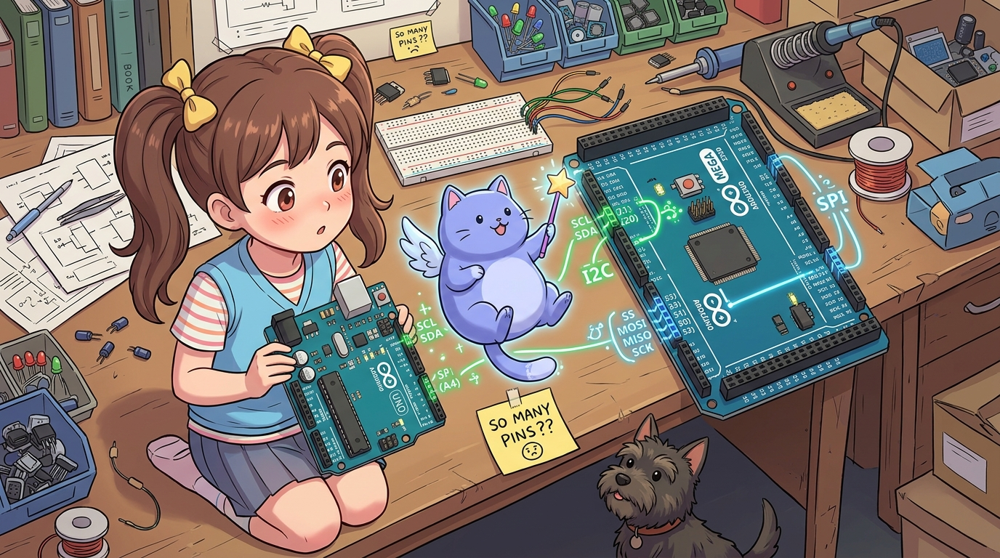
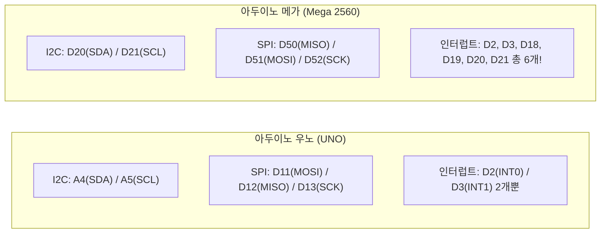

# 174_아두이노메가_핀맵과_우노호환성주의점 ⚠️🔌

> **우노에서 잘 되던 쉴드가 메가에 꽂으니 먹통? 초보 메이커가 가장 많이 겪는 함정 완벽 분석!**  
> I2C(SDA/SCL), SPI(MISO/MOSI/SCK), 외부 인터럽트(INT0~INT5), PWM 핀 배치의 결정적 차이와 우노용 쉴드를 메가에서 100% 정상 작동시키는 하드웨어 바이패스 및 전처리기 비법을 전수합니다.



* 🖥️ **강의 슬라이드**: [slides.md](./slides.md)

---

## 1. 쉴드는 꼭 맞게 꽂히는데 왜 동작하지 않을까? 🤔

아두이노 메가는 우노(UNO R3)의 핀헤더 외형 규격을 그대로 계승하도록 설계되었습니다. 따라서 시중의 우노용 LCD 쉴드, 모터 드라이버 쉴드, SD카드 쉴드를 메가 위에 물리적으로 '딸깍' 장착하는 것은 완벽히 가능합니다.  
**하지만! 전원을 켜고 코드를 올리면 센서가 인식되지 않거나 데이터가 깨지는 치명적인 문제가 발생합니다.**

> **👧 도로시**: "지니야! 우노에서 잘 되던 I2C LCD랑 SD카드 쉴드를 메가에 똑같이 꽂았는데 아무 글자도 안 나오고 인식이 안 돼!"  
> **🐱 지니**: "외형 핀 위치는 같아 보여도, 메가의 두뇌(ATmega2560) 내부에서 통신 선로가 완전히 다른 번호로 연결되어 있기 때문이란다!"  
> **🐶 토토**: "멍멍! (겉모습에 속으면 안 된다 멍! 내부 배선 차이를 알아야 한다 멍!)"

---

## 2. 메가 vs 우노 결정적 통신 핀 차이 3가지 🔍

가장 치명적인 차이는 **I2C**, **SPI**, **외부 인터럽트** 3가지 인터페이스입니다.



### 📌 핵심 비교표
| 통신 인터페이스 | 아두이노 우노 (UNO) | 아두이노 메가 (Mega 2560) | 쉴드 장착 시 문제점 및 해결책 |
| :--- | :--- | :--- | :--- |
| **I2C (SDA)** | **A4** (아날로그 4번) | **20번 (D20)** | 우노 전용 쉴드는 A4를 읽으므로 통신 불가 ➡️ **R3 상단 SDA 핀 또는 20번 점퍼 연결** |
| **I2C (SCL)** | **A5** (아날로그 5번) | **21번 (D21)** | 우노 전용 쉴드는 A5를 읽으므로 통신 불가 ➡️ **R3 상단 SCL 핀 또는 21번 점퍼 연결** |
| **SPI (MISO)** | **12번** | **50번** | 구형 SD카드/이더넷 쉴드 먹통 ➡️ **중앙 ICSP 6핀 헤더 활용 필수** |
| **SPI (MOSI)** | **11번** | **51번** | 11번에 꽂혀 있으면 메가는 신호를 못 보냄 ➡️ **51번 또는 ICSP 연결** |
| **SPI (SCK)** | **13번** | **52번** | 13번 LED 클럭 불일치 ➡️ **52번 또는 ICSP 연결** |
| **SPI (SS/CS)** | **10번** | **53번 (하드웨어 기본)** | 메가에서 SPI 마스터 동작 시 **53번은 반드시 OUTPUT으로 유지** |

---

## 3. I2C 통신 호환성 해결책: R3 핀헤더와 점퍼 바이패스 🛠️

최신 아두이노 쉴드(R3 규격)는 AREF 핀 위쪽에 별도의 **SDA, SCL 핀**이 추가되어 있습니다. 메가 보드 역시 이 상단 핀에 20번, 21번이 내부 연결되어 있으므로 **R3 지원 쉴드는 수정 없이 바로 동작**합니다.

하지만 **구형 쉴드나 A4/A5에 납땜된 모듈**을 사용할 때는 점퍼선 바이패스가 필요합니다:
1. 쉴드의 A4 핀을 메가 20번 핀(SDA)과 점퍼 와이어로 연결.
2. 쉴드의 A5 핀을 메가 21번 핀(SCL)과 점퍼 와이어로 연결.

---

## 4. SPI 통신과 6핀 ICSP 헤더의 구원 💾

이더넷 쉴드(W5100)나 MicroSD 카드 쉴드를 잘 살펴보면, 보드 가운데 아래쪽에 6핀 암놈 소켓이 뚫려 있는 것을 볼 수 있습니다.  
이 6핀 단자가 바로 **ICSP(In-Circuit Serial Programming) 헤더**입니다!

* **왜 표준 쉴드는 ICSP를 쓸까?**:
  - 우노(D11~D13)와 메가(D50~D52)의 SPI 핀 번호가 서로 다르기 때문에, 표준 규격 쉴드는 보드 중앙의 ICSP 6핀 단자로부터 SPI 신호를 직접 끌어옵니다.
  - 따라서 **가운데 ICSP 6핀 소켓이 장착된 정품 규격 쉴드는 메가에서도 아무런 개조 없이 완벽하게 작동**합니다!
* **단, 메가에서 SPI 마스터 코드를 작성할 때 필수 주의점!**:
  - 스케치에서 칩 셀렉트(CS) 핀으로 10번이나 4번을 쓰더라도, 메가의 하드웨어 SPI SS 핀인 **53번 핀은 반드시 `pinMode(53, OUTPUT);`으로 설정**해 두어야 합니다. (53번이 INPUT LOW가 되면 메가가 슬레이브 모드로 오작동함!)

```cpp
#include <SPI.h>

void setup() {
  // [메가 2560 SPI 사용 시 필수 골든 룰!]
  // 하드웨어 SS(53번) 핀을 반드시 OUTPUT으로 설정해야 마스터 모드가 풀리지 않습니다!
  pinMode(53, OUTPUT);
  SPI.begin();
}
```

---

## 5. 외부 하드웨어 인터럽트(Interrupt) 6개 매핑표 ⚡

우노는 외부 신호의 즉각적인 감지를 위한 하드웨어 인터럽트 핀이 **2번(INT0), 3번(INT1)** 딱 2개뿐이었습니다.  
반면 메가 2560은 **무려 6개의 독립된 외부 인터럽트**를 지원합니다!

| 인터럽트 번호 | 아두이노 메가 핀 번호 | 아두이노 우노 핀 번호 | 추천 연결 장치 |
| :---: | :---: | :---: | :--- |
| **INT0** | **2번** | 2번 | 엔코더 모터 위상 A / 비상 정지 스위치 |
| **INT1** | **3번** | 3번 | 엔코더 모터 위상 B |
| **INT2** | **21번** (SCL과 공유) | 없음 | 외부 센서 데이터 준비(Ready) 신호 |
| **INT3** | **20번** (SDA과 공유) | 없음 | I2C 통신 중단 감지 |
| **INT4** | **19번** (RX1과 공유) | 없음 | 블루투스 수신 패킷 즉각 인터럽트 |
| **INT5** | **18번** (TX1과 공유) | 없음 | 원격 컨트롤러 패킷 트리거 |

> **⚠️ 인터럽트 사용 시 주의**:  
> 메가에서 I2C 통신(20, 21번)을 사용하고 있다면 `INT2`와 `INT3`은 사용할 수 없습니다. 마찬가지로 `Serial1`(18, 19번)을 사용 중이라면 `INT4`와 `INT5`는 양보해야 합니다.

---

## 6. 우노/메가 자동 판별 코드 템플릿: C++ 전처리기 활용 🧙‍♂️

동일한 소스코드를 우노와 메가 양쪽에서 수정 없이 컴파일하고 싶다면, 컴파일러가 자동 정의하는 매크로 상수를 활용합니다.

```cpp
/*
 * [우노 및 메가 2560 겸용 자동 핀 할당 템플릿]
 */

#if defined(__AVR_ATmega2560__) || defined(__AVR_ATmega1280__)
  // 아두이노 메가 환경
  #define BOARD_TYPE "Arduino Mega 2560"
  const int chipSelectPin = 53;  // 메가 SPI 기본 SS
  const int statusLedPin  = 13;
  const int sensorIntPin  = 18;  // 메가 전용 INT5 사용
#elif defined(__AVR_ATmega328P__)
  // 아두이노 우노/나노 환경
  #define BOARD_TYPE "Arduino Uno / Nano"
  const int chipSelectPin = 10;  // 우노 SPI 기본 SS
  const int statusLedPin  = 13;
  const int sensorIntPin  = 2;   // 우노 INT0 사용
#else
  #error "지원되지 않는 보드입니다! Mega 또는 Uno를 선택해 주세요."
#endif

void setup() {
  Serial.begin(115200);
  Serial.print(F("현재 빌드 보드: "));
  Serial.println(BOARD_TYPE);
  Serial.print(F("할당된 CS 핀: "));
  Serial.println(chipSelectPin);
}

void loop() {
  // 메인 로직...
}
```

---

## 🌟 도로시와 지니의 핵심 요약! 🏆


* [x] **I2C 핀 차이**: 우노는 A4/A5, 메가는 20/21번입니다. 구형 쉴드는 20/21번으로 점퍼를 연결해야 합니다.
* [x] **SPI 핀 차이**: 우노는 11~13번, 메가는 50~52번입니다. 메가용 쉴드는 중앙 ICSP 6핀 소켓을 경유해야 정상 통신합니다.
* [x] **SS 53번 룰**: 메가에서 SPI 통신 시 하드웨어 53번 핀은 무조건 `OUTPUT` 모드로 켜두어야 마스터 모드가 풀리지 않습니다.
* [x] **풍부한 인터럽트**: 2번, 3번뿐 아니라 18, 19, 20, 21번까지 총 6개의 외부 하드웨어 인터럽트를 제공합니다.

> **👧 도로시**: "우노 쉴드를 꽂을 때 왜 ICSP 6핀이 중앙에 솟아 있었는지 이제 완벽하게 이해했어!"  
> **🐱 지니**: "하드웨어 핀 배치의 차이를 꿰뚫고 있다면 어떤 복잡한 쉴드라도 자유자재로 다룰 수 있단다. 다음 챕터에서는 메가의 막강한 다중 통신 무기인 **'166_아두이노메가_IDE설정과_4개하드웨어시리얼'**을 본격적으로 실습해 보자!"
