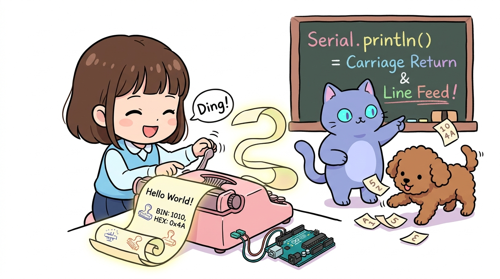
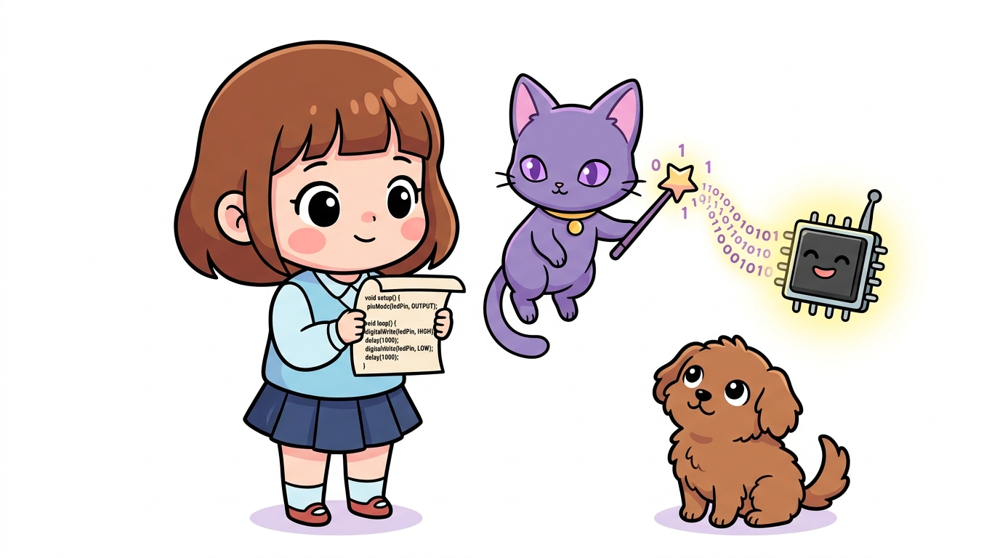
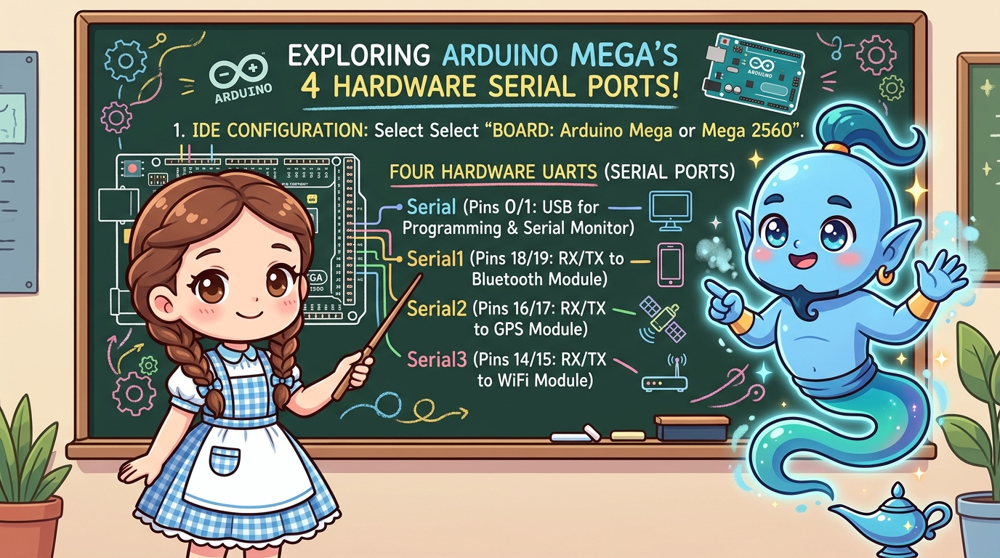

# 175_아두이노메가_IDE설정과_4개하드웨어시리얼 📻⚡

> **시리얼 충돌 해방! 4개의 독립된 고속 하드웨어 UART 시리얼 포트 완벽 정복**  
> 아두이노 IDE 보드 설정, 4쌍의 시리얼 핀맵(D14~D19), PC 시리얼 모니터와 무선 블루투스/GPS 동시 통신 브릿지 코드를 학습합니다.



* 🖥️ **강의 슬라이드**: [slides.md](./slides.md)

---

## 1. 아두이노 IDE에서 메가 2560 보드 지정하기 ⚙️

아두이노 메가를 컴퓨터에 연결하고 IDE에서 보드 타입을 설정합니다.



### 📌 IDE 설정 순서
1. **`툴(Tools)` ➡️ `보드(Board)` ➡️ `Arduino AVR Boards` ➡️ `Arduino Mega or Mega 2560`**을 클릭합니다.
2. **`툴` ➡️ `프로세서(Processor)`**에서 **`ATmega2560 (Mega 2560)`**이 기본 선택되어 있는지 확인합니다.
3. **`툴` ➡️ `포트(Port)`**에서 메가 보드가 연결된 시리얼 포트를 지정하면 준비 완료!

---

## 2. 우노와 격이 다른 4개의 독립 하드웨어 시리얼! 📡

아두이노 우노는 하드웨어 시리얼이 0번(RX), 1번(TX) 딱 1개뿐이어서, 블루투스나 GPS를 연결하면 PC 시리얼 모니터와 충돌하여 코드가 업로드되지 않는 큰 불편이 있었습니다.  
하지만 메가 2560은 **4개의 독립된 하드웨어 시리얼**을 내장하여 충돌이 전혀 없습니다!



### 📌 메가 하드웨어 시리얼 4총사 핀맵
| 시리얼 포트 명칭 | 수신 핀 (RX) | 송신 핀 (TX) | 주 용도 및 추천 연결 장치 |
| :--- | :---: | :---: | :--- |
| **`Serial`** | **0번 (RX0)** | **1번 (TX0)** | **PC USB 케이블 연결 (스케치 업로드 & 시리얼 모니터 디버깅)** |
| **`Serial1`** | **19번 (RX1)**| **18번 (TX1)**| **HC-06 블루투스 모듈 (무선 스마트폰 원격 제어)** |
| **`Serial2`** | **17번 (RX2)**| **16번 (TX2)**| **GPS 위성 수신기 모듈 (위도/경도 실시간 수신)** |
| **`Serial3`** | **15번 (RX3)**| **14번 (TX3)**| **ESP8266 와이파이 모듈 / 기타 센서 컨트롤러** |

> **👧 도로시**: "우노에서는 `SoftwareSerial` 라이브러리를 써서 억지로 가상 통신을 했는데, 메가는 진짜 전용 하드웨어 통신 핀이 4쌍이나 있네!"  
> **🐱 지니**: "하드웨어 시리얼은 CPU에 부담을 주지 않고 고속(115,200bps 이상)으로 데이터를 버퍼에 담아두기 때문에 글자가 깨지거나 유실되지 않는단다!"

---

## 3. 실전! 시리얼 모니터와 블루투스 동시 통신 브릿지 실습 🌉

PC 화면에서 명령을 치면 블루투스로 전달되고, 스마트폰에서 보낸 문자가 PC 화면에 즉시 출력되는 양방향 통신 중계 코드입니다.


```cpp
// 아두이노 메가 4개 시리얼 실전: PC(Serial) <-> 블루투스(Serial1) 완벽 중계
void setup() {
  Serial.begin(9600);   // PC USB 시리얼 모니터 시작
  Serial1.begin(9600);  // 18번(TX1), 19번(RX1)에 연결된 블루투스 시작
  
  Serial.println("=== 아두이노 메가 다중 통신 브릿지 가동 ===");
  Serial.println("스마트폰 앱과 PC 시리얼 모니터가 연결되었습니다.");
}

void loop() {
  // 1. 스마트폰(블루투스)에서 데이터가 들어오면 -> PC 화면(Serial)으로 출력!
  if (Serial1.available()) {
    char inByte = Serial1.read();
    Serial.write(inByte);
  }
  
  // 2. PC 키보드(Serial)에서 명령을 치면 -> 스마트폰(Serial1)으로 전송!
  if (Serial.available()) {
    char outByte = Serial.read();
    Serial1.write(outByte);
  }
}
```

> **🐶 토토**: "멍멍! PC로 보낸 글자가 스마트폰 화면에 실시간으로 퐁퐁 뜬다 멍!"

---

## 🌟 도로시와 지니의 핵심 요약! 🏆


* [x] **IDE 보드 설정**: `Arduino Mega or Mega 2560`을 선택합니다.
* [x] **4개 시리얼 포트**: `Serial`, `Serial1`, `Serial2`, `Serial3`를 독립적으로 `begin()` 하여 동시 가동합니다.
* [x] **충돌 제로**: 업로드할 때 블루투스 전선을 뽑을 필요 없이 18번, 19번 핀에서 항상 안전하게 통신합니다.

> **👧 도로시**: "통신 포트가 4개나 있으니 GPS, 블루투스, 와이파이를 한 번에 다 달 수 있겠어!"  
> **🐱 지니**: "바로 그거야! 다음 시간에는 이렇게 복잡하고 거대한 시스템을 한 치의 딜레이도 없이 이끄는 **'167_아두이노메가_운영체제_FreeRTOS기초'**로 넘어가 보자!"
