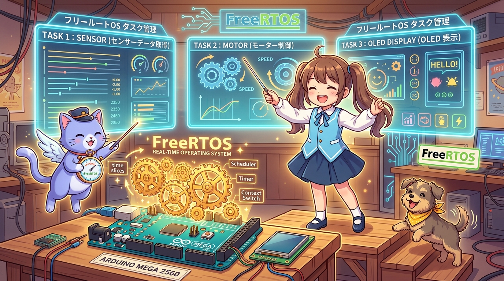
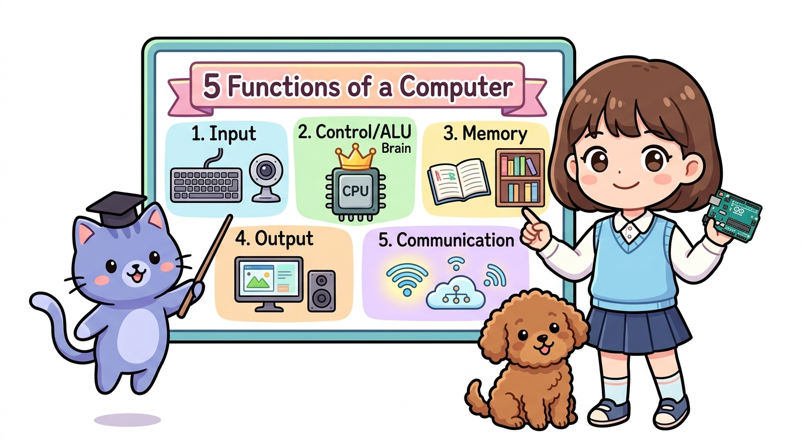
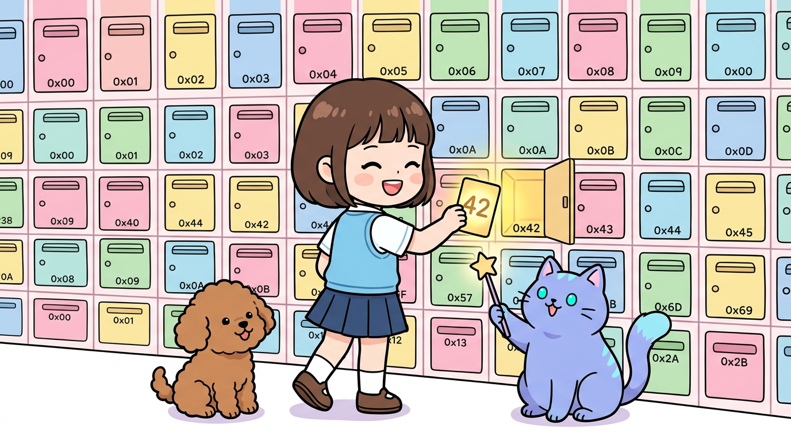
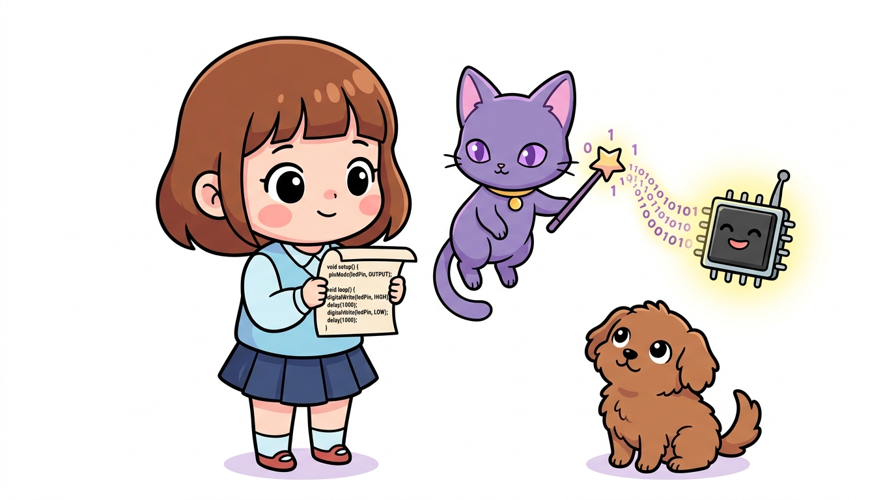
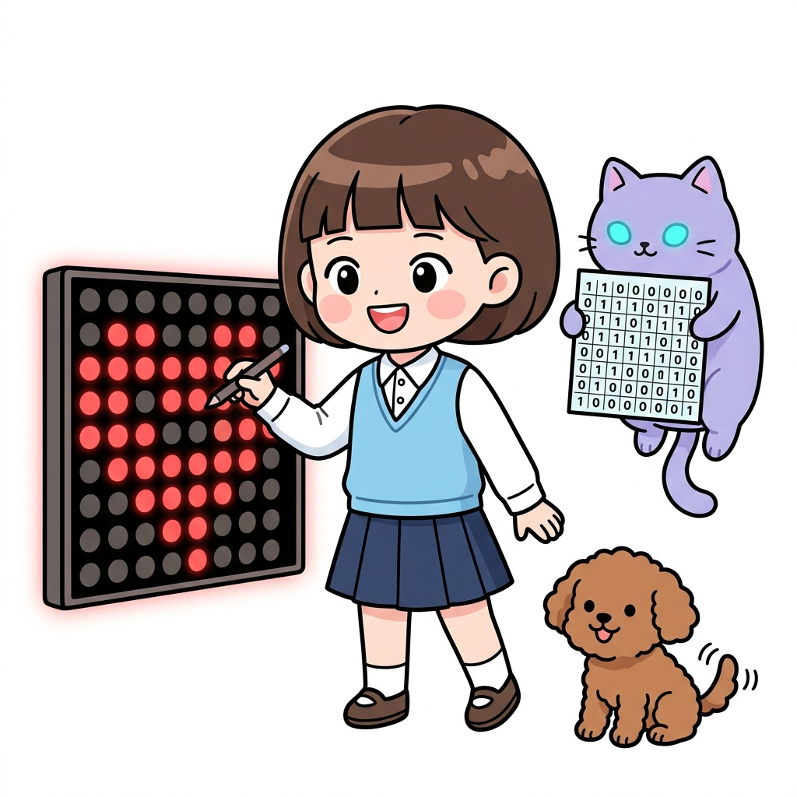
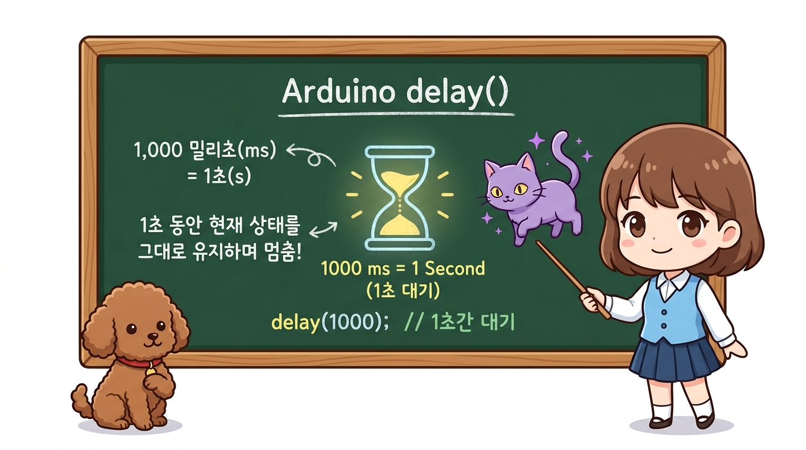

# 176_아두이노메가_운영체제_FreeRTOS기초 ⏱️🎼



* **단일 루프의 한계를 넘어 실시간 멀티태스킹의 세계로! 아두이노 메가에 탑재하는 실시간 운영체제(RTOS)**
* 베어메탈(Super Loop)의 delay() 병목 한계, 8KB 대용량 SRAM을 활용한 FreeRTOS 포팅 원리, 태스크(Task) 생성 및 선점형 스케줄러(Preemptive Scheduler) 실습을 진행합니다.
* 📖 **상세 강의 교재**: [index.md](./index.md)


> 여러분 안녕하세요! 이번 시간에는 '176. 아두이노메가 운영체제 FreeRTOS기초 ⏱️🎼'을 주제로 함께 흥미진진한 탐험을 떠나보겠습니다. 마법 멘토 지니와 호기심 많은 탐험가 도로시, 그리고 귀여운 토토와 함께 신나는 아두이노 모험을 힘차게 시작해 봅시다. 준비되셨나요?

---
## 1. 아두이노에 운영체제(OS)가 왜 필요할까요? 🤔




* **👧 도로시**: "지니야! 초음파 센서로 장애물도 피해야 하고, 모터 속도도 조절해야 하고, 블루투스 명령도 받아야 하는데 코드가 서로 엉켜서 멈칫거려!"
* **🐱 지니**: "그럴 때 바로 컴퓨터의 Windows나 스마트폰의 Android처럼 일정을 분배해 주는 **실시간 운영체제(FreeRTOS)**를 올리면 된단다! 각 작업을 독립된 '태스크'로 쪼개어 마치 여러 개의 두뇌가 동시에 일하는 것처럼 만들어주지!"
* **🐶 토토**: "멍멍! (마치 오케스트라 지휘자처럼 순서와 박자를 맞춰준다 멍!)"

1. **`delay()`의 재앙**: 모터를 부드럽게 돌리기 위해 `delay(500)`을 넣는 순간, 그 0.5초 동안 초음파 센서도 못 읽고 화재 감지 경보기도 작동을 멈춥니다!
2. **복잡한 `millis()` 상태 머신**: 여러 동작을 동시에 하려고 `millis()` 타이머 변수를 10개씩 만들다 보면 코드가 걷잡을 수 없이 꼬여버립니다.
3. **엄격한 시간 보장 실패**: 센서 데이터를 10ms마다 정확히 읽어야 하는데, 무거운 LCD 화면을 그리는 작업 때문에 타이밍을 놓치게 됩니다.

지금까지 우리가 작성한 아두이노 코드는 모두 `void setup()`이 한 번 실행된 후, `void loop()` 함수가 무한히 뱅글뱅글 도는 **단일 순차 실행 방식(Bare-metal Super Loop)**이었습니다.
하지만 대형 로봇이나 복잡한 스마트팩토리 시스템을 만들다 보면 다음과 같은 치명적인 벽에 부딪힙니다:

> 자, 이번 슬라이드의 질문을 함께 보시겠습니다. 바로 '1. 아두이노에 운영체제(OS)가 왜 필요할까요? 🤔'라는 아주 흥미로운 질문입니다. 도로시가 ' 지니야! 초음파 센서로 장애물도 피해야 하고, 모터 속도도 조절해야 하고, 블루투스 명령도 받아야 하는데 코드가 서로 엉켜서 멈칫거려! '라고 질문하자, 지니 멘토는 ' 그럴 때 바로 컴퓨터의 Windows나 스마트폰의 Android처럼 일정을 분배해 주는 실시간 운영체제(FreeRTOS)를 올리면 된단다! 각 작업을 독립된  '라며 명쾌한 답을 들려주었는데요. 이 질문 속에 숨겨진 전자 회로와 컴퓨팅의 핵심 원리를 지금부터 차근차근 하나씩 파헤쳐 보겠습니다.
---
## 2. 왜 우노는 힘들고 메가 2560에서 RTOS가 날아다닐까? 💾




* **우노(2KB SRAM)**: 태스크 1개당 최소 150~200바이트의 스택이 필요한데, 2~3개만 띄워도 메모리가 고갈되어 MCU가 재부팅(Crash)됩니다.
* **메가(8KB SRAM)**: 넉넉한 8KB 덕분에 **센서 태스크, 통신 태스크, 디스플레이 태스크, 모터 PID 태스크 등 5~8개의 태스크를 동시에 여유롭게 구동**할 수 있습니다!

운영체제(RTOS)가 여러 작업을 동시에 번갈아가며 실행(문맥 교환, Context Switching)하려면, **각 태스크마다 CPU 레지스터와 로컬 변수를 보관할 독립된 스택(Stack) 메모리**를 할당해야 합니다.

```
 [ SRAM 메모리 크기와 RTOS 수용 능력 비교 ]

 ■ 아두이노 우노 (SRAM 2 KB)
 ┌──────────────────────────────────────┐
 │ 시스템 변수 + FreeRTOS 커널 (1.2KB)    │ -> 태스크 2개만 만들어도 스택 오버플로우로 다운!
 └──────────────────────────────────────┘

 ■ 아두이노 메가 2560 (SRAM 8 KB! - 4배의 여유 공간)
 ┌───────────────────┬─────────┬─────────┬─────────┬─────────┬──────────────────────┐
 │ 커널 기본 (1.5KB) │ 태스크1 │ 태스크2 │ 태스크3 │ 태스크4 │ 넉넉한 여유 힙 버퍼  │
 └───────────────────┴─────────┴─────────┴─────────┴─────────┴──────────────────────┘
```

> 자, 이번 슬라이드의 질문을 함께 보시겠습니다. 바로 '2. 왜 우노는 힘들고 메가 2560에서 RTOS가 날아다닐까? 💾'라는 아주 흥미로운 질문입니다. 우리가 일상에서 흔히 접하는 우노(2KB SRAM): 태스크 1개당 최소 150~200바이트의 스택이 필요한데, 2~3개만 띄워도 메모리가 고갈되어 MCU가 재부팅(Crash)됩니다. 현상을 떠올려보면 왜 이런 의문이 생기는지 쉽게 공감할 수 있습니다. 이 질문 속에 숨겨진 전자 회로와 컴퓨팅의 핵심 원리를 지금부터 차근차근 하나씩 파헤쳐 보겠습니다.
---
## 3. FreeRTOS 라이브러리 설치와 기본 뼈대 📦




1. IDE 메뉴: `스케치(Sketch)` ➡️ `라이브러리 포함하기` ➡️ `라이브러리 관리...`
2. 검색창에 **`FreeRTOS`** 입력 ➡️ Richard Barry의 **`FreeRTOS`** (또는 Phillip Stevens의 `FreeRTOS`) 라이브러리를 **설치**합니다.
3. 코드 최상단에 `#include <Arduino_FreeRTOS.h>`를 선언하면 준비 완료!
1. **`xTaskCreate()`**: 새로운 독립 작업(태스크)을 생성하고 스케줄러에 등록합니다.
2. **`vTaskDelay()`**: 마이크로컨트롤러를 멍때리게 만드는 `delay()`와 완전히 다릅니다!

아두이노 IDE에서 오픈소스 실시간 OS인 FreeRTOS를 설치합니다.
### 📌 FreeRTOS의 핵심 함수 2가지
자신이 지정된 시간 동안 잠자는 동안, **다른 태스크가 CPU를 쓸 수 있도록 권한을 즉시 양보(Yield)**합니다.

   ```cpp
   xTaskCreate(
     함수이름,        // 실행할 태스크 함수 포인터
     "태스크이름",    // 디버깅용 텍스트 이름
     스택크기,        // 할당할 스택 바이트 수 (메가 기준 128~256 추천)
     전달파라미터,    // NULL 또는 전달할 데이터 주소
     우선순위,        // 0(가장 낮음) ~ 3(높음)
     &태스크핸들      // NULL 또는 태스크 제어용 핸들
   );
   ```

> 이번 슬라이드에서는 '3. FreeRTOS 라이브러리 설치와 기본 뼈대 📦'에 대한 실제 동작 코드를 분석해 보겠습니다. 화면의 코드를 살펴보시면, 컴퓨터가 아두이노 하드웨어에 단계별로 명령을 내리는 흐름을 명확하게 확인할 수 있습니다. 여기서 핵심은 IDE 메뉴: 스케치(Sketch) ➡️ 라이브러리 포함하기 ➡️ 라이브러리 관리...입니다. 각 함수의 역할과 괄호 안의 매개변수가 하드웨어 핀과 어떤 관계를 맺고 동작하는지 주의 깊게 살펴보시기 바랍니다.
---
## 4. 실전 실습: 3대 태스크 병렬 멀티태스킹 🚀




* **태스크 1**: 13번 내장 LED 점멸 (0.5초 주기)
* **태스크 2**: A0 아날로그 센서 고속 수집 및 필터링 (0.1초 주기)
* **태스크 3**: PC 시리얼 모니터로 종합 리포트 전송 (1초 주기)

메가 2560에서 3개의 독립된 작업이 서로의 타이밍을 방해하지 않고 완벽하게 동시 실행되는 예제입니다:

```cpp
/*
 * [아두이노 메가 2560 FreeRTOS 멀티태스킹 기초]
 * 3개의 태스크가 서로 방해하지 않고 독립 주기 실행!
 */

#include <Arduino_FreeRTOS.h>

// 태스크 함수 프로토타입 선언
void TaskBlink(void *pvParameters);
void TaskSensor(void *pvParameters);
void TaskReport(void *pvParameters);

// 공유 데이터 변수 (센서 최신값 저장)
volatile int globalSensorValue = 0;

void setup() {
  Serial.begin(115200);
  while (!Serial) { ; } // 시리얼 연결 대기

  Serial.println(F("========================================"));
  Serial.println(F("  👑 아두이노 메가 2560 FreeRTOS 시작!  "));
  Serial.println(F("========================================"));

  // 1. LED 점멸 태스크 생성 (우선순위 1, 스택 128)
  xTaskCreate(TaskBlink, "BlinkLED", 128, NULL, 1, NULL);

  // 2. 센서 수집 태스크 생성 (우선순위 2 - 더 높은 우선순위!, 스택 128)
  xTaskCreate(TaskSensor, "ReadSensor", 128, NULL, 2, NULL);

  // 3. 시리얼 리포트 태스크 생성 (우선순위 1, 스택 192)
  xTaskCreate(TaskReport, "SerialReport", 192, NULL, 1, NULL);

  // FreeRTOS 스케줄러가 자동으로 구동되므로 setup() 이후 loop()는 비워둡니다.
}

void loop() {
  // FreeRTOS 커널이 동작 중이므로 loop()는 아무 일도 하지 않습니다.
}

// [태스크 1] 13번 LED 점멸 (Heartbeat)
void TaskBlink(void *pvParameters) {
  (void) pvParameters;
  pinMode(13, OUTPUT);

  for (;;) { // 태스크는 무한 루프로 동작해야 합니다!
    digitalWrite(13, HIGH);
    vTaskDelay(500 / portTICK_PERIOD_MS); // 500ms 동안 CPU 양보!
    digitalWrite(13, LOW);
    vTaskDelay(500 / portTICK_PERIOD_MS);
  }
}

// [태스크 2] A0 아날로그 센서 실시간 수집 (100ms 주기)
void TaskSensor(void *pvParameters) {
  (void) pvParameters;

  for (;;) {
    // 100ms마다 A0 센서 읽기
    globalSensorValue = analogRead(A0);
    vTaskDelay(100 / portTICK_PERIOD_MS); // 100ms 대기
  }
}

// [태스크 3] 시리얼 모니터 현황 출력 (1000ms 주기)
void TaskReport(void *pvParameters) {
  (void) pvParameters;

  for (;;) {
    Serial.print(F("[FreeRTOS 모니터] 가동시간: "));
    Serial.print(millis() / 1000);
    Serial.print(F("초 | A0 센서값: "));
    Serial.println(globalSensorValue);

    vTaskDelay(1000 / portTICK_PERIOD_MS); // 1초마다 출력
  }
}
```

> 이번 슬라이드에서는 '4. 실전 실습: 3대 태스크 병렬 멀티태스킹 🚀'에 대한 실제 동작 코드를 분석해 보겠습니다. 화면의 코드를 살펴보시면, 컴퓨터가 아두이노 하드웨어에 단계별로 명령을 내리는 흐름을 명확하게 확인할 수 있습니다. 여기서 핵심은 태스크 1: 13번 내장 LED 점멸 (0.5초 주기)입니다. 각 함수의 역할과 괄호 안의 매개변수가 하드웨어 핀과 어떤 관계를 맺고 동작하는지 주의 깊게 살펴보시기 바랍니다.
---
## 5. FreeRTOS 선점형 스케줄러(Preemptive Scheduler)의 마법 🪄




* **우선순위 우선권**: CPU가 `TaskBlink`를 실행 중이더라도, 100ms가 되어 `TaskSensor`가 깨어나면 스케줄러는 즉시 `TaskBlink`를 일시 정지시키고 **우선순위가 더 높은 `TaskSensor`에 CPU를 넘겨줍니다(선점, Preemption)**.
* **센서의 정확성 보장**: 이 원리 덕분에 모터가 돌든, 화면을 그리든, 중요한 센서 측정 루틴은 1마이크로초의 오차도 없이 칼같이 제시간에 실행될 수 있는 것입니다!

위 코드에서 `TaskSensor`의 우선순위는 **2**, 나머지 태스크는 **1**입니다.
이것은 무엇을 의미할까요?

> 이번 슬라이드에서는 '5. FreeRTOS 선점형 스케줄러(Preemptive Scheduler)의 마법 🪄'에 대해 자세히 살펴보겠습니다. 첫 번째 핵심은 우선순위 우선권: CPU가 TaskBlink를 실행 중이더라도, 100ms가 되어 TaskSensor가 깨어나면 스케줄러는 즉시 TaskBlink를 일시 정지시키고 우선순위가 더 높은 TaskSensor에 CPU를 넘겨줍니다(선점, Preemption).이며, 두 번째로는 센서의 정확성 보장: 이 원리 덕분에 모터가 돌든, 화면을 그리든, 중요한 센서 측정 루틴은 1마이크로초의 오차도 없이 칼같이 제시간에 실행될 수 있는 것입니다!입니다. 이 원리는 아두이노 시스템 전체를 관통하는 핵심 논리이므로 머릿속에 꼭 정리해 두시기 바랍니다.
---

## 🌟 도로시와 지니의 핵심 요약! 🏆


* **👧 도로시**: "loop() 하나에 모든 걸 억지로 구겨 넣지 않고, 각자 맡은 일을 하는 독립된 태스크로 나누니까 코드가 너무 깔끔해!"
* **🐱 지니**: "대형 프로젝트의 기초를 훌륭하게 다졌구나! 그런데 태스크들이 데이터를 주고받을 때 서로 부딪치면 데이터가 깨질 수 있단다. 다음 시간 **'168_아두이노메가_운영체제_동기화와큐'**에서 안전한 통신 비법을 알아보자!"

* [x] **단일 루프 탈피**: FreeRTOS를 적용하면 여러 동작을 독립된 태스크로 나누어 병렬로 실행할 수 있습니다.
* [x] **메가의 8KB SRAM 축복**: 우노에서는 불가능에 가까웠던 다중 태스크 스택 할당이 메가에서는 여유롭게 동작합니다.
* [x] **vTaskDelay()의 미학**: 무식하게 시간을 끄는 `delay()` 대신, 다른 작업에 CPU를 넘겨주는 친절한 비차단 딜레이를 제공합니다.
* [x] **선점형 우선순위**: 중요한 작업(센서, 비상 정지)에 높은 우선순위를 부여하여 완벽한 실시간 반응성을 확보합니다.

> 오늘 배운 '🌟 도로시와 지니의 핵심 요약! 🏆'의 핵심 내용을 모두 정리해 보았습니다. 오늘 다룬 내용 중에서도 [x] 단일 루프 탈피: FreeRTOS를 적용하면 여러 동작을 독립된 태스크로 나누어 병렬로 실행할 수 있습니다. 부분은 앞으로의 아두이노 실습과 프로젝트에서 계속 사용되는 매우 중요한 기초 지식입니다. 지니 멘토가 강조했듯이 대형 프로젝트의 기초를 훌륭하게 다졌구나! 그런데 태스크들이 데이터를 주고받을 때 서로 부딪치면 데이터가 깨질 수 있단다. 다음 시간 라는 점을 꼭 마음에 새겨두시길 바랍니다. 오늘 배운 내용을 꼭 다시 한번 복습해 보시고, 다음 강의에서 더욱 신나고 유익한 모험으로 다시 만나겠습니다. 모두 수고 많으셨습니다!