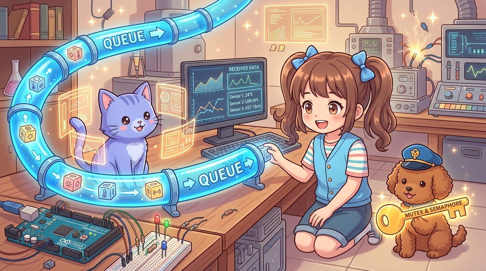
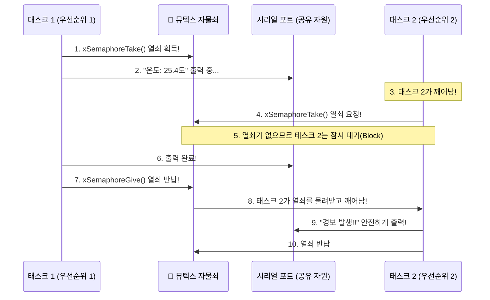

# 177_아두이노메가_운영체제_동기화와큐 📦🔑

> **태스크끼리 대화하고 질서를 지키는 법! FreeRTOS 메시지 큐(Queue)와 뮤텍스(Mutex/Semaphore) 완전 정복**  
> 여러 작업이 동시에 시리얼 포트나 공유 변수를 건드릴 때 발생하는 데이터 깨짐(경쟁 상태, Race Condition)을 방지하고, 스레드 안전(Thread-Safe)한 생산자-소비자 패턴 파이프라인을 구축합니다.



* 🖥️ **강의 슬라이드**: [slides.md](./slides.md)

---

## 1. 멀티태스킹의 함정: 데이터 충돌(Race Condition)과 글자 깨짐 💥

이전 챕터에서 여러 태스크를 동시에 돌리는 법을 배웠습니다.  
하지만 태스크들이 아무런 규칙 없이 **시리얼 포트, I2C 버스, 전역 변수** 같은 공유 자원을 마구 건드리면 끔찍한 대참사가 일어납니다!

```
[ 자원 충돌 참사 시나리오: 시리얼 모니터 글자 뒤섞임 ]

태스크 A (온도 출력): "Temperature: "  ---> [시리얼 버퍼] ---> "Tem-WAR-pera-NING-ture" (외계어 발생!)
태스크 B (경보 출력): "WARNING!! "       ---> [시리얼 버퍼]
```

> **👧 도로시**: "지니야! 태스크 A랑 태스크 B가 둘 다 `Serial.print()`를 불렀더니 글자가 반씩 쪼개져서 이상한 외계어가 찍혀!"  
> **🐱 지니**: "화장실 문에 자물쇠가 없어서 두 사람이 동시에 들어가 버린 상황과 같단다! 이럴 땐 단 한 명만 자원을 쓸 수 있게 해주는 **황금 열쇠(뮤텍스, Mutex)**가 필요해!"  
> **🐶 토토**: "멍멍! (그리고 태스크 간에 데이터를 넘길 땐 전용 컨베이어 벨트인 **큐(Queue)**를 써야 안전하다 멍!)"

---

## 2. 공유 자원의 수호자: 뮤텍스(Mutex)와 세마포어(Semaphore) 🔑

**뮤텍스(Mutual Exclusion, 상호 배제)**는 공유 자원(시리얼 포트, 디스플레이 등)을 한 번에 오직 하나의 태스크만 독점해서 사용할 수 있도록 보장하는 소프트웨어 자물쇠입니다.



### 📌 뮤텍스 핵심 API 3총사
1. **`xSemaphoreCreateMutex()`**: 뮤텍스 객체를 생성합니다.
2. **`xSemaphoreTake(mutex, portMAX_DELAY)`**: 자물쇠 열쇠를 쥡니다. 다른 태스크가 쓰고 있다면 열쇠가 반납될 때까지 잠자며 기다립니다.
3. **`xSemaphoreGive(mutex)`**: 볼일이 끝나면 열쇠를 반납하여 대기 중인 다른 태스크에게 넘겨줍니다.

---

## 3. 스레드 안전 데이터 파이프라인: 메시지 큐(Queue) 📦

한 태스크(생산자, Producer)가 측정한 센서 데이터를 다른 태스크(소비자, Consumer)로 보낼 때, 전역 변수를 쓰면 읽는 도중에 값이 바뀌어 데이터가 오염될 수 있습니다.  
**메시지 큐(Queue)**는 데이터 패킷을 순서대로 담아 전달하는 완벽한 FIFO(First-In, First-Out) 파이프라인입니다.

* **복사(Copy) 방식 안전성**: 큐에 데이터를 넣을 때 메모리 복사가 이루어지므로, 원본 변수가 바뀌어도 큐 안의 데이터는 안전합니다.
* **비차단/차단 유연성**: 소비자는 큐에 데이터가 들어올 때까지 CPU 점유율 0% 상태로 잠자다가, 데이터가 도착하는 즉시 1마이크로초 만에 깨어납니다!

---

## 4. 실전 종합 실습: 센서 수집 ➡️ 큐 전달 ➡️ 안전 로깅 시스템 🚀

아두이노 메가 2560에서 구조체(Struct) 센서 데이터를 큐를 통해 전달하고, 뮤텍스로 보호된 시리얼 모니터로 안전하게 출력하는 전문가급 산업용 펌웨어 구조입니다.

```cpp
/*
 * [아두이노 메가 2560 FreeRTOS 큐와 뮤텍스 실전]
 * - TaskProducer: 센서 데이터를 측정하여 큐(Queue)에 안전하게 푸시
 * - TaskConsumer: 큐에서 패킷을 팝하여 시리얼 모니터로 출력
 * - SerialMutex: 동시 출력 충돌을 원천 차단하는 자물쇠
 */

#include <Arduino_FreeRTOS.h>
#include <queue.h>
#include <semphr.h>

// 1. 전송할 센서 데이터 패킷 구조체 정의
struct SensorPacket {
  uint16_t sensorId;  // 센서 고유 번호
  int      rawValue;  // 측정 아날로그 값
  uint32_t timestamp; // 측정 시각 (ms)
};

// 2. 큐 및 뮤텍스 핸들 선언
QueueHandle_t     xSensorQueue;
SemaphoreHandle_t xSerialMutex;

// 태스크 함수 선언
void TaskProducer(void *pvParameters);
void TaskConsumer(void *pvParameters);

void setup() {
  Serial.begin(115200);
  while (!Serial) { ; }

  Serial.println(F("========================================"));
  Serial.println(F(" 👑 FreeRTOS 큐 & 뮤텍스 시스템 가동! "));
  Serial.println(F("========================================"));

  // 1. 최대 10개의 SensorPacket을 담을 수 있는 큐 생성
  xSensorQueue = xQueueCreate(10, sizeof(SensorPacket));

  // 2. 시리얼 포트 보호용 뮤텍스 자물쇠 생성
  xSerialMutex = xSemaphoreCreateMutex();

  if (xSensorQueue != NULL && xSerialMutex != NULL) {
    // 3. 생산자 태스크 생성 (우선순위 2, 200ms 주기 수집)
    xTaskCreate(TaskProducer, "Producer", 192, NULL, 2, NULL);

    // 4. 소비자 태스크 생성 (우선순위 1, 큐 데이터 수신 및 출력)
    xTaskCreate(TaskConsumer, "Consumer", 256, NULL, 1, NULL);
  } else {
    Serial.println(F("[ERROR] 큐 또는 뮤텍스 생성 실패 (메모리 부족)!"));
  }
}

void loop() {
  // FreeRTOS 커널 구동 중
}

// [생산자 태스크] 200ms마다 A0 센서를 읽어 큐에 넣음
void TaskProducer(void *pvParameters) {
  (void) pvParameters;
  uint16_t count = 0;

  for (;;) {
    SensorPacket packet;
    packet.sensorId  = 101;
    packet.rawValue  = analogRead(A0);
    packet.timestamp = millis();

    // 큐에 데이터 밀어넣기 (큐가 가득 찼으면 최대 10ms 대기)
    if (xQueueSend(xSensorQueue, &packet, (TickType_t)10) != pdPASS) {
      // 큐 가득 참 경고 (뮤텍스 획득 후 출력)
      if (xSemaphoreTake(xSerialMutex, (TickType_t)10) == pdTRUE) {
        Serial.println(F("[WARN] 센서 큐가 가득 찼습니다!"));
        xSemaphoreGive(xSerialMutex);
      }
    }

    vTaskDelay(200 / portTICK_PERIOD_MS); // 200ms 대기
  }
}

// [소비자 태스크] 큐에 패킷이 도착하면 즉시 꺼내어 출력
void TaskConsumer(void *pvParameters) {
  (void) pvParameters;
  SensorPacket receivedPacket;

  for (;;) {
    // 큐에서 패킷이 올 때까지 무한 대기 (portMAX_DELAY: CPU 점유율 0%)
    if (xQueueReceive(xSensorQueue, &receivedPacket, portMAX_DELAY) == pdPASS) {
      
      // 시리얼 출력을 위해 뮤텍스 열쇠 획득!
      if (xSemaphoreTake(xSerialMutex, portMAX_DELAY) == pdTRUE) {
        Serial.print(F("[수신 패킷 #"));
        Serial.print(receivedPacket.sensorId);
        Serial.print(F("] 시각: "));
        Serial.print(receivedPacket.timestamp);
        Serial.print(F("ms | 측정값: "));
        Serial.print(receivedPacket.rawValue);
        Serial.print(F(" (전압: "));
        Serial.print(receivedPacket.rawValue * (5.0 / 1023.0), 2);
        Serial.println(F("V)"));

        // 볼일이 끝났으니 열쇠 반납!
        xSemaphoreGive(xSerialMutex);
      }
    }
  }
}
```

---

## 5. FreeRTOS 디버깅: 스택 오버플로우 감지와 워터마크 🛡️

메가의 SRAM이 8KB로 넉넉하더라도, 태스크 안에서 너무 큰 지역 배열을 선언하면 스택이 넘칠 수 있습니다.  
이때 잔여 스택을 실시간 검사하는 함수가 **`uxTaskGetStackHighWaterMark()`**입니다!

```cpp
// 해당 태스크에서 아직 사용되지 않은 최소 잔여 스택 바이트 수 확인
UBaseType_t remainingStack = uxTaskGetStackHighWaterMark(NULL);
Serial.print(F("안전 잔류 스택: "));
Serial.print(remainingStack);
Serial.println(F(" words"));
```
* 이 값이 `0`에 가까워지면 스택 크기를 `xTaskCreate`에서 늘려주어야 시스템이 안전합니다!

---

## 🌟 도로시와 지니의 핵심 요약! 🏆


* [x] **뮤텍스(Mutex)**: 여러 태스크가 시리얼 포트 등 공유 하드웨어를 동시에 쓸 때 발생하는 충돌과 글자 깨짐을 완벽히 방지합니다.
* [x] **메시지 큐(Queue)**: 태스크 간에 데이터 패킷을 스레드 안전(Thread-Safe)하게 전달하는 버퍼 파이프라인입니다.
* [x] **CPU 낭비 제로**: `portMAX_DELAY`를 사용하면 큐에 데이터가 없을 때 태스크가 잠들어 배터리와 연산 자원을 100% 절약합니다.
* [x] **대규모 시스템의 초석**: 공장 자동화나 3D 프린터처럼 실시간 센싱과 모터 구동이 결합된 대형 프로젝트를 안정적으로 이끄는 표준 기술입니다.

> **👧 도로시**: "큐와 뮤텍스까지 장착하니까, 아무리 많은 센서와 모터가 동시에 돌아가도 한 치의 오차 없이 완벽하게 소통할 수 있겠어!"  
> **🐱 지니**: "장하다 도로시! 이제 메가의 강력한 힘을 실전에서 뿜어낼 시간이야. 다음 시간 **'169_아두이노메가_3D프린터와_대규모로봇제어'**에서 거대한 응용 시스템을 직접 제어해 보자!"
