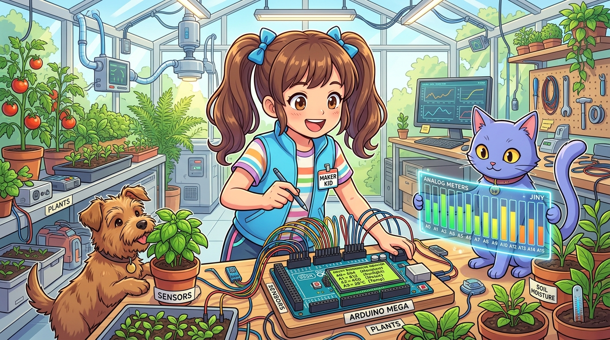

# 178_아두이노메가_16채널아날로그_센서허브 🌿📊

> **우노의 6개 아날로그 핀 한계는 이제 그만! 외장 멀티플렉서 없이 16개 센서를 단 한 대의 메가에 직결하라**  
> 대형 스마트 온실과 산업용 배터리 팩에서 A0부터 A15까지 16채널 아날로그 신호를 고속 스캐닝하고, 노이즈 필터링 및 JSON 데이터 패킷으로 일괄 전송하는 대규모 관제 시스템을 구축합니다.



* 🖥️ **강의 슬라이드**: [slides.md](./slides.md)

---

## 1. 우노에서는 왜 대형 스마트팜을 만들기 힘들었을까요? 🤔

아두이노 우노(UNO)는 아날로그 입력 핀이 **A0부터 A5까지 딱 6개**뿐입니다.  
작은 화분 1개를 가꿀 때는 충분하지만, 여러 구역으로 나뉜 스마트 온실이나 배터리 팩 모니터링을 시도하는 순간 치명적인 벽에 부딪힙니다!

```
[ 우노의 아날로그 핀 고갈 시나리오 ]
구역1 토양수분 (A0) + 구역2 토양수분 (A1) + 구역3 토양수분 (A2) + 구역4 토양수분 (A3) 
+ 저수조 수위 센서 (A4) + 광센서 (A5) 
---------------------------------------------------------------------------------
= 6개 핀 전부 소진! ➡️ 온도센서, 이산화탄소 센서, 화재 가스 센서는 연결 불가! 😱
```

> **👧 도로시**: "지니야! 화분이 4개 있고 물탱크랑 조도 센서까지 달았더니 우노 핀이 꽉 차서 온습도 센서랑 가스 센서를 꽂을 자리가 없어!"  
> **🐱 지니**: "우노에서는 74HC4067 같은 복잡한 외장 멀티플렉서 칩을 따로 달아야 했지만, **아두이노 메가는 A0부터 A15까지 16개의 독립된 아날로그 입력 포트**를 기본 내장하고 있단다!"  
> **🐶 토토**: "멍멍! (16개의 센서를 한 번에 꽂아도 핀이 남는다 멍!)"

---

## 2. ATmega2560 내부 ADC(아날로그-디지털 컨버터) 구조 🔬

메가 2560은 내부적으로 **16채널 10비트 연속 근사형(SAR) ADC**를 탑재하고 있습니다.
* **10비트 분해능**: 0V ~ 5V 전압을 0부터 1023까지 1024단계의 디지털 숫자로 정밀 변환합니다. (1단계당 약 4.88mV)
* **포트 분할**:
  - `A0 ~ A7`: **PORTF** (PF0 ~ PF7)
  - `A8 ~ A15`: **PORTK** (PK0 ~ PK7)
* **내부 멀티플렉서**: 하나의 고성능 ADC 코어가 고속 스위칭을 통해 A0부터 A15까지의 전압을 번갈아가며 수백 마이크로초 만에 측정합니다.

---

## 3. 다채널 센서 측정 시 필수 주의점: ADC 채널 전환 지연(Ghosting) 👻

연속해서 여러 아날로그 핀을 `analogRead()`로 빠르게 읽다 보면, 이전 채널의 잔류 전압이 다음 채널의 샘플 앤 홀드(Sample & Hold) 커패시터에 남아 **측정값이 서로 번지는 '고스팅(Ghosting) 현상'**이 발생할 수 있습니다.

```cpp
// [고스팅 방지 골든 룰: 더미 리드(Dummy Read) 기법]
int readAnalogStable(int pin) {
  analogRead(pin); // 채널 전환 후 첫 번째 측정값은 버림! (커패시터 충전용)
  delayMicroseconds(10);
  return analogRead(pin); // 두 번째 안정된 진짜 측정값 반환
}
```

---

## 4. 실전 실습: 16채널 환경 센서 고속 스캔 & JSON 패킷 리포터 🚀

A0부터 A15까지 16개의 아날로그 센서를 순차 스캔하고, 4회 이동 평균(Moving Average) 필터를 거쳐 클라우드나 PC로 전송할 수 있는 깔끔한 JSON 데이터 패킷을 생성하는 스케치입니다.

```cpp
/*
 * [아두이노 메가 2560 16채널 아날로그 센서 허브 실습]
 * 측정 핀: A0 ~ A15 (총 16채널 동시 스캔)
 * 출력 형식: 표준 JSON 데이터 패킷
 */

const int NUM_CHANNELS = 16;
int rawValues[NUM_CHANNELS];
float voltageValues[NUM_CHANNELS];

// 안정된 아날로그 전압 읽기 함수 (더미 리드 적용)
int readCleanAnalog(int pin) {
  analogRead(pin);
  delayMicroseconds(10);
  return analogRead(pin);
}

void setup() {
  Serial.begin(115200);
  while (!Serial) { ; }

  Serial.println(F("========================================"));
  Serial.println(F(" 🌿 아두이노 메가 16채널 센서 허브 가동 "));
  Serial.println(F("========================================"));
}

void loop() {
  // 1. A0 ~ A15 전 채널 순차 스캔 및 4회 평균 필터링
  for (int ch = 0; ch < NUM_CHANNELS; ch++) {
    long sum = 0;
    for (int sample = 0; sample < 4; sample++) {
      sum += readCleanAnalog(A0 + ch);
    }
    rawValues[ch] = sum / 4;
    voltageValues[ch] = rawValues[ch] * (5.0 / 1023.0);
  }

  // 2. 표준 JSON 패킷 구성 및 시리얼 전송
  Serial.print(F("{\"timestamp\":"));
  Serial.print(millis());
  Serial.print(F(",\"sensors\":["));
  
  for (int ch = 0; ch < NUM_CHANNELS; ch++) {
    Serial.print(F("{\"ch\":"));
    Serial.print(ch);
    Serial.print(F(",\"raw\":"));
    Serial.print(rawValues[ch]);
    Serial.print(F(",\"volt\":"));
    Serial.print(voltageValues[ch], 2);
    Serial.print(F("}"));
    if (ch < NUM_CHANNELS - 1) Serial.print(F(","));
  }
  
  Serial.println(F("]}"));

  delay(1000); // 1초마다 전체 16구역 리포트
}
```

---

## 🌟 도로시와 지니의 핵심 요약! 🏆


* [x] **우노 대비 2.7배 확장**: 외장 확장 보드 없이 단일 보드로 16개 아날로그 센서를 즉시 직결합니다.
* [x] **더미 리드(Dummy Read)**: 고속 채널 전환 시 이전 핀의 잔류 전압이 간섭하는 고스팅 노이즈를 완벽하게 차단합니다.
* [x] **대규모 농장·공장 최적**: 토양 수분, 수위, 광량, 기온, 가스 센서를 구역별로 16군데 동시에 통합 관제할 수 있습니다.

> **👧 도로시**: "우노에서는 상상도 못 했던 16개 화분 동시 측정이 메가에서는 코드 몇 줄로 너무 쉽게 끝나네!"  
> **🐱 지니**: "이것이 바로 대용량 핀을 품은 메가의 진정한 위력이란다! 다음 챕터에서는 우노에서는 지터(떨림) 때문에 불가능했던 **'175_아두이노메가_다축서보_12관절동시제어'**를 정복해 보자!"
