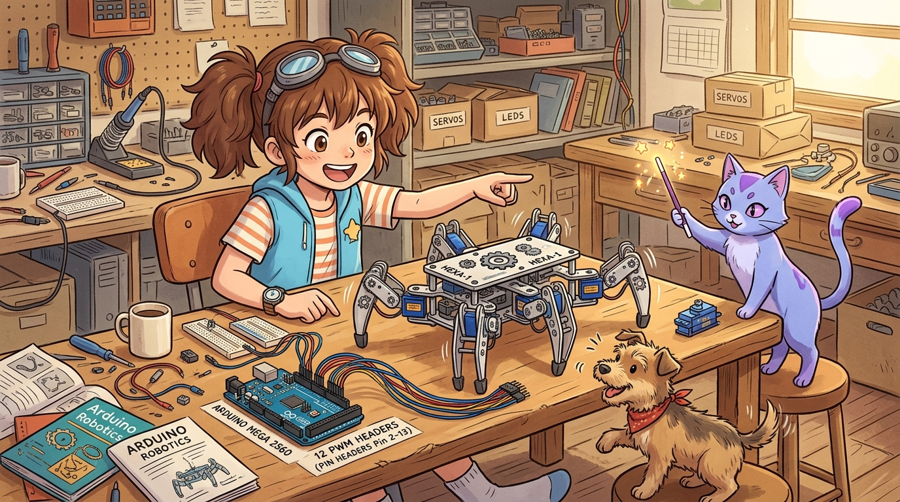

# 179_아두이노메가_다축서보_12관절동시제어 🤖🦾

> **우노의 서보 모터 떨림(Jitter)과 타이머 고갈 한계를 돌파하라! 4개의 16비트 하드웨어 타이머로 지휘하는 12축 다관절 보행 로봇**  
> 우노 Timer1의 한계와 핀 비활성화 문제, 메가 2560의 4대 16비트 타이머(Timer1/3/4/5)를 활용한 최대 48개 서보 구동 원리, 다축 서보 전원 분리 설계 및 6족 로봇 삼각 보행(Tripod Gait) 제어를 학습합니다.



* 🖥️ **강의 슬라이드**: [slides.md](./slides.md)

---

## 1. 우노에서 서보 모터를 많이 달면 왜 부들부들 떨릴까요? 抖

6족 보행 로봇(거미 로봇)이나 2족 보행 로봇을 만들려면 최소 12개의 관절 서보 모터가 필요합니다.  
하지만 아두이노 우노(UNO)에 서보 모터를 6개 이상 연결하고 코드를 돌리면, 모터들이 목표 각도에 가만히 있지 못하고 **"지지직- 부들부들" 떨리는 끔찍한 현상(Jitter)**이 발생합니다!

```
[ 우노(UNO)의 단일 타이머 한계와 비극 ]
- 16비트 타이머가 Timer1 단 1개뿐!
- Servo 라이브러리를 켜는 순간 9번, 10번 PWM 핀 기능이 영구 마비됨!
- 타이머 1개로 여러 모터의 펄스를 소프트웨어적으로 쪼개다 보니 시간 오차가 누적되어 모터가 격렬하게 떨림!
```

> **👧 도로시**: "지니야! 우노에 서보 모터를 8개 달았더니 로봇 다리가 가만히 서 있지를 못하고 덜덜 떨리면서 주저앉아버려!"  
> **🐱 지니**: "우노에는 16비트 타이머가 1개뿐이라 모터들에게 동시에 정확한 박자를 맞춰주지 못하기 때문이란다! 하지만 **메가 2560은 16비트 하드웨어 타이머가 무려 4개**나 있어서 12개는 물론 **최대 48개의 서보 모터**를 한 치의 떨림도 없이 부드럽게 움직일 수 있단다!"  
> **🐶 토토**: "멍멍! (4명의 지휘자가 동시에 로봇 관절을 지휘하는 거다 멍!)"

---

## 2. 메가 2560의 4대 16비트 하드웨어 타이머 스펙 ⏱️

서보 모터는 20ms(50Hz) 주기로 1.0ms ~ 2.0ms 사이의 정밀한 펄스 폭을 공급받아야 각도를 유지합니다.

| 구분 | 아두이노 우노 (UNO) | 아두이노 메가 2560 (Mega) |
| :--- | :---: | :---: |
| **16비트 고정밀 타이머** | **Timer1** (단 1개!) | **Timer1, Timer3, Timer4, Timer5 (총 4개!)** |
| **최대 서보 제어 수** | 최대 12개 (심한 지터 발생) | **최대 48개 (12개 제어 시 지터 0% 완벽)** |
| **PWM 기능 상실 여부** | 9번, 10번 PWM 영구 상실 | 타이머를 분산하여 다른 PWM 핀 영향 최소화 |
| **관절 제어 안정성** | 불안정 (진동 및 소음) | **초정밀 지터 프리(Jitter-Free) 부드러운 모션** |

---

## 3. 다축 서보 연결 시 생명선: 외장 전원 분리 설계 ⚡🔌

서보 모터 12개가 동시에 움직일 때 순간 소비 전류(돌입 전류)는 **최대 3A ~ 5A**까지 치솟습니다!  
아두이노 메가 보드의 5V 핀은 최대 500~800mA까지만 견딜 수 있으므로, 보드 5V 핀에 서보를 주렁주렁 달면 전압 강하로 메가가 무한 재부팅(Brown-out)되거나 기판이 타버립니다.

```
 [ 12축 서보 모터 안전 외장 전원 배선도 ]

 [ 외장 5V 5A 전원 공급기 ]
   ├── (+) 5V ─────────────────> [ 서보 모터 12개 빨간선 (VCC) 직결! ]
   └── (-) GND ────────┬────────> [ 서보 모터 12개 갈색선 (GND) 직결! ]
                       │
                       └────────> [ 아두이노 메가 GND 핀과 반드시 공통 접지(Common GND) 결선! ]

 [ 아두이노 메가 2560 ]
   └── D2 ~ D13 ───────────────> [ 서보 모터 12개 주황색 신호선 (Signal) 각각 연결 ]
```

---

## 4. 실전 실습: 12개 관절 서보 동시 스무스 스케줄러 🚀

2번부터 13번 핀까지 12개의 서보 모터를 메가에 장착하고, 6족 로봇의 3다리 교차 보행(Tripod Gait) 알고리즘을 부드러운 각도 보간(Interpolation)으로 실행하는 스케치입니다.

```cpp
/*
 * [아두이노 메가 2560 12개 서보 모터 동시 구동 실습]
 * 핀 할당: D2 ~ D13 (12채널 서보 신호선)
 * 전원: 외장 5V 5A 파워서플라이 필수 (GND 공통 연결)
 */

#include <Servo.h>

const int NUM_SERVOS = 12;
Servo myServos[NUM_SERVOS];

// 12개 서보 연결 핀 번호 (D2 ~ D13)
const int servoPins[NUM_SERVOS] = {2, 3, 4, 5, 6, 7, 8, 9, 10, 11, 12, 13};

void setup() {
  Serial.begin(115200);
  Serial.println(F("========================================"));
  Serial.println(F(" 🤖 아두이노 메가 12축 관절 제어기 가동 "));
  Serial.println(F("========================================"));

  // 12개 서보 모터 순차 부착 (메가는 4개 16비트 타이머로 자동 분산 관리)
  for (int i = 0; i < NUM_SERVOS; i++) {
    myServos[i].attach(servoPins[i]);
    myServos[i].write(90); // 초기 원점 90도 정렬
    delay(50);
  }

  Serial.println(F("[준비 완료] 12개 관절이 원점에 정렬되었습니다."));
  delay(1000);
}

void loop() {
  // 1. 삼각 보행 A그룹(짝수 서보) 전진, B그룹(홀수 서보) 후진
  Serial.println(F("[Step 1] Tripod Group A 전진..."));
  for (int angle = 60; angle <= 120; angle += 2) {
    for (int i = 0; i < NUM_SERVOS; i++) {
      if (i % 2 == 0) {
        myServos[i].write(angle);
      } else {
        myServos[i].write(180 - angle);
      }
    }
    delay(15); // 부드러운 모션 보간
  }

  delay(200);

  // 2. 삼각 보행 반대 동작 (Group B 전진, Group A 복귀)
  Serial.println(F("[Step 2] Tripod Group B 전진..."));
  for (int angle = 120; angle >= 60; angle -= 2) {
    for (int i = 0; i < NUM_SERVOS; i++) {
      if (i % 2 == 0) {
        myServos[i].write(angle);
      } else {
        myServos[i].write(180 - angle);
      }
    }
    delay(15);
  }

  delay(200);
}
```

---

## 🌟 도로시와 지니의 핵심 요약! 🏆


* [x] **우노의 Timer1 한계 극복**: 메가는 4개의 독립 16비트 타이머를 갖추어 서보 모터의 떨림(Jitter)을 100% 제거합니다.
* [x] **최대 48개 서보 지원**: 우노에서는 꿈도 꿀 수 없었던 12축/18축 휴머노이드 및 6족 로봇을 단 한 대로 제어합니다.
* [x] **외장 전원 필수 분리**: 12개 서보의 수 암페어 돌입 전류를 감당하기 위해 외장 5V 전원과 Common GND 결선을 구축합니다.

> **👧 도로시**: "12개의 모터가 동시에 움직이는데도 전혀 덜덜거리지 않고 발레리나처럼 부드럽게 춤을 춰!"  
> **🐱 지니**: "하드웨어 타이머의 풍요로움이 만들어낸 기적이탈다! 다음 챕터에서는 우노에서는 메모리 부족으로 절대 올릴 수 없는 **'176_아두이노메가_16비트병렬_TFT터치스크린'** GUI를 정복해 보자!"
