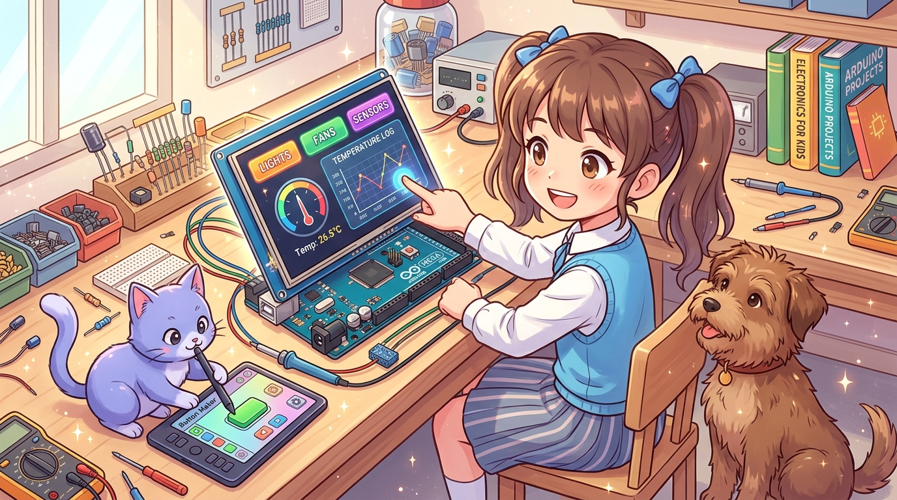

# 180_아두이노메가_16비트병렬_TFT터치스크린 📱🎛️

> **우노의 핀과 2KB RAM으로는 절대 불가능했던 꿈의 컬러 GUI! 3.5인치 16비트 초고속 병렬 TFT LCD 터치스크린 대시보드**  
> 21가닥의 신호선(16비트 데이터 버스 + 5개 제어선)을 단번에 소화하는 메가의 더블 로우 핀헤더, 고해상도 그래픽 버퍼 구동, 터치 좌표 캘리브레이션 및 인터랙티브 제어판 GUI를 구현합니다.



* 🖥️ **강의 슬라이드**: [slides.md](./slides.md)

---

## 1. 우노는 왜 3.5인치 16비트 컬러 TFT LCD를 켤 수 없을까요? ❌

아두이노로 영화 속 스마트홈처럼 화려한 터치스크린 화면을 만들고 싶어서 3.2인치나 3.5인치 대화면 TFT LCD 쉴드를 샀다가 우노에서 좌절하는 메이커들이 매우 많습니다.

```
[ 우노(UNO)가 16비트 TFT LCD 앞에서 무릎 꿇는 이유 3가지 ]
1. 핀 수 부족: 16비트 데이터 버스(16핀) + 제어선(5핀) = 최소 21개 핀 필요! (우노는 총 14핀뿐)
2. 메모리(SRAM) 고갈: 컬러 그래픽 라이브러리와 폰트 롬을 로드하면 우노의 2KB SRAM은 즉시 폭발!
3. SPI 방식의 느린 속도: 우노에서 1선 직렬 SPI로 320x480 화면을 그리면 슬라이드 쇼처럼 버벅거림!
```

> **👧 도로시**: "지니야! 스마트폰처럼 손가락으로 꾹꾹 누르는 컬러 터치스크린을 우노에 꽂으려고 했더니 전선이 20가닥도 넘게 필요해서 아예 꽂을 수가 없어!"  
> **🐱 지니**: "그럴 땐 아두이노 메가의 거대한 더블 로우 핀헤더 위에 **Mega 2560 전용 16비트 TFT LCD 쉴드**를 얹으면 된단다! 16비트 데이터를 1클럭(62.5ns) 만에 화면으로 뿜어내어 아주 매끄러운 그래픽 화면을 그려주지!"  
> **🐶 토토**: "멍멍! (화면을 터치하면 버튼이 쏙쏙 눌린다 멍!)"

---

## 2. 16비트 병렬 버스(Parallel Bus)의 압도적인 속도 원리 🏎️

시중의 소형 LCD는 데이터를 1비트씩 한 줄로 보내는 **직렬(SPI)** 방식을 씁니다.  
하지만 320×480 해상도는 총 153,600개의 픽셀을 가지고 있고, 1픽셀당 16비트(65,536 컬러) 색상 정보를 전송해야 하므로 1프레임을 그리려면 **무려 2,457,600비트**의 데이터를 보내야 합니다!

```
 ■ 직렬 SPI 방식 (우노 수준):
   [CPU] ─ 1비트씩 245만 번 줄 서서 통과... ──> [화면 한 줄씩 위에서 아래로 스캔되며 버벅거림]

 ■ 16비트 병렬 버스 방식 (메가 2560 PORTA + PORTC):
   [CPU] ════ 16비트(1워드)가 한 번에 고속 고속도로로 전송! ════> [눈 깜짝할 사이에 전면 갱신!]
```

* **PORTA (D22 ~ D29)**: 데이터 버스 하위 8비트 (DB0 ~ DB7)
* **PORTC (D30 ~ D37)**: 데이터 버스 상위 8비트 (DB8 ~ DB15)
* **제어선 (D38 ~ D41)**: `RS`(명령/데이터), `WR`(쓰기), `CS`(칩 선택), `RESET`

---

## 3. 메가 전용 TFT 쉴드 구조와 하드웨어 장착법 🛠️

메가 전용 TFT LCD 쉴드(ILI9486 / ILI9341 / SSD1289)는 메가 보드의 외형 크기에 꼭 맞게 설계되어 점퍼선 연결 없이 **메가 보드 위에 모자처럼 얹기만 하면 설치가 끝납니다!**

1. **상단 핀헤더**: 전원(5V, 3.3V, GND) 및 SPI 핀 자동 연결 (내장 MicroSD 카드 슬롯용).
2. **후면 더블 로우 핀헤더**: D22부터 D53까지의 16비트 고속 병렬 버스 직결.
3. **저항막 터치스크린 내장**: 화면을 손가락이나 스타일러스 펜으로 눌렀을 때 X, Y 좌표를 읽어내는 4선식 터치 패널 기본 탑재.

---

## 4. 실전 실습: 인터랙티브 컬러 터치 GUI 대시보드 스케치 🚀

화면에 예쁜 컬러 버튼과 원형 게이지를 그리고, 화면을 터치하여 장치를 제어하는 스마트 홈 제어판 스케치입니다. (표준 `MCUFRIEND_kbv` 및 `TouchScreen` 라이브러리 기반)

```cpp
/*
 * [아두이노 메가 2560 16비트 TFT 터치스크린 대시보드]
 * 하드웨어: Arduino Mega 2560 + 3.5인치 TFT LCD Touch Shield (ILI9486)
 * 기능: 조명 제어 터치 버튼 + 실시간 온도 게이지 UI
 */

#include <Adafruit_GFX.h>
#include <MCUFRIEND_kbv.h>
#include <TouchScreen.h>

MCUFRIEND_kbv tft;

// 터치스크린 핀 설정 (메가 TFT 쉴드 기본 핀맵)
#define YP A3  // A3
#define XM A2  // A2
#define YM 9   // D9
#define XP 8   // D8
TouchScreen ts = TouchScreen(XP, YP, XM, YM, 300);

// 색상 상수 정의 (16비트 RGB565)
#define BLACK   0x0000
#define BLUE    0x001F
#define RED     0xF800
#define GREEN   0x07E0
#define CYAN    0x07FF
#define WHITE   0xFFFF
#define DARKGREY 0x4208

bool lightState = false;

void drawDashboard() {
  tft.fillScreen(BLACK);

  // 1. 헤더 타이틀 바
  tft.fillRect(0, 0, 320, 40, BLUE);
  tft.setTextColor(WHITE);
  tft.setTextSize(2);
  tft.setCursor(20, 12);
  tft.println(F("MEGA SMART DASHBOARD"));

  // 2. 조명 토글 터치 버튼 (박스 그리기)
  drawLightButton(lightState);

  // 3. 센서 모니터링 영역
  tft.drawRect(20, 180, 280, 100, DARKGREY);
  tft.setTextColor(CYAN);
  tft.setTextSize(2);
  tft.setCursor(40, 200);
  tft.println(F("TEMP: 26.5 C"));
  tft.setCursor(40, 235);
  tft.println(F("HUMI: 55.0 %"));
}

void drawLightButton(bool state) {
  if (state) {
    tft.fillRect(20, 60, 280, 100, GREEN);
    tft.setTextColor(BLACK);
    tft.setTextSize(3);
    tft.setCursor(75, 95);
    tft.println(F("LIGHT: ON"));
  } else {
    tft.fillRect(20, 60, 280, 100, RED);
    tft.setTextColor(WHITE);
    tft.setTextSize(3);
    tft.setCursor(70, 95);
    tft.println(F("LIGHT: OFF"));
  }
}

void setup() {
  Serial.begin(115200);
  uint16_t ID = tft.readID(); // LCD 컨트롤러 IC 식별
  tft.begin(ID);
  tft.setRotation(0); // 세로 모드 (0: 320x480)
  
  drawDashboard();
  Serial.println(F("TFT 터치 대시보드 준비 완료!"));
}

void loop() {
  // 1. 터치 감지 (압력 Z > 10)
  TSPoint p = ts.getPoint();
  pinMode(XM, OUTPUT);
  pinMode(YP, OUTPUT);

  if (p.z > 10 && p.z < 1000) {
    // 2. 아날로그 좌표를 스크린 픽셀 좌표(320x480)로 변환 (보정)
    int pixelX = map(p.x, 920, 150, 0, 320);
    int pixelY = map(p.y, 120, 940, 0, 480);

    // 3. 조명 버튼 영역(Y: 60~160) 터치 여부 판별
    if (pixelY >= 60 && pixelY <= 160) {
      lightState = !lightState; // 상태 반전
      drawLightButton(lightState);
      
      Serial.print(F("버튼 터치! 조명 상태: "));
      Serial.println(lightState ? "ON" : "OFF");
      
      delay(300); // 디바운스 딜레이
    }
  }
}
```

---

## 🌟 도로시와 지니의 핵심 요약! 🏆


* [x] **우노의 핀 부족 해결**: 16비트 데이터 버스와 제어선 21개를 단번에 직결하는 3.5인치 대화면 쉴드를 구동합니다.
* [x] **8KB SRAM의 그래픽 버퍼**: 우노의 2KB에서는 불가능했던 컬러 폰트, 버튼 렌더링, 실시간 계측 위젯을 자유자재로 배치합니다.
* [x] **16비트 초고속 전송**: 1워드(16비트)를 62.5ns에 전송하여 깜빡임 없는 매끄러운 스마트 홈 터치 GUI를 완성합니다.

> **👧 도로시**: "우노에서는 상상도 못 했던 스마트폰 스타일의 컬러 터치 대시보드가 메가 위에 딸깍 올라가니까 너무 멋져!"  
> **🐱 지니**: "훌륭해! 이제 마지막으로 우노에서는 2개밖에 없어서 다축 로봇에 쓸 수 없었던 **'177_아두이노메가_6개하드웨어인터럽트_다축엔코더'**의 세계로 가보자!"
