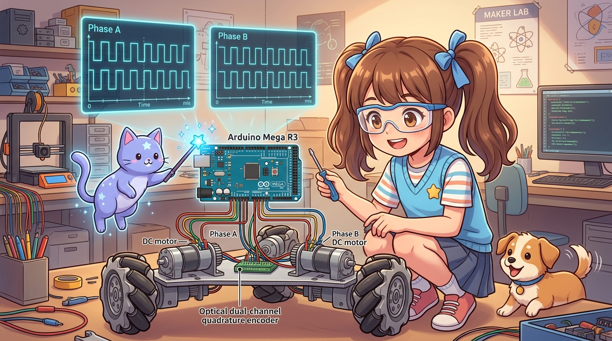
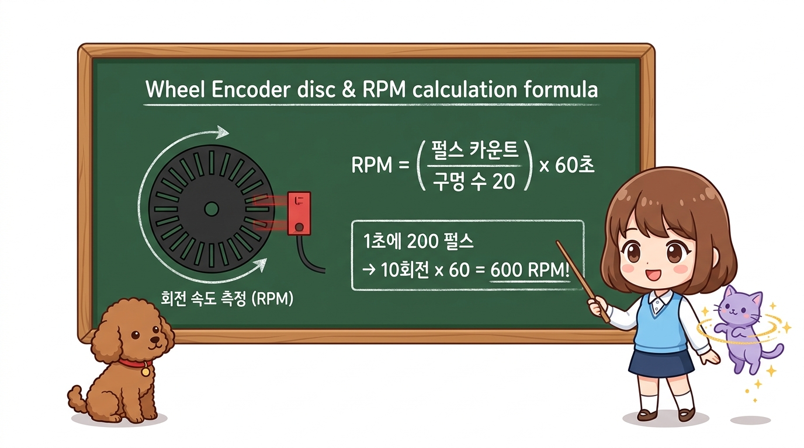
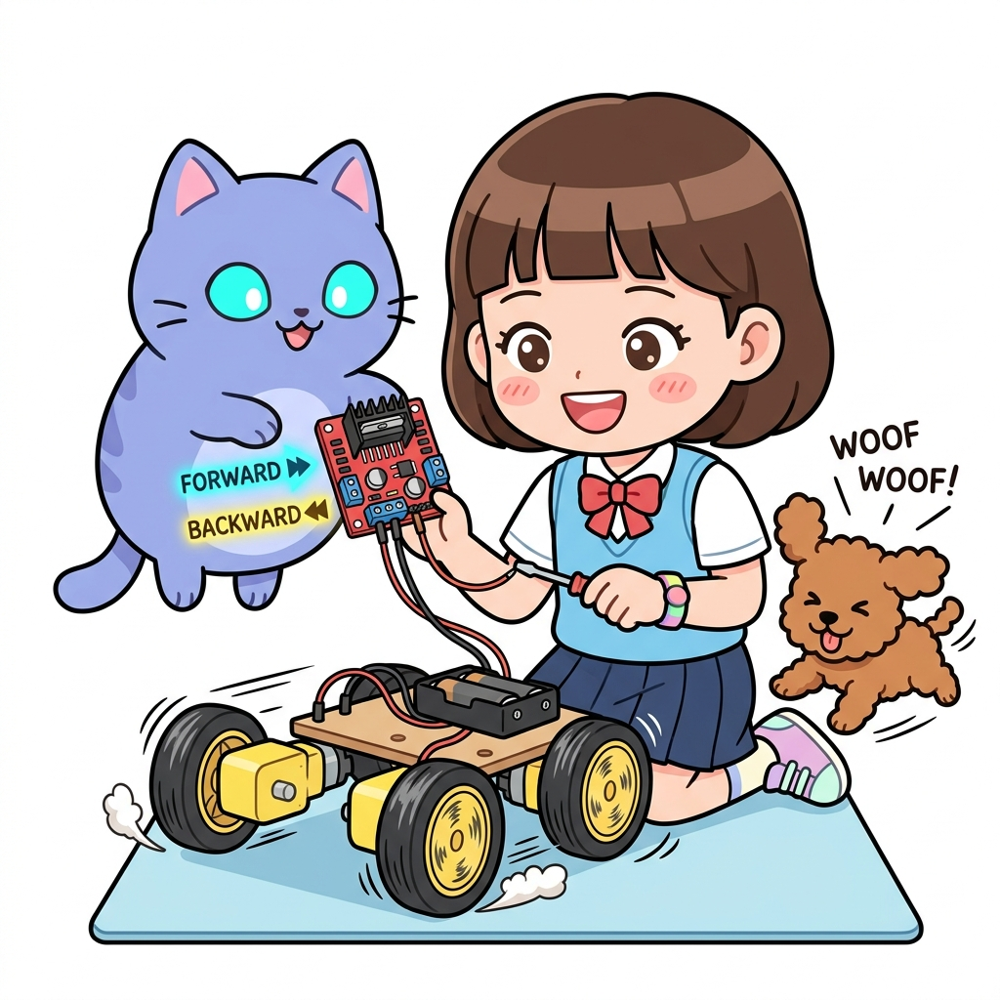

# 181_아두이노메가_6개하드웨어인터럽트_다축엔코더 ⚙️🏎️



* **우노의 2개 인터럽트로는 꿈도 못 꿨던 다륜 로봇의 오도메트리! 3대 이상의 모터 엔코더를 1펄스도 놓치지 않고 동시 추적하라**
* 2상 쿼드러처 엔코더(Quadrature Encoder)의 A/B 위상차 원리, 우노의 2핀 인터럽트 한계 극복, 메가 2560의 6대 외부 하드웨어 인터럽트(INT0~INT5)를 활용한 3축 동시 정밀 위치 추적(Odometry) 시스템을 구축합니다.
* 📖 **상세 강의 교재**: [index.md](./index.md)


> 여러분 안녕하세요! 이번 시간에는 '181. 아두이노메가 6개하드웨어인터럽트 다축엔코더 ⚙️🏎️'을 주제로 함께 흥미진진한 탐험을 떠나보겠습니다. 마법 멘토 지니와 호기심 많은 탐험가 도로시, 그리고 귀여운 토토와 함께 신나는 아두이노 모험을 힘차게 시작해 봅시다. 준비되셨나요?

---
## 1. 우노에서는 왜 2바퀴 이상의 엔코더를 완벽히 읽지 못했을까요? 🤔


* **👧 도로시**: "지니야! 바퀴가 3개 달린 옴니휠 로봇을 만들고 있는데, 모터 1개만 연결했는데 우노 인터럽트 핀 2개가 다 끝나버렸어!"
* **🐱 지니**: "우노는 외부 인터럽트가 2번, 3번 딱 2개뿐이라 다륜 로봇의 엔코더를 감당할 수 없단다! 하지만 **아두이노 메가는 6개의 강력한 하드웨어 인터럽트(INT0부터 INT5까지)**를 품고 있어서, 모터 3대의 A/B상 신호선 6가닥을 단 1펄스도 놓치지 않고 초고속 인터럽트로 추적할 수 있지!"
* **🐶 토토**: "멍멍! (아무리 빨리 달려도 1바퀴의 오차도 없다 멍!)"

자율주행 로봇이 자신이 얼마나 앞으로 갔고 몇 도를 회전했는지 정확히 알려면 바퀴 모터 뒤에 달린 **광학 2상 쿼드러처 엔코더(Quadrature Encoder)**를 읽어야 합니다.
엔코더는 회전 방향과 속도를 정확히 구별하기 위해 **A상과 B상 2가닥의 고속 펄스 선**을 내보냅니다.

```
[ 우노(UNO)의 인터럽트 핀 고갈 참사 ]
모터 1번: Phase A (D2번 / INT0) + Phase B (D3번 / INT1)
------------------------------------------------------
= 우노의 외부 하드웨어 인터럽트 2개 완전 소진! 😱
➡️ 모터 2번(오른쪽 바퀴), 모터 3번은 하드웨어 인터럽트로 연결할 핀이 0개 남음!
```

> 자, 이번 슬라이드의 질문을 함께 보시겠습니다. 바로 '1. 우노에서는 왜 2바퀴 이상의 엔코더를 완벽히 읽지 못했을까요? 🤔'라는 아주 흥미로운 질문입니다. 도로시가 ' 지니야! 바퀴가 3개 달린 옴니휠 로봇을 만들고 있는데, 모터 1개만 연결했는데 우노 인터럽트 핀 2개가 다 끝나버렸어! '라고 질문하자, 지니 멘토는 ' 우노는 외부 인터럽트가 2번, 3번 딱 2개뿐이라 다륜 로봇의 엔코더를 감당할 수 없단다! 하지만 아두이노 메가는 6개의 강력한 하드웨어 인터럽트(INT0부터 INT5까지)를 품고 있어서, 모터 3대의 A/B상 신호선 6가닥을 단 1펄스도 놓치지 않고 초고속 인터럽트로 추적할 수 있지! '라며 명쾌한 답을 들려주었는데요. 이 질문 속에 숨겨진 전자 회로와 컴퓨팅의 핵심 원리를 지금부터 차근차근 하나씩 파헤쳐 보겠습니다.
---
## 2. 메가 2560의 6대 외부 인터럽트 핀맵 🗺️


| 인터럽트 채널 | 아두이노 메가 핀 번호 | 아두이노 우노 지원 여부 | 3축 로봇 연결 추천 |
| :---: | :---: | :---: | :--- |
| **INT0** | **2번 (D2)** | O (우노 지원) | **모터 1 (왼쪽 바퀴) - Phase A** |
| **INT1** | **3번 (D3)** | O (우노 지원) | **모터 1 (왼쪽 바퀴) - Phase B** |
| **INT2** | **21번 (D21)** | X (메가 전용) | **모터 2 (오른쪽 바퀴) - Phase A** |
| **INT3** | **20번 (D20)** | X (메가 전용) | **모터 2 (오른쪽 바퀴) - Phase B** |
| **INT4** | **19번 (D19)** | X (메가 전용) | **모터 3 (후륜/조향) - Phase A** |
| **INT5** | **18번 (D18)** | X (메가 전용) | **모터 3 (후륜/조향) - Phase B** |

아두이노 메가는 CPU가 다른 무거운 연산을 하느라 바쁘더라도, 핀에 전압 펄스가 들어오는 즉시 1마이크로초 만에 반응하는 **6개의 독립된 외부 인터럽트 전용 포트**를 갖추고 있습니다.

> 이번에 살펴볼 내용은 '2. 메가 2560의 6대 외부 인터럽트 핀맵 🗺️'입니다. 슬라이드에 정리된 표를 통해 각 항목의 특징과 수치, 차이점을 한눈에 비교해 보실 수 있습니다. 이 기본 개념을 확실히 잡아두셔야 실제 부품을 브레드보드에 꽂고 코딩할 때 실수 없이 완성할 수 있습니다.
---
## 3. 2상 쿼드러처 엔코더 방향 판별 원리 🧭




모터 축이 회전할 때 Phase A와 Phase B는 서로 90도의 시간차(위상차)를 두고 사각파 펄스를 뿜어냅니다.

```
 [ 시계 방향(CW) 회전 시 ]
   Phase A: ──┐    ┌────┐    ┌──── (A가 먼저 솟구침!)
              │    │    │    │
   Phase B: ─────┐    ┌────┐    ┌ (B가 뒤따라옴)
   ==> Phase A가 RISING(상승)할 때 Phase B의 전압이 LOW이면: 전진(+1)!

 [ 반시계 방향(CCW) 회전 시 ]
   Phase A: ─────┐    ┌────┐    ┌
   Phase B: ──┐    ┌────┐    ┌──── (B가 먼저 솟구침!)
   ==> Phase A가 RISING(상승)할 때 Phase B의 전압이 HIGH이면: 후진(-1)!
```

> 이번 슬라이드에서는 '3. 2상 쿼드러처 엔코더 방향 판별 원리 🧭'에 대한 실제 동작 코드를 분석해 보겠습니다. 화면의 코드를 살펴보시면, 컴퓨터가 아두이노 하드웨어에 단계별로 명령을 내리는 흐름을 명확하게 확인할 수 있습니다. 각 함수의 역할과 괄호 안의 매개변수가 하드웨어 핀과 어떤 관계를 맺고 동작하는지 주의 깊게 살펴보시기 바랍니다.
---
## 4. 실전 실습: 3대 모터 6채널 동시 오도메트리(Odometry) 추적기 🚀




3대의 모터 엔코더 신호선 6가닥을 메가의 INT0~INT5에 모두 직결하고, 1초에 수만 번 발생하는 고속 회전 펄스를 단 한 개도 흘리지 않고 실시간 계측하는 스케치입니다.

```cpp
/*
 * [아두이노 메가 2560 3대 모터 6채널 엔코더 인터럽트 실습]
 * - 모터 1: D2 (INT0), D3 (INT1)
 * - 모터 2: D21 (INT2), D20 (INT3)
 * - 모터 3: D19 (INT4), D18 (INT5)
 */

// 3개 모터의 누적 회전 펄스 카운터 (인터럽트에서 수정하므로 volatile 필수!)
volatile long motor1Pos = 0;
volatile long motor2Pos = 0;
volatile long motor3Pos = 0;

// [모터 1 인터럽트 서비스 루틴]
void isrMotor1() {
  if (digitalRead(3) == LOW) {
    motor1Pos++; // 시계 방향
  } else {
    motor1Pos--; // 반시계 방향
  }
}

// [모터 2 인터럽트 서비스 루틴]
void isrMotor2() {
  if (digitalRead(20) == LOW) {
    motor2Pos++;
  } else {
    motor2Pos--;
  }
}

// [모터 3 인터럽트 서비스 루틴]
void isrMotor3() {
  if (digitalRead(18) == LOW) {
    motor3Pos++;
  } else {
    motor3Pos--;
  }
}

void setup() {
  Serial.begin(115200);

  // 6개 인터럽트 핀 풀업 설정
  pinMode(2, INPUT_PULLUP);
  pinMode(3, INPUT_PULLUP);
  pinMode(21, INPUT_PULLUP);
  pinMode(20, INPUT_PULLUP);
  pinMode(19, INPUT_PULLUP);
  pinMode(18, INPUT_PULLUP);

  // 메가 2560 6대 외부 인터럽트 등록 (Phase A의 상승 엣지 감지)
  attachInterrupt(digitalPinToInterrupt(2),  isrMotor1, RISING); // INT0
  attachInterrupt(digitalPinToInterrupt(21), isrMotor2, RISING); // INT2
  attachInterrupt(digitalPinToInterrupt(19), isrMotor3, RISING); // INT4

  Serial.println(F("========================================"));
  Serial.println(F(" ⚙️ 아두이노 메가 3축 엔코더 오도메트리 가동 "));
  Serial.println(F("========================================"));
}

void loop() {
  // 100ms마다 3개 바퀴의 정밀 이동 위치 출력
  static unsigned long lastPrint = 0;
  if (millis() - lastPrint >= 100) {
    lastPrint = millis();

    Serial.print(F("[위치 계측] "));
    Serial.print(F("M1(좌): "));
    Serial.print(motor1Pos);
    Serial.print(F(" tick | M2(우): "));
    Serial.print(motor2Pos);
    Serial.print(F(" tick | M3(후): "));
    Serial.print(motor3Pos);
    Serial.println(F(" tick"));
  }
}
```

> 이번 슬라이드에서는 '4. 실전 실습: 3대 모터 6채널 동시 오도메트리(Odometry) 추적기 🚀'에 대한 실제 동작 코드를 분석해 보겠습니다. 화면의 코드를 살펴보시면, 컴퓨터가 아두이노 하드웨어에 단계별로 명령을 내리는 흐름을 명확하게 확인할 수 있습니다. 각 함수의 역할과 괄호 안의 매개변수가 하드웨어 핀과 어떤 관계를 맺고 동작하는지 주의 깊게 살펴보시기 바랍니다.
---

## 🌟 도로시와 지니의 핵심 요약! 🏆


* **👧 도로시**: "우노에서는 상상도 못 했던 16채널 센서, 12관절 서보, 16비트 터치스크린, 그리고 6채널 고속 인터럽트까지! 메가의 진정한 슈퍼 파워를 온몸으로 느꼈어!"
* **🐱 지니**: "축하한다 도로시! 이제 우노의 한계를 넘어 대규모 산업용 프로젝트와 첨단 로봇 공학을 자유자재로 지휘하는 진정한 마스터 엔지니어가 되었단다!"

* [x] **우노의 2핀 인터럽트 한계 돌파**: 2, 3, 18, 19, 20, 21번 총 6개의 외부 인터럽트를 제공합니다.
* [x] **다축 로봇 오도메트리 완성**: 3대 이상의 모터 쿼드러처 엔코더를 초고속 펄스 누락 없이 실시간 추적합니다.
* [x] **완벽한 PID 제어 기반**: 하드웨어 인터럽트로 수집된 정밀 위치 데이터를 통해 자율주행 로봇의 위치 오차를 제로(0)로 수렴시킵니다.

> 오늘 배운 '🌟 도로시와 지니의 핵심 요약! 🏆'의 핵심 내용을 모두 정리해 보았습니다. 오늘 다룬 내용 중에서도 [x] 우노의 2핀 인터럽트 한계 돌파: 2, 3, 18, 19, 20, 21번 총 6개의 외부 인터럽트를 제공합니다. 부분은 앞으로의 아두이노 실습과 프로젝트에서 계속 사용되는 매우 중요한 기초 지식입니다. 오늘 배운 내용을 꼭 다시 한번 복습해 보시고, 다음 강의에서 더욱 신나고 유익한 모험으로 다시 만나겠습니다. 모두 수고 많으셨습니다!