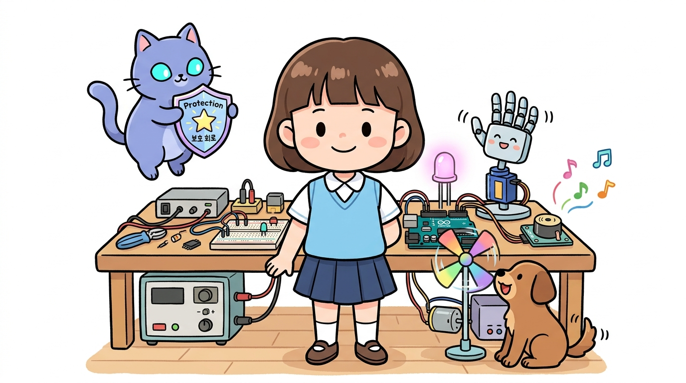
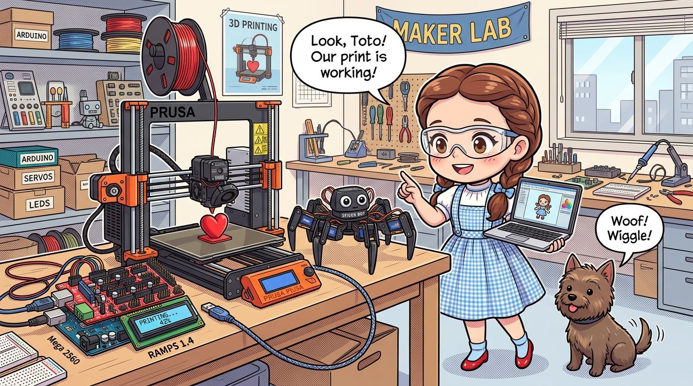

# 182_아두이노메가_3D프린터와_대규모로봇제어 🤖🏗️

> **메이커 운동의 심장! 아두이노 메가 2560으로 구축하는 거대 시스템의 세계**  
> RAMPS 1.4 실드를 결합한 3D 프린터, 서보 모터 12개 이상 동시 구동 다족 보행 로봇, 스마트 팜 통합 관제를 탐구합니다.

* 🖥️ **강의 슬라이드**: [slides.md](./slides.md)

---

## 1. 전 세계 3D 프린터의 표준 심장: 메가 + RAMPS 1.4 🖨️✨

우리가 일상에서 사용하는 FDM 오픈소스 3D 프린터(RepRap 계열)의 90% 이상은 놀랍게도 **아두이노 메가 2560**을 메인 제어 보드로 채택하고 있습니다!

### 📌 3D 프린터의 필수 구성 요소와 메가의 역할
1. **스텝 모터 4~5개 동시 제어**:
   - X축(좌우), Y축(앞뒤), Z축(상하), 익스트루더(필라멘트 밀어내기) 스텝 모터를 0.01mm 정밀도로 제어.
2. **초정밀 온도 PID 제어**:
   - 노즐 핫엔드($200^\circ	ext{C}$ 이상)와 히팅베드($60^\circ	ext{C}$) 온도 센서(NTC 서미스터)를 아날로그 핀으로 실시간 감시.
3. **RAMPS 1.4 실드 결합**:
   - 아두이노 메가 위에 빨간색 **RAMPS 1.4 확장 보드**를 샌드위치처럼 꽂아 고전류 A4988 스텝 드라이버를 안전하게 장착합니다.

---

## 2. 서보 모터 12개 이상 동시 구동! 다관절 보행 로봇 🕷️🤖

우노에서는 서보 모터를 4~5개만 연결해도 핀과 타이머 자원이 부족해 모터가 덜덜 떨리거나 멈추었습니다.

### 🦾 6족 거미 로봇(Hexapod) 제어 원리
* 6개의 다리에 관절 서보 모터가 각각 3개씩(골반, 허벅지, 정강이) 들어가면 총 **18개의 서보 모터**가 필요합니다!
* 아두이노 메가는 **15개의 PWM 핀**과 54개의 디지털 핀을 보유하여 18개의 서보 모터 각도를 부드럽게 동시 제어할 수 있습니다.
* 복잡한 역기구학(Inverse Kinematics) 보행 연산 공식을 메가의 8KB SRAM이 실시간으로 풀어냅니다.

---

## 3. 스마트 팜 & 공장 자동화(FA) 통합 관제 시스템 🌾🏭

수십 개의 온실 동을 거느린 스마트 팜에서도 메가 1대가 마스터 컴퓨터 역할을 해냅니다.

* **16개 아날로그 핀**:
  - 토양 수분 센서 8개 + 실내 온습도 센서 4개 + 광센서 4개를 단 1대의 보드에 직결.
* **54개 디지털 핀**:
  - 환기팬 릴레이, 관수 모터 밸브, 차광막 개폐 모터를 독립 채널로 일괄 구동.
* **통신 포트 분업**:
  - `Serial1`은 중앙 서버 PC로 클라우드 데이터 업로드, `Serial2`는 현장 LCD 터치스크린과 연동.

---

## 🌟 도로시와 지니의 아두이노 대단원 마스터 정리! 🏆

축하합니다! 가장 기초적인 전기와 LED 점등부터 시작하여, C언어 문법, 센서와 모터, 통신과 앱 인벤터, 그리고 초소형 나노와 천하장사 메가 2560에 이르는 **피지컬 컴퓨팅의 모든 지평을 완벽하게 완주**했습니다!

### 📋 최종 마스터 체크리스트
* [x] **아두이노 우노 (UNO)**: 피지컬 컴퓨팅의 표준 기초를 완벽히 마스터했습니다.
* [x] **아두이노 나노 (Nano)**: 브레드보드 직결과 Old Bootloader 설정을 정복하여 초소형 작품을 만듭니다.
* [x] **아두이노 메가 (Mega 2560)**: 54개 핀과 4개 시리얼 포트로 3D 프린터와 대형 로봇 시스템을 자유자재로 지휘합니다.

> **👧 도로시**: "지니야! 이제 머릿속으로 상상하는 모든 로봇과 3D 프린터를 내 손으로 직접 만들 수 있어!"  
> **🐱 지니**: "멋지다 도로시! 그런데 이 거대한 로봇을 미국이나 지구 반대편에서도 실시간으로 감시하고 제어할 수는 없을까? 다음 시간 **'170_아두이노메가_네트워크_이더넷기초'**에서 전 세계 인터넷과 연결하는 비법을 배워보자!"  
> **🐶 토토**: "바우! 랜선만 꽂으면 인터넷 세상으로 직행한다 멍!"
