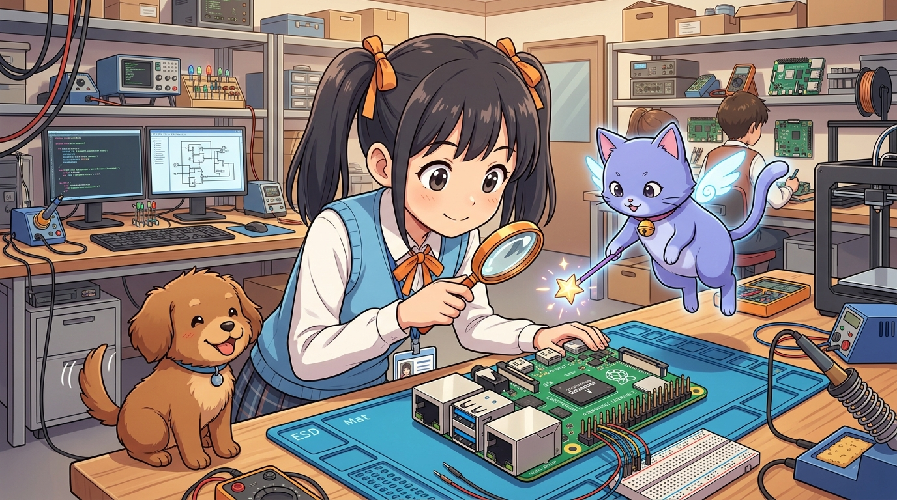

# 185_라즈베리파이_소개와_SBC하드웨어스펙 🍓💻



**도로시와 지니가 함께하는 초소형 싱글보드 컴퓨터(SBC)의 신비한 하드웨어 탐구**

* 👧 **도로시**: "지니야! 신용카드만 한 손바닥 크기 초록색 보드에 모니터, 키보드, 마우스, 인터넷 케이블까지 다 꽂혀! 이게 진짜 컴퓨터야?"
* 🐱 **지니**: "맞아, 도로시! 손바닥 위에 올려놓을 수 있는 진짜 완전한 개인용 컴퓨터, **싱글보드 컴퓨터(SBC: Single Board Computer)** 인 **라즈베리파이(Raspberry Pi)** 란다!"
* 🐶 **토토**: "바우! 모니터를 꽂으면 윈도우처럼 리눅스 화면이 뜨고 유튜브도 볼 수 있다 멍!"

* 🖥️ **강의 슬라이드**: [slides.md](./slides.md)

---

## 1. 싱글보드 컴퓨터(SBC)란 무엇인가?


### 🌟 메인보드 하나에 컴퓨터의 모든 것을 담다!
일반적인 데스크톱 PC는 거대한 케이스 안에 메인보드, CPU 칩, RAM 카드, 그래픽 카드, 하드디스크 파워서플라이가 제각각 꽂혀 있습니다. 하지만 **라즈베리파이**는 이 모든 부품을 **단 한 장의 얇은 인쇄회로기판(PCB)** 위에 집적해 넣었습니다.

```
[ 전통적인 PC 구조 ]
[CPU] + [RAM 카드] + [그래픽카드] + [SSD/HDD] ➔ 거대한 메인보드에 각각 장착

[ 라즈베리파이 SBC 구조 ]
[Broadcom SoC (CPU+GPU+VPU)] + [LPDDR RAM] + [MicroSD/PCIe] ➔ 손바닥 크기 단일 기판 완성!
```

### 🇬🇧 라즈베리파이의 탄생 배경
* **설립 주체**: 영국 케임브리지 대학의 에벤 업톤(Eben Upton) 교수를 중심으로 설립된 **라즈베리파이 재단(Raspberry Pi Foundation)**.
* **목적**: 비싼 컴퓨터를 사기 힘든 전 세계 학생들이 프로그래밍과 컴퓨터 과학(CS)을 35달러라는 파격적인 가격에 배울 수 있도록 개발되었습니다.
* **혁신**: 단순 교육용을 넘어 전 세계 메이커, 로봇 공학자, 사물인터넷(IoT) 엔지니어의 핵심 플랫폼으로 거듭났습니다.

---

## 2. 라즈베리파이 4B & 5 하드웨어 상세 스펙

| 구분 | 라즈베리파이 4 Model B | 라즈베리파이 5 (최신 플래그십) | 아두이노 우노 (참고 비교) |
| :--- | :--- | :--- | :--- |
| **SoC (CPU)** | Broadcom BCM2711<br>(쿼드코어 Cortex-A72 @ 1.5GHz) | Broadcom BCM2712<br>(쿼드코어 Cortex-A76 @ 2.4GHz) | Microchip ATmega328P<br>(1코어 AVR @ 16MHz) |
| **RAM (메모리)** | 2GB / 4GB / 8GB LPDDR4 | 4GB / 8GB LPDDR4X | **2 KB** (약 4백만 배 차이!) |
| **운영체제** | 64비트 리눅스 (Raspberry Pi OS) | 64비트 리눅스 (Raspberry Pi OS) | 운영체제 없음 (Bare-metal) |
| **비디오 출력** | Micro-HDMI x 2 (4K 60fps 지원) | Micro-HDMI x 2 (4K 60fps HDR) | 디스플레이 출력 없음 |
| **네트워크** | 기가비트 이더넷, Wi-Fi 5, BT 5.0 | 기가비트 이더넷, Wi-Fi 5, BT 5.0 | 없음 (외부 모듈 필요) |
| **USB 포트** | USB 3.0 x 2, USB 2.0 x 2 | USB 3.0 x 2, USB 2.0 x 2 | USB Type-B 1개 (시리얼 통신) |
| **확장 슬롯** | MicroSD 슬롯 | MicroSD + PCIe 2.0 1-lane | 없음 |
| **전원 규격** | USB Type-C (5V 3A 권장) | USB Type-C (5V 5A PD 권장) | USB 5V 또는 DC Jack 7~12V |

---

## 3. 피지컬 컴퓨팅의 핵심! 40핀 GPIO 헤더

라즈베리파이가 일반 PC와 가장 차별화되는 무기는 메인보드 상단에 일렬로 돋아난 **40개의 GPIO(General Purpose Input/Output) 핀**입니다. PC이면서도 아두이노처럼 센서와 모터를 직접 제어할 수 있는 관문입니다.

```
       [ Raspberry Pi 40-Pin GPIO Header Map ]
 3.3V Power ( 1) ( 2) 5V Power
GPIO 2 (SDA) ( 3) ( 4) 5V Power
GPIO 3 (SCL) ( 5) ( 6) Ground (GND)
     GPIO 4  ( 7) ( 8) GPIO 14 (UART TX)
Ground (GND) ( 9) (10) GPIO 15 (UART RX)
    GPIO 17  (11) (12) GPIO 18 (PWM0)
    GPIO 27  (13) (14) Ground (GND)
    GPIO 22  (15) (16) GPIO 23
 3.3V Power  (17) (18) GPIO 24
GPIO 10(MOSI)(19) (20) Ground (GND)
GPIO 9 (MISO)(21) (22) GPIO 25
GPIO 11(SCLK)(23) (24) GPIO 8 (CE0)
Ground (GND) (25) (26) GPIO 7 (CE1)
  ID_SD(I2C) (27) (28) ID_SC(I2C)
     GPIO 5  (29) (30) Ground (GND)
     GPIO 6  (31) (32) GPIO 12 (PWM0)
    GPIO 13  (33) (34) Ground (GND)
    GPIO 19  (35) (36) GPIO 16
    GPIO 26  (37) (38) GPIO 20
Ground (GND) (39) (40) GPIO 21
```

> [!CAUTION]
> **치명적 주의 (3.3V Only!)**: 라즈베리파이의 모든 GPIO 핀은 **3.3V 논리 레벨(LVCMOS)** 로 동작합니다! 아두이노 우노의 5V 출력을 그대로 꽂으면 칩셋이 영구 손상됩니다. (이에 대한 안전한 보호 회로는 181강에서 깊이 다룹니다!)

---

## 4. 전원 공급과 발열 쿨링 시스템


### ⚡ 1. 저전압(Under-voltage) 방지
* 고성능 쿼드코어 CPU와 USB 장치들이 전기를 많이 소모합니다. 일반 스마트폰 충전기(1A~1.5A)를 꽂으면 화면 우측 상단에 **노란색 번개 아이콘(⚡)** 이 깜빡이며 기기가 멈추거나 SD 카드가 손상될 수 있습니다.
* 반드시 정격 규격인 **5V 3.0A 이상의 고품질 전원 어댑터**를 사용해야 합니다.

### ❄️ 2. 발열과 쓰로틀링(Throttling) 방지
* CPU 온도가 **80°C**를 넘어가면 칩을 보호하기 위해 스스로 동작 속도를 강제로 떨어뜨리는 **서멀 쓰로틀링**이 일어납니다.
* 알루미늄 방열판(Heat sink)과 소형 5V DC 쿨링팬이 포함된 케이스를 장착하는 것이 시스템 안정성의 기본 원칙입니다.

---

## 🌟 도로시와 지니의 핵심 요약 노트!


* 👧 **도로시**: "라즈베리파이는 단순한 회로 부품이 아니라 4K 듀얼 모니터에 기가비트 인터넷까지 돌아가는 진짜 리눅스 컴퓨터구나!"
* 🐱 **지니**: "그렇단다! 40핀 GPIO 헤더 덕분에 컴퓨터의 강력한 연산 능력과 하드웨어 제어 능력을 동시에 얻을 수 있어."
* 🐶 **토토**: "바우! 다음 시간엔 SD 카드에 진짜 리눅스 OS를 설치하고 접속하는 **'179_라즈베리파이_OS설치와_리눅스환경구축'**으로 떠나보자 멍!"
