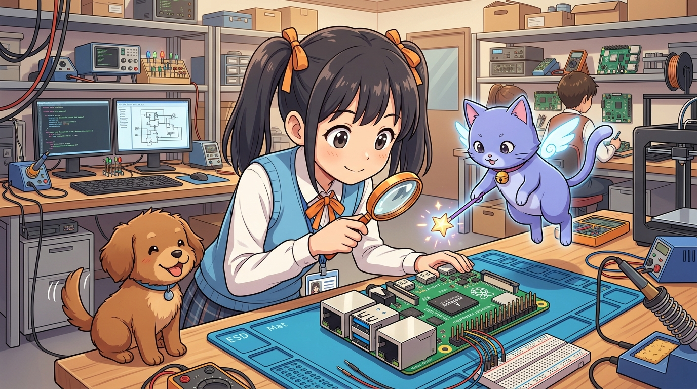
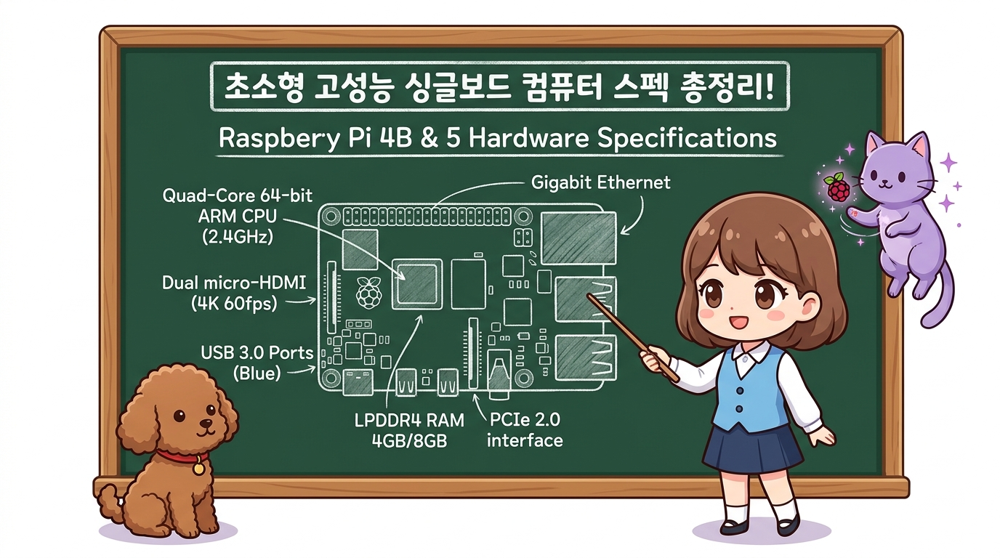
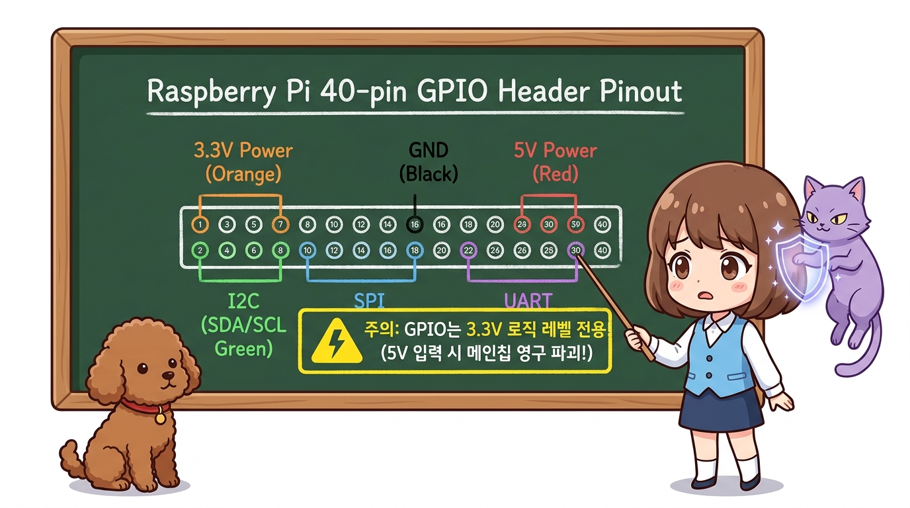
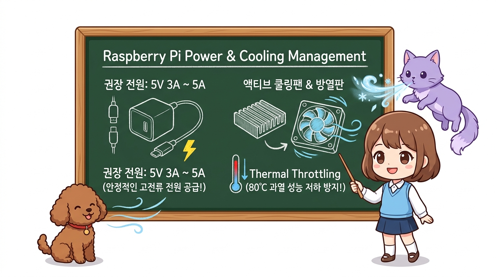

# 185_라즈베리파이_소개와_SBC하드웨어스펙 🍓💻



**도로시와 지니가 함께하는 초소형 싱글보드 컴퓨터(SBC)의 신비한 하드웨어 탐구**
* 👧 **도로시**: "지니야! 신용카드만 한 손바닥 크기 초록색 보드에 모니터, 키보드, 마우스, 인터넷 케이블까지 다 꽂혀! 이게 진짜 컴퓨터야?"
* 🐱 **지니**: "맞아, 도로시! 손바닥 위에 올려놓을 수 있는 진짜 완전한 개인용 컴퓨터, **싱글보드 컴퓨터(SBC: Single Board Computer)** 인 **라즈베리파이(Raspberry Pi)** 란다!"
* 🐶 **토토**: "바우! 모니터를 꽂으면 윈도우처럼 리눅스 화면이 뜨고 유튜브도 볼 수 있다 멍!"
* 📖 **상세 강의 교재**: [index.md](./index.md)


> 여러분 안녕하세요! 이번 시간에는 '185. 라즈베리파이 소개와 SBC하드웨어스펙 🍓💻'을 주제로 함께 흥미진진한 탐험을 떠나보겠습니다. 오늘 강의에서는 특히 도로시와 지니가 함께하는 초소형 싱글보드 컴퓨터(SBC)의 신비한 하드웨어 탐구, 👧 도로시: "지니야! 신용카드만 한 손바닥 크기 초록색 보드에 모니터, 키보드, 마우스, 인터넷 케이블까지 다 꽂혀! 이게 진짜 컴퓨터야?"를 중심으로 핵심 원리와 응용 방법을 차근차근 배워보겠습니다. 마법 멘토 지니와 호기심 많은 탐험가 도로시, 그리고 귀여운 토토와 함께 신나는 아두이노 모험을 힘차게 시작해 봅시다. 준비되셨나요?

---

## 1. 싱글보드 컴퓨터(SBC)란 무엇인가?


* **설립 주체**: 영국 케임브리지 대학의 에벤 업톤(Eben Upton) 교수를 중심으로 설립된 **라즈베리파이 재단(Raspberry Pi Foundation)**.
* **목적**: 비싼 컴퓨터를 사기 힘든 전 세계 학생들이 프로그래밍과 컴퓨터 과학(CS)을 35달러라는 파격적인 가격에 배울 수 있도록 개발되었습니다.
* **혁신**: 단순 교육용을 넘어 전 세계 메이커, 로봇 공학자, 사물인터넷(IoT) 엔지니어의 핵심 플랫폼으로 거듭났습니다.

### 🌟 메인보드 하나에 컴퓨터의 모든 것을 담다!
일반적인 데스크톱 PC는 거대한 케이스 안에 메인보드, CPU 칩, RAM 카드, 그래픽 카드, 하드디스크 파워서플라이가 제각각 꽂혀 있습니다. 하지만 **라즈베리파이**는 이 모든 부품을 **단 한 장의 얇은 인쇄회로기판(PCB)** 위에 집적해 넣었습니다.
### 🇬🇧 라즈베리파이의 탄생 배경

```
[ 전통적인 PC 구조 ]
[CPU] + [RAM 카드] + [그래픽카드] + [SSD/HDD] ➔ 거대한 메인보드에 각각 장착

[ 라즈베리파이 SBC 구조 ]
[Broadcom SoC (CPU+GPU+VPU)] + [LPDDR RAM] + [MicroSD/PCIe] ➔ 손바닥 크기 단일 기판 완성!
```

> 자, 이번 슬라이드의 질문을 함께 보시겠습니다. 바로 '1. 싱글보드 컴퓨터(SBC)란 무엇인가?'라는 아주 흥미로운 질문입니다. 우리가 일상에서 흔히 접하는 설립 주체: 영국 케임브리지 대학의 에벤 업톤(Eben Upton) 교수를 중심으로 설립된 라즈베리파이 재단(Raspberry Pi Foundation). 현상을 떠올려보면 왜 이런 의문이 생기는지 쉽게 공감할 수 있습니다. 이 질문 속에 숨겨진 전자 회로와 컴퓨팅의 핵심 원리를 지금부터 차근차근 하나씩 파헤쳐 보겠습니다.

---
## 2. 라즈베리파이 4B & 5 하드웨어 상세 스펙




| 구분 | 라즈베리파이 4 Model B | 라즈베리파이 5 (최신 플래그십) | 아두이노 우노 (참고 비교) |
| :--- | :--- | :--- | :--- |
| **SoC (CPU)** | Broadcom BCM2711<br>(쿼드코어 Cortex-A72 @ 1.5GHz) | Broadcom BCM2712<br>(쿼드코어 Cortex-A76 @ 2.4GHz) | Microchip ATmega328P<br>(1코어 AVR @ 16MHz) |
| **RAM (메모리)** | 2GB / 4GB / 8GB LPDDR4 | 4GB / 8GB LPDDR4X | **2 KB** (약 4백만 배 차이!) |
| **운영체제** | 64비트 리눅스 (Raspberry Pi OS) | 64비트 리눅스 (Raspberry Pi OS) | 운영체제 없음 (Bare-metal) |
| **비디오 출력** | Micro-HDMI x 2 (4K 60fps 지원) | Micro-HDMI x 2 (4K 60fps HDR) | 디스플레이 출력 없음 |
| **네트워크** | 기가비트 이더넷, Wi-Fi 5, BT 5.0 | 기가비트 이더넷, Wi-Fi 5, BT 5.0 | 없음 (외부 모듈 필요) |
| **USB 포트** | USB 3.0 x 2, USB 2.0 x 2 | USB 3.0 x 2, USB 2.0 x 2 | USB Type-B 1개 (시리얼 통신) |
| **확장 슬롯** | MicroSD 슬롯 | MicroSD + PCIe 2.0 1-lane | 없음 |
| **전원 규격** | USB Type-C (5V 3A 권장) | USB Type-C (5V 5A PD 권장) | USB 5V 또는 DC Jack 7~12V |

> 이번에 살펴볼 내용은 '2. 라즈베리파이 4B & 5 하드웨어 상세 스펙'입니다. 슬라이드에 정리된 표를 통해 각 항목의 특징과 수치, 차이점을 한눈에 비교해 보실 수 있습니다. 이 기본 개념을 확실히 잡아두셔야 실제 부품을 브레드보드에 꽂고 코딩할 때 실수 없이 완성할 수 있습니다.
---
## 3. 피지컬 컴퓨팅의 핵심! 40핀 GPIO 헤더




* [!CAUTION]
* **치명적 주의 (3.3V Only!)**: 라즈베리파이의 모든 GPIO 핀은 **3.3V 논리 레벨(LVCMOS)** 로 동작합니다! 아두이노 우노의 5V 출력을 그대로 꽂으면 칩셋이 영구 손상됩니다. (이에 대한 안전한 보호 회로는 181강에서 깊이 다룹니다!)

라즈베리파이가 일반 PC와 가장 차별화되는 무기는 메인보드 상단에 일렬로 돋아난 **40개의 GPIO(General Purpose Input/Output) 핀**입니다. PC이면서도 아두이노처럼 센서와 모터를 직접 제어할 수 있는 관문입니다.

```
       [ Raspberry Pi 40-Pin GPIO Header Map ]
 3.3V Power ( 1) ( 2) 5V Power
GPIO 2 (SDA) ( 3) ( 4) 5V Power
GPIO 3 (SCL) ( 5) ( 6) Ground (GND)
     GPIO 4  ( 7) ( 8) GPIO 14 (UART TX)
Ground (GND) ( 9) (10) GPIO 15 (UART RX)
    GPIO 17  (11) (12) GPIO 18 (PWM0)
    GPIO 27  (13) (14) Ground (GND)
    GPIO 22  (15) (16) GPIO 23
 3.3V Power  (17) (18) GPIO 24
GPIO 10(MOSI)(19) (20) Ground (GND)
GPIO 9 (MISO)(21) (22) GPIO 25
GPIO 11(SCLK)(23) (24) GPIO 8 (CE0)
Ground (GND) (25) (26) GPIO 7 (CE1)
  ID_SD(I2C) (27) (28) ID_SC(I2C)
     GPIO 5  (29) (30) Ground (GND)
     GPIO 6  (31) (32) GPIO 12 (PWM0)
    GPIO 13  (33) (34) Ground (GND)
    GPIO 19  (35) (36) GPIO 16
    GPIO 26  (37) (38) GPIO 20
Ground (GND) (39) (40) GPIO 21
```

> 이번 슬라이드에서는 '3. 피지컬 컴퓨팅의 핵심! 40핀 GPIO 헤더'에 대한 실제 동작 코드를 분석해 보겠습니다. 화면의 코드를 살펴보시면, 컴퓨터가 아두이노 하드웨어에 단계별로 명령을 내리는 흐름을 명확하게 확인할 수 있습니다. 각 함수의 역할과 괄호 안의 매개변수가 하드웨어 핀과 어떤 관계를 맺고 동작하는지 주의 깊게 살펴보시기 바랍니다.
---
## 4. 전원 공급과 발열 쿨링 시스템




* 고성능 쿼드코어 CPU와 USB 장치들이 전기를 많이 소모합니다. 일반 스마트폰 충전기(1A~1.5A)를 꽂으면 화면 우측 상단에 **노란색 번개 아이콘(⚡)** 이 깜빡이며 기기가 멈추거나 SD 카드가 손상될 수 있습니다.
* 반드시 정격 규격인 **5V 3.0A 이상의 고품질 전원 어댑터**를 사용해야 합니다.
* CPU 온도가 **80°C**를 넘어가면 칩을 보호하기 위해 스스로 동작 속도를 강제로 떨어뜨리는 **서멀 쓰로틀링**이 일어납니다.
* 알루미늄 방열판(Heat sink)과 소형 5V DC 쿨링팬이 포함된 케이스를 장착하는 것이 시스템 안정성의 기본 원칙입니다.

### ⚡ 1. 저전압(Under-voltage) 방지
### ❄️ 2. 발열과 쓰로틀링(Throttling) 방지

> 이번 슬라이드에서는 '4. 전원 공급과 발열 쿨링 시스템'에 대해 자세히 살펴보겠습니다. 화면의 다이어그램과 사진을 함께 참고해 주시기 바랍니다. 첫 번째 핵심은 고성능 쿼드코어 CPU와 USB 장치들이 전기를 많이 소모합니다. 일반 스마트폰 충전기(1A~1.5A)를 꽂으면 화면 우측 상단에 노란색 번개 아이콘(⚡) 이 깜빡이며 기기가 멈추거나 SD 카드가 손상될 수 있습니다.이며, 두 번째로는 반드시 정격 규격인 5V 3.0A 이상의 고품질 전원 어댑터를 사용해야 합니다.입니다. 여기에 덧붙여 CPU 온도가 80°C를 넘어가면 칩을 보호하기 위해 스스로 동작 속도를 강제로 떨어뜨리는 서멀 쓰로틀링이 일어납니다. 내용까지 함께 이해해 두시면 완벽합니다. 이 원리는 아두이노 시스템 전체를 관통하는 핵심 논리이므로 머릿속에 꼭 정리해 두시기 바랍니다.
---

## 🌟 도로시와 지니의 핵심 요약 노트!


* 👧 **도로시**: "라즈베리파이는 단순한 회로 부품이 아니라 4K 듀얼 모니터에 기가비트 인터넷까지 돌아가는 진짜 리눅스 컴퓨터구나!"
* 🐱 **지니**: "그렇단다! 40핀 GPIO 헤더 덕분에 컴퓨터의 강력한 연산 능력과 하드웨어 제어 능력을 동시에 얻을 수 있어."
* 🐶 **토토**: "바우! 다음 시간엔 SD 카드에 진짜 리눅스 OS를 설치하고 접속하는 **'179_라즈베리파이_OS설치와_리눅스환경구축'**으로 떠나보자 멍!"

> 오늘 배운 '🌟 도로시와 지니의 핵심 요약 노트!'의 핵심 내용을 모두 정리해 보았습니다. 오늘 다룬 내용 중에서도 👧 도로시: "라즈베리파이는 단순한 회로 부품이 아니라 4K 듀얼 모니터에 기가비트 인터넷까지 돌아가는 진짜 리눅스 컴퓨터구나!" 부분은 앞으로의 아두이노 실습과 프로젝트에서 계속 사용되는 매우 중요한 기초 지식입니다. 오늘 배운 내용을 꼭 다시 한번 복습해 보시고, 다음 강의에서 더욱 신나고 유익한 모험으로 다시 만나겠습니다. 모두 수고 많으셨습니다!