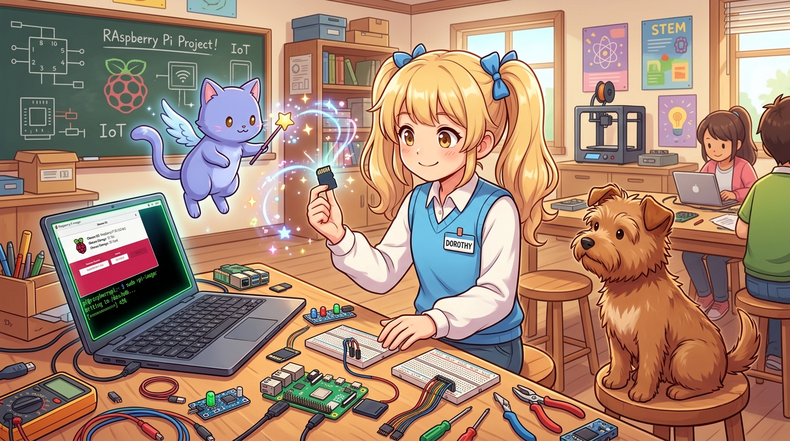
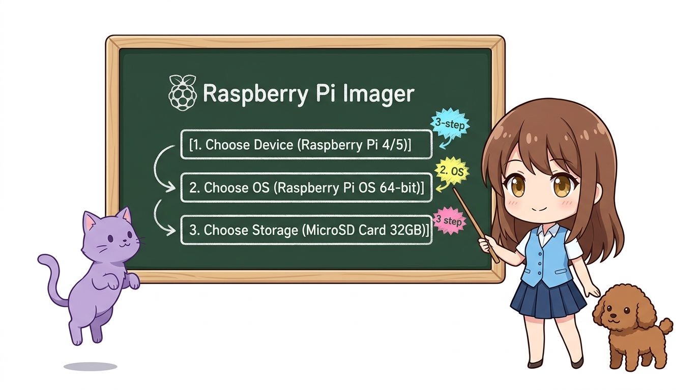
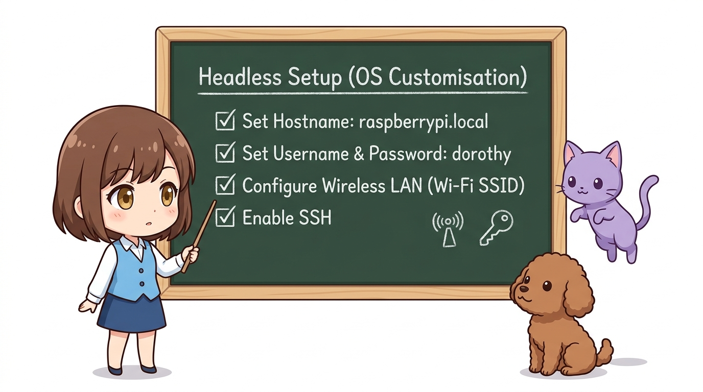
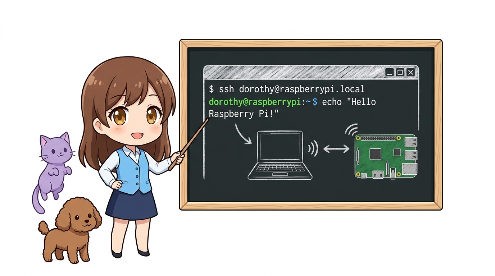
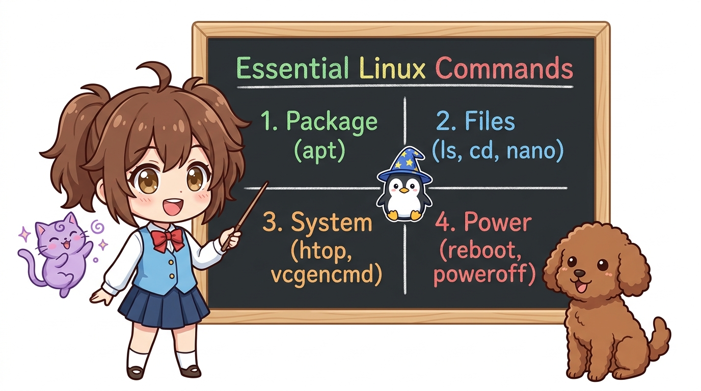
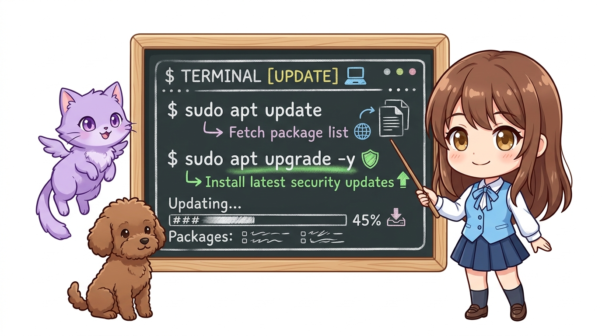
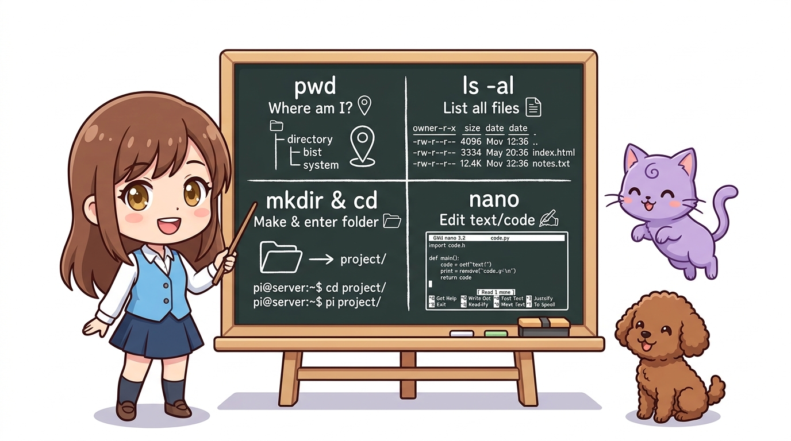
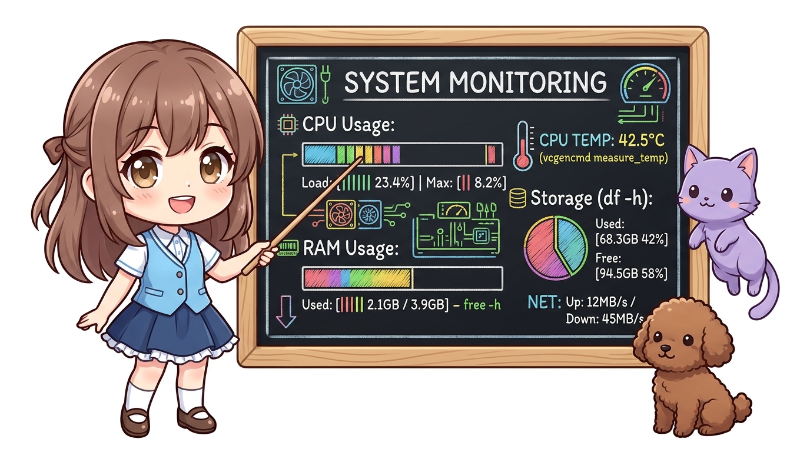
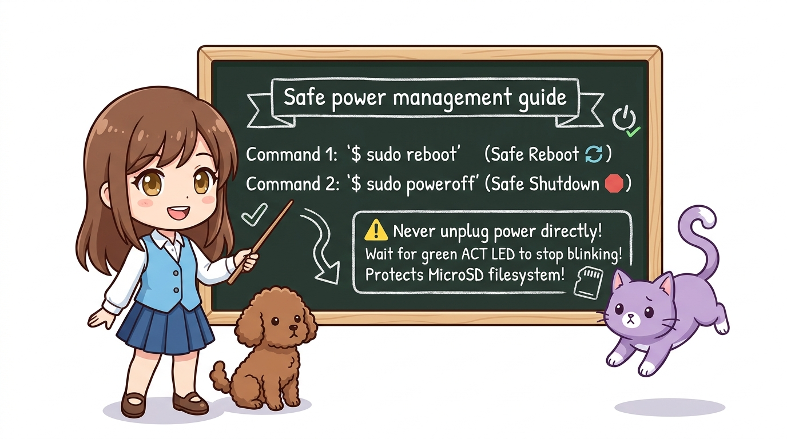

# 186_라즈베리파이_OS설치와_리눅스환경구축 💾🐧



**도로시와 지니가 함께하는 Raspberry Pi Imager와 헤드리스(Headless) 원격 개발 환경**
* 👧 **도로시**: "지니야! 라즈베리파이에 모니터랑 키보드가 따로 없는데도 원격으로 제어할 수 있어?"
* 🐱 **지니**: "물론이지! 모니터 없이도 Wi-Fi와 SSH 네트워크 통신을 통해 노트북에서 손쉽게 조종하는 방식을 **헤드리스(Headless)** 모드라고 부른단다!"
* 🐶 **토토**: "바우! MicroSD 카드에 운영체제 마법을 구워 넣자 멍!"
* 📖 **상세 강의 교재**: [index.md](./index.md)


> 여러분 안녕하세요! 이번 시간에는 '186. 라즈베리파이 OS설치와 리눅스환경구축 💾🐧'을 주제로 함께 흥미진진한 탐험을 떠나보겠습니다. 오늘 강의에서는 특히 도로시와 지니가 함께하는 Raspberry Pi Imager와 헤드리스(Headless) 원격 개발 환경, 👧 도로시: "지니야! 라즈베리파이에 모니터랑 키보드가 따로 없는데도 원격으로 제어할 수 있어?"를 중심으로 핵심 원리와 응용 방법을 차근차근 배워보겠습니다. 마법 멘토 지니와 호기심 많은 탐험가 도로시, 그리고 귀여운 토토와 함께 신나는 아두이노 모험을 힘차게 시작해 봅시다. 준비되셨나요?

---

## 1. Raspberry Pi Imager로 OS 굽기



1. **장치 선택 (Device)**: 사용 중인 보드 모델 선택 (예: Raspberry Pi 4 또는 Raspberry Pi 5)
2. **운영체제 선택 (Operating System)**: **`Raspberry Pi OS (64-bit)`** (데비안 북웜 Bookworm 기반)
3. **저장소 선택 (Storage)**: PC에 연결한 MicroSD 카드(권장 용량 32GB 이상, Class 10/A1 규격)

### 💿 1단계: 공식 도구 다운로드
공식 웹사이트([raspberrypi.com/software](https://www.raspberrypi.com/software/))에서 Windows/Mac/Linux용 **Raspberry Pi Imager**를 무료로 다운로드하여 실행합니다.
### ⚙️ 2단계: 핵심 설정 단계

> 이번 슬라이드에서는 '1. Raspberry Pi Imager로 OS 굽기'에 대해 자세히 살펴보겠습니다. 화면의 다이어그램과 사진을 함께 참고해 주시기 바랍니다. 첫 번째 핵심은 장치 선택 (Device): 사용 중인 보드 모델 선택 (예: Raspberry Pi 4 또는 Raspberry Pi 5)이며, 두 번째로는 운영체제 선택 (Operating System): Raspberry Pi OS (64-bit) (데비안 북웜 Bookworm 기반)입니다. 여기에 덧붙여 저장소 선택 (Storage): PC에 연결한 MicroSD 카드(권장 용량 32GB 이상, Class 10/A1 규격) 내용까지 함께 이해해 두시면 완벽합니다. 이 원리는 아두이노 시스템 전체를 관통하는 핵심 논리이므로 머릿속에 꼭 정리해 두시기 바랍니다.

---
## 3. 헤드리스(Headless) 사전 설정 마법 (`Ctrl+Shift+X`)




* [!IMPORTANT]
* 최신 Raspberry Pi OS는 보안 강화를 위해 과거 기본 계정이었던 `pi / raspberry`가 기본 비활성화되어 있습니다. Imager에서 반드시 나만의 사용자 계정명과 강력한 비밀번호를 직접 생성해야 합니다.

Imager의 가장 강력한 기능은 굽기 직전에 **Wi-Fi와 SSH 계정을 미리 설정**하여 별도 모니터 없이 즉시 부팅할 수 있게 해주는 것입니다.

```
+-----------------------------------------------------+
| OS 커스터마이즈 옵션 (Advanced Options)             |
+-----------------------------------------------------+
| [V] 호스트 이름 지정 : raspberrypi.local            |
| [V] 사용자 이름 및 비밀번호 설정                    |
|     * 계정 : dorothy                                |
|     * 암호 : maker1234!                             |
| [V] 무선 LAN(Wi-Fi) 설정                            |
|     * SSID : MyHome_WiFi_2.4G                       |
|     * 비밀번호 : wifi_password                      |
|     * 무선 랜 국가 : KR (대한민국)                  |
| [V] SSH 사용 활성화 (비밀번호 인증)                 |
+-----------------------------------------------------+
```

> 이번 슬라이드에서는 '3. 헤드리스(Headless) 사전 설정 마법 (Ctrl+Shift+X)'에 대한 실제 동작 코드를 분석해 보겠습니다. 화면의 코드를 살펴보시면, 컴퓨터가 아두이노 하드웨어에 단계별로 명령을 내리는 흐름을 명확하게 확인할 수 있습니다. 각 함수의 역할과 괄호 안의 매개변수가 하드웨어 핀과 어떤 관계를 맺고 동작하는지 주의 깊게 살펴보시기 바랍니다.
---

## 4. SSH 원격 터미널 접속하기



*(처음 접속 시 보안 질문 `Are you sure you want to continue connecting (yes/no)?`가 뜨면 `yes`를 입력하고 설정한 비밀번호를 입력합니다.)*

MicroSD 카드를 구운 후 라즈베리파이 카드 슬롯에 꽂고 Type-C 전원을 연결합니다. 초록색 ACT LED가 깜빡거리며 약 1분 후 부팅이 완료됩니다.
### 💻 내 PC의 터미널(또는 CMD/PowerShell)에서 접속
정상 접속되면 다음과 같은 녹색 리눅스 프롬프트가 반겨줍니다:

```bash
ssh dorothy@raspberrypi.local
```
```bash
Linux raspberrypi 6.1.0-rpi7-rpi-v8 #1 SMP PREEMPT Debian 1:6.1.63-1+rpt1
dorothy@raspberrypi:~ $ 
```

> 이번 슬라이드에서는 '4. SSH 원격 터미널 접속하기'에 대한 실제 동작 코드를 분석해 보겠습니다. 화면의 코드를 살펴보시면, 컴퓨터가 아두이노 하드웨어에 단계별로 명령을 내리는 흐름을 명확하게 확인할 수 있습니다. 여기서 핵심은 (처음 접속 시 보안 질문 Are you sure you want to continue connecting (yes/no)?가 뜨면 yes를 입력하고 설정한 비밀번호를 입력합니다.)입니다. 각 함수의 역할과 괄호 안의 매개변수가 하드웨어 핀과 어떤 관계를 맺고 동작하는지 주의 깊게 살펴보시기 바랍니다.

---
## 5. 알아두면 평생 쓰는 라즈베리파이 리눅스 필수 명령어




> 이번 슬라이드에서는 '5. 알아두면 평생 쓰는 라즈베리파이 리눅스 필수 명령어'에 대해 자세히 살펴보겠습니다. 이 원리는 아두이노 시스템 전체를 관통하는 핵심 논리이므로 머릿속에 꼭 정리해 두시기 바랍니다.
---
### 📦 1. 시스템 패키지 최신 업데이트




새로운 보드를 켰을 때 가장 먼저 실행해야 하는 표준 명령어입니다:

```bash
sudo apt update && sudo apt upgrade -y
```

> 이번 슬라이드에서는 '📦 1. 시스템 패키지 최신 업데이트'에 대한 실제 동작 코드를 분석해 보겠습니다. 화면의 코드를 살펴보시면, 컴퓨터가 아두이노 하드웨어에 단계별로 명령을 내리는 흐름을 명확하게 확인할 수 있습니다. 각 함수의 역할과 괄호 안의 매개변수가 하드웨어 핀과 어떤 관계를 맺고 동작하는지 주의 깊게 살펴보시기 바랍니다.
---
### 📂 2. 폴더 및 파일 다루기




* 현재 폴더 위치 확인: `pwd`
* 파일 목록 상세 보기: `ls -al`
* 폴더 생성 및 이동: `mkdir project && cd project`
* 텍스트 파일 생성 및 편집: `nano blink.py`

> 이번 슬라이드에서는 '📂 2. 폴더 및 파일 다루기'에 대해 자세히 살펴보겠습니다. 첫 번째 핵심은 현재 폴더 위치 확인: pwd이며, 두 번째로는 파일 목록 상세 보기: ls -al입니다. 여기에 덧붙여 폴더 생성 및 이동: mkdir project && cd project 내용까지 함께 이해해 두시면 완벽합니다. 이 원리는 아두이노 시스템 전체를 관통하는 핵심 논리이므로 머릿속에 꼭 정리해 두시기 바랍니다.
---
### 📊 3. 시스템 상태 모니터링




* CPU 온도 실시간 확인: `vcgencmd measure_temp`
* 메모리 사용량 확인: `free -h`
* 디스크 남은 용량 확인: `df -h`
* 화려한 리소스 모니터: `htop`

> 이번 슬라이드에서는 '📊 3. 시스템 상태 모니터링'에 대해 자세히 살펴보겠습니다. 첫 번째 핵심은 CPU 온도 실시간 확인: vcgencmd measuretemp이며, 두 번째로는 메모리 사용량 확인: free -h입니다. 여기에 덧붙여 디스크 남은 용량 확인: df -h 내용까지 함께 이해해 두시면 완벽합니다. 이 원리는 아두이노 시스템 전체를 관통하는 핵심 논리이므로 머릿속에 꼭 정리해 두시기 바랍니다.
---
### 🔌 4. 안전한 전원 끄기 및 재부팅




* [!WARNING]
* 라즈베리파이는 완전한 리눅스 파일 시스템(ext4)을 사용합니다. 컴퓨터 종료 명령(`sudo poweroff`) 없이 전원 케이블을 갑자기 뽑아버리면 SD 카드 내부 데이터가 깨질 수 있으니 반드시 정상 종료 후 전원을 분리하세요!

* 시스템 안전 재부팅: `sudo reboot`
* 시스템 안전 종료 (전원 끄기): `sudo poweroff`

> 이번 슬라이드에서는 '🔌 4. 안전한 전원 끄기 및 재부팅'에 대해 자세히 살펴보겠습니다. 첫 번째 핵심은 시스템 안전 재부팅: sudo reboot이며, 두 번째로는 시스템 안전 종료 (전원 끄기): sudo poweroff입니다. 이 원리는 아두이노 시스템 전체를 관통하는 핵심 논리이므로 머릿속에 꼭 정리해 두시기 바랍니다.
---

## 🌟 도로시와 지니의 핵심 요약 노트!


* 👧 **도로시**: "모니터와 마우스 선이 주렁주렁 없어도 노트북 터미널에서 `ssh` 한 줄로 파이를 완전히 조종할 수 있어!"
* 🐱 **지니**: "맞아! 이것이 바로 전 세계 전문 엔지니어들이 임베디드 리눅스를 다루는 표준 개발 방식이란다."
* 🐶 **토토**: "바우! 다음 시간엔 아두이노의 끝판왕 '메가'와 '라즈베리파이'의 압도적인 체급 차이를 비교해보자 멍!"

> 오늘 배운 '🌟 도로시와 지니의 핵심 요약 노트!'의 핵심 내용을 모두 정리해 보았습니다. 오늘 다룬 내용 중에서도 👧 도로시: "모니터와 마우스 선이 주렁주렁 없어도 노트북 터미널에서 ssh 한 줄로 파이를 완전히 조종할 수 있어!" 부분은 앞으로의 아두이노 실습과 프로젝트에서 계속 사용되는 매우 중요한 기초 지식입니다. 오늘 배운 내용을 꼭 다시 한번 복습해 보시고, 다음 강의에서 더욱 신나고 유익한 모험으로 다시 만나겠습니다. 모두 수고 많으셨습니다!