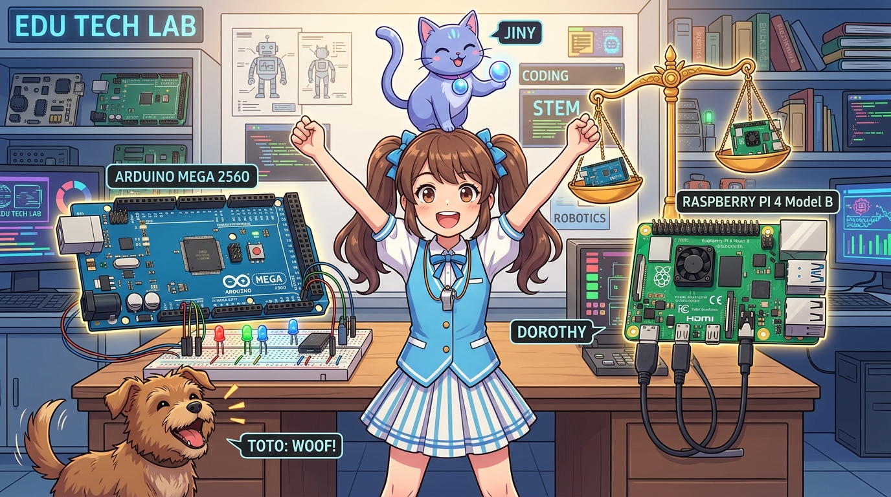
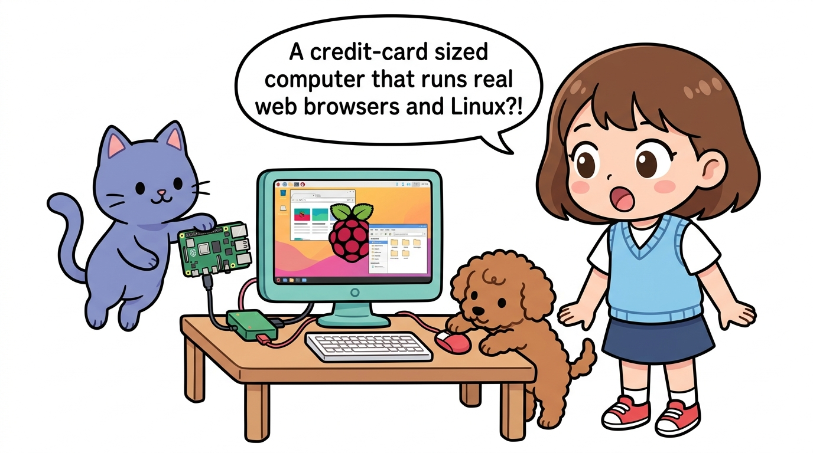

# 187_라즈베리파이_vs_아두이노메가_체급비교 🥊⚖️



**도로시와 지니가 함께하는 MCU 끝판왕 메가와 초소형 PC 라즈베리파이의 체급 대결**

* 👧 **도로시**: "지니야! 아두이노 메가도 핀이 54개나 되고 엄청 크잖아. 라즈베리파이랑 비교하면 누가 더 세?"
* 🐱 **지니**: "후후, 이건 마치 **'최고 속도의 육상 달리기 선수(메가)'** 와 **'초거대 도서관을 통째로 외운 천재 과학자(파이)'** 의 대결과도 같단다!"
* 🐶 **토토**: "바우! 체급과 특기가 완전히 다르다 멍!"

* 🖥️ **강의 슬라이드**: [slides.md](./slides.md)

---

## 1. 하드웨어 스펙 1:1 맞짱 비교표


| 비교 항목 | 아두이노 메가 2560 (Arduino Mega) | 라즈베리파이 4B / 5 (Raspberry Pi) | 승자 및 특징 |
| :--- | :--- | :--- | :--- |
| **장치 분류** | **MCU** (마이크로컨트롤러) | **SBC** (싱글보드 컴퓨터) | 목적이 다름 |
| **CPU 코어** | 8비트 AVR 1코어 | 64비트 ARM Cortex-A 쿼드(4)코어 | **파이 압승** (멀티스레딩) |
| **클럭 속도** | **16 MHz** (초당 1천6백만 번 연산) | **1,500 ~ 2,400 MHz** (초당 24억 번 연산) | **파이 150배 속도** |
| **SRAM (메모리)** | **8 KB** (8,192 바이트) | **4 GB ~ 8 GB** (약 8,500,000,000 바이트) | **파이 100만 배 용량** |
| **프로그램 저장소** | 256 KB Flash | 32 GB ~ 1 TB MicroSD / NVMe SSD | **파이 압승** |
| **부팅 시간** | **즉시 (0.2초 이내)** | 약 **25초 ~ 40초** (OS 로딩 필요) | **메가 압승** |
| **디지털 핀 수** | **54개** (PWM 15개 포함) | **28개** (GPIO) | **메가 압승** |
| **아날로그 핀 (ADC)** | **16개 (A0~A15, 10비트 내장)** | **0개** (외부 ADC 칩 필수!) | **메가 완승** |
| **소비 전력** | **0.2W ~ 0.5W** (배터리로 장기 구동) | **3.0W ~ 15W** (방열판 및 대전력 필수) | **메가 친환경** |

---

## 2. 운영체제(OS)의 유무가 만드는 결정적 차이

### ⚡ 1. 아두이노 메가: 베어메탈(Bare-metal) 방식
* 운영체제라는 중간 관리자가 없습니다. 전원이 켜지자마자 우리가 작성한 C++ 코드가 CPU의 연산 레지스터를 100% 독점하여 실행됩니다.
* 방해꾼이 없으므로 **1마이크로초(0.000001초)** 의 오차도 없이 일정한 주기로 펄스를 쏘아줄 수 있습니다.

### 🐧 2. 라즈베리파이: 리눅스(Linux) 멀티태스킹 OS
* 수백 개의 백그라운드 프로세스(네트워크 통신, 그래픽 렌더링, 파일 시스템, 보안 데몬)가 CPU 시간을 쪼개어 번갈아 가며 실행(시분할 스케줄링)됩니다.
* 파이썬, C++, 웹서버, 인공지능 프레임워크(OpenCV, TensorFlow) 등 거대한 소프트웨어를 마음껏 돌릴 수 있습니다.

---

## 3. 실시간 제어(Real-Time)와 지터(Jitter) 현상



### ⚠️ 왜 라즈베리파이만으로 3D 프린터나 정밀 모터를 돌리지 않을까요?
* 라즈베리파이에서 파이썬 코드로 `time.sleep(0.001)`을 주어 스텝 모터를 돌리면, 갑자기 리눅스 OS가 와이파이 패킷을 처리하느라 우리 코드를 0.005초 동안 잠시 멈춥니다.
* 이 때문에 펄스 주기가 들쭉날쭉해지는 현상을 **지터(Jitter)** 라고 부르며, 모터가 덜덜 떨리거나 회전 스텝을 놓쳐버리게 됩니다!

```
[ 아두이노 메가의 하드웨어 타이머 펄스 ] (지터 0%, 완벽한 대칭 사각파)
_-_-_-_-_-_-_-_-_-_-_-_-_-_-_-_-_-_-_-_-_-_-_-_-_-_-_-_-_-_-_-

[ 리눅스 OS에서 소프트웨어로 만든 펄스 ] (지터 발생, 간격이 찌그러짐)
_---_-_-------__---_-_--____---_-_-----_--___-_
```

> [!NOTE]
> * **아두이노 메가 = 하드 리얼타임(Hard Real-Time)**: 정해진 데드라인을 1마이크로초라도 어기면 안 되는 모터, 안전 브레이크, 인터럽트 감지에 특화.
> * **라즈베리파이 = 소프트 리얼타임(Soft Real-Time)**: 영상 처리, 음성 인식, 웹 대시보드, 데이터베이스 등 복잡하고 큰 데이터를 처리하는 데 특화.

---

## 4. 아날로그 센서 측정의 차이

* **아두이노 메가**: 가변저항, 온도 센서, 조도 센서의 신호선을 A0~A15에 그냥 꽂고 `analogRead(A0)`만 호출하면 0~1023 값으로 즉시 읽어옵니다.
* **라즈베리파이**: 아날로그를 디지털로 바꿔주는 변환기(ADC)가 하드웨어 내부에 아예 없습니다! 따라서 외부 ADC 칩(예: MCP3008, ADS1115)을 SPI나 I2C로 달아서 통신으로 읽어와야 합니다.

---

## 5. 최강의 드림팀: 두뇌(Brain)와 척수(Spine)의 분업!


두 보드는 서로 싸우는 경쟁자가 아니라, **손을 잡았을 때 전 세계에서 가장 강력한 로봇 시스템**을 완성하는 환상의 파트너입니다!

```
                  ┌────────────────────────────────────────┐
                  │      라즈베리파이 (고차원 두뇌 / Brain)    │
                  │  * 카메라 영상인식 (OpenCV AI)           │
                  │  * 음성 인식 및 ChatGPT 대화 모델      │
                  │  * 웹서버 및 클라우드 IoT 데이터베이스 │
                  └──────────────────┬─────────────────────┘
                                     │ USB 시리얼 / I2C 버스
                  ┌──────────────────┴─────────────────────┐
                  │      아두이노 메가 (신속한 척수 / Spine)   │
                  │  * 12축 로봇 관절 서보모터 정밀 PWM    │
                  │  * 3축 스텝 모터 마이크로초 펄스 출력   │
                  │  * 16채널 아날로그 센서 및 비상 인터럽트│
                  └────────────────────────────────────────┘
```

---

## 🌟 도로시와 지니의 핵심 요약 노트!


* 👧 **도로시**: "아하! 라즈베리파이는 생각하는 두뇌이고, 아두이노 메가는 지치지 않고 일하는 튼튼한 팔다리구나!"
* 🐱 **지니**: "바로 그거야! 두 장치의 장점만을 골라 결합하는 것이 최신 스마트 로봇과 자율주행차 공학의 핵심 비결이란다."
* 🐶 **토토**: "바우! 그런데 두 보드를 전선으로 이을 때 엄청 조심해야 할 비밀이 있다던데? **'181_라즈베리파이_아두이노연동_전압주의와_레벨시프터'**에서 밝혀보자 멍!"
