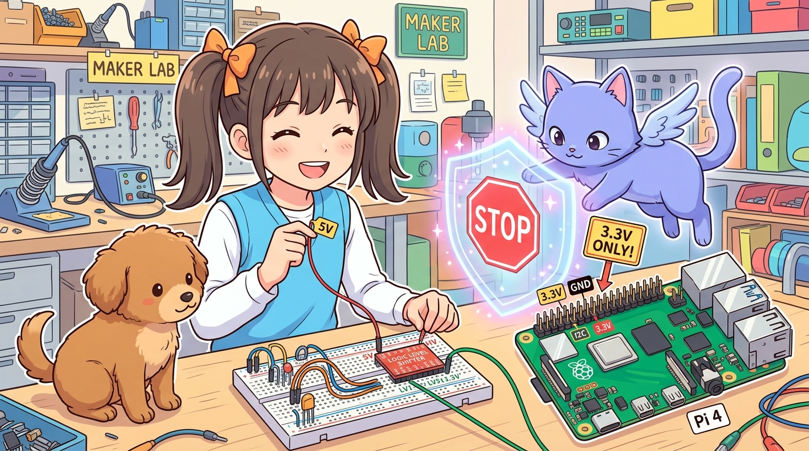
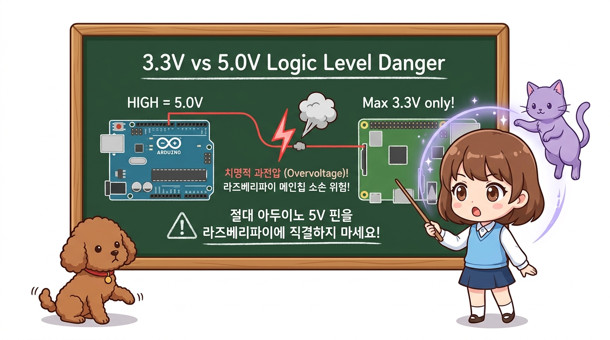
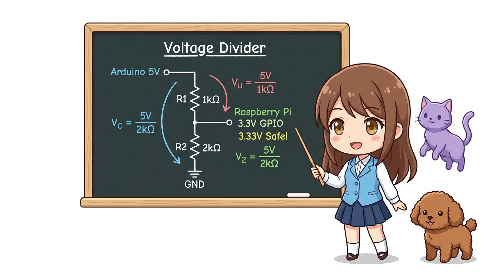
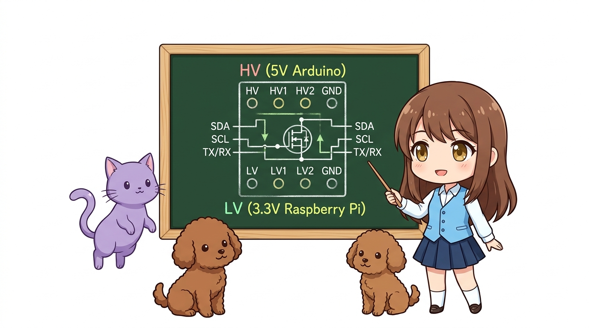
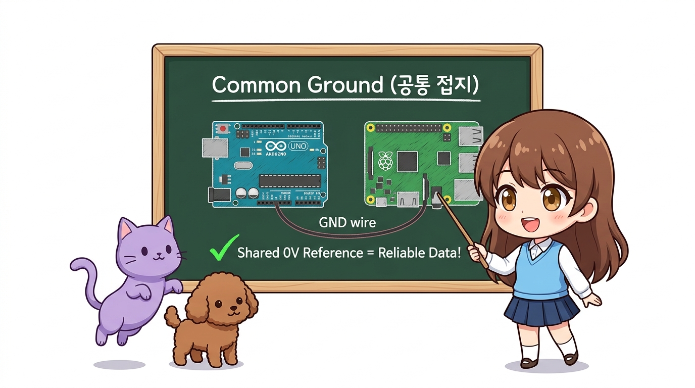
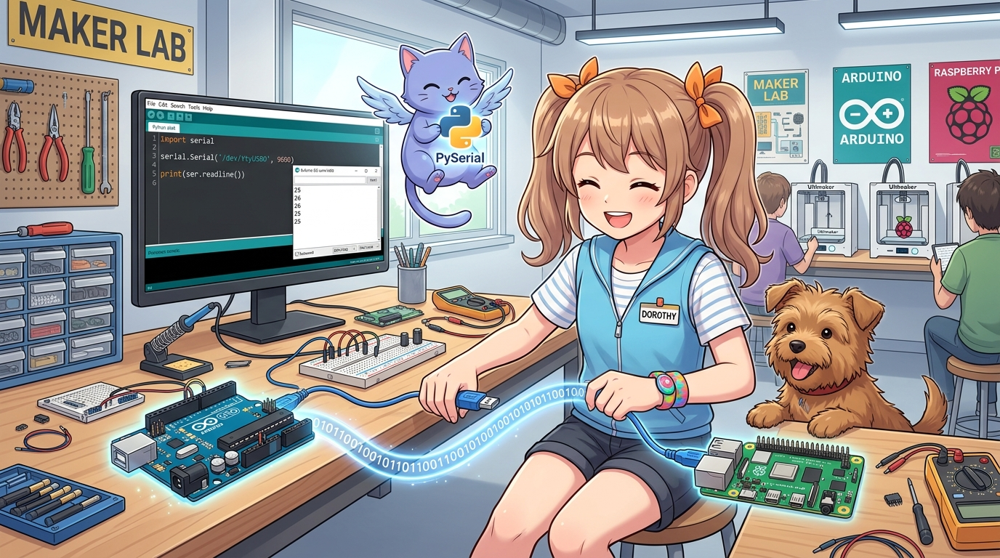

# 188_라즈베리파이_아두이노연동_전압주의와_레벨시프터 ⚡🛡️



**도로시와 지니가 함께하는 3.3V와 5.0V 전압 충돌 방지와 양방향 레벨 컨버터의 원리**
* 👧 **도로시**: "지니야! 아두이노 우노나 나노의 디지털 핀을 라즈베리파이 GPIO 핀에 점퍼선으로 그냥 꽂으면 안 돼?"
* 🐱 **지니**: "안 돼, 도로시! 멈춰! 아두이노는 **5V** 신호를 뿜어내지만, 라즈베리파이는 연약한 **3.3V** 심장을 가지고 있어서 파이가 불타버릴 수 있단다!"
* 🐶 **토토**: "바우! 지니 마법사의 레벨 시프터 방패를 준비해야 한다 멍!"
* 📖 **상세 강의 교재**: [index.md](./index.md)


> 여러분 안녕하세요! 이번 시간에는 '188. 라즈베리파이 아두이노연동 전압주의와 레벨시프터 ⚡🛡️'을 주제로 함께 흥미진진한 탐험을 떠나보겠습니다. 오늘 강의에서는 특히 도로시와 지니가 함께하는 3.3V와 5.0V 전압 충돌 방지와 양방향 레벨 컨버터의 원리, 👧 도로시: "지니야! 아두이노 우노나 나노의 디지털 핀을 라즈베리파이 GPIO 핀에 점퍼선으로 그냥 꽂으면 안 돼?"를 중심으로 핵심 원리와 응용 방법을 차근차근 배워보겠습니다. 마법 멘토 지니와 호기심 많은 탐험가 도로시, 그리고 귀여운 토토와 함께 신나는 아두이노 모험을 힘차게 시작해 봅시다. 준비되셨나요?

---

## 1. 가장 위험한 함정! 3.3V vs 5.0V 로직 레벨의 충돌



* **아두이노 우노/나노/메가**: 전통적인 5V TTL 로직을 사용하여 HIGH 신호가 나올 때 **5.0V** 전압을 출력합니다.
* **라즈베리파이 (모든 모델)**: 최신 초미세 나노미터 공정으로 제작된 3.3V LVCMOS 로직을 사용합니다.
* ⚠️ **5V Tolerant(5V 허용) 기능 없음!**: 라즈베리파이 GPIO 핀에 3.6V를 초과하는 전압이 1초라도 유입되면, Broadcom SoC 칩 내부의 미세 트랜지스터 절연막이 영구 파괴되어 칩 전체가 사망합니다.

라즈베리파이와 아두이노를 처음 연동하는 메이커들이 가장 많이 저지르는 실수가 바로 **전압 불일치로 인한 보드 파괴**입니다.
### 💥 왜 라즈베리파이는 5V를 견디지 못할까요?

> 이번 슬라이드에서는 '1. 가장 위험한 함정! 3.3V vs 5.0V 로직 레벨의 충돌'에 대해 자세히 살펴보겠습니다. 화면의 다이어그램과 사진을 함께 참고해 주시기 바랍니다. 첫 번째 핵심은 아두이노 우노/나노/메가: 전통적인 5V TTL 로직을 사용하여 HIGH 신호가 나올 때 5.0V 전압을 출력합니다.이며, 두 번째로는 라즈베리파이 (모든 모델): 최신 초미세 나노미터 공정으로 제작된 3.3V LVCMOS 로직을 사용합니다.입니다. 여기에 덧붙여 ⚠️ 5V Tolerant(5V 허용) 기능 없음!: 라즈베리파이 GPIO 핀에 3.6V를 초과하는 전압이 1초라도 유입되면, Broadcom SoC 칩 내부의 미세 트랜지스터 절연막이 영구 파괴되어 칩 전체가 사망합니다. 내용까지 함께 이해해 두시면 완벽합니다. 이 원리는 아두이노 시스템 전체를 관통하는 핵심 논리이므로 머릿속에 꼭 정리해 두시기 바랍니다.

---
## 2. 해결책 1: 저항 분압 회로 (단방향 5V ➔ 3.3V)




* **장점**: 서랍 속에 굴러다니는 1kΩ, 2kΩ 저항만으로 즉시 안전 확보!
* **단점**: 단방향만 가능. I2C나 SPI처럼 선 하나로 양방향 신호가 오가는 버스에는 절대 사용할 수 없습니다.

아두이노의 5V 신호를 라즈베리파이(3.3V)로 보낼 때, 가장 구하기 쉬운 저항 2개로 전압을 안전하게 깎아낼 수 있습니다.
### 📐 전압 분압 공식
$$V_{out} = V_{in} \times \frac{R_2}{R_1 + R_2} = 5.0V \times \frac{2000\Omega}{1000\Omega + 2000\Omega} = 5.0V \times \frac{2}{3} \approx 3.33V$$

```
[ 아두이노 5V TX 출력 ]
         │
       [1 kΩ]  (R1)
         │
         ├───▶ [ 라즈베리파이 3.3V RX 입력 ] (V_out ≈ 3.33V)
         │
       [2 kΩ]  (R2)
         │
     [ 공통 GND ]
```

> 이번 슬라이드에서는 '2. 해결책 1: 저항 분압 회로 (단방향 5V ➔ 3.3V)'에 대한 실제 동작 코드를 분석해 보겠습니다. 화면의 코드를 살펴보시면, 컴퓨터가 아두이노 하드웨어에 단계별로 명령을 내리는 흐름을 명확하게 확인할 수 있습니다. 여기서 핵심은 장점: 서랍 속에 굴러다니는 1kΩ, 2kΩ 저항만으로 즉시 안전 확보!입니다. 각 함수의 역할과 괄호 안의 매개변수가 하드웨어 핀과 어떤 관계를 맺고 동작하는지 주의 깊게 살펴보시기 바랍니다.
---

## 3. 해결책 2: 양방향 로직 레벨 컨버터 (Logic Level Shifter)



1. **HV 핀**: 아두이노의 **5V** 핀에 연결 (고전압 기준)
2. **LV 핀**: 라즈베리파이의 **3.3V (Pin 1)** 에 연결 (저전압 기준)
3. **GND 핀**: 아두이노 GND와 라즈베리파이 GND를 **공통 접지(Common Ground)** 로 연결!
4. **신호선**:
* `HV1` ➔ 아두이노 SDA (A4)  |  `LV1` ➔ 라즈베리파이 SDA (GPIO 2)
* `HV2` ➔ 아두이노 SCL (A5)  |  `LV2` ➔ 라즈베리파이 SCL (GPIO 3)
* `HV3` ➔ 아두이노 TX (D1)   |  `LV3` ➔ 라즈베리파이 RX (GPIO 15)

실제 로봇과 IoT 프로젝트에서 가장 널리 쓰이는 표준 부품은 **BSS138 N-채널 MOSFET 기반 4채널 양방향 레벨 시프터**입니다.
### 🔌 레벨 시프터 표준 배선 핀맵

```
       [ 4-Channel Bidirectional Logic Level Shifter ]
               High Voltage (HV: 5V) 측 (아두이노)
        ┌───────┬───────┬───────┬───────┬───────┬───────┐
        │  HV   │  HV1  │  HV2  │  HV3  │  HV4  │  GND  │
        └───┬───┴───┬───┴───┬───┴───┬───┴───┬───┴───┬───┘
            │       │       │       │       │       │
       [BSS138]   [MOS]   [MOS]   [MOS]   [MOS]     │
            │       │       │       │       │       │
        ┌───┴───┬───┴───┬───┴───┬───┴───┬───┴───┬───┴───┐
        │  LV   │  LV1  │  LV2  │  LV3  │  LV4  │  GND  │
        └───────┴───────┴───────┴───────┴───────┴───────┘
               Low Voltage (LV: 3.3V) 측 (라즈베리파이)
```

> 이번 슬라이드에서는 '3. 해결책 2: 양방향 로직 레벨 컨버터 (Logic Level Shifter)'에 대한 실제 동작 코드를 분석해 보겠습니다. 화면의 코드를 살펴보시면, 컴퓨터가 아두이노 하드웨어에 단계별로 명령을 내리는 흐름을 명확하게 확인할 수 있습니다. 여기서 핵심은 HV 핀: 아두이노의 5V 핀에 연결 (고전압 기준)입니다. 각 함수의 역할과 괄호 안의 매개변수가 하드웨어 핀과 어떤 관계를 맺고 동작하는지 주의 깊게 살펴보시기 바랍니다.

---
## 4. 공통 접지(Common Ground)의 절대 법칙!




* 라즈베리파이가 생각하는 0V(GND)와 아두이노가 생각하는 0V(GND)가 서로 전선으로 이어져 있지 않으면, 3.3V 신호를 보내도 상대방은 이를 1.2V나 4.5V처럼 엉뚱한 값으로 오인하게 됩니다.
* **불문율**: 두 보드가 서로 다른 전원 어댑터를 쓰더라도, **두 보드의 GND 핀은 반드시 하나의 점퍼선으로 묶어주어야 합니다!**

전자 회로에서 전압(Voltage)이란 두 지점 사이의 **전위차**를 의미합니다.

> 이번 슬라이드에서는 '4. 공통 접지(Common Ground)의 절대 법칙!'에 대해 자세히 살펴보겠습니다. 첫 번째 핵심은 라즈베리파이가 생각하는 0V(GND)와 아두이노가 생각하는 0V(GND)가 서로 전선으로 이어져 있지 않으면, 3.3V 신호를 보내도 상대방은 이를 1.2V나 4.5V처럼 엉뚱한 값으로 오인하게 됩니다.이며, 두 번째로는 불문율: 두 보드가 서로 다른 전원 어댑터를 쓰더라도, 두 보드의 GND 핀은 반드시 하나의 점퍼선으로 묶어주어야 합니다!입니다. 이 원리는 아두이노 시스템 전체를 관통하는 핵심 논리이므로 머릿속에 꼭 정리해 두시기 바랍니다.
---

## 5. 전압 스트레스 제로! 가장 안전한 대안: USB 케이블



* 아두이노에 동봉된 **표준 USB 케이블(파란색 A-B 케이블 또는 Type-C)** 을 라즈베리파이의 USB 2.0/3.0 포트에 꽂기만 하면 끝납니다!
* **이유**: USB 규격 내부의 D+, D- 데이터 라인과 전원 규격이 국제 표준으로 완벽히 호환되므로 전압 충돌 사고가 100% 원천 차단됩니다.

복잡한 레벨 시프터나 저항 분압기 회로를 꾸미기 번거롭다면?

> 이번 슬라이드에서는 '5. 전압 스트레스 제로! 가장 안전한 대안: USB 케이블'에 대해 자세히 살펴보겠습니다. 화면의 다이어그램과 사진을 함께 참고해 주시기 바랍니다. 첫 번째 핵심은 아두이노에 동봉된 표준 USB 케이블(파란색 A-B 케이블 또는 Type-C) 을 라즈베리파이의 USB 2.0/3.0 포트에 꽂기만 하면 끝납니다!이며, 두 번째로는 이유: USB 규격 내부의 D+, D- 데이터 라인과 전원 규격이 국제 표준으로 완벽히 호환되므로 전압 충돌 사고가 100% 원천 차단됩니다.입니다. 이 원리는 아두이노 시스템 전체를 관통하는 핵심 논리이므로 머릿속에 꼭 정리해 두시기 바랍니다.

---

## 🌟 도로시와 지니의 핵심 요약 노트!


* 👧 **도로시**: "라즈베리파이 핀에 아두이노 5V 선을 직결하면 큰일 난다는 걸 명심할게요! 레벨 시프터나 USB를 써야겠어요."
* 🐱 **지니**: "훌륭해! 안전이 엔지니어링의 제1원칙이란다. 전압 보호 회로를 이해하면 어떤 센서와 보드도 자유자재로 연결할 수 있어."
* 🐶 **토토**: "바우! 다음 시간엔 가장 안전하고 쉬운 **'182_라즈베리파이_아두이노_USB시리얼통신'**을 직접 코딩해보자 멍!"

> 오늘 배운 '🌟 도로시와 지니의 핵심 요약 노트!'의 핵심 내용을 모두 정리해 보았습니다. 오늘 다룬 내용 중에서도 👧 도로시: "라즈베리파이 핀에 아두이노 5V 선을 직결하면 큰일 난다는 걸 명심할게요! 레벨 시프터나 USB를 써야겠어요." 부분은 앞으로의 아두이노 실습과 프로젝트에서 계속 사용되는 매우 중요한 기초 지식입니다. 오늘 배운 내용을 꼭 다시 한번 복습해 보시고, 다음 강의에서 더욱 신나고 유익한 모험으로 다시 만나겠습니다. 모두 수고 많으셨습니다!