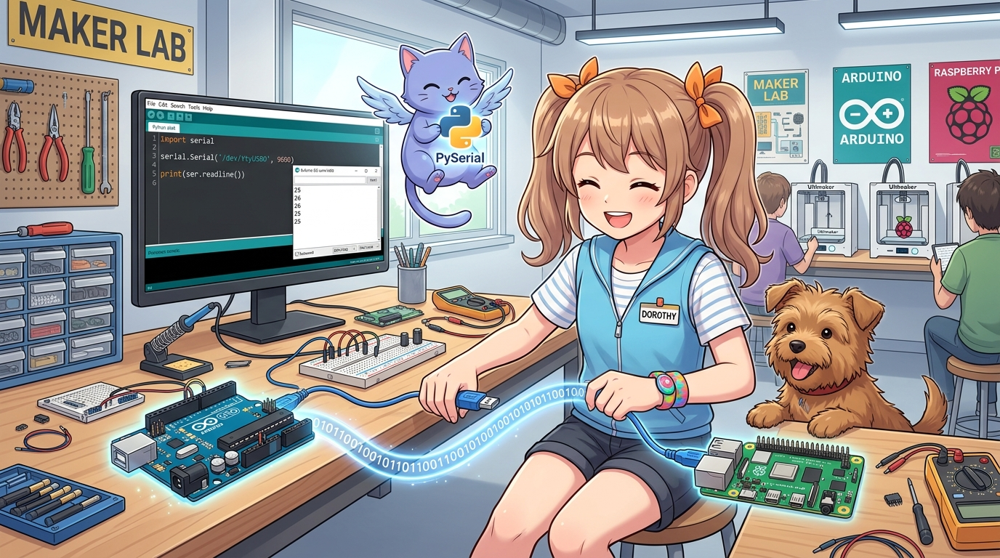

# 189_라즈베리파이_아두이노_USB시리얼통신 🔌🐍



**도로시와 지니가 함께하는 가장 안전하고 쉬운 USB 케이블 직결과 PySerial 양방향 통신**

* 👧 **도로시**: "지니야! 복잡한 전압 레벨 시프터 없이도 USB 케이블 하나만 꽂으면 바로 통신할 수 있다면서?"
* 🐱 **지니**: "그럼! USB 케이블은 데이터 통신뿐만 아니라 아두이노에 필요한 5V 전원까지 함께 공급해주니 일석이조란다!"
* 🐶 **토토**: "바우! 파이썬 코드로 아두이노에 명령을 쏴보자 멍!"

* 🖥️ **강의 슬라이드**: [slides.md](./slides.md)

---

## 1. 리눅스에서 아두이노 USB 시리얼 포트 찾기

아두이노 우노 또는 나노를 USB 케이블로 라즈베리파이의 USB 2.0/3.0 포트에 연결합니다.


### 🔍 1단계: 연결된 시리얼 장치 확인
라즈베리파이 터미널에서 다음 명령어를 실행합니다:
```bash
ls /dev/ttyACM* /dev/ttyUSB*
```

* **`/dev/ttyACM0`**: 아두이노 정품 우노(UNO) 또는 메가(MEGA)가 인식되었을 때 나타납니다.
* **`/dev/ttyUSB0`**: 아두이노 나노(Nano)나 CH340 칩셋이 탑재된 호환 보드가 인식되었을 때 나타납니다.

### 📋 2단계: 커널 인식 로그 확인 (`dmesg`)
```bash
dmesg | tail -n 15
```
출력 결과에 `ch341-uart converter now attached to ttyUSB0` 또는 `cdc_acm: ttyACM0` 메시지가 보이면 물리적 연결이 완벽하게 끝난 것입니다.

---

## 2. 아두이노 펌웨어: 센서 송신 및 LED 제어 (C++)

아두이노는 1초마다 아날로그 조도 센서(A0)와 가상 온도를 JSON 형식 텍스트로 라즈베리파이에 쏘아주고, 라즈베리파이가 보낸 문자(`1` 또는 `0`)에 따라 13번 내장 LED를 켭니다.

```cpp
// [아두이노 스케치: Arduino_Serial_Node.ino]
const int ledPin = 13;
unsigned long lastSendTime = 0;

void setup() {
  Serial.begin(9600); // 9600 bps 속도로 시리얼 개방
  pinMode(ledPin, OUTPUT);
  digitalWrite(ledPin, LOW);
}

void loop() {
  // 1. 라즈베리파이로부터 원격 제어 명령 수신
  if (Serial.available() > 0) {
    char cmd = Serial.read();
    if (cmd == '1') {
      digitalWrite(ledPin, HIGH); // LED 켜기
    } else if (cmd == '0') {
      digitalWrite(ledPin, LOW);  // LED 끄기
    }
  }

  // 2. 1초마다 센서 데이터 패킷 전송 (JSON 포맷)
  if (millis() - lastSendTime >= 1000) {
    lastSendTime = millis();
    int light = analogRead(A0);
    float dummyTemp = 24.5 + (random(-10, 10) / 10.0);

    // 라즈베리파이 파이썬이 파싱하기 쉬운 JSON 형식으로 출력
    Serial.print("{\"light\":");
    Serial.print(light);
    Serial.print(",\"temp\":");
    Serial.print(dummyTemp, 1);
    Serial.println("}");
  }
}
```

---

## 3. 라즈베리파이 파이썬 마스터 스크립트 (`PySerial`)

### 📦 1단계: 시리얼 통신 라이브러리 설치
```bash
pip3 install pyserial
```

### 🐍 2단계: 파이썬 모니터링 & 제어 프로그램 작성 (`serial_hub.py`)

```python
import serial
import time
import json

# 포트 이름 확인 (/dev/ttyACM0 또는 /dev/ttyUSB0)
PORT = '/dev/ttyUSB0'  # 나노 보드의 경우 (우노는 보통 /dev/ttyACM0)
BAUD = 9600

print(f"Connecting to Arduino on {PORT}...")
ser = serial.Serial(PORT, BAUD, timeout=1)

# 중요: 아두이노는 시리얼 연결 시 DTR 신호로 인해 자동으로 리셋(부팅)됩니다.
# 아두이노 부트로더가 준비될 때까지 2초간 대기합니다!
time.sleep(2)
print("Connected successfully! Starting communication...\n")

try:
    count = 0
    while True:
        # 1. 아두이노가 보낸 한 줄 읽기
        if ser.in_waiting > 0:
            raw_line = ser.readline().decode('utf-8', errors='ignore').strip()
            if raw_line.startswith('{') and raw_line.endswith('}'):
                try:
                    data = json.loads(raw_line)
                    print(f"📥 [수신 데이터] 조도: {data['light']} | 온도: {data['temp']}°C")
                except json.JSONDecodeError:
                    pass

        # 2. 3초마다 아두이노 LED를 번갈아가며 켜고 끄기
        count += 1
        if count % 30 == 0:  # 약 3초 주기
            print("📤 [명령 전송] 아두이노 LED 켜기 (1)")
            ser.write(b'1\n')
        elif count % 30 == 15:
            print("📤 [명령 전송] 아두이노 LED 끄기 (0)")
            ser.write(b'0\n')

        time.sleep(0.1)

except KeyboardInterrupt:
    print("\n통신을 안전하게 종료합니다.")
    ser.close()
```

---

## 4. 실행 결과 확인

터미널에서 `python3 serial_hub.py`를 실행하면 콘솔에 실시간 센서 로그가 출력되며 아두이노의 LED가 원격으로 깜빡입니다!

```
Connecting to Arduino on /dev/ttyUSB0...
Connected successfully! Starting communication...

📥 [수신 데이터] 조도: 512 | 온도: 24.8°C
📥 [수신 데이터] 조도: 510 | 온도: 24.7°C
📤 [명령 전송] 아두이노 LED 켜기 (1)
📥 [수신 데이터] 조도: 520 | 온도: 25.1°C
📤 [명령 전송] 아두이노 LED 끄기 (0)
```

> [!TIP]
> **DTR 오토리셋(Auto-reset) 현상이란?**:
> 라즈베리파이의 파이썬 스크립트가 `serial.Serial()`을 여는 순간, 시리얼 칩의 DTR 핀 전압이 떨어지며 아두이노가 처음부터 리셋(재부팅)됩니다. 따라서 포트를 열자마자 `ser.write()`를 날리면 아두이노가 부트로더 상태라 명령을 씹어버립니다. 반드시 코드 상단에 `time.sleep(2)`를 두는 습관을 들이세요!

---

## 🌟 도로시와 지니의 핵심 요약 노트!


* 👧 **도로시**: "USB 케이블만 꽂았을 뿐인데 라즈베리파이 파이썬 화면에 아두이노 센서 데이터가 실시간으로 술술 들어와!"
* 🐱 **지니**: "전압 레벨 차이 걱정도 없고 배선도 깔끔해서 현업 IoT 산업 현장에서도 가장 선호하는 통신 방식이란다."
* 🐶 **토토**: "바우! 다음 시간엔 40핀 GPIO 헤더의 I2C 버스로 1대 N 멀티 통신을 하는 **'183_라즈베리파이_아두이노_I2C통신과_레벨시프터'**를 배워보자 멍!"
