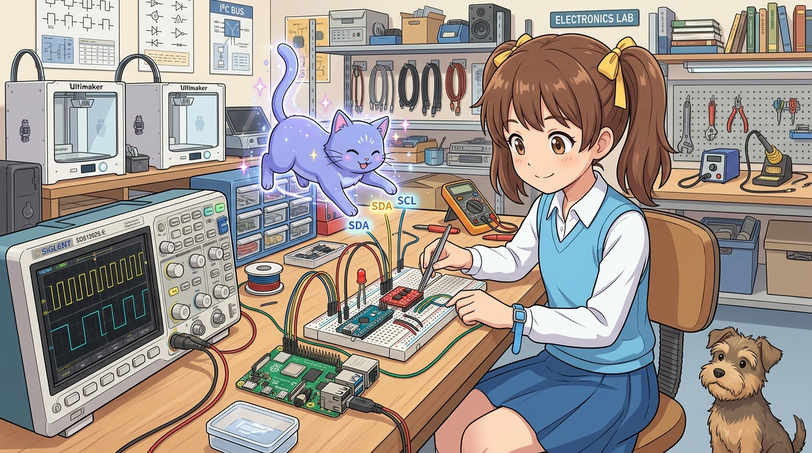

# 190_라즈베리파이_아두이노_I2C통신과_레벨시프터 ⚡🎛️



**도로시와 지니가 함께하는 40핀 GPIO I2C 버스 활성화와 양방향 레벨 시프터 멀티 통신**

* 👧 **도로시**: "지니야! USB 포트를 쓰지 않고 라즈베리파이 핀과 아두이노 핀을 직접 연결해서 통신하려면 어떻게 해야 해?"
* 🐱 **지니**: "단 2가닥의 신호선(SDA, SCL)으로 127개의 센서와 아두이노를 줄줄이 엮을 수 있는 **I2C 버스**가 있단다! 물론 3.3V-5V 레벨 시프터는 필수지!"
* 🐶 **토토**: "바우! 오실로스코프로 통신 사각파 파형을 지켜보자 멍!"

* 🖥️ **강의 슬라이드**: [slides.md](./slides.md)

---

## 1. 라즈베리파이 I2C 하드웨어 포트 활성화

라즈베리파이의 기본 설정에서는 I2C 하드웨어 컨트롤러가 잠겨 있습니다.


### 🛠️ 1단계: 라즈베리파이 설정 도구 실행
```bash
sudo raspi-config
```
1. `3 Interface Options` 선택
2. `I5 I2C` 선택
3. `Would you like the ARM I2C interface to be enabled?` ➔ `<Yes>` 선택
4. 완료 후 재부팅: `sudo reboot`

### 📦 2단계: I2C 진단 도구 및 파이썬 패키지 설치
```bash
sudo apt update
sudo apt install -y i2c-tools python3-smbus2
```

---

## 2. 안전한 하드웨어 배선도 (BSS138 레벨 시프터 필수)


라즈베리파이 GPIO 2(SDA)와 GPIO 3(SCL)에는 보드 내부에 1.8kΩ 풀업 저항이 3.3V에 묶여 있습니다. 아두이노 우노/나노(5V)를 직결하면 즉시 파이가 손상되므로 **4채널 양방향 레벨 시프터**를 거쳐야 합니다.

```
 [ 라즈베리파이 (3.3V) ]     [ 레벨 시프터 ]     [ 아두이노 우노/나노 (5V) ]
 ──────────────────────────────────────────────────────────────────────────
 Pin 1 (3.3V Power)  ───▶   LV  (저전압)
 Pin 6 (GND)         ───▶   GND ────────────▶   GND (공통 접지!)
 Pin 3 (GPIO 2: SDA) ───▶   LV1 ─── MOSFET ─── HV1 ───▶ A4 (SDA)
 Pin 5 (GPIO 3: SCL) ───▶   LV2 ─── MOSFET ─── HV2 ───▶ A5 (SCL)
                            HV  (고전압) ◀─── 5V Power
```

---

## 3. 리눅스 터미널에서 슬레이브 주소 탐색 (`i2cdetect`)

배선을 마치고 아두이노에 주소 `0x08`번 슬레이브 코드를 업로드한 뒤, 라즈베리파이 터미널에서 다음 명령을 칩니다:

```bash
sudo i2cdetect -y 1
```

```
     0  1  2  3  4  5  6  7  8  9  a  b  c  d  e  f
00:          -- -- -- -- -- 08 -- -- -- -- -- -- -- 
10: -- -- -- -- -- -- -- -- -- -- -- -- -- -- -- -- 
20: -- -- -- -- -- -- -- -- -- -- -- -- -- -- -- -- 
...
```
* 주소 번호판 **`08`** 위치에 숫자가 선명하게 뜨면, 라즈베리파이 마스터와 아두이노 슬레이브 간의 물리적 신호선 연결이 완벽하게 성공한 것입니다!

---

## 4. 아두이노 슬레이브 펌웨어 (C++)

아두이노는 라즈베리파이가 보내는 제어 바이트를 받고(`receiveEvent`), 라즈베리파이가 센서 값을 요청할 때 4바이트 데이터를 응답(`requestEvent`)합니다.

```cpp
#include <Wire.h>

#define SLAVE_ADDRESS 0x08
const int ledPin = 13;
volatile byte receivedCmd = 0;

void setup() {
  Wire.begin(SLAVE_ADDRESS);     // 0x08번 주소로 I2C 슬레이브 시작
  Wire.onReceive(receiveEvent);  // 데이터 수신 인터럽트 핸들러 등록
  Wire.onRequest(requestEvent);  // 데이터 요청 인터럽트 핸들러 등록
  
  pinMode(ledPin, OUTPUT);
}

void loop() {
  // 메인 루프는 다른 실시간 모터나 긴급 작업을 수행 가능!
  delay(10);
}

// 1. 라즈베리파이가 데이터를 보냈을 때 자동 실행
void receiveEvent(int byteCount) {
  while (Wire.available()) {
    receivedCmd = Wire.read();
    if (receivedCmd == 0x01) digitalWrite(ledPin, HIGH);
    else if (receivedCmd == 0x00) digitalWrite(ledPin, LOW);
  }
}

// 2. 라즈베리파이가 센서 데이터를 요구했을 때 자동 응답
void requestEvent() {
  int sensorValue = analogRead(A0); // 0 ~ 1023
  byte high = highByte(sensorValue);
  byte low = lowByte(sensorValue);

  byte buffer[2] = { high, low };
  Wire.write(buffer, 2); // 2바이트 패킷으로 라즈베리파이에 회신
}
```

---

## 5. 라즈베리파이 파이썬 마스터 스크립트 (`smbus2`)

```python
from smbus2 import SMBus
import time

I2C_BUS = 1
SLAVE_ADDR = 0x08

print("Starting Raspberry Pi I2C Master...")

with SMBus(I2C_BUS) as bus:
    for i in range(10):
        # 1. 아두이노에 명령 쓰기 (짝수: LED ON, 홀수: LED OFF)
        cmd = 0x01 if (i % 2 == 0) else 0x00
        bus.write_byte(SLAVE_ADDR, cmd)
        print(f"[{i+1}] Sent Command: {'LED ON (0x01)' if cmd==1 else 'LED OFF (0x00)'}")

        time.sleep(0.5)

        # 2. 아두이노로부터 2바이트 센서 값 읽어오기
        data = bus.read_i2c_block_data(SLAVE_ADDR, 0, 2)
        sensor_val = (data[0] << 8) | data[1]
        print(f"    Received Sensor Value (A0): {sensor_val}")

        time.sleep(1.0)

print("I2C Communication Test Completed!")
```

---

## 🌟 도로시와 지니의 핵심 요약 노트!


* 👧 **도로시**: "단 두 가닥 선(SDA, SCL)으로 아두이노 LED를 껐다 켜고, 아두이노의 아날로그 센서 값까지 정확하게 읽어올 수 있어!"
* 🐱 **지니**: "맞아! I2C는 주소 기반 버스라서 선을 추가하지 않고도 0x08, 0x09, 0x0A 주소로 수많은 아두이노를 하나의 파이에 엮을 수 있단다."
* 🐶 **토토**: "바우! 이제 마지막 대단원! 파이와 아두이노가 뭉쳐 만드는 스마트홈 프로젝트 **'184_두뇌와손발_협동프로젝트_스마트홈_AIoT허브'**로 가자 멍!"
