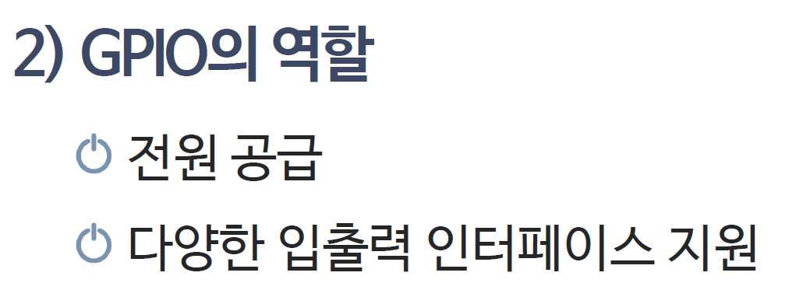
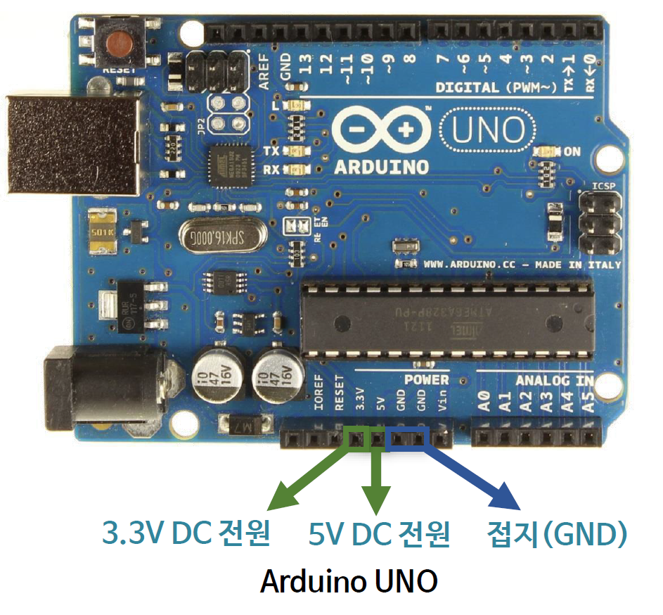
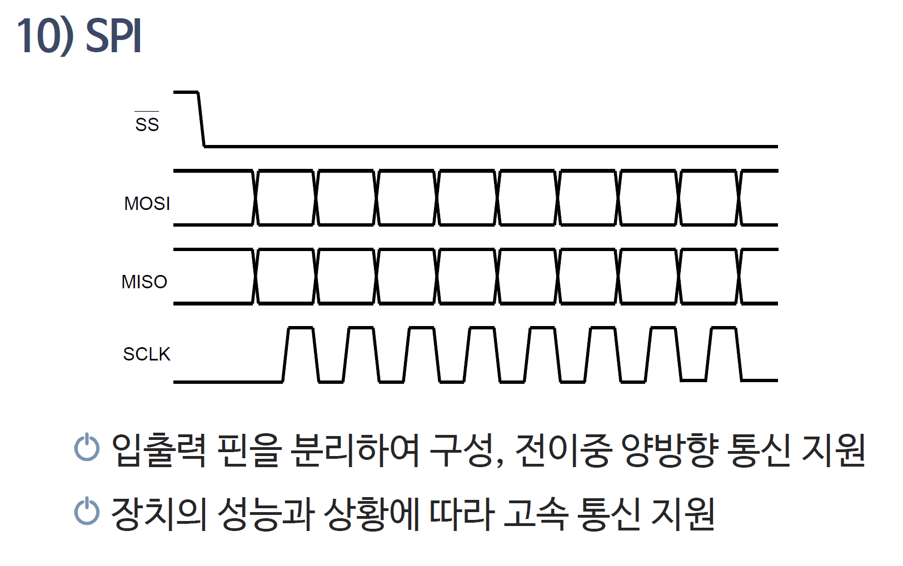
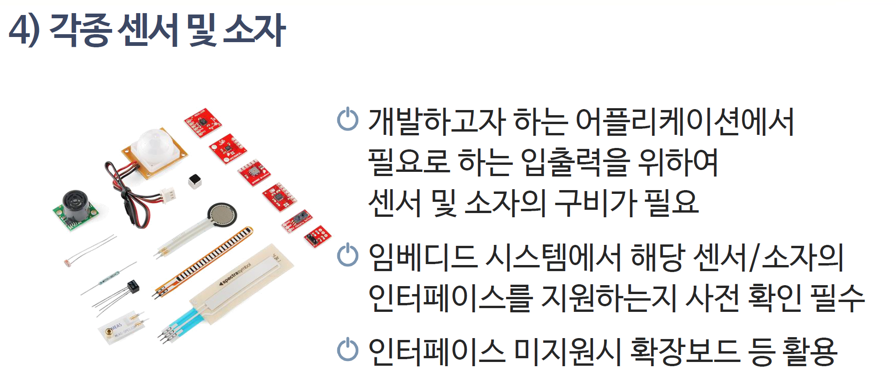

# 191_라즈베리파이_기초 🍓🤖


**도로시와 지니가 함께하는 싱글보드 컴퓨터와 I2C 협동 제어**

* 👧 **도로시**: "지니야! 손바닥만 한 초록색 기판에 모니터랑 마우스를 꽂으니 진짜 컴퓨터 화면이 떠! 아두이노랑 뭐가 달라?"
* 🐱 **지니**: "이건 진짜 리눅스 OS가 돌아가는 초소형 미니 PC **라즈베리파이(Raspberry Pi)** 란다! 아두이노와 찰떡궁합이지!"
* 🐶 **토토**: "바우! 라즈베리파이가 두뇌, 아두이노가 손발이다 멍!"

* 🖥️ **강의 슬라이드**: [slides.md](./slides.md)

---

## 1. 아두이노 vs 라즈베리파이 역할 분담


### 🤝 최강의 드림팀 파트너십!

* **라즈베리파이 (두뇌 - Brain)**:
  * 리눅스 운영체제, 파이썬(Python), 인공지능 영상인식(OpenCV), 웹서버 실행!
  * 복잡한 계산과 네트워크 데이터베이스 처리를 담당해요.
* **아두이노 (손과 발 - Hands & Feet)**:
  * 마이크로초 단위의 정밀한 모터 회전 제어, 아날로그 센서 측정!
  * ➡️ **두 장치가 I2C로 손을 잡으면 최첨단 인공지능 로봇 탄생!**

---

## 2. 라즈베리파이와 아두이노 I2C 결선도



### 🔌 전압 레벨에 주의하며 3가닥 연결!
* **라즈베리파이 GPIO (3.3V 로직)**:
  * Pin 3: **SDA (GPIO 2)** ➡️ 아두이노 **A4 (SDA)**
  * Pin 5: **SCL (GPIO 3)** ➡️ 아두이노 **A5 (SCL)**
  * Pin 6: **GND** ➡️ 아두이노 **GND**
* *주의*: 라즈베리파이는 3.3V이므로 신호선에 전압 레벨 시프터(Level Shifter)를 사용하면 더욱 안전해요!

---

## 3. 라즈베리파이 터미널에서 I2C 장치 검색



### 🔍 `i2cdetect -y 1` 명령어로 주소 찾기!
* 라즈베리파이 리눅스 터미널 창을 열고 명령어를 칩니다:
  ```bash
  sudo i2cdetect -y 1
  ```
* 1번 버스 격자판에 우리가 아두이노 슬레이브로 지정한 번호(예: **`0x08`**)가 선명하게 나타나면 통신 선로 연결 완료!

---

## 4. 파이썬(Python) 마스터 스크립트 작성



### 🐍 `smbus` 라이브러리로 아두이노에 명령 보내기

```python
import smbus
import time

bus = smbus.SMBus(1)    # 1번 I2C 버스 개방
address = 0x08          # 아두이노 슬레이브 주소

while True:
    cmd = int(input("1: LED ON, 0: LED OFF -> "))
    bus.write_byte(address, cmd) # 아두이노로 1바이트 슝!
    time.sleep(1)
```

* 라즈베리파이 파이썬 창에서 `1`을 치면 아두이노가 즉시 불을 켭니다!

---

## 5. 아두이노 슬레이브 수신 스케치



### 📥 `Wire.onReceive`로 라즈베리파이 명령 수행!

```cpp
#include <Wire.h>
const int ledPin = 13;

void setup() {
  Wire.begin(0x08);             // 주소 8번 슬레이브 모드
  Wire.onReceive(receiveEvent); // 수신 이벤트 등록
  pinMode(ledPin, OUTPUT);
}

void loop() { delay(100); }

void receiveEvent(int bytes) {
  int cmd = Wire.read();
  if (cmd == 1) digitalWrite(ledPin, HIGH);
  else if (cmd == 0) digitalWrite(ledPin, LOW);
}
```

---

## 🌟 도로시와 지니의 핵심 요약 노트!


* 👧 **도로시**: "라즈베리파이 파이썬 코드로 아두이노에게 명령을 보내니 진짜 인공지능 로봇을 만들 수 있겠어!"
* 🐱 **지니**: "맞아! 고성능 두뇌(라즈베리파이)와 정밀한 손발(아두이노)이 결합된 최고의 엔지니어링 협업이란다."
* 🐶 **토토**: "바우! 이제 마지막 보너스 실습 챕터로 가보자 멍!"
